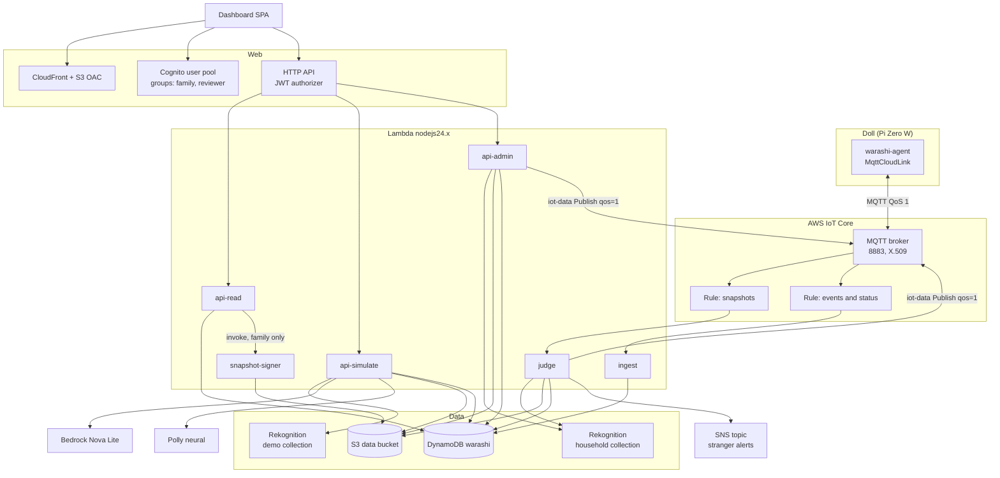
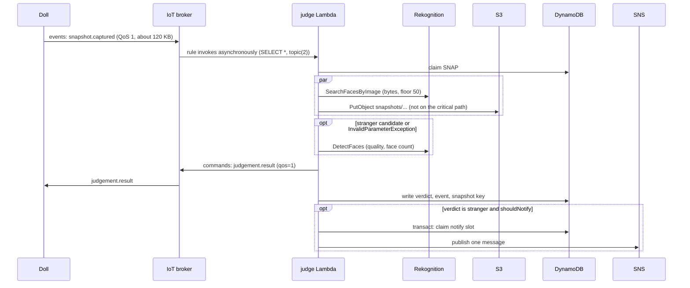
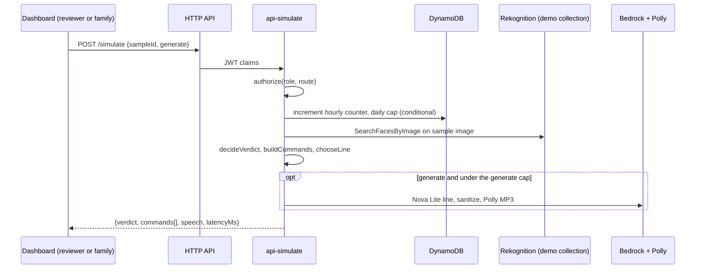

# Design Document: cloud-judgement

## Overview

`cloud-judgement` is the AWS backend of the zashiki-warashi guardian. It receives a snapshot
from the doll over AWS IoT Core, decides whether the face is family, a stranger, absent or
uncertain, answers the doll with a `judgement.result`, records the encounter, tells the family
once when a stranger stands at the door, and serves the dashboard through an authenticated HTTP
API. The spec also covers the pieces that connect the doll to this backend: the device
provisioning script, the voice-line generation script and the real MQTT `CloudLink` for
`warashi-agent`.

The design was checked against the AWS documentation before it was written. Section
[Design review: risks and corrections](#design-review-risks-and-corrections) lists where the
original idea was wrong or risky, with the evidence and the decision for each point. Section
[Verified AWS facts](#verified-aws-facts) lists every limit, ID and API shape the design relies on
and the documentation page that proves it. Anything that is **not** verified in the documentation
is marked *unverified* and becomes a measurement or a check in the first implementation task.

Scope: IoT connectivity, judgement, notification, encounter log, HTTP API, Cognito roles,
hosting, budget alarm, `scripts/provision_device.sh`, `scripts/generate_voice_lines.*`, and the
device `MqttCloudLink`. Out of scope: the dashboard UI (`dashboard-simulation`) and live voice
conversation (`voice-conversation`).

Languages: TypeScript for `/cloud` (CDK v2, Lambda on `nodejs24.x`, vitest, fast-check), Python
for the device adapter (stdlib, `paho-mqtt` from `apt`, pytest, Hypothesis). Algorithms that are
not tied to one language use pseudocode in `pascal` blocks.

## Design review: risks and corrections

Severity: **High** changes the design or the contract, **Medium** needs a guard in code or
configuration, **Low** is documented only.

| # | Sev | Original assumption | Finding (evidence in [Verified AWS facts](#verified-aws-facts)) | Decision |
|---|---|---|---|---|
| C1 | High | The Judge Lambda publishes `judgement.result` **and** a `speak` with a cached line id. | The device already plays its own cached line the moment it enters `greeting`, `warning` or `uncertain` (`device-core-loop` design, entry table). A cloud `speak` that arrives during playback is rejected with `audio_busy` (R12.6). A `speak` before the verdict would play a line before the doll knows who is there. A `speak` with `audioUrl` is accepted only in a family encounter (R13.2/13.3). | The automatic path publishes **only** `judgement.result`. The device chooses its line. `speak` is sent only by dashboard commands (`POST /commands`) and returned by `simulate`. Generated speech for the real doll is a flagged P1 follow-up (see [Generated speech](#generated-speech-bedrock--polly)). |
| C2 | High | `SearchFacesByImage` returns "no face" as an empty result. | With no detectable face the API returns `InvalidParameterException`, and the same exception also reports other bad parameters. It searches only the **largest** face. A low-quality face filtered by `QualityFilter` is silently not searched and looks like "no match". | Call with `QualityFilter: NONE`. On `InvalidParameterException` or on a stranger candidate, call `DetectFaces` to tell "no face" from "bad request" and to check face quality before declaring a stranger. A second person standing behind a family member is a **documented limitation**. |
| C3 | High | One `FaceMatchThreshold` splits family and stranger. | The default threshold is 80 and Rekognition itself advises higher values when a wrong match matters. A false "stranger" sends an alarm to the family, a false "family" greets an intruder. | Search with a low floor (50) to see the best similarity, then apply two thresholds: `family` at similarity ≥ 90, `stranger` only below 70 **and** a good-quality face, everything between is `uncertain`. Defaults are configuration, calibrated on real photos in the sanity task. |
| C4 | High | A 90,000-byte JPEG inside the MQTT JSON fits the 128 KB limit. | It fits, with a margin of about 10 KB: 90,000 B becomes 120,000 base64 characters plus about 600 B of envelope. The MQTT payload limit is 128 KB and not adjustable. IoT bills each message in 5 KB steps, so one snapshot counts as 24 message units. Lambda accepts 1 MB for asynchronous invocation, and IoT invokes Lambda asynchronously. | Keep the inline design. Add a contract assertion (`docs/schema.md`) and a test that the largest legal `snapshot.captured` stays below 128,000 bytes. The S3 pre-signed upload alternative stays documented as the fallback if the JPEG cap ever rises. |
| C5 | High | The IoT rule calls the Lambda and the Lambda answers. | The Lambda rule action is **asynchronous**: nothing returns to the device, and Lambda's async retry policy re-runs a failed invocation. `iot-data Publish` defaults to **QoS 0**, and the data endpoint is account specific. | The Judge function is configured with 0 retries and a short maximum event age (a late verdict is useless). It publishes with `qos=1` explicitly, using the endpoint from `DescribeEndpoint` (`iot:Data-ATS`) passed as an environment variable. A DynamoDB claim on `snapshotId` makes the handler idempotent. |
| C6 | High | The envelope `deviceId` identifies the sender. | `deviceId` is written by the device. A compromised or misconfigured device could write another doll's id. | The IoT rule SQL adds `topic(2) AS topicDeviceId`. Ingest and Judge drop any message whose `deviceId` differs from `topicDeviceId`. |
| C7 | Medium | The device may use an MQTT persistent session so it does not miss commands. | A persistent session stores QoS 1 messages for up to one hour (MQTT 3) and replays them at 10 messages per second. A replayed `speak` or `gaze` would act on a visit that ended long ago. | The device connects with a clean session. The IoT policy allows only the `LastWill` connect attribute, so a persistent connection is refused. The device re-subscribes on every connect and reports `cloud.connected` only after the SUBACK. |
| C8 | Medium | `status.offline` (last will) marks the doll offline reliably. | The will payload is fixed at connect time, so its `ts` is the connect time. AWS states that will messages are not guaranteed to arrive in order across reconnects. | The cloud uses its **arrival time** for the will and never trusts its `ts`. A later `status.report` (sent on the first tick and every 60 s) repairs a stale offline mark. The dashboard shows "last seen". `docs/schema.md` records this. |
| C9 | High | Polly can synthesize a childlike Japanese voice as a 16 kHz WAV. | Japanese voices are Mizuki (standard), Takumi (standard, neural), Kazuha and Tomoko (neural). No Japanese generative voice exists. Neural voices do **not** support SSML `pitch`, only `rate` and `volume`. `pcm` output is raw 16-bit mono little-endian without a header and allows 8,000 or 16,000 Hz. | Default voice: neural **Kazuha** with `rate` and `volume` prosody, config-selectable (Tomoko, or standard Mizuki with `pitch` as the childlike alternative). A small pure `pcm16ToWav` adds the 44-byte header. MP3 for browsers comes from the same call with `OutputFormat: mp3`. |
| C10 | High | A small Bedrock text model (Nova Micro) writes the lines in Tokyo. | Nova Micro is not available in-Region in Tokyo, and its model card lists no APAC inference profile. Nova Lite is in-Region in Tokyo. Claude Haiku 4.5 has no in-Region Tokyo endpoint: it needs the `jp.` geo profile (Tokyo and Osaka) and is a Marketplace-billed model with an agreement and use-case step. All three have lifecycle dates. | Default model: `amazon.nova-lite-v1:0` in `ap-northeast-1`. The model ID is configuration. The LLM is **optional**: every generated line passes a pure sanitizer, and on any failure or sanitizer rejection the cached line is used. The LLM is never on the critical path of a verdict. |
| C11 | Medium | SNS notifies the family by e-mail or SMS. | An e-mail subscription must be confirmed by the recipient, and SNS deletes an unconfirmed subscription after 48 hours. SMS starts in a sandbox that accepts only verified numbers and needs an origination identity; Japan supports short codes and Sender IDs. | E-mail is the P0 channel. SMS is out of scope. The README and stack output tell the owner to confirm within 48 hours. The notifier sits behind a `Notifier` interface. |
| C12 | Medium | API Gateway usage plans rate-limit `simulate`. | Usage plans exist for REST APIs, and AWS states their limits are best effort. HTTP API throttling is also best effort. | HTTP API with a JWT authorizer, a coarse route throttle, and **hard counters in DynamoDB** (per user per hour, plus a global daily cap on `simulate`). WAF is not used: it adds a fixed monthly cost for little gain here. |
| C13 | Medium | `simulate` runs on "a sample image" against the household collection. | The reviewer account is public (its password goes into the submission). A reviewer must not be able to probe the family's face data. | `simulate` searches a separate **demo collection** that holds only the consented sample portraits. The household collection is reachable only by the Judge function and the family-only admin function. Sample images live under a private S3 prefix and are chosen by `sampleId`; a reviewer never uploads an image. |
| C14 | Medium | S3 lifecycle enforces "7 days or less" and pre-signed URLs are short-lived. | Lifecycle expiration works in whole days from the creation time, rounded up to midnight UTC. A pre-signed URL stops working when the credential that signed it expires, even before its own expiry. | Snapshots expire after 3 days (real lifetime 3 to 4 days, below the 7-day cap). Pre-signed URLs last 5 minutes and are minted on demand. |
| C15 | Medium | DynamoDB TTL removes expired data on time. | TTL deletes typically within a few days after expiry. | Reads filter out items whose `ttl` is in the past. The 7-day privacy promise is carried by S3 lifecycle plus this filter. |
| C16 | Medium | `cdk deploy --all` builds and publishes a dashboard that does not exist yet. | `Source.asset` on a missing folder fails at synth time. The dashboard also needs the API URL and Cognito IDs, which exist only after deployment. | `WebStack` uses the built dashboard if `dashboard/dist` exists, otherwise a one-page placeholder. Runtime settings go to `/config.json` through `Source.jsonData`, so the dashboard needs no rebuild. |
| C17 | Low | The stack is free until 2027-01-29. | Rekognition's free tier is 1,000 images per month for 12 months from account creation (plus sign-up credits). Bedrock and Polly have no comparable permanent free tier in the pages checked. An AWS Budget **alerts**, it does not stop spending. | Budget alarm at 50 %, 80 % and 100 % of a small monthly amount, plus the hard caps in C12. Per-call costs are small; the only cost that scales with abuse is `simulate`, and it is capped. |
| C18 | Medium | The Pi can reach AWS as soon as it boots. | TLS needs a correct clock and the Pi Zero W has no real-time clock. | The systemd unit orders after `time-sync.target`. The link retries with backoff until TLS succeeds. |
| C19 | Low | The device cloud adapter downloads generated audio. | `device-core-loop` already implements the HTTPS download inside the audio adapter (R13.2). | `MqttCloudLink` only carries messages. Nothing is duplicated. |
| C20 | Medium | Faces are registered by uploading a photo. | Rekognition stores feature vectors, not images, so an enrolled photo has no reason to stay in S3. A photo with two faces would enroll a bystander. | The photo goes to a staging prefix, is indexed, and is deleted at once. The request is rejected unless exactly one face is indexed. Consent is versioned and recorded. `ExternalImageId` is an opaque member id, never a name. |
| C21 | Low | `AWS::Rekognition::Collection` can be redeclared freely. | A changed `CollectionId` replaces the resource and drops every enrolled face. | The collection ids are fixed names and never derived from a stack-level token that can change. |

## Verified AWS facts

Every row was read from the AWS documentation in this session. Pages are cited so `tasks.md` can
re-check them. The [Region table](#region-table) lists the Region of every service and model.
*Unverified* items are listed at the end of the table.

| Topic | Fact | Source |
|---|---|---|
| MQTT payload | Each publish payload is at most 128 KB. Not adjustable. | [IoT Core quotas](https://docs.aws.amazon.com/general/latest/gr/iot-core.html) |
| MQTT5 packet | The maximum MQTT 5 packet is 146 KB. | same |
| Per-connection rate | 100 publish requests per second per connection. Not adjustable. | same |
| QoS | Only QoS 0 and 1. QoS 1 is sent at least once, so duplicates happen. | [MQTT](https://docs.aws.amazon.com/iot/latest/developerguide/mqtt.html) |
| QoS 1 retry | Unacknowledged QoS 1 messages are retried for up to 960 s. | [IoT Core quotas](https://docs.aws.amazon.com/general/latest/gr/iot-core.html) |
| Keep-alive | Below 30 s is treated as 30 s. Default 1,200 s. | same |
| Persistent session | Stored QoS 1 messages replay on reconnect at 10 per second. MQTT 3 sessions last one hour by default. | [MQTT](https://docs.aws.amazon.com/iot/latest/developerguide/mqtt.html) |
| Last will | Published on any unrequested disconnect. Order across reconnects is not guaranteed. | same |
| Connect attributes | A policy condition on `iot:ConnectAttributes` can allow only `LastWill`, which forbids `PersistentConnect`. | [Connect policy examples](https://docs.aws.amazon.com/iot/latest/developerguide/connect-policy.html) |
| Thing policy variable | `${iot:Connection.Thing.ThingName}` works in resource ARNs when the client id equals the thing name. `iot:Connection.Thing.IsAttached` can be required. | [Thing policy variables](https://docs.aws.amazon.com/iot/latest/developerguide/thing-policy-variables.html) |
| Lambda rule action | AWS IoT invokes Lambda **asynchronously**. A resource policy with `iot.amazonaws.com`, `SourceArn` and `SourceAccount` is required. | [Lambda rule action](https://docs.aws.amazon.com/iot/latest/developerguide/lambda-rule-action.html) |
| Binary payloads | A Lambda action cannot take raw binary; JSON is passed as is. | [Binary payloads](https://docs.aws.amazon.com/iot/latest/developerguide/binary-payloads.html) |
| Lambda payload | 6 MB synchronous, 1 MB asynchronous. | [Lambda quotas](https://docs.aws.amazon.com/lambda/latest/dg/gettingstarted-limits.html) |
| Lambda runtime | `nodejs24.x` (deprecation 2028-04-30) and `nodejs26.x` (no date scheduled) are supported. `nodejs22.x` deprecates 2027-05-30. | [Lambda runtimes](https://docs.aws.amazon.com/lambda/latest/dg/lambda-runtimes.html) |
| `iot-data Publish` | Parameters include `qos` (0 or 1, **default 0**), `retain`, `messageExpiry`. | [Publish API](https://docs.aws.amazon.com/iot/latest/apireference/API_iotdata_Publish.html) |
| Rekognition search | Detects the **largest** face, searches the collection, returns `SearchedFaceBoundingBox`, `SearchedFaceConfidence` and matches by `Similarity`. No face gives `InvalidParameterException`. `FaceMatchThreshold` 0 to 100, default 80. `QualityFilter` default `NONE`. | [SearchFacesByImage](https://docs.aws.amazon.com/rekognition/latest/APIReference/API_SearchFacesByImage.html) |
| Similarity advice | 80 % is an example for casual use; 99 % or more for high-stakes use. | [Similarity thresholds](https://docs.aws.amazon.com/rekognition/latest/dg/thresholds-collections.html) |
| Rekognition limits | Raw bytes up to 5 MB, S3 object up to 15 MB, JPEG or PNG. Minimum face 40×40 px in a 1920×1080 image. | [Rekognition quotas](https://docs.aws.amazon.com/rekognition/latest/dg/limits.html) |
| Rekognition Tokyo | Available in `ap-northeast-1`. Search and index operations default to 5 transactions per second there; `DetectFaces` to 25. | [Rekognition endpoints and quotas](https://docs.aws.amazon.com/general/latest/gr/rekognition.html) |
| Rekognition storage | Faces are stored as feature vectors, not images. | [IndexFaces](https://docs.aws.amazon.com/rekognition/latest/dg/add-faces-to-collection-procedure.html) |
| Rekognition in CloudFormation | `AWS::Rekognition::Collection` exists. | [Collection resource](https://docs.aws.amazon.com/AWSCloudFormation/latest/TemplateReference/aws-resource-rekognition-collection.html) |
| Rekognition free tier | 1,000 images per month per API group for 12 months from account creation. | [Rekognition pricing](https://aws.amazon.com/rekognition/pricing/) |
| Polly voices | Japanese: Mizuki (standard), Takumi (standard and neural), Kazuha (neural), Tomoko (neural). No generative or long-form. | [Available voices](https://docs.aws.amazon.com/polly/latest/dg/available-voices.html) |
| Polly neural Tokyo | Neural voices are supported in `ap-northeast-1`. | [Neural voices](https://docs.aws.amazon.com/polly/latest/dg/neural-voices.html) |
| Polly output | `pcm` is signed 16-bit mono little-endian, rates 8,000 or 16,000 (default 16,000). `mp3` rates include 16,000, 22,050 and 24,000. Engine defaults to `standard`, so a neural voice needs `Engine: neural`. | [SynthesizeSpeech](https://docs.aws.amazon.com/polly/latest/APIReference/API_SynthesizeSpeech.html) |
| Polly SSML | Neural voices support `volume` and `rate`, not `pitch`. | [Prosody tag](https://docs.aws.amazon.com/polly/latest/dg/prosody-tag.html) |
| Polly size | 3,000 billed characters per `SynthesizeSpeech` call. | [Polly quotas](https://docs.aws.amazon.com/general/latest/gr/pol.html) |
| Nova Lite | `amazon.nova-lite-v1:0`, In-Region **and** Geo in Tokyo, lifecycle Active, launched 2024-12-05. | [Nova Lite card](https://docs.aws.amazon.com/bedrock/latest/userguide/model-card-amazon-nova-lite.html) |
| Nova Micro | Tokyo is Geo only; the card lists only `us.` and `eu.` profile ids. | [Nova Micro card](https://docs.aws.amazon.com/bedrock/latest/userguide/model-card-amazon-nova-micro.html) |
| Claude Haiku 4.5 | Needs a profile id; `jp.anthropic.claude-haiku-4-5-20251001-v1:0` routes between Tokyo and Osaka. Billed through AWS Marketplace. EOL no sooner than 2026-10-16. | [Haiku 4.5 card](https://docs.aws.amazon.com/bedrock/latest/userguide/model-card-anthropic-claude-haiku-4-5.html) |
| Model lifecycle | A model stays at least 12 months before EOL and at least 6 months in Legacy. New customers cannot use Legacy models. | [Model lifecycle](https://docs.aws.amazon.com/bedrock/latest/userguide/model-lifecycle-legacy.html) |
| Model access | Models with a Marketplace product id need an agreement. | [Model access](https://docs.aws.amazon.com/bedrock/latest/userguide/model-access.html) |
| SNS e-mail | The recipient must confirm. Unconfirmed subscriptions are deleted after 48 hours. Body customization is not supported. | [SNS e-mail](https://docs.aws.amazon.com/sns/latest/dg/sns-email-notifications.html) |
| SNS SMS | New accounts start in an SMS sandbox. Japan: short code and Sender ID. | [SMS sandbox](https://docs.aws.amazon.com/sns/latest/dg/sns-sms-sandbox.html), [Japan](https://docs.aws.amazon.com/end-user-messaging/latest/userguide/nx-supported-countries-asia.html) |
| S3 lifecycle | Expiration is age in days, rounded up to midnight UTC. | [Lifecycle rules](https://docs.aws.amazon.com/AmazonS3/latest/userguide/intro-lifecycle-rules.html) |
| Pre-signed URL | Up to 7 days with the SDK, but never longer than the signing credential. | [Pre-signed URLs](https://docs.aws.amazon.com/AmazonS3/latest/userguide/using-presigned-url.html) |
| DynamoDB TTL | Epoch seconds in a Number attribute. Deletion happens "typically within a few days". | [TTL](https://docs.aws.amazon.com/amazondynamodb/latest/developerguide/TTL.html) |
| JWT authorizer | Validates `iss`, `aud` or `client_id`, `exp`, `scope`. Claims reach Lambda in `requestContext.authorizer.jwt.claims`. | [JWT authorizers](https://docs.aws.amazon.com/apigateway/latest/developerguide/http-api-jwt-authorizer.html) |
| Cognito groups | `cognito:groups` appears in ID and access tokens. | [User pool groups](https://docs.aws.amazon.com/cognito/latest/developerguide/cognito-user-pools-user-groups.html) |
| HTTP API throttle | Route-level throttling exists and is best effort. | [HTTP API throttling](https://docs.aws.amazon.com/apigateway/latest/developerguide/http-api-throttling.html) |
| Usage plans | REST API feature; limits are not hard. | [Usage plans](https://docs.aws.amazon.com/apigateway/latest/developerguide/api-gateway-api-usage-plans.html) |
| API payload | 10 MB, not adjustable. | [API Gateway quotas](https://docs.aws.amazon.com/general/latest/gr/apigateway.html) |
| Budgets | `AWS::Budgets::Budget` with notification subscribers. | [Budget subscriber](https://docs.aws.amazon.com/AWSCloudFormation/latest/TemplateReference/aws-properties-budgets-budget-subscriber.html) |

**Unverified items.** Every item below is either verified or marked "pending owner measurement" by
the first implementation task (task 1). No item may stay unmarked (Requirement 27.4).

*Verified from the documentation or the local toolchain by task 1, with date and source recorded here:*

- **`cognito:groups` shape at an HTTP API Lambda** (checked 2026-11-20). The HTTP API JWT
  authorizer page and the payload format 2.0 page only show `requestContext.authorizer.jwt.claims`
  with string examples and do not say how an array claim is passed
  ([JWT authorizers](https://docs.aws.amazon.com/apigateway/latest/developerguide/http-api-jwt-authorizer.html),
  [payload format 2.0](https://docs.aws.amazon.com/apigateway/latest/developerguide/http-api-develop-integrations-lambda.html)).
  Only the REST API page states that array claims keep their JSON type
  ([REST API claims](https://docs.aws.amazon.com/apigateway/latest/developerguide/rest-api-jwt-authorizer-claims.html)),
  and it does not apply to HTTP APIs. The documentation therefore cannot decide array versus string.
  `rolesFromClaims` keeps accepting both an array and a string such as `"[family reviewer]"`; the
  real shape is pending owner measurement, procedure in task 24.1.
- **Collection ARN as IAM resource** (checked 2026-11-20, [Service Authorization Reference for
  Rekognition](https://docs.aws.amazon.com/service-authorization/latest/reference/list_rekognition.html)).
  `rekognition:SearchFacesByImage` requires the resource type `collection`
  (`arn:${Partition}:rekognition:${Region}:${Account}:collection/${CollectionId}`), so the household
  and demo collections get separate permissions as planned. `rekognition:DetectFaces` lists no
  resource type, so it cannot be scoped to a collection and uses `Resource: "*"` with a comment.
  The Lambda table change this needs is applied in the `judge` and `api-simulate` rows below.
- **CDK constants** (verified by task 1.2, run with Node.js 24): the installed `aws-cdk-lib` is
  version `2.278.0`. It offers `Runtime.NODEJS_24_X` (runtime name `nodejs24.x`) and
  `S3BucketOrigin.withOriginAccessControl` in `aws-cdk-lib/aws-cloudfront-origins`. The chosen Lambda
  runtime is therefore `nodejs24.x`, the current Node.js LTS, so no fallback under R19.5 is needed.
  `cloud/test/cdk-constants.test.ts` keeps the check and names the newest offered LTS constant if
  `NODEJS_24_X` ever disappears.
- **`python3-paho-mqtt` on Trixie** (checked 2026-11-20): Debian package `2.1.0-1`
  ([Debian package page](https://packages.debian.org/trixie/python3-paho-mqtt)). Version 2.x provides
  `mqtt.CallbackAPIVersion.VERSION2`, so the adapter targets the version 2 callback API. The Debian
  page is the Debian archive, not the Raspberry Pi archive; the owner confirms on the doll with
  `apt policy python3-paho-mqtt` and `python3 -c "import paho.mqtt.client as c; print(c.CallbackAPIVersion.VERSION2)"`
  (owner step O8). Pending owner measurement, procedure in owner step O8.

*Pending owner measurement (needs a deployed account; the owner fills value, date and source after
the first deployment):*

- **Latency of Lambda cold start, IoT rule, Rekognition search and `DetectFaces`, and the `judge`
  round trip in Tokyo.** The [latency budget](#latency-budget) uses engineering estimates only.
  Pending owner measurement, procedure in task 24.1 (latency harness; value, date and source are
  filled in after the first deployment).
- **Latency of Bedrock Nova Lite and Polly in Tokyo**, and that both answer in `ap-northeast-1`
  with the configured model id, voice and engine. Region availability is documented (see the
  [Region table](#region-table)); the real response and its latency are pending owner measurement,
  procedure in task 24.2.
- **The real shape of the `cognito:groups` claim** seen by a deployed `api-read`. Pending owner
  measurement, procedure in task 24.1.
- **Billed amounts** for Rekognition, Polly and Bedrock Nova Lite. Pending owner measurement,
  procedure in task 24.2 (list prices are recorded below).
- **`AWS::Budgets::Budget` in a stack deployed to `ap-northeast-1`.** The Budgets API is a global
  service whose endpoint is in `us-east-1` (see the Region table), and no page read for this task
  states that CloudFormation accepts the resource in a Tokyo stack. Pending owner measurement: the
  first `npx cdk deploy --all` confirms it, and the result is recorded with task 24.1.
- **Package check on the doll** (`python3-paho-mqtt` from the Raspberry Pi archive). Pending owner
  measurement, procedure in owner step O8.

*Status check (task 1.3, 2026-11-20):* every item named as unverified in this document is now
either verified above with a date and a source, or listed in this pending list with the task that
measures it. Facts in the "Verified AWS facts" table each carry a documentation link.

*Tokyo (`ap-northeast-1`) list prices, read 2026-11-20 from the AWS Price List bulk files (the
AWS documentation has no price tables; pricing pages are not machine readable). Publication dates
are in the file; prices change, so the owner re-checks them when choosing the budget amount.
Billed amounts are pending owner measurement, procedure in task 24.2:*

| Service | Unit price (USD) | Source (publication date of the file) |
|---|---|---|
| Rekognition `SearchFacesByImage` and `DetectFaces` | 0.0013 per image, first 1,000,000 images per month (Group 1 and Group 2 alike); free tier 1,000 images per month per group for 12 months | [AmazonRekognition](https://pricing.us-east-1.amazonaws.com/offers/v1.0/aws/AmazonRekognition/current/ap-northeast-1/index.json) (2026-09-11) |
| Rekognition face vector storage | 0.013 per 1,000 faces per month | same |
| Polly neural | 16 per million characters (standard: 4) | [AmazonPolly](https://pricing.us-east-1.amazonaws.com/offers/v1.0/aws/AmazonPolly/current/ap-northeast-1/index.json) (2026-10-22) |
| Bedrock Nova Lite on demand | input 0.000072 per 1,000 tokens (0.072 per million); output 0.000288 per 1,000 tokens (0.288 per million) | [AmazonBedrock](https://pricing.us-east-1.amazonaws.com/offers/v1.0/aws/AmazonBedrock/current/ap-northeast-1/index.json) (2026-11-11) |

## Architecture



#### Region table

Every stack deploys to `ap-northeast-1` (Tokyo). Checked 2026-11-20 with the `aws-docs` MCP server.
No service or model used here needs a Region other than `ap-northeast-1` for the way this design
uses it. The two services that have a fixed or global location are listed with their reason.

| Service or model | Region used | Documentation |
|---|---|---|
| AWS IoT Core (control plane and account-specific data endpoint `data-ats`) | `ap-northeast-1` | [IoT Core endpoints](https://docs.aws.amazon.com/general/latest/gr/iot-core.html) |
| AWS Lambda (`nodejs24.x`) | `ap-northeast-1` | [Lambda endpoints](https://docs.aws.amazon.com/general/latest/gr/lambda-service.html) |
| Amazon API Gateway (HTTP API) | `ap-northeast-1` | [API Gateway endpoints](https://docs.aws.amazon.com/general/latest/gr/apigateway.html) |
| Amazon Cognito user pools | `ap-northeast-1` | [Cognito endpoints](https://docs.aws.amazon.com/general/latest/gr/cognito.html) |
| Amazon DynamoDB | `ap-northeast-1` | [DynamoDB endpoints](https://docs.aws.amazon.com/general/latest/gr/ddb.html) |
| Amazon S3 (data bucket, web bucket) | `ap-northeast-1` | [S3 endpoints](https://docs.aws.amazon.com/general/latest/gr/s3.html) |
| Amazon SNS (stranger alerts) | `ap-northeast-1` | [SNS endpoints](https://docs.aws.amazon.com/general/latest/gr/sns.html) |
| Amazon Rekognition (`SearchFacesByImage`, `DetectFaces`, collections) | `ap-northeast-1` | [Rekognition endpoints and quotas](https://docs.aws.amazon.com/general/latest/gr/rekognition.html) |
| Amazon Polly, neural voice Kazuha | `ap-northeast-1` | [Polly endpoints](https://docs.aws.amazon.com/general/latest/gr/pol.html), [neural voices](https://docs.aws.amazon.com/polly/latest/dg/neural-voices.html) |
| Amazon Bedrock runtime, model `amazon.nova-lite-v1:0` (In-Region) | `ap-northeast-1` | [Bedrock endpoints](https://docs.aws.amazon.com/general/latest/gr/bedrock.html), [Nova Lite card](https://docs.aws.amazon.com/bedrock/latest/userguide/model-card-amazon-nova-lite.html) |
| Amazon CloudFront (distribution with the default `*.cloudfront.net` certificate) | Global; the S3 origin is in `ap-northeast-1`. No ACM certificate is requested, so the `us-east-1` certificate rule does not apply. | [CloudFront endpoints](https://docs.aws.amazon.com/general/latest/gr/cf_region.html), [certificate Region rule](https://docs.aws.amazon.com/AmazonCloudFront/latest/DeveloperGuide/cnames-and-https-requirements.html) |
| AWS Budgets (`AWS::Budgets::Budget`) | Global service; its API endpoint is in `us-east-1`. The stack is deployed in `ap-northeast-1`; see the pending item above. | [Billing and Cost Management endpoints](https://docs.aws.amazon.com/general/latest/gr/billing.html), [`AWS::Budgets::Budget`](https://docs.aws.amazon.com/AWSCloudFormation/latest/TemplateReference/aws-resource-budgets-budget.html) |

Models that are **not** used because of Region limits: Nova Micro (Tokyo is Geo only, no `jp.`
profile listed) and Claude Haiku 4.5 (needs the `jp.` profile that routes between Tokyo and Osaka;
see the Verified AWS facts table). Amazon Nova Sonic (P1) is outside this spec;
`voice-conversation` must verify its Region.

**One snapshot, end to end.**



**Dashboard simulation against the live cloud.**



Nothing is published to the real doll and nothing is written to the encounter table by
`simulate`.

## Components and Interfaces

### CDK stacks (`cloud/lib`)

| Stack | Contents |
|---|---|
| `DataStack` | S3 data bucket (private, SSE-S3, lifecycle by prefix, block public access, `enforceSSL`), DynamoDB table `warashi` (on-demand, TTL attribute `ttl`, GSI1), Rekognition collections `warashi-household` and `warashi-demo` (fixed ids). |
| `JudgementStack` | IoT data endpoint lookup (custom resource calling `DescribeEndpoint` with `iot:Data-ATS`), device IoT policy, two topic rules, `judge` and `ingest` functions with Lambda permissions for `iot.amazonaws.com`, SNS topic and optional e-mail subscription. |
| `ApiStack` | Cognito user pool (no self sign-up, groups `family` and `reviewer`), public SPA app client, HTTP API with JWT authorizer, `api-read`, `snapshot-signer` (internal, no route), `api-simulate`, `api-admin`, CORS limited to the web origin, route throttles. |
| `WebStack` | Private S3 site bucket, CloudFront with origin access control, SPA error fallback, `BucketDeployment` with `config.json`. |
| `BudgetStack` | `AWS::Budgets::Budget`, monthly, notifications at 50, 80 and 100 percent. |

**App wiring (task 19.9, `cloud/bin/cloud.ts`).** Order: `DataStack` → `JudgementStack` →
`ApiStack` → `WebStack`; `BudgetStack` is independent. All stacks use region `ap-northeast-1` and the
account from `CDK_DEFAULT_ACCOUNT` (none in the code). The `dashboardUrl` context key feeds
`JudgementStack` (the CloudFront domain would create a cycle). `cdk.json` runs the app with `tsx`
and sets `@aws-cdk/core:defaultCrossStackReferences` to `strong`. Outputs: `DataStack` has
`DataBucketName`, `HouseholdCollectionId`, `DemoCollectionId`; `JudgementStack` has `IotEndpoint`,
`DevicePolicyName`, `StrangerTopicArn`; `ApiStack` has `ApiUrl`, `UserPoolId`, `UserPoolClientId`;
`WebStack` has `WebUrl`. Runtime: an Aspect sets every Node.js `AWS::Lambda::Function` (including
the CDK-managed providers for `AwsCustomResource` and `autoDeleteObjects`) to `nodejs24.x`. One
exception cannot change: the `BucketDeployment` handler in `WebStack` is Python (`python3.13`), because
its code is Python.

Stack outputs: `ApiUrl`, `WebUrl`, `IotEndpoint`, `UserPoolId`, `UserPoolClientId`,
`DevicePolicyName`, `HouseholdCollectionId`, `DemoCollectionId`, `DataBucketName`,
`StrangerTopicArn`. No value is committed; owner-specific values (e-mail addresses, budget
amount) come from CDK context (`cdk.context.json`, git-ignored, with a `cdk.context.example.json`).
Every resource is tagged `project=zashiki-warashi`.

**Web and API stack cycle (task 19.7).** `WebStack` needs the API URL and Cognito ids, and the
API's CORS needs the CloudFront origin. Resolution: dependencies run one way, `WebStack` → `ApiStack`.
`ApiStack` must create the HTTP API **without** `corsPreflight` and export `apiUrl`, `apiId`,
`userPoolId` and `userPoolClientId`. `WebStack` then sets `CorsConfiguration` (origin
`https://<distribution domain>`, methods `GET POST DELETE OPTIONS`, headers `authorization` and
`content-type`) with an `AwsCustomResource` that calls API Gateway V2 `UpdateApi`; its role has only
`apigateway:PATCH` on that one API (the IAM action for update operations, see the
[API Gateway IAM reference](https://docs.aws.amazon.com/service-authorization/latest/reference/list_apigateway.html)).
R18.6 and R19.8 hold as written. Caveat: if a later `ApiStack` change replaces the API or adds
`corsPreflight`, the CORS setting is lost until `WebStack` is deployed again (`cdk deploy --all` does both).
`/config.json` has its own CloudFront behavior (cache policy max TTL 60 s) and its own
`BucketDeployment` (`Cache-Control: public, max-age=60`, no prune), so the dashboard bundle is never rebuilt
for a config change. `WebStack` also adds a response headers policy (HSTS, nosniff, frame deny, referrer
policy, CSP limited to the API URL, Cognito and S3 pre-signed URLs).

`WebStack` runtime settings, deployed as `/config.json`:

```json
{ "apiUrl": "https://example.execute-api.ap-northeast-1.amazonaws.com", "region": "ap-northeast-1",
  "userPoolId": "ap-northeast-1_example", "userPoolClientId": "example", "illustrationBase": "/illustrations/" }
```

### IoT rules and device policy

Rule `warashi_snapshots`: `SELECT *, topic(2) AS topicDeviceId FROM 'warashi/+/events' WHERE type = 'snapshot.captured'` with one Lambda action (`judge`, alias-less ARN).

Rules `warashi_ingest_events` and `warashi_ingest_status`: `SELECT *, topic(2) AS topicDeviceId FROM 'warashi/+/events'`
and the same for `'warashi/+/status'`, each with one Lambda action to `ingest`. A single
`warashi/+/+` rule is avoided because it would also match the `commands` topic and feed the cloud's own
messages back into the log.

Device policy (created by CDK, attached to each certificate by `provision_device.sh`). The
`${...}` text below is an IoT policy variable, not a TypeScript template:

```json
{ "Version": "2012-10-17", "Statement": [
  { "Effect": "Allow", "Action": "iot:Connect",
    "Resource": "arn:aws:iot:REGION:ACCOUNT:client/${iot:Connection.Thing.ThingName}",
    "Condition": { "Bool": { "iot:Connection.Thing.IsAttached": "true" },
                   "ForAllValues:StringEquals": { "iot:ConnectAttributes": ["LastWill"] } } },
  { "Effect": "Allow", "Action": "iot:Publish",
    "Resource": ["arn:aws:iot:REGION:ACCOUNT:topic/warashi/${iot:Connection.Thing.ThingName}/events",
                 "arn:aws:iot:REGION:ACCOUNT:topic/warashi/${iot:Connection.Thing.ThingName}/status"] },
  { "Effect": "Allow", "Action": "iot:Subscribe",
    "Resource": "arn:aws:iot:REGION:ACCOUNT:topicfilter/warashi/${iot:Connection.Thing.ThingName}/commands" },
  { "Effect": "Allow", "Action": "iot:Receive",
    "Resource": "arn:aws:iot:REGION:ACCOUNT:topic/warashi/${iot:Connection.Thing.ThingName}/commands" } ] }
```

Implemented by `cloud/lib/device-policy.ts`. The ARN forms (`client/`, `topic/`, `topicfilter/`)
are checked against the [AWS IoT policies page](https://docs.aws.amazon.com/iot/latest/developerguide/iot-policies.html);
the `iot:ConnectAttributes` condition against the [connect policy examples](https://docs.aws.amazon.com/iot/latest/developerguide/connect-policy.html).

The client id must equal the thing name, which equals `deviceId`. The device needs `iot:Publish`
on its `status` topic for the last will to be delivered.

### Lambda functions (`cloud/lambda/<function>`)

| Function | Trigger | Purpose | AWS permissions (least privilege) |
|---|---|---|---|
| `judge` | IoT rule, async, 0 retries, max event age 60 s | Verdict, `judgement.result`, snapshot store, encounter update, stranger notification | `rekognition:SearchFacesByImage` on the household collection ARN, `rekognition:DetectFaces` on `*` (no resource type), `s3:PutObject` on `snapshots/*`, `dynamodb:PutItem/UpdateItem/TransactWriteItems` on the table, `iot:Publish` on `warashi/*/commands`, `sns:Publish` on the one topic |
| `ingest` | IoT rules, async | Validate, dedupe, strip image, append to the encounter log, track status | DynamoDB write on the table |
| `api-read` | HTTP API | `GET /me`, `/samples`, `/encounters`, `/encounters/{id}`, `/device/status` | DynamoDB read, `lambda:InvokeFunction` on `snapshot-signer` only, `s3:GetObject` on `samples/*` only (the sample manifest). **No S3 permission on `snapshots/*`** (Requirements 14.4, 14.11) |
| `snapshot-signer` | internal invoke from `api-read` only, no HTTP route | Signs 300-second snapshot URLs for Family_Role requests; refuses `reviewer` and any key outside `snapshots/` (Requirement 14.10) | `s3:GetObject` on `snapshots/*` only, the only role that has it |
| `api-simulate` | HTTP API | `POST /simulate` | `rekognition:SearchFacesByImage` on the demo collection ARN, `DetectFaces` on `*` (no resource type), `bedrock:InvokeModel` on the one model, `polly:SynthesizeSpeech`, `s3:GetObject` on `samples/*`, `s3:PutObject` and `s3:GetObject` (pre-signing) on `audio/sim/*` (`AUDIO_KEY_PREFIX`), DynamoDB counters |
| `api-admin` | HTTP API (family only) | `POST /commands`, `/faces` operations | `iot:Publish` on `warashi/*/commands`, `rekognition:IndexFaces/DeleteFaces/ListFaces` (household collection), `s3` on `faces-staging/*`, DynamoDB |

Environment variables set by the CDK stack (names fixed by the implementation, never secrets):
`WARASHI_TABLE_NAME`, `WARASHI_BUCKET_NAME`, `WARASHI_SIGNER_FUNCTION_NAME`, `WARASHI_WEB_ORIGIN`,
`WARASHI_CONSENT_NOTICE_VERSION`, `WARASHI_DASHBOARD_URL`, `WARASHI_HOUSEHOLD_COLLECTION_ID`,
`WARASHI_DEMO_COLLECTION_ID`, `WARASHI_DEVICE_LABEL`, `WARASHI_BEDROCK_MODEL_ID`,
`WARASHI_POLLY_VOICE_ID`, `WARASHI_BLOCKED_WORDS`, `IOT_DATA_ENDPOINT`, `NOTIFY_TOPIC_ARN`, and
`WARASHI_<SETTING_IN_UPPER_SNAKE_CASE>` for each tunable in `_shared/config.ts`.

A resource of `*` is used only where the service requires it, with a comment saying why
(for example `rekognition:DetectFaces` has no resource type; `bedrock:InvokeModel` also needs the
foundation-model ARN of the model behind the profile).

Documented `*`-resource exceptions (R25.6), each carrying a comment in the CDK code:
`iot:DescribeEndpoint` (endpoint custom resource), `rekognition:DetectFaces` (`judge`,
`api-simulate`), `polly:SynthesizeSpeech` (`api-simulate`), and
`cloudfront:CreateInvalidation` / `cloudfront:GetInvalidation` (the `BucketDeployment` handler).

Deviations in the Judgement and Api stacks as built:

- `ApiCommands` is a separate function with a 3 s timeout. `api-admin` has no IoT permission, so
  `POST /commands` runs in its own function that holds `iot:Publish`.
- `JudgementStack`: `ingest` keeps the default asynchronous retries, `judge` has 0 retries.
- DynamoDB permissions are granted as explicit action sets per function, not the broad
  read/write helpers.
- The dashboard URL comes from the CDK context key `dashboardUrl`.

Settings: memory 512 MB, timeout 15 s for `judge`, 29 s for `api-simulate`, 10 s for the others,
X-Ray off, log retention 14 days. Environment variables carry table, bucket, topic, collection
and endpoint names, never secrets.

### Pure modules (`cloud/lambda/_shared` and per-function modules)

`cloud/lambda/_shared` is shared by the functions and contains only pure TypeScript. Adapters
(AWS SDK calls) live next to each handler and are injected, so every test runs without AWS.

```typescript
// messages.ts - mirrors docs/schema.md and device/warashi_agent/messages.py
export const SCHEMA_VERSION = 1;
export const MAX_INBOUND_BYTES = 131_072;

export type Envelope<T extends string = string, D = unknown> = {
  v: 1; id: string; ts: string; deviceId: string; encounterId: string | null; type: T; data: D;
};
export type DecodeResult =
  | { kind: "valid"; message: Envelope }
  | { kind: "ignored"; reason: "unsupported_version" | "unknown_type" }
  | { kind: "malformed"; reason: string };

export function decodeEnvelope(raw: Uint8Array | string): DecodeResult;
export function encodeEnvelope(e: Envelope): string;          // drops undefined data fields
export function makeCommand<T extends CommandType>(
  type: T, data: CommandData[T], ctx: { id: string; now: Date; deviceId: string; encounterId: string | null },
): Envelope<T, CommandData[T]>;                                // clamps ranges as the device does
export function topicFor(deviceId: string, kind: "events" | "commands" | "status"): string;
```

```typescript
// verdict.ts
export type Verdict = "family" | "stranger" | "no_face" | "uncertain";
export type FaceBox = { left: number; top: number; width: number; height: number };   // fractions 0..1
export type SearchOutcome =
  | { kind: "no_face" }
  | { kind: "face"; box: FaceBox; faceConfidence: number; bestSimilarity: number | null }; // 0..100
export type FaceQuality = { sharpness: number; brightness: number; yawDeg: number } | null;
export type AdapterFailure = { kind: "failure"; stage: "search" | "detect" | "store" };

export interface VerdictConfig {
  searchFloor: number;       // FaceMatchThreshold sent to Rekognition. Default 50
  familyMin: number;         // best similarity at or above this is family. Default 90
  strangerMax: number;       // best similarity below this may be stranger. Default 70
  faceConfidenceMin: number; // SearchedFaceConfidence needed for stranger. Default 90
  minFaceWidth: number;      // fraction of image width. Default 0.08
  minSharpness: number;      // Default 30
  minBrightness: number;     // Default 25
  maxYawDeg: number;         // Default 40
  acceptMin: number;         // device accept threshold mirror. Default 0.80
}
export type Judgement = { verdict: Verdict; confidence: number; face: FaceBox | null; reason: string };

export function decideVerdict(s: SearchOutcome | AdapterFailure, q: FaceQuality, c: VerdictConfig): Judgement;
export function isStrangerCandidate(s: SearchOutcome, c: VerdictConfig): boolean;  // triggers DetectFaces
export function classifySearchError(errorName: string): "no_face_or_bad_param" | "throttled" | "failure";
```

```typescript
// notify.ts
export type NotifyInput = { verdict: Verdict; encounterAlreadyNotified: boolean;
  lastNotifiedAtMs: number | null; nowMs: number; windowMs: number };
export type NotifyDecision = { notify: boolean; reason: "not_stranger" | "encounter_done" | "within_window" | "clock_skew" | "send" };
export function shouldNotify(i: NotifyInput): NotifyDecision;
export function buildStrangerNotification(ctx: { deviceLabel: string; atIso: string; dashboardUrl: string }):
  { subject: string; body: string };         // no face data, no names, no image link
```

```typescript
// authz.ts, redact.ts, ratelimit.ts
export type Role = "family" | "reviewer";
export function rolesFromClaims(claims: Record<string, unknown>): Role | null;  // reviewer wins when both groups are present
export type RouteKey = "GET /me" | "GET /samples" | "GET /encounters" | "GET /encounters/{id}"
  | "GET /device/status" | "POST /simulate" | "POST /commands" | "GET /faces"
  | "POST /faces/upload" | "POST /faces" | "DELETE /faces/{memberId}";
export function authorize(role: Role | null, route: string): "allow" | "deny";   // unknown route is deny
export function redactEncounter(e: EncounterRecord, role: Role): EncounterRecord;
export function bucketOf(nowMs: number, windowMs: number): number;
export function withinLimit(countAfterIncrement: number, limit: number): boolean;
```

```typescript
// lines.ts, persona.ts, wav.ts
export type Category = "family" | "stranger" | "uncertain";
export type VoiceLine = { id: string; category: Category; ja: string; en: string };
export function chooseLine(lines: readonly VoiceLine[], category: Category, rand: number): VoiceLine | null;
export function buildPrompt(situation: Category, hint: string | null): { system: string; user: string };
export function sanitizeLine(text: string, blockedWords: readonly string[]): string | null;
export function pcm16ToWav(pcm: Uint8Array, sampleRate: 16000 | 8000): Uint8Array;
```

Ports used by handlers (all faked in tests):

```typescript
export interface FaceSearch {
  search(image: Uint8Array, collectionId: string, floor: number): Promise<SearchOutcome>; // maps InvalidParameterException to a signal
  detect(image: Uint8Array): Promise<{ faces: number; quality: FaceQuality; box: FaceBox | null }>;
}
export interface SnapshotStore { put(key: string, jpeg: Uint8Array): Promise<void>; signGet(key: string, ttlS: number): Promise<string>; }
export interface DeviceBus { publish(deviceId: string, envelope: Envelope): Promise<void>; }   // qos=1
export interface Notifier { send(message: { subject: string; body: string }): Promise<void>; }
export interface StateStore {
  claim(key: string, ttlS: number): Promise<boolean>;                    // conditional put, true when first
  claimNotifySlot(deviceId: string, encounterId: string, nowMs: number, windowMs: number): Promise<boolean>; // transaction
  releaseNotifySlot(deviceId: string, encounterId: string): Promise<void>;
  releaseClaim(key: string): Promise<void>;                              // give back own claim so a redelivery can retry (R4.5, R10.10)
  lastNotifiedAtMs(deviceId: string): Promise<number | null>;            // input of shouldNotify
  incrementCounter(key: string, limit: number, ttlS: number): Promise<{ allowed: boolean; count: number }>;
  releaseCounter(key: string): Promise<void>;                            // ADD -1, never below 0; keeps counters unchanged when a later counter rejects (R15.13)
  // encounter and status read/write methods omitted here; see Data models
}
export interface SpeechSynth { line(situation: Category, hint: string | null): Promise<string | null>;
  mp3(text: string): Promise<Uint8Array>; wav16k(text: string): Promise<Uint8Array>; }
```

## Data Models

### DynamoDB single table `warashi`

Partition key `pk` (S), sort key `sk` (S), TTL attribute `ttl` (N, epoch seconds), GSI1 with
`gsi1pk` and `gsi1sk` (projection ALL).

| Item | `pk` | `sk` | Attributes | TTL |
|---|---|---|---|---|
| Encounter meta | `ENC#<encounterId>` | `META` | `deviceId`, `startedAt`, `endedAt`, `state`, `verdict`, `confidence`, `reaction`, `notified`, `snapshotKey`, `errorCount`, `gsi1pk=DEV#<deviceId>`, `gsi1sk=<startedAt>` | 30 days |
| Encounter event | `ENC#<encounterId>` | `EVT#<ts>#<messageId>` | the envelope with `jpegBase64` removed and `hasImage: true` | 30 days |
| Message dedupe | `MSG#<messageId>` | `DEDUP` | none | 1 day |
| Snapshot claim | `SNAP#<snapshotId>` | `CLAIM` | `claimedAt` | 1 day |
| Device status | `DEV#<deviceId>` | `STATUS` | latest `status.report` data, `receivedAtMs`, `online` | none |
| Notify slot | `NOTIFY#<deviceId>` | `LAST` | `lastNotifiedAtMs`, `lastEncounterId` | 1 day |
| Family member | `FAMILY` | `MEMBER#<memberId>` | `displayName`, `faceIds[]`, `consentVersion`, `consentAt`, `createdBy` | none |
| Rate counter | `RATE#<scope>#<bucket>` | `COUNT` | `count` | 2 hours or 2 days |

List newest first: query GSI1 with `gsi1pk = DEV#<deviceId>`, descending, filter `ttl > now`.
All conditional writes use `attribute_not_exists(pk)` or an explicit condition expression.

### S3 data bucket layout

| Prefix | Content | Lifetime |
|---|---|---|
| `snapshots/<deviceId>/<yyyymmdd>/<snapshotId>.jpg` | real snapshots | expires after 3 days |
| `audio/<yyyymmdd>/<id>.mp3` | generated speech for browsers | expires after 1 day |
| `faces-staging/<memberRequestId>.jpg` | enrollment photo before indexing | expires after 1 day; deleted right after indexing |
| `samples/<sampleId>.jpg`, `samples/manifest.json` | owner-supplied consented portraits for `simulate`, uploaded by hand with the AWS CLI | none (private prefix, never in git) |

`samples/manifest.json`: `[{ "id": "sample-family-1", "label": "family" | "stranger" | "no_face" | "uncertain" }]`.
The manifest never contains names.

### Voice lines for the cloud

`device/warashi_agent/voice/lines.toml` is the single source. `scripts/generate_voice_lines.*`
writes the device WAV files and also `cloud/lambda/_shared/voice-lines.json` (id, category, ja, en).
A test fails when the JSON and the TOML disagree.

### Encounter record (HTTP API)

Defined normatively in `docs/schema.md` ("HTTP API"). The record reuses `Envelope`, `State`,
`Verdict`, and the `reaction.performed` data. `snapshot.captured` events never carry
`jpegBase64` in a record.

## docs/schema.md Changes

The contract changes first. All changes are applied to `docs/schema.md` together with this design.

1. **Snapshot size note.** The "verify in the AWS documentation" sentence is replaced by the
   verified fact (128 KB publish limit, not adjustable) and the worst case: 90,000 B JPEG, 120,000
   base64 characters, below 128,000 B in total.
2. **`status.offline` timing.** The will payload is built at connect time, so receivers use their
   own arrival time for it and never its `ts`.
3. **Cloud receivers** drop a message whose `deviceId` differs from the topic id.
4. **`judgement.result` confidence.** For `stranger` it is the face-detection confidence, not the
   probability of being a stranger. For `family` it is the best similarity divided by 100.
5. **HTTP API section** is defined (routes, roles, bodies, errors, encounter record, `config.json`).
6. **Fixtures.** Golden message files in `docs/fixtures/schema-v1/` are read by the Python and the
   TypeScript tests (see Testing Strategy).

No existing field of an event or command changes, so `v` stays 1 and the device needs no change.

## HTTP API (summary)

Normative detail: `docs/schema.md`. Auth: Cognito access token in `Authorization: Bearer`.
Role: `family` has every route; `reviewer` has the rows marked R.

| Route | Roles | Purpose |
|---|---|---|
| `GET /me` | F, R | role and server limits (consent notice version, rate limits) |
| `GET /samples` | F, R | sample ids and labels for `simulate` |
| `GET /encounters?limit&cursor` | F full, R redacted | newest first |
| `GET /encounters/{id}` | F full, R redacted | meta plus event timeline |
| `GET /device/status` | F, R | latest `status.report`, `online`, `lastSeenAt`; camera and microphone indicators are always visible |
| `POST /simulate` | F, R | run the judgement pipeline on a sample; returns commands, never publishes |
| `POST /commands` | F | publish `speak` (cached `lineId`), `gaze`, `lantern`, `mode.set` to the real doll |
| `GET /faces` | F | list registered members (id, display name, created, consent version) |
| `POST /faces/upload` | F | pre-signed POST (5 MB limit) to the staging prefix |
| `POST /faces` | F | index the staged photo; needs the current consent notice version |
| `DELETE /faces/{memberId}` | F | delete the vectors and the member record |

Redaction for `reviewer`: no `snapshot` object, no S3 key, no face box, no member data. The record
carries `illustration` (`silhouette-family`, `silhouette-stranger`, `silhouette-none`,
`silhouette-uncertain`) which names a static image shipped with the dashboard.

## Algorithms

### Judge handler

```pascal
PROCEDURE handleSnapshot(event, deps)
  INPUT: event = IoT rule message with topicDeviceId; deps = ports and config
  OUTPUT: nothing (side effects)

  SEQUENCE
    decoded <- decodeEnvelope(event)
    IF decoded IS NOT valid OR decoded.type != "snapshot.captured" THEN RETURN END IF
    IF decoded.deviceId != event.topicDeviceId THEN RETURN END IF             // C6
    jpeg <- decodeBase64Jpeg(decoded.data.jpegBase64, maxBytes = 100000)      // checks FF D8 FF
    IF jpeg IS invalid THEN RETURN END IF
    IF NOT deps.state.claim("SNAP#" + decoded.data.snapshotId, ttl = 1 day) THEN RETURN END IF   // C5

    started <- now()
    storeTask  <- START deps.snapshots.put(snapshotKey(decoded), jpeg)        // off the critical path
    searchOut  <- TRY deps.faces.search(jpeg, householdCollection, cfg.searchFloor)
                  CATCH e: failure(classifySearchError(e))

    IF searchOut IS bad-parameter-or-no-face THEN
      det <- TRY deps.faces.detect(jpeg) CATCH: failure
      searchOut <- IF det.faces = 0 THEN no_face
                   ELSE IF det IS failure THEN failure
                   ELSE uncertain-with-face(det.box)
    ELSE IF searchOut IS face AND isStrangerCandidate(searchOut, cfg) THEN
      quality <- TRY deps.faces.detect(jpeg).quality CATCH: null
    END IF

    judgement <- decideVerdict(searchOut, quality, cfg)
    command   <- makeCommand("judgement.result", toWire(decodedSnapshotId, judgement), ctx)
    TRY deps.bus.publish(decoded.deviceId, command) CATCH: log("publish_failed")

    AWAIT storeTask (errors logged)
    deps.store.recordVerdict(decoded.encounterId, judgement, snapshotKey, command)

    IF judgement.verdict = "stranger" THEN notifyOnce(decoded, deps) END IF
  END SEQUENCE
END PROCEDURE
```

**Preconditions:** the message came through the snapshot rule; `deps` ports are connected.
**Postconditions:** at most one `judgement.result` is published per `snapshotId`; the published
verdict is `uncertain` after any adapter failure; no image bytes, face id or name appears in logs.
**Loop invariants:** none (no loops).

### Verdict decision

```pascal
FUNCTION decideVerdict(s, q, cfg) RETURNS Judgement
  IF s IS failure THEN RETURN {uncertain, 0, null, "adapter_failure"} END IF
  IF s IS no_face THEN RETURN {no_face, 1, null, "no_face"} END IF

  box <- clamp01(s.box)
  sim <- s.bestSimilarity                      // null means below the search floor

  IF sim != null AND sim >= cfg.familyMin THEN
    conf <- sim / 100
    IF conf >= cfg.acceptMin THEN RETURN {family, conf, box, "match"} END IF
    RETURN {uncertain, conf, box, "low_confidence"}
  END IF

  IF sim != null AND sim >= cfg.strangerMax THEN
    RETURN {uncertain, sim / 100, box, "similarity_band"}
  END IF

  // stranger candidate: below the band or no match at all
  IF s.faceConfidence < cfg.faceConfidenceMin THEN RETURN {uncertain, s.faceConfidence / 100, box, "weak_face"} END IF
  IF box.width < cfg.minFaceWidth THEN RETURN {uncertain, s.faceConfidence / 100, box, "face_too_small"} END IF
  IF q = null OR q.sharpness < cfg.minSharpness OR q.brightness < cfg.minBrightness
     OR abs(q.yawDeg) > cfg.maxYawDeg THEN
    RETURN {uncertain, s.faceConfidence / 100, box, "poor_quality"}
  END IF
  conf <- s.faceConfidence / 100
  IF conf < cfg.acceptMin THEN RETURN {uncertain, conf, box, "low_confidence"} END IF
  RETURN {stranger, conf, box, "no_household_match"}
END FUNCTION
```

**Preconditions:** `cfg.searchFloor <= cfg.strangerMax <= cfg.familyMin <= 100`; similarity and
face confidence are in 0..100.
**Postconditions:** `confidence` is in 0..1; `face` is `null` when the verdict is `no_face` or when
the adapter failed (the failure verdict is `uncertain` with `face` `null`), and otherwise it is the
box of the searched face;
a `family` or `stranger` verdict has `confidence >= cfg.acceptMin`; `family` implies
`bestSimilarity >= familyMin`; `stranger` implies `bestSimilarity` is null or below `strangerMax`,
and a good-quality face; every failure maps to `uncertain`.

The face box is the `SearchedFaceBoundingBox` of the largest face. Because the camera sits on
the tilt plate, the device turns by `(centerX - 0.5) x 54` degrees as in `hardware.md`.

### Notification debounce

```pascal
FUNCTION shouldNotify(i) RETURNS NotifyDecision
  IF i.verdict != "stranger"        THEN RETURN {false, "not_stranger"}   END IF
  IF i.encounterAlreadyNotified      THEN RETURN {false, "encounter_done"} END IF
  IF i.lastNotifiedAtMs = null       THEN RETURN {true,  "send"}           END IF
  IF i.nowMs < i.lastNotifiedAtMs    THEN RETURN {false, "clock_skew"}     END IF
  IF i.nowMs - i.lastNotifiedAtMs < i.windowMs THEN RETURN {false, "within_window"} END IF
  RETURN {true, "send"}
END FUNCTION

PROCEDURE notifyOnce(msg, deps)
  last <- deps.store.readNotifySlot(msg.deviceId)
  enc  <- deps.store.readEncounter(msg.encounterId)
  d <- shouldNotify({stranger, enc.notified, last.at, now(), cfg.notifyWindowMs})
  IF NOT d.notify THEN RETURN END IF
  IF NOT deps.state.claimNotifySlot(msg.deviceId, msg.encounterId, now(), cfg.notifyWindowMs) THEN RETURN END IF   // transaction
  TRY deps.notifier.send(buildStrangerNotification(...))
  CATCH: deps.state.releaseNotifySlot(msg.deviceId, msg.encounterId)       // allow a later snapshot to retry
END PROCEDURE
```

The device debounces its own reaction (cooldown). The cloud adds two limits: one message per
encounter and one per `notifyWindowMs` (default 10 minutes) per device, so a person loitering
through many 35-second encounters produces one e-mail.

### Generated speech (Bedrock + Polly)

```pascal
FUNCTION generateSpeech(situation, hint, deps) RETURNS Speech
  IF situation = stranger AND NOT cfg.allowStrangerGeneration THEN situation <- uncertain-cached END IF
  prompt <- buildPrompt(situation, hint)                  // persona.md rules; no names in the type
  text   <- TRY deps.synth.line(...) CATCH: null
  clean  <- IF text = null THEN null ELSE sanitizeLine(text, cfg.blockedWords)
  IF clean = null THEN
    line <- chooseLine(deps.lines, situation, deps.rand)
    RETURN {ja: line.ja, en: line.en, lineId: line.id, mp3: null, generated: false}
  END IF
  mp3 <- TRY deps.synth.mp3(clean) CATCH: null
  RETURN {ja: clean, en: translateOrNull, lineId: null, mp3: mp3, generated: true}
END FUNCTION
```

`sanitizeLine` accepts text only when it follows `persona.md` and the device manifest rules:
at most 40 characters, at most two sentences, no Latin letters, no emoji, no blocked word, no
threat. The prompt contains the persona rules and the situation, never a person's name.
The English subtitle of a generated line is produced in the same model call as strict JSON
(`{"ja": "...", "en": "..."}`); a response that does not parse is rejected like any other failure.

Where it is used: `POST /simulate` with `generate: true` (MP3 for the browser, capped separately),
and `POST /commands` is **not** extended with generated audio in this spec. The `speak` envelope
that `simulate` returns may carry the pre-signed MP3 URL as `audioUrl`. It is for the dashboard
only, because the doll plays 16-bit PCM WAV and nothing publishes it to a doll. `POST /commands`
rejects `audioUrl` (the device accepts `audioUrl` only in a family encounter, see C1). The WAV path (`wav16k`) exists and is tested
so the P1 follow-up needs no new synthesis code, but nothing calls it automatically.
Polly request: `Engine: neural`, `VoiceId: Kazuha`, `OutputFormat: pcm` with `SampleRate: 16000`
for WAV, `OutputFormat: mp3` for the browser, SSML `<prosody rate="slow" volume="soft">`.

### Rate limiting

```pascal
PROCEDURE guardSimulate(user, wantsGenerate, deps)
  hour <- bucketOf(now(), 1 hour); day <- bucketOf(now(), 1 day)
  r1 <- deps.state.incrementCounter("RATE#sim#" + user.sub + "#" + hour, cfg.simPerHour, 2 hours)
  r2 <- deps.state.incrementCounter("RATE#simday#" + day, cfg.simPerDay, 2 days)
  IF wantsGenerate THEN r3 <- deps.state.incrementCounter("RATE#gen#" + user.sub + "#" + hour, cfg.genPerHour, 2 hours) END IF
  IF any result is not allowed THEN RETURN 429 rate_limited END IF
END PROCEDURE
```

`incrementCounter` is one `UpdateItem` with `ADD count :1` and a condition `attribute_not_exists(count) OR count < :limit`;
a failed condition means "not allowed". Defaults: reviewer 20 per hour and 3 generated per hour per
user, global 300 per day, family 100 per hour. The HTTP API stage also has a route throttle
(`POST /simulate`: 2 requests per second, burst 5) as a coarse guard.

### Roles

```pascal
FUNCTION rolesFromClaims(claims) RETURNS Role OR null
  groups <- parseGroups(claims["cognito:groups"])      // accepts an array or a string such as "[family reviewer]"
  IF "reviewer" IN groups THEN RETURN reviewer END IF  // least privilege wins
  IF "family"   IN groups THEN RETURN family   END IF
  RETURN null
END FUNCTION
```

### Latency budget

The doll waits `verdict_timeout_s = 8` per snapshot attempt (`device-core-loop`), counted from the
moment the snapshot is requested. The numbers below are **estimates to be measured**, not
documented values.

| Step | Estimate | Note |
|---|---|---|
| Camera capture and encode on the Pi | 0.7 to 1.5 s | outside this spec |
| Upload 120 KB over Wi-Fi from a Pi Zero W | 0.3 to 1.0 s | link dependent |
| IoT rule plus async Lambda start | 0.1 to 0.5 s | warm; cold start adds 0.5 to 1.0 s |
| Rekognition search (bytes) | 0.3 to 1.0 s | S3 upload runs in parallel |
| `DetectFaces` (stranger path only) | 0.2 to 0.6 s | |
| `Publish` to the doll | 0.05 to 0.2 s | |
| Cloud total (family path) | about 1 to 2 s | target p95 under 3 s |
| Cloud total (stranger path) | about 1.5 to 3 s | target p95 under 4 s |

Bedrock and Polly are not in this path. Cold starts are limited by creating SDK clients at module
scope and by keeping the bundle small (esbuild, AWS SDK v3 clients per service only).

## Provisioning and scripts

### `scripts/provision_device.sh`

Inputs: `--thing warashi-01`, `--out <dir outside the repository>`, `--region` (default
`ap-northeast-1`), `--policy <DevicePolicyName>` (stack output), optional `--rotate`.
Steps, each idempotent: create the thing if missing; create a certificate and key into `--out`
(`umask 077`, key `0600`, directory `0700`); attach the policy to the certificate; attach the
certificate to the thing; read the endpoint with `describe-endpoint --endpoint-type iot:Data-ATS`;
fetch the Amazon Root CA 1 file from the Amazon Trust Services repository; write
`warashi-aws.toml` into `--out`. The script refuses an `--out` inside a git work tree and
prints how to copy the files to the Pi (`scp`) without echoing key material.
`--rotate` creates a new certificate, attaches it, then deactivates and detaches the old one.

`warashi-aws.toml` feeds the opaque `[aws]` table of `config.toml` (R21.7):

```toml
[aws]
enabled = true
endpoint = "example-ats.iot.ap-northeast-1.amazonaws.com"
port = 8883
ca_file = "/home/pi/.warashi/AmazonRootCA1.pem"
cert_file = "/home/pi/.warashi/device.pem.crt"
key_file = "/home/pi/.warashi/device.private.key"
keepalive_s = 60
reconnect_min_s = 1
reconnect_max_s = 60
```

### `scripts/generate_voice_lines.*`

Reads `lines.toml`, calls Polly (`Engine: neural`, Kazuha, `pcm`, 16,000 Hz), wraps each result in
a WAV header with the same `pcm16ToWav` logic (a Python port with its own test), writes
`<id>.wav` beside `lines.toml`, and writes `voice-lines.json` for the cloud. It skips lines whose
text and voice settings did not change (hash in a git-ignored sidecar file) and reports each
line's duration so the owner can check the two-sentence rule. Polly is called from the
owner's laptop with the owner's AWS credentials, not from the Pi.

## Device: `MqttCloudLink` (`device/warashi_agent/adapters/cloud.py`)

Implements the existing `CloudLink` protocol (`start`, `publish`, `stop`).

```python
class MqttClientFactory(Protocol):                  # small adapter so tests need no network
    def __call__(self, client_id: str) -> "MqttClient": ...

class MqttCloudLink:
    def __init__(self, cfg: AwsConfig, device_id: str, make_client: MqttClientFactory,
                 encode: Callable[[Envelope], bytes], log: logging.Logger) -> None: ...
    def start(self, post: Callable[[InboundRaw | CloudConnected | CloudDisconnected], None]) -> None: ...
    def publish(self, envelope: Envelope) -> None: ...   # never blocks, never raises
    def stop(self) -> None: ...
```

Behaviour:

- paho `Client(CallbackAPIVersion.VERSION2, client_id=device_id, protocol=MQTTv311, clean_session=True)`;
  `tls_set(ca_certs, certfile, keyfile)`; port 8883.
- `will_set(status_topic, encode(status.offline envelope), qos=1, retain=False)`.
- `reconnect_delay_set(min_delay=cfg.reconnect_min_s, max_delay=cfg.reconnect_max_s)`;
  `connect_async` followed by `loop_start()`. paho retries with exponential backoff; the first
  failure at boot (clock not yet synced, no Wi-Fi) is retried the same way.
- `on_connect`: subscribe to `warashi/<id>/commands` with QoS 1 on **every** connect.
  `on_subscribe` posts `CloudConnected`. `on_disconnect` posts `CloudDisconnected`.
- `on_message`: `post(InboundRaw(payload))` only. The device pipeline validates and dedupes.
- `publish`: choose the topic from the envelope type (`status.*` to `status`, others to `events`),
  encode, `client.publish(topic, payload, qos=1)`. While disconnected, `snapshot.captured` is
  dropped (it would be stale), the latest `status.report` is kept and sent on reconnect, and
  other events are dropped. Every drop is logged without payload content. All exceptions are
  caught and logged.
- `max_queued_messages_set(32)` bounds memory.
- `stop`: `disconnect()` (a clean disconnect does not publish the will), then `loop_stop()`.

`__main__` picks `Fake_Cloud_Link` with `--fake`, `MqttCloudLink` when `[aws].enabled` is true,
and `Local_Cloud_Link` otherwise. The systemd unit gains
`After=network-online.target time-sync.target` and `Wants=time-sync.target`. Packages come from
`apt` (`python3-paho-mqtt`); nothing with a native wheel is added.

## Error Handling

| Scenario | Condition | Response | Recovery |
|---|---|---|---|
| Malformed or oversize inbound message | decode fails | drop, log reason and `id` only | none needed |
| Topic id differs from `deviceId` | spoof or misconfiguration | drop, log `security_mismatch` | investigate |
| Duplicate `snapshotId` | QoS 1 redelivery, double rule fire | claim fails, return | none |
| Rekognition throttled or failing | SDK error | one retry with jitter if under 1.5 s elapsed, then `uncertain` verdict | device continues; timeline shows `adapter_failure` |
| Publish to the doll fails | IoT error | log, record verdict anyway | device times out into `uncertain` |
| DynamoDB or S3 write fails after publish | SDK error | log, do not retry the verdict | encounter record has a gap |
| Ingest sees an event `id` already stored | redelivery after a failed meta update | store no second event; re-apply the same idempotent meta patch (R10.9) | none |
| SNS publish fails | SDK error | release the notify slot, log | next stranger snapshot may notify |

**Notification retry caveat (R9.8).** The slot is released only after the Notifier reports a
failure, never after a success. If a failure is reported after SNS had already accepted the
message (for example a timeout on the response), the retry on a later stranger snapshot can send
one extra message. The guarantee is at most one successfully sent message per encounter and
Notify_Window, plus attempts after reported failures.

**SNS subject limit.** The SNS Publish page ([Publish](https://docs.aws.amazon.com/sns/latest/api/API_Publish.html))
says a subject must be UTF-8 text with no line breaks and less than 100 characters. R9.9 and
`notify.ts` first used 100, which was off by one. They now use 99 (`MAX_SUBJECT_LENGTH`).
| Bedrock or Polly failure, or sanitizer rejection | any | fall back to the cached line | none |
| Counter limit hit | `incrementCounter` not allowed | HTTP 429 `rate_limited` | wait for the next window |
| Role not allowed | `authorize` deny | HTTP 403 `forbidden`, no side effect | none |
| Command to an offline doll | `status.online` is false | HTTP 202 with `deviceOnline: false`; the clean session discards it | retry later |
| Face photo has zero or several faces | `FaceRecords` length not 1 | delete any indexed faces, delete the staging object, HTTP 422 | upload another photo |
| Consent version mismatch | body version differs from server | HTTP 409 `consent_required` | show the current notice |

Error bodies use `{ "error": { "code": string, "message": string } }`. Messages contain no image
data, face id, name or pre-signed URL.

## Testing Strategy

### Unit tests (vitest, mocked AWS clients)

Handlers are tested with fake ports (`FaceSearch`, `SnapshotStore`, `DeviceBus`, `Notifier`,
`StateStore`, `SpeechSynth`). Cases: family, stranger, no face, uncertain band, each adapter
failure, duplicate delivery, topic mismatch, notify success and failure, redaction per role,
every route for both roles, consent flow, upload staging cleanup. AWS SDK clients are replaced
with `aws-sdk-client-mock`-style stubs only in the thin adapter tests (request shapes: `qos: 1`,
`QualityFilter: NONE`, `Engine: neural`, `OutputFormat`, `SampleRate`).

### Property-based tests (fast-check, **required tasks**)

See [Correctness Properties](#correctness-properties). Python Hypothesis tests cover the device
link and the shared fixtures.

### CDK tests

Template assertions (`aws-cdk-lib/assertions`): Lambda runtime and async retry settings, S3
lifecycle days and block public access, DynamoDB TTL, absence of `Principal: "*"`, every IAM
statement's resource, topic rule SQL and permissions, Cognito self sign-up disabled, HTTP API
authorizer on every route, `config.json` in the deployment, budget notifications, tags. A test
fails on any IAM resource `*` without a comment-registered exception list.

### Integration and sanity

`cloud/test/integration` (opt-in, needs an AWS account, not part of `make test`): publish a
fixture `snapshot.captured` and read the `judgement.result`; measure and record the latency budget;
check Bedrock Nova Lite and Polly respond in Tokyo. `device/tools/check_cloud.py` is a bring-up
script for the real doll.

## Correctness Properties

A property is a statement that must hold for all valid inputs. Each one is a required
property-based test (fast-check in `/cloud`, Hypothesis in `/device`). Each property names the
requirements of `requirements.md` it validates.

### Property 1: Verdict totality

For every `SearchOutcome` or adapter failure, every quality value and every valid
`VerdictConfig`, `decideVerdict` returns a defined verdict, a `confidence` in [0, 1], a `face`
that is `null` when the verdict is `no_face` or the adapter failed (an `uncertain` verdict with
`face` `null`), and a box inside [0, 1] otherwise.

**Validates: Requirements 5.11, 5.12**

### Property 2: Threshold soundness

`family` implies `bestSimilarity >= familyMin`. `stranger` implies `bestSimilarity` is null or
below `strangerMax`, face confidence at least `faceConfidenceMin`, face width at least
`minFaceWidth`, and passing quality. A similarity in `[strangerMax, familyMin)` is never `family`
or `stranger`.

**Validates: Requirements 5.2, 5.3, 5.4, 5.5, 5.13**

### Property 3: Monotonicity

With everything else fixed, raising `bestSimilarity` never moves a verdict from `family` to a
non-family verdict.

**Validates: Requirements 5.15**

### Property 4: Failure safety

Any adapter failure (search, detect, store) yields `uncertain`, never `family` or `stranger`.

**Validates: Requirements 5.9**

### Property 5: Device-accept consistency

Every emitted `family` or `stranger` verdict has `confidence >= acceptMin`, so the device never
downgrades a cloud verdict that the cloud presented as decided.

**Validates: Requirements 5.14**

### Property 6: Notification limits

For any sequence of snapshots with non-decreasing times, `shouldNotify` never fires for a
non-stranger verdict, fires at most once per encounter, and two firings are at least `windowMs`
apart. A clock earlier than the last notification never fires.

**Validates: Requirements 9.2, 9.3, 9.4, 9.5**

### Property 7: Notify slot atomicity

With an in-memory `StateStore` that models the conditional transaction, concurrent `notifyOnce`
calls for one encounter send at most one message, and a failed send releases the slot.

**Validates: Requirements 9.6, 9.8**

### Property 8: No label leakage

For every situation other than `family`, the reaction, prompt, speech and notification builders
never contain any member label from the registry, even when the registry is passed in.
`judgement.result`, `status.report` and every stored event contain no field outside the contract.

**Validates: Requirements 8.1, 8.2**

### Property 9: Envelope round trip

For every valid envelope, `decodeEnvelope(encodeEnvelope(e))` equals `e`. Invalid `v`, `id`,
`ts`, enumerations, non-finite numbers and oversize inputs are rejected. Undefined data fields
are dropped.

**Validates: Requirements 6.3, 24.1, 24.6, 24.7, 24.8**

### Property 10: Cross-language contract

Every golden fixture in `docs/fixtures/schema-v1` decodes in TypeScript and in Python, and
re-encoding gives the same semantic value on both sides.

**Validates: Requirements 24.13, 24.14**

### Property 11: Snapshot size bound

The largest legal `snapshot.captured` (90,000-byte JPEG, longest legal ids and angles) encodes to
fewer than 128,000 bytes.

**Validates: Requirements 2.5**

### Property 12: Idempotent handling

Feeding the same envelope id or `snapshotId` to the handlers twice produces the side effects of
one delivery: one `judgement.result` and one event item.

**Validates: Requirements 4.1, 4.2, 4.3, 4.4, 4.7**

### Property 13: Spoof guard

A message whose `deviceId` differs from `topicDeviceId` produces no side effect.

**Validates: Requirements 3.1, 3.2, 3.3, 3.4**

### Property 14: Redaction

For `reviewer`, `redactEncounter` output has none of the forbidden keys (snapshot URL or key,
`faceIds`, `displayName`, face box) at any depth and no S3 key text. The function is idempotent,
and for `family` it is the identity. *Known limit:* `redactEncounter` matches forbidden keys by
**name** only. It does not scan string values, so a face id or S3 key placed in a value under an
allowed key would pass. The record builders never put such text there, and the property generates
forbidden data only under forbidden key names.

**Validates: Requirements 14.1, 14.2, 14.3, 14.4, 14.7**

### Property 15: Authorization table

For every generated route string, a `reviewer` is allowed exactly the reviewer set. An unknown
route, a missing role, or both groups never grants more than `reviewer`. `family` is allowed
exactly the full set.

**Validates: Requirements 13.4, 13.5, 13.7**

### Property 16: Rate limit

In any request sequence, accepted requests per bucket never exceed the limit, and a new bucket
restarts the count.

**Validates: Requirements 15.10, 15.13**

### Property 17: WAV wrapper

`pcm16ToWav` output has length `44 + n`, a consistent RIFF header (sizes, 16-bit, mono, rate) and
the original data after the header. It rejects odd lengths.

**Validates: Requirements 7.10, 7.11, 22.6**

### Property 18: Line sanitizer

`sanitizeLine` returns either `null` or text that satisfies the persona rules: length, sentence
count, no Latin letters, no emoji, no blocked word.

**Validates: Requirements 7.6**

### Property 19: Line choice

`chooseLine` returns a line of the requested category or `null`, gives the same result for the
same input, and keeps the index in range for every `rand` in [0, 1).

**Validates: Requirements 7.2, 7.3**

### Property 20: TTL filter

No query helper returns an item with `ttl <= now`.

**Validates: Requirements 11.5**

### Property 21: Device policy shape

The generated device policy contains no `*` resource, and every topic resource starts with
`warashi/${iot:Connection.Thing.ThingName}/`.

**Validates: Requirements 1.5**

### Property 22: Link safety (Hypothesis, device)

`MqttCloudLink.publish` never raises for any envelope or client failure, never publishes
`snapshot.captured` while disconnected, and keeps at most one pending `status.report`.

**Validates: Requirements 23.10, 23.12, 23.13**

## Performance Considerations

- The judge path publishes the verdict before it persists anything.
- Rekognition receives raw bytes (up to 5 MB allowed), so no S3 read sits in the path.
- Tokyo allows 5 search transactions per second per account. One doll produces far fewer; the
  `api-simulate` counters keep demo traffic under that limit.
- The bundle uses esbuild with per-service SDK v3 clients to keep cold starts short.
- IoT bills each message in 5 KB steps, so each snapshot costs 24 units. Normal use stays small.

## Security Considerations

- **Least privilege.** One IAM role per function (table above). The reviewer-facing functions
  cannot publish to IoT and cannot touch the household collection.
- **Reviewer read isolation (decided).** `api-read`, which serves reviewer requests, has no S3
  permission on `snapshots/`. The internal `snapshot-signer` is the only role with
  `s3:GetObject` on `snapshots/*`. `api-read` invokes it only after the role is `family`, and it
  refuses `reviewer` and keys outside `snapshots/`. No HTTP route is added. Implemented in
  `cloud/lambda/snapshot-signer/signer-core.ts` (pure, over a `signGet` port; also refuses
  traversal keys and lifetimes above 300 s) and the `SnapshotUrlSigner` adapter
  `cloud/lambda/_shared/adapters/signer.ts` (`WARASHI_SIGNER_FUNCTION_NAME`). A template test checks
  that neither `api-read` nor `api-simulate` grants `s3:GetObject` on `snapshots/*`
  (Requirements 14.10 to 14.12).
- **Device identity.** One certificate per doll, a thing policy limited to its own topics, a policy
  that forbids persistent sessions, and a topic-id check in the cloud.
- **No secrets in git.** Certificates, keys and e-mail addresses live outside the repository.
  `provision_device.sh` refuses an output directory inside the work tree. Account ids, endpoints
  and ARNs appear only in stack outputs and environment variables.
- **Privacy.** Snapshots expire after 3 days (S3 lifecycle) and encounter data after 30 days.
  Names are stored only in the family member record, never in events, commands, logs, prompts for
  non-family situations or notifications. Pre-signed URLs last 5 minutes and are never logged in full.
  The e-mail to the family contains no image and no link to one.
- **Face registration.** Family role only, versioned consent recorded with time and user, exactly
  one face, enrollment photo deleted at once, delete route removes vectors and record.
- **Reviewer.** Read-only by construction: demo collection, sample images by id, redacted records,
  hard counters, no routes that reach the doll.
- **Transport.** TLS everywhere; S3 `enforceSSL`; CORS limited to the CloudFront origin; the
  access token is the only credential the SPA holds.
- **Known limits (stated honestly in the README).** The largest face decides the verdict, a photograph of
  a family member would be greeted, and the doll is an art piece, not an alarm.

## Cost Considerations

| Item | Behaviour | Control |
|---|---|---|
| Rekognition | per image; free tier 1,000 images per month for 12 months | one call per snapshot, `DetectFaces` only on the stranger or no-face path, simulate caps |
| Bedrock Nova Lite, Polly | per token and per character | only in `simulate` with `generate`, capped per hour |
| IoT Core | connectivity minutes and 5 KB message units | one doll, small event count |
| Lambda, API Gateway, DynamoDB, S3, CloudFront, SNS | pay per use, cents at demo volume | on-demand modes, lifecycle rules |
| Budget | alert only | `BudgetStack`, plus hard caps |

Tokyo list prices were read on 2026-11-20 (see the price table in "Verified AWS facts"); billed amounts are pending owner measurement, procedure in task 24.2, and the prices are re-checked when the budget amount is chosen.

## Dependencies

- Cloud: `aws-cdk-lib` v2, `constructs`, TypeScript, esbuild, `@aws-sdk/client-*` v3 (rekognition,
  s3, s3-request-presigner, s3-presigned-post, dynamodb with `lib-dynamodb`, iot-data-plane, sns,
  bedrock-runtime, polly), `vitest`, `fast-check`, `aws-sdk-client-mock`.
- Device: `python3-paho-mqtt` (apt), standard library, `pytest`, `hypothesis`, `pytest-timeout`.
- Scripts: AWS CLI v2 and `bash` for `provision_device.sh` (no `jq`); the Python standard library
  plus `boto3` for `generate_voice_lines.py`, run on the owner's laptop and never on the Pi. `boto3`
  is a new dependency for this one script only.
- New folders and why: `cloud/lambda/_shared` holds the pure modules used by several functions;
  `docs/fixtures/schema-v1` holds golden messages read by both the Python and the TypeScript tests.

## Open Questions for the Owner

Items 1, 3, 4, 5 and 6 are decided in the requirements (A1 to A6) and implemented. Items 2 and 4
need owner action.

1. **Auto `speak` removed (C1). Decided (A1).** The real doll keeps choosing its own cached line.
   Generated audio for the real doll waits for a P1 follow-up. The MP3 URL in a `simulate` `speak`
   is for the dashboard only.
2. **Voice (C9). Owner-open.** Default is neural Kazuha. Mizuki (standard) allows `pitch`, which
   sounds more childlike but less natural. Decide after a listening test (owner step).
3. **Model (C10). Decided (A2).** Default Nova Lite (`amazon.nova-lite-v1:0`, `ap-northeast-1`).
   The model id is configuration. Claude Haiku 4.5 needs a Marketplace agreement and the `jp.`
   profile.
4. **Demo collection (C13). Owner-open (A6, step O1).** The owner supplies consented sample
   portraits and runs a one-time seeding step (`aws s3 cp`, then the seed script) before reviewers
   can use `simulate`.
5. **Reviewer view of real encounters. Decided (A3, A5).** Reviewers see redacted real encounters
   (time, verdict, reaction, no image). The `reviewerRealEncounters` setting set to `hidden` hides
   them completely. Snapshot read isolation is `api-read` plus `snapshot-signer`, see Security
   Considerations.
6. **Alert and budget values. Owner-open (A6).** E-mail address and monthly budget are passed as
   CDK context.
