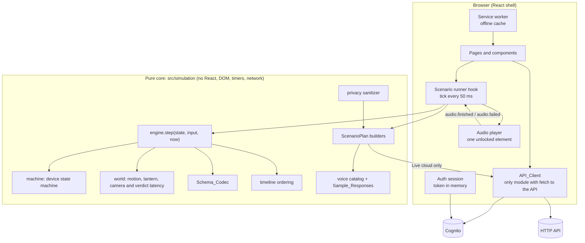
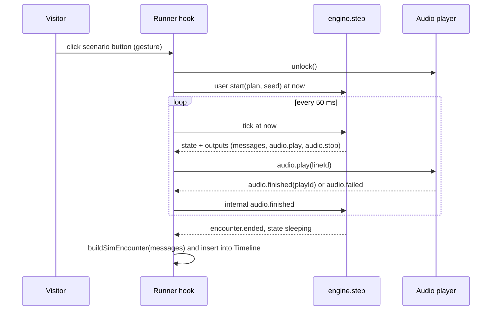
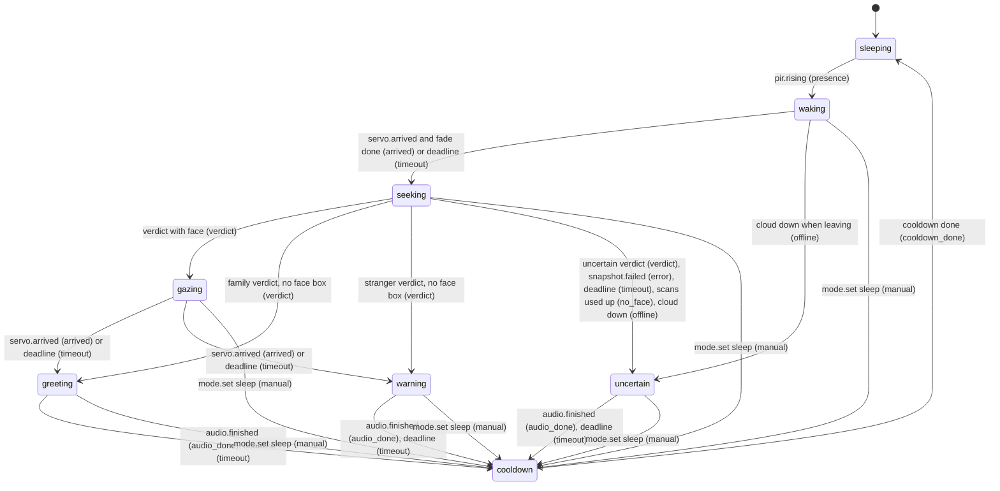

# Design Document: dashboard-simulation

## Overview

`dashboard-simulation` is the web application in `/dashboard`: a React + Vite + TypeScript single-page app that reviewers and the family open. A visitor with no hardware and no account clicks "Enter the house" and runs one of four scenarios against a virtual doll. The virtual doll runs the same state machine, the same state names, the same reasons and the same messages as the real doll (`docs/schema.md`). A signed-in user adds a "Live cloud" mode, the timeline of real encounters, the device panel, manual controls for the real doll (family only) and face registration (family only). A privacy indicator on every view shows whether the real doll's camera or microphone is active.

The design has one rule that shapes everything else: **the simulation engine is a pure function** `step(state, input, now) -> { state, outputs }` with no React, no DOM, no timers, no network and no randomness source. Time and a random seed are passed in. The doll's hardware (servos, lantern, camera latency) and the cloud's answer (the verdict) are modelled inside the engine as deterministic "world" rules driven by a `ScenarioPlan`. Everything else (React components, audio, HTTP, sign-in) is a thin shell around that core, and the shell is replaceable by fakes so `make test` needs no backend, no AWS account and no network.

Scope: the dashboard only. The contract (`docs/schema.md`), the HTTP API and the roles belong to `cloud-judgement`; this spec consumes them. Live voice conversation belongs to `voice-conversation`. Where this design finds that the contract or the cloud design is missing something, it is listed in [Changes to make first](#changes-to-make-first). Nothing is changed silently.

Language: TypeScript (strict), React function components and hooks, no heavy state library. Test tools: vitest, Testing Library, fast-check (all in the workspace stack). Algorithms use TypeScript or pseudocode.

### Research summary

The AWS facts below were read from the AWS documentation in this session. The `aws-docs` MCP server was not available in this session, so the pages were read through a web fetch and search; each fact carries its page. [Verified facts](#verified-facts) lists them and marks what stays unverified.

Key findings that shaped the design:

1. Cognito can sign a user in from a browser with `InitiateAuth` and the `USER_PASSWORD_AUTH` flow when the app client allows `ALLOW_USER_PASSWORD_AUTH`. The password travels in the request body over TLS. SRP avoids that but needs an SRP library, which the docs say the low-level SDKs do not provide. Managed login needs a Cognito domain and callback URLs, which would add a second stack cycle on top of the one `cloud-judgement` already resolves for CORS. Decision D1 below chooses `USER_PASSWORD_AUTH` with a plain `fetch` and zero dependencies.
2. Cognito access tokens are valid for one hour by default (configurable from 5 minutes to 1 day). A token kept in memory therefore outlives a reviewer's visit, so the design stores no refresh token and does not refresh.
3. A browser upload to a pre-signed S3 POST is a cross-origin request. S3 answers it only if the bucket has a CORS rule for the dashboard origin. The `cloud-judgement` design has CORS for the HTTP API only. This is a gap (X2).
4. `docs/schema.md` has no route for the voice-line catalog and does not say where the consent notice text lives. The dashboard needs both (S1, S2).

## Design review: gaps and decisions

Severity: **High** changes a contract or another spec, **Medium** needs a guard in code, **Low** is documented only.

| # | Sev | Finding | Decision |
|---|---|---|---|
| D1 | High | Sign-in method is not defined. `cloud-judgement` creates a "public SPA app client" and no Cognito domain. | Direct `InitiateAuth` with `USER_PASSWORD_AUTH` through `fetch` (no SDK, no SRP library). Needs `ALLOW_USER_PASSWORD_AUTH` on the app client (X1). Trade-off: the password is sent in the request body over TLS, which AWS documents; acceptable for a family app and a public read-only demo account. A user pool challenge (`NEW_PASSWORD_REQUIRED`, MFA) is not handled: the UI shows "This account needs setup. Ask the owner." and the owner sets a permanent password with `aws cognito-idp admin-set-user-password --permanent`. |
| D2 | High | The Control_Panel selector (Requirement 14.1) needs each cached line's id, Japanese text and English subtitle, and the simulation needs the same lines and their audio. No HTTP route returns them. | Bundle a generated **voice catalog** (`src/simulation/data/voice-catalog.json`) made from the device's `voice/lines.toml` by `scripts/export_voice_catalog.py`. `make test` runs it with `--check`, so a drift between device lines and dashboard catalog fails the build. See S2. |
| D3 | High | `consent.noticeVersion` is a string, but the notice text itself is not defined anywhere. | The dashboard bundles the notice text per version under `src/content/consent/<version>.md`. If the version from `GET /me` has no bundled text, registration is disabled with "This consent notice is out of date. Reload the page." See S1. |
| D4 | High | Requirement 12.5 says the engine receives `speak` from the `simulate` response as a command. The real device plays its **own** cached reaction line the moment it enters `greeting`, `warning` or `uncertain` (`device-core-loop` design, entry table), and a `speak` during playback is rejected with `audio_busy`. `cloud-judgement` C1 states the same: the automatic path sends only `judgement.result`. A `speak` delivered to the engine during `gazing` would also break the silent stare of Requirement 3.2. | The runner delivers the response's `judgement.result` to the engine, and uses the response's `speak.lineId` as the **line the doll chooses** (`ScenarioPlan.reactionLineId`). The engine still implements `speak` commands exactly like the device (`on_speak` rules), so manual commands and property tests stay faithful. Requirement 12.5 needs a wording fix (Q1). |
| D5 | Medium | `judgement.result` is matched by `snapshotId` only. The `simulate` response was produced for a sample, so its `snapshotId` cannot equal the one the engine just created. | The runner builds a fresh `judgement.result` envelope for each attempt: new `id`, the engine's current `snapshotId`, and the verdict, confidence and face from the response. No contract change; the response is treated as data. |
| D6 | Medium | Requirement 9.4 asks the Dashboard to discard text containing a Family_Label, but a visitor or reviewer cannot read `GET /faces`, so the dashboard does not know any label. | For a verdict other than `family`, the displayed line text is **always** the bundled catalog text of the line id, never the text from the response. For `family`, the response text is shown only if it passes the sanitizer. The labels known to the dashboard (family role only) are an extra filter, not the only defence. |
| D7 | Medium | Requirement 2.4 (120 s per scenario) and Requirement 20.12 (all four scenarios in under two minutes) conflict with the device default `cooldown_s = 20`: one scenario would last about 35 s. | The simulation uses `cooldown_s = 5`, the smallest value the device accepts with its defaults (`glide_timeout_s + lantern_fade_out_ms / 1000 = 3 + 2`). Estimated durations: `family_home` 14 s, `stranger_night` 17 s, `nobody_there` 20 s, `network_down` 11 s, about 62 s in total. All other timings are the device defaults. |
| D8 | Medium | "Slow turning is part of the character" and "at most 2° per step, at least 30 ms between steps". | The engine moves **one step per `step()` call at most**, and only when at least `glideIntervalMs` passed since the last step. Defaults: 1° per step, 50 ms between steps (20°/s, so a 30° turn takes 1.5 s). Both stay inside the device rules. The runner calls `tick` every 50 ms. |
| D9 | Medium | Requirement 17.3 (reduced motion) says the head moves to its target in one step, but Requirement 17.4 says the messages stay the same. | The engine always runs the same slow motion. `Sim_State` exposes `panTarget`, `tiltTarget` and `lanternTarget`. Under Reduced_Motion the **renderer** draws the target instead of the current value. The engine has no motion preference input, so the message order cannot depend on it. |
| D10 | Medium | Browsers block audio until a user gesture, and iOS Safari only lets an audio element play later if it was started in a gesture. | One shared `HTMLAudioElement` is created and "unlocked" (a silent 1-sample WAV is played) inside the click handlers of "Enter the house" and of every scenario button. All later playback reuses that element. *Unverified on iOS Safari*: owner check in task list. |
| D11 | Medium | Offline use (Requirement 19.1, 19.2) with hashed build files. A service worker installed during the first load does not control that load, so the files fetched during it are not cached by a runtime rule. | `public/sw.js` pre-caches the unhashed files (`/`, audio, illustrations) at install. After `load`, the page sends the service worker the URLs from `performance.getEntriesByType("resource")` and the worker adds them to the cache. `/config.json` is network-first with a cache fallback. API calls are never cached. |
| D12 | Medium | `GET /device/status` is allowed for `reviewer`, so the privacy indicator can show the real doll's camera state to a reviewer. | Allowed and intended: the schema allows it and it contains no household data (`state`, angles, flags). It never shows an image. |
| D13 | Medium | The simulation must show "Family notified" for the stranger scenario, but nothing is sent. | The Timeline entry says "Family notified" with a visible "(simulated, nothing was sent)" note, so the label never claims a real notification. |
| D14 | Low | Fonts must be under the OFL and the app must work offline. | Self-host one Japanese serif (Shippori Mincho, OFL 1.1) as a subset woff2 under `public/fonts/`, listed in `docs/third-party.md`. UI body text uses the system font stack. No font CDN. |
| D15 | Low | Router dependency for four views. | A 30-line hash router (`#/`, `#/house`, `#/timeline`, `#/family`). No `react-router`. The CloudFront SPA fallback in `WebStack` still serves `index.html` for unknown paths. |
| D16 | Low | `Content-Type` of a Cognito `InitiateAuth` request is not stated on the page read. The sample response on that page uses `application/x-amz-json-1.0`. | The request uses `application/x-amz-json-1.1`, the value AWS SDKs send for this service. *Unverified*: the first deployment confirms it (owner measurement, listed below). |

### Changes to make first

Per the workspace rules, a gap in `docs/schema.md` is a schema change that comes **before** any code. These are not applied by this design; they become the first tasks.

| # | Target | Change | Reason |
|---|---|---|---|
| S1 | `docs/schema.md`, `GET /me` | State that `consentNoticeVersion` names a notice text that the dashboard bundles under `dashboard/src/content/consent/<version>.md`, and that the cloud and the dashboard are released together when it changes. | Without it the consent checkbox has no text to consent to (Requirement 15.3). |
| S2 | `docs/schema.md`, `POST /commands` and Shared definitions | State that the voice-line catalog is the device's `voice/lines.toml` (ids, categories, `ja`, `en`) and that `scripts/export_voice_catalog.py` copies it to the dashboard. The cloud's `lineId` check uses the same ids. | Fixes the single source of the catalog and the drift check. |

Changes to the cloud design (not to the contract) that the dashboard depends on:

| # | Target | Change | Reason |
|---|---|---|---|
| X1 | `cloud-judgement` `ApiStack` | The public app client enables `ALLOW_USER_PASSWORD_AUTH` (`authFlows.userPassword: true`), has no client secret, and sets no Cognito domain. | D1. |
| X2 | `cloud-judgement` `DataStack` | A CORS rule on the data bucket: `AllowedOrigins` the CloudFront origin, `AllowedMethods` `POST`, `AllowedHeaders` `*`. A browser POST to the pre-signed URL of `/faces/upload` fails without it. | Verified in the S3 CORS page: S3 matches origin, method and headers against the bucket rules. |
| X3 | `cloud-judgement` fixtures | `POST /simulate` response examples for the three sample labels, which the dashboard bundles as Sample_Responses and validates in a test. | Requirement 2 and 3: no network in Simulation_Mode. |

Requirement clarifications (the requirements are the owner's; these need an update before tasks):

| # | Requirement | Clarification |
|---|---|---|
| Q1 | 12.5 | Replace "receive the `judgement.result` and `speak` from `commands` as input commands" with "receive the `judgement.result` as an input command and use the `lineId` of the `speak` as the line the doll says" (D4). |
| Q2 | 2.3 | "Scenario_Script" is a `ScenarioPlan` (data) plus the engine's world rules. The ordered message list is the *result* of running the plan and is what the tests check. `network_down` has no `snapshot.captured`, as Requirement 3.4 already says. |
| Q3 | 3.3 | `nobody_there` makes four snapshots (the first one and three scan moves to -15°, 15° and 0°) before `uncertain` with reason `no_face`, because the device does (`scan_attempts_max = 3`). |
| Q4 | 6.8 | Read as: between two consecutive states pan and tilt change by at most one step (default 1°, never above 2°), and not at all when less than `glideIntervalMs` has passed since the last step. |

### Verified facts

| Topic | Fact | Source |
|---|---|---|
| Cognito sign-in | `InitiateAuth` accepts `AuthFlow: USER_PASSWORD_AUTH` with `AuthParameters` `USERNAME` and `PASSWORD`. The request carries `X-Amz-Target: AWSCognitoIdentityProviderService.InitiateAuth`. | [InitiateAuth](https://docs.aws.amazon.com/cognito-user-identity-pools/latest/APIReference/API_InitiateAuth.html) |
| Cognito app client | Client-side password sign-in needs `ALLOW_USER_PASSWORD_AUTH` in the app client's `ExplicitAuthFlows`. The password is sent in the request; SRP sends no readable secret but needs a library because the low-level SDKs do not compute the SRP values. | [Authentication flow methods](https://docs.aws.amazon.com/cognito/latest/developerguide/amazon-cognito-user-pools-authentication-flow-methods.html) |
| Cognito endpoint | The request host has the form `cognito-idp.<region>.amazonaws.com`. | [InitiateAuth examples](https://docs.aws.amazon.com/cognito-user-identity-pools/latest/APIReference/API_InitiateAuth.html) |
| Token lifetime | Access tokens are valid for one hour unless the app client says otherwise; the allowed range is 5 minutes to 1 day. | [UserPoolClientType](https://docs.aws.amazon.com/cognito-user-identity-pools/latest/APIReference/API_UserPoolClientType.html), [TokenValidityUnits](https://docs.aws.amazon.com/AWSCloudFormation/latest/TemplateReference/aws-properties-cognito-userpoolclient-tokenvalidityunits.html) |
| Access token claims | The access token carries the user's groups and scopes. | [Access token](https://docs.aws.amazon.com/cognito/latest/developerguide/amazon-cognito-user-pools-using-the-access-token.html) |
| S3 CORS | S3 uses the first CORS rule whose origin, method and headers match the browser request. | [CORS](https://docs.aws.amazon.com/AmazonS3/latest/userguide/cors.html) |
| API contract, CORS, roles | Routes, error codes, role matrix and CORS settings. | `docs/schema.md`, `cloud-judgement` design |

**Unverified items** (each becomes a check in the first task or a pending owner measurement):

- The form field order of a pre-signed S3 POST: community reports say the `file` field must be last. The design appends it last, and the owner confirms with one real upload.
- The `Content-Type` of the `InitiateAuth` request (D16) and that `cognito-idp` answers browser requests with CORS headers for the dashboard origin. Amplify's browser library calls the same endpoint, but no page read this session states it. First deployment confirms it.
- Audio unlock on iOS Safari (D10).
- The exact error names Cognito returns for a wrong password (`NotAuthorizedException`) and an unconfirmed user. The UI shows one message for every failure, so no mapping depends on the names.

## Architecture



Data flow of one scenario in Simulation_Mode:



### Device state machine mirrored by the engine

The states and edges are those of `device-core-loop`. The reason on each edge is the one in the "Reason mapping" table of `docs/schema.md`, and a test reads that table from the markdown file to keep the two in step.



`conversing` (P1) is not simulated. A real `status.report` with state `conversing` is shown by name in the Device_Panel, and the Virtual_Doll draws the `greeting` pose for it (Requirement 7.3).

## Components and Interfaces

### Directory layout

```
dashboard/
  index.html  vite.config.ts  tsconfig.json  eslint.config.js  package.json
  public/
    sw.js  fonts/  audio/<lineId>.wav  illustrations/silhouette-*.svg
  src/
    simulation/                 pure TypeScript, no React imports
      types.ts  codec.ts  rng.ts  config.ts
      machine.ts  world.ts  engine.ts  head.ts
      plans.ts  privacy.ts  timeline.ts  controls.ts  indicator.ts
      data/voice-catalog.json  data/sample-responses/*.json
    lib/
      api.ts  auth.ts  settings.ts  audio.ts  clock.ts  router.ts  sw-register.ts
    hooks/    useScenarioRunner.ts  useDeviceStatus.ts  useSession.ts
    components/  VirtualDoll.tsx  ScenarioPanel.tsx  Subtitle.tsx  LiveRegion.tsx
                 PrivacyIndicator.tsx  DevicePanel.tsx  ControlPanel.tsx  Locked.tsx
                 TimelineList.tsx  EncounterDetail.tsx  FaceList.tsx  ErrorBoundary.tsx
    pages/       Landing.tsx  House.tsx  Timeline.tsx  Family.tsx
    content/consent/<version>.md   copy.ts
  test/          property, component and fixture tests
```

`eslint.config.js` has an override for `src/simulation/**` that forbids imports of `react`, `react-dom` and anything under `src/lib`, `src/hooks`, `src/components`, and forbids the globals `window`, `document`, `fetch`, `setTimeout`, `setInterval`, `Date`, `performance`, `localStorage` and `Math.random`. This enforces Requirement 5.1; a small test also greps the folder for these names.

### Schema_Codec (`codec.ts`, Requirement 4)

```ts
export type Result<T, E> = { ok: true; value: T } | { ok: false; error: E };
export type Malformed = { rule: MalformedRule; path: string };           // first failing rule
export type DecodeResult =
  | { kind: "valid"; message: SchemaMessage }
  | { kind: "malformed"; rule: MalformedRule; path: string }
  | { kind: "unsupported_version"; v: number };

export const MAX_MESSAGE_BYTES = 131_072;
export function decodeText(text: string): DecodeResult;       // size, UTF-8 length, JSON, then decodeValue
export function decodeValue(value: unknown): DecodeResult;    // all rules below, in this order
export function encode(message: SchemaMessage): string;       // JSON text
export const ALL_TYPES: readonly string[];                    // every event, command and status type
```

`SchemaMessage` is a discriminated union on `type`, one member per type in `docs/schema.md` (`presence.detected`, `snapshot.captured`, `state.changed`, `reaction.performed`, `encounter.ended`, `error.reported`, `judgement.result`, `speak`, `gaze`, `lantern`, `mode.set`, `status.report`, `status.offline`), with the same field names and enumerations. Rules are checked in this order, and the first failure is returned with its rule name:

1. size above 131,072 bytes (`size`); 2. invalid JSON (`json`); 3. top level not an object (`not_object`); 4. `v` not an integer ≥ 1 (`version_type`); 5. `v` > 1 returns `unsupported_version` (not malformed); 6. a missing envelope field (`missing_field`); 7. a wrong type (`wrong_type`), including a non-finite number (`non_finite`) and an `int` field that holds a float; 8. a value outside an enumeration (`bad_enum`); 9. `speak` without exactly one of `lineId` and `audioUrl` (`speak_source`). Unknown `type` returns `unknown_type`. Undefined `data` fields are dropped on decode (as the device does), so `decode(encode(m))` equals `m` for every valid `m`. Finite numbers outside documented ranges are valid, as on the device.

### Engine types (`types.ts`, `engine.ts`)

```ts
export type DeviceState = "sleeping" | "waking" | "seeking" | "gazing" | "greeting" | "warning" | "uncertain" | "cooldown";
export type EyeState = "closed" | "half" | "open" | "stare";
export type VerdictLabel = "family" | "stranger" | "no_face" | "uncertain" | "offline";

export interface ScenarioPlan {
  scenario: ScenarioId;                         // family_home | stranger_night | nobody_there | network_down
  cloud: "up" | "down";                         // down: cloud.disconnected is delivered before pir.rising
  attempts: PlannedVerdict[];                   // one per snapshot attempt; the last repeats if more are needed
  reactionLineId: string | null;                // from the response's speak.lineId; null lets the engine choose
  display: { ja: string; en: string } | null;   // generated text, family verdict only (see privacy.ts)
  cameraDelayMs: number;                        // default 600
  verdictDelayMs: number;                       // default 1200 (Live cloud: not the measured latency)
}
export interface PlannedVerdict {
  verdict: "family" | "stranger" | "no_face" | "uncertain";
  confidence: number;                           // 0..1
  face: FaceBox | null;
}

export type Input =
  | { kind: "tick" }
  | { kind: "command"; value: unknown }        // a parsed JSON value; the engine decodes it with the codec
  | { kind: "internal"; event: InternalEvent } // servo.arrived is produced by the engine itself
  | { kind: "user"; action: { type: "start"; plan: ScenarioPlan; seed: number; encounterIdSeed?: number } | { type: "stop" } };

export type InternalEvent =
  | { type: "pir.rising" } | { type: "audio.finished"; playId: string }
  | { type: "audio.failed"; playId: string; code: "audio_failed" | "interrupted" }
  | { type: "snapshot.ready"; snapshotId: string } | { type: "snapshot.failed"; snapshotId: string; code: "camera_failed" | "snapshot_too_large" }
  | { type: "cloud.connected" } | { type: "cloud.disconnected" } | { type: "servo.arrived"; motionId: string };

export type Output =
  | { kind: "message"; envelope: SchemaMessage }          // on the wire (events, status); never device-internal events
  | { kind: "audio.play"; playId: string; lineId: string; ja: string; en: string; durationHintMs: number | null }
  | { kind: "audio.stop" };

export function step(state: SimState, input: Input, now: number): { state: SimState; outputs: Output[] };
export function initialState(config?: Partial<SimConfig>): SimState;   // validates config; unsafe values fall back to defaults
```

`SimState` holds everything the renderer needs and everything the engine needs to continue; it is a plain JSON-serializable object (no functions, no classes), so two states can be compared with `toEqual` in the determinism test.

```ts
export interface SimState {
  config: SimConfig;
  phase: Phase;                       // discriminated union: sleeping | waking{fadeDoneAt,deadline} | seeking{attempt,scans,scan} | ...
  deviceState: DeviceState;           // equal to phase.kind, kept for the renderer
  mode: "guard" | "sleep";
  pan: number; tilt: number;          // current head angles, always inside the limits
  panTarget: number; tiltTarget: number;
  motion: { id: string | null; lastStepAt: number };
  lantern: number;                    // current level 0..1
  lanternTarget: { level: number; fadeMs: number; startedAt: number; from: number } | null;
  eye: EyeState;
  subtitle: { ja: string; en: string } | null;
  verdict: VerdictLabel | null;       // for the visible verdict text label (Requirement 3.7)
  encounter: { id: string; startedAt: number; reacted: boolean; accepted: "family" | "stranger" | "uncertain" | "no_face" | null } | null;
  plan: ScenarioPlan | null;
  pending: PendingInput[];            // world inputs scheduled for later ticks, sorted by `at` then insertion order
  seenCommandIds: string[];           // last 256 accepted command ids (dedup)
  rng: number;                        // 32-bit PRNG state (mulberry32); the only source of "random" values
  log: SchemaMessage[];               // messages emitted since start, status.report included
  running: boolean;                   // a scenario is running (buttons disabled while true)
}
```

### Engine behaviour

`step` is a composition of small pure functions. It never reads a clock or a random source; it reads `now` and `state.rng`.

1. **Decode.** A `command` input goes through `decodeValue`. A malformed result produces one `error.reported` with code `malformed_message` and no other change (a `gaze` with a non-finite angle takes this path, Requirement 6.4). `unsupported_version` produces `error.reported` with code `unsupported_version`. A `deviceId` other than `warashi-sim` produces `wrong_device`. A repeated `id` among the last 256 accepted ids is dropped without any output (Requirement 5.5).
2. **Dispatch.** The machine handles the event with the device's rules: `judgement.result` is accepted only in `seeking`, for the current `snapshotId`, once; `gaze` and `lantern` are rejected with `command_rejected_state` in `sleeping` and `cooldown`; `speak` follows `on_speak` (unknown line, category not permitted for the situation, `audio_busy`, silent stare); `mode.set sleep` during an encounter enters `cooldown` with reason `manual`. An input that is not defined for the current state returns the state unchanged with no `state.changed` (Requirement 5.4).
3. **Accept rule.** `family` needs `confidence ≥ 0.80`, `stranger` needs `confidence ≥ 0.80`; otherwise the verdict is treated as `uncertain` (device defaults `family_confidence_min`, `stranger_confidence_min`).
4. **Motion model** (`world.ts`). On a tick, if a target differs from the current angle and `now − motion.lastStepAt ≥ glideIntervalMs`, pan and tilt each move by `min(glideStepDeg, |target − current|)` toward the target, then both are clamped to the limits. When both reach the target, the engine feeds `servo.arrived(motionId)` to the machine in the same call. Targets are clamped when they are set, so a `gaze` with any finite angle never leaves the range (Requirement 6.1, 6.7). `config` validation rejects limits above pan ±60° or tilt ±30° and `glideStepDeg` above 2 or `glideIntervalMs` below 30, and falls back to the defaults (Requirement 6.2).
5. **Lantern model.** `lantern` is linear between `from` and `target.level` over `fadeMs`, recomputed on each call from `now`.
6. **World responders.** `TakeSnapshot` schedules `snapshot.ready` at `now + cameraDelayMs`. The machine's `snapshot.captured` event schedules a `judgement.result` at `now + verdictDelayMs` when the cloud is up and the plan has an attempt for it. A cloud that is down schedules nothing, so the attempt deadline (`verdict_timeout_s`) is the only way out, as on the device. `cloud.disconnected` and `cloud.connected` are delivered by the plan at the start.
7. **Head tracker** (`head.ts`). `pan = clamp(snapshotPan + (cx − 0.5) × hfov)`, `tilt = clamp(snapshotTilt + (0.5 − cy) × vfov)` with `cx`, `cy` the face box centre, `hfov = 54`, `vfov = 41.8`. It mirrors `device-core-loop` `head_tracker.py`; a golden table of corner faces is shared in a test.
8. **Reaction line.** On entering `greeting`, `uncertain` or (after the stare) `warning`, the engine picks `plan.reactionLineId` if it exists in the catalog and its category is permitted, otherwise `choose_line(category, rand)` with `rand` drawn from `state.rng` (same algorithm as the device, sorted by id). It emits `audio.play`, sets the subtitle from the catalog (never from the plan unless the verdict is `family` and the sanitizer accepts it, D6), and emits `reaction.performed` once per encounter.
9. **Ids and times.** Every envelope has `v: 1`, an id built from four draws of `state.rng` in UUID v4 format, `ts = new Date(now).toISOString()` (done through a small pure formatter, not `Date`), `deviceId: "warashi-sim"`, `encounterId` set from `presence.detected` to `encounter.ended` and `null` otherwise. `status.report` always carries `null`.
10. **End of encounter.** `cooldown` sets the targets to 0° and the lantern to 0 over `lantern_fade_out_ms`, and after `cooldown_s` the machine enters `sleeping` with reason `cooldown_done`, emits `encounter.ended`, restores `mode` to `guard`, clears the subtitle and sets `running` to false. A `stop` user action is the same as `mode.set` `sleep`: `cooldown` with reason `manual`, then `encounter.ended` with reason `manual`.
11. **Loop guard.** After each input the engine runs a bounded loop (at most 16 rounds) that feeds due `pending` inputs and internal feedback to the machine, so one call never loops forever.

Every `state.changed` is emitted by one helper `enter(state, to, reason)` that reads `from` from the state before the change, so Requirement 5.7 holds by construction.

### Scenario plans (`plans.ts`) and Sample_Responses

A Sample_Response is a JSON file shaped like a successful `POST /simulate` response. Three files are bundled (`family`, `stranger`, `no_face`), validated against the codec in a test. `planFromResponse(scenario, response)` is a pure function used for both modes:

| Scenario | Plan |
|---|---|
| `family_home` | `cloud: up`, one attempt from the response (`family`, face box present), `reactionLineId` from `speak.lineId` |
| `stranger_night` | `cloud: up`, one attempt (`stranger`, face box present) |
| `nobody_there` | `cloud: up`, the response's `no_face` verdict repeated for four attempts (Q3) |
| `network_down` | `cloud: down`, no attempts, no response needed |

`GET /samples` is used in Live cloud mode to find the `sampleId` for a scenario: the first sample (sorted by `sampleId`) whose `label` equals the scenario's label (`family`, `stranger`, `no_face`). If none exists, the scenario falls back to Simulation_Mode and the UI says so.

### Privacy (`privacy.ts`, Requirement 9)

```ts
export function containsLabel(text: string, labels: readonly string[]): boolean;     // case-insensitive substring, empty labels ignored
export function safeLineText(verdict, catalogLine, responseText, labels): { ja: string; en: string };
export function scrubMessages(messages: readonly SchemaMessage[], labels: readonly string[]): SchemaMessage[]; // for tests and Live results
```

`safeLineText` returns the catalog text for every verdict except `family`. For `family` it returns the response text only if it is non-empty, at most 200 characters and free of every known label that must not appear (family nicknames may appear in a family `speak` text, Requirement 9.3, so the family case keeps the response text but never copies it into the Timeline, `state.changed` or any event). The labels the dashboard knows come from `GET /faces` (family role only) and are held in memory, never stored (Requirement 9.5).

### Timeline (`timeline.ts`, Requirement 10)

```ts
export function compareEncounters(a: Encounter, b: Encounter): number;   // startedAt desc, then encounterId asc
export function sortEncounters(list: readonly Encounter[]): Encounter[]; // stable, pure
export function insertSimulated(list: readonly SimEncounter[], e: SimEncounter, max = 50): SimEncounter[];
export function buildSimEncounter(log: readonly SchemaMessage[], meta: { mode: "simulation" | "live"; ja: string; en: string }): SimEncounter;
```

`insertSimulated` sorts `[e, ...list]` with `compareEncounters` and drops entries beyond `max` from the end, which are the oldest. `SimEncounter` is an `Encounter` record of `docs/schema.md` plus `mode`, `line: { ja, en }` and `notified`. `notified` is true for a stranger verdict with a stranger reaction; the UI shows "Family notified (simulated, nothing was sent)". Simulated and real lists are separate arrays with separate headings.

### Roles and locked controls (`lib/roles.ts`, `components/Locked.tsx`)

```ts
export type Role = "visitor" | "reviewer" | "family";
export function capabilities(role: Role): {
  liveCloud: boolean; deviceStatus: boolean; realTimeline: boolean;
  controls: boolean; faces: boolean; snapshot: "none" | "url" | "illustration";
};
```

Visitor: all false, `snapshot: "none"`. Reviewer: `liveCloud`, `deviceStatus`, `realTimeline` true, `controls` and `faces` false, `snapshot: "illustration"`. Family: all true, `snapshot: "url"`. `Role` comes only from `GET /me`; before it returns, a signed-in user is treated as `visitor`. A `Locked` control renders `<button aria-disabled="true" aria-describedby="…">` (not the `disabled` attribute, so it stays focusable) with the one-line explanation in the element named by `aria-describedby`; the click handler does nothing and no API function is reachable from it.

### API_Client (`lib/api.ts`, Requirement 19.4 to 19.8)

One module, the only one that calls the HTTP API. Every function returns `Promise<Result<T, ApiError>>` and never throws.

```ts
export type ApiErrorCode = "unauthorized" | "forbidden" | "not_found" | "validation_failed" | "consent_required"
  | "face_count_invalid" | "rate_limited" | "internal" | "timeout" | "network";
export interface ApiError { code: ApiErrorCode; message: string; retryAfterS?: number }
export function mapErrorCode(code: unknown): ApiErrorCode;   // unknown or missing code -> "internal"

export interface ApiClient {
  me(): ...; samples(): ...; encounters(limit: number, cursor?: string): ...; encounter(id: string): ...;
  deviceStatus(deviceId: string): ...; simulate(sampleId: string, generate: boolean): ...;
  command(deviceId: string, command: OutgoingCommand): ...;
  faces(): ...; faceUpload(): ...; faceRegister(body: FaceRegisterBody): ...; faceDelete(memberId: string): ...;
}
export function createApiClient(deps: { baseUrl: string; getToken: () => string | null; fetch: typeof fetch; setTimer: ...; }): ApiClient;
```

It adds `Authorization: Bearer <token>` to every call, aborts a request after 10 seconds (`AbortController` plus an injected timer, so fake timers work) and returns `timeout`, parses `{ error: { code, message } }`, maps `code` through `mapErrorCode`, reads `Retry-After` as an integer clamped to 1..86,400 (60 when it is missing or invalid), and checks each success body with a hand-written guard before returning it (a body that fails the guard becomes `internal`). It never logs a token, image data, a face id or a pre-signed URL; `console` is not used in this module, and a test asserts it with a spy. The component tests inject a fake `ApiClient`.

### Auth session (`lib/auth.ts`, Requirement 11)

```ts
export interface Session { signIn(user: string, password: string): Promise<Result<void, "failed" | "needs_setup" | "offline">>;
  signOut(): void; token(): string | null; expiresAt(): number | null; subscribe(fn: () => void): () => void; }
```

`signIn` posts `{ AuthFlow: "USER_PASSWORD_AUTH", ClientId, AuthParameters: { USERNAME, PASSWORD } }` to `https://cognito-idp.<region>.amazonaws.com/` with `Content-Type: application/x-amz-json-1.1` and `X-Amz-Target: AWSCognitoIdentityProviderService.InitiateAuth`. On success it keeps `AuthenticationResult.AccessToken` and its expiry in a closure variable, so the token is **memory only**: a reload signs the user out, which is intended for a public demo (Requirement 11.7). The refresh token and the ID token are discarded. A `ChallengeName` in the response gives `needs_setup`. The password input is cleared after every attempt. When the token is within 60 seconds of expiry, the next API call behaves as a `401`: the session is discarded and the dashboard returns to Simulation_Mode with "Please sign in again" (Requirement 11.5). `signOut` discards the token and the cached real encounters.

### Live cloud mode (`hooks/useScenarioRunner.ts`)

With the switch on and a scenario that has a sample, the runner calls `api.simulate(sampleId, generate)` first (the doll still sleeps; the UI shows "Asking the cloud…"). On success it measures the browser round trip with the injected clock and builds the plan from the response; the displayed steps are "Request to the cloud (measured in the browser)", "Cloud total (server)", "Face search (server)" and "Network and overhead (browser minus server, never below 0)". On `429` it shows the rate message with `Retry-After` and offers Simulation_Mode; on any other error or a timeout it shows "The cloud did not answer", adds nothing to the Timeline and offers Simulation_Mode. `network_down` never calls the API and shows "No cloud call: the network is down". An encounter that ran in this mode is labelled "Live cloud". If `speech.mp3Url` is not null, the audio player plays the MP3 instead of the bundled WAV for the reaction line, after the user gesture and only while sound is on; the Japanese and English text of the `speech` is shown after the sanitizer (D6).

### Audio player (`lib/audio.ts`)

```ts
export interface AudioPlayer {
  unlock(): void;                                        // call inside a user gesture
  play(req: { playId: string; src: string | null; minHoldMs: number }, cb: { finished(id: string): void; failed(id: string, code: string): void }): void;
  stop(): void; setMuted(muted: boolean): void; readonly muted: boolean;
}
```

When muted, or when `src` is null (file missing) or `play()` rejects (blocked), the player calls `failed` for a blocked or missing file and otherwise waits `max(minHoldMs, 3000)` before calling `finished`, so subtitles stay for at least 3 seconds (Requirement 8.1, 8.5). The runner forwards `finished` and `failed` to the engine as internal inputs. At the end of a scenario it calls `stop()` and the subtitle is cleared by the engine in the same call (within 1 second, Requirement 8.7). A fake player with a manual clock is used in tests.

### Virtual doll and accessibility

`VirtualDoll` is original SVG with CSS classes: room (shoji paper, tatami, night window), body and kimono, head group, eyes, andon lantern with a radial-gradient glow. Head and eyes and glow are separate groups with separate transitions, driven by custom properties set from the state:

- head pan: `translateX(sin(pan) × 28px)` and `scaleX(cos(pan))` on the head group, with the face features shifted by the same sine so the head seems to turn;
- head tilt: `translateY(−sin(tilt) × 14px)` and `rotate(−tilt × 0.4deg)`;
- eyes: the four `EyeState` shapes (`closed`, `half`, `open`, `stare` without blinking);
- glow: opacity and blur radius follow `lantern`.

The renderer takes the current values normally and the **targets** when Reduced_Motion is set (D9), with transitions of at most 100 ms for the lantern and no looping animation. The SVG has `role="img"` and an `aria-label` built from the state, the pan direction (`left`, `ahead`, `right`) and the lantern level (`dark`, `dim`, `bright`). A `LiveRegion` (`aria-live="polite"`) announces each new subtitle (`ja` then `en`) and each state label once.

### Privacy indicator (`simulation/indicator.ts`, `components/PrivacyIndicator.tsx`, Requirement 13)

```ts
export type StatusFetch = { kind: "none" } | { kind: "failed" } | { kind: "ok"; online: boolean; status: StatusReportData | null };
export type IndicatorView =
  | { kind: "simulation"; text: "Simulation: no real camera or microphone is in use" }
  | { kind: "unknown"; text: "Camera and microphone state unknown" }
  | { kind: "off"; text: "Camera off, microphone off" }
  | { kind: "active"; parts: ("Camera on" | "Microphone on")[] };
export function indicatorView(f: StatusFetch): IndicatorView;
```

`none` (visitor) gives `simulation`. `failed`, or `ok` with `online: false`, gives `unknown` (Requirement 13.8 takes precedence over 13.5 when the doll is offline). `ok` with `online: true` and a status gives `active` when either flag is true and `off` when both are false. `ok`, online and no status gives `simulation`. A symbol (camera, microphone) always comes with its text label. The component is rendered in the page header, outside every view and outside the error boundary's replaceable area.

### Controls (`simulation/controls.ts`, Requirement 14)

```ts
export type Control =
  | { kind: "speak"; lineId: string } | { kind: "look"; side: "left" | "right" }
  | { kind: "lantern"; level: number; fadeS: number } | { kind: "mode"; mode: "guard" | "sleep" };
export function buildCommand(c: Control): OutgoingCommand;   // always inside the documented ranges
```

`look` sends `panDeg` of -20 or 20 and `tiltDeg` 0, inside the default limits ±30° and ±20°. `lantern` clamps `level` to 0..1 and `fadeS × 1000` to an integer 0..10000. `speak` carries only `lineId`. A non-finite number becomes 0. The panel disables the control while its request is pending and never retries automatically.

### Family page (Requirement 15)

`validateFaceFile({ type, size })` accepts `image/jpeg` and `image/png` up to 5,000,000 bytes and returns the reason otherwise, with no API call. Registration calls `faceUpload()`, then posts a `FormData` whose pre-signed `fields` are appended **first** and the `file` **last**, then calls `faceRegister`. The consent checkbox starts unticked, and "Register" stays disabled while it is unticked or `displayName` is outside 1..40 characters. Errors map as in the requirements (`422` message, `409` reloads `GET /me`). Deleting opens an `alertdialog` that names the member. After any registration or deletion the selected `File`, its preview URL (`URL.revokeObjectURL`) and the form state are cleared.

### Service worker (`public/sw.js`, Requirement 19.2)

Install pre-caches `/`, `/audio/*`, `/illustrations/*` and `/fonts/*` from an inline list generated at build time by a small Vite plugin (`generateBundle` writes the list). The page posts the loaded resource URLs after `load` (D11). Fetch handling: same-origin `GET` for cached URLs is cache-first; `/config.json` is network-first with a cache fallback; anything not same-origin (the API, Cognito, S3) is never touched. The worker is registered only on `https:` or `localhost`. The offline banner uses `navigator.onLine` and the `online` and `offline` events.

## Data Models

### Simulation configuration

```ts
export const DEFAULT_CONFIG: SimConfig = {
  panLimit: 30, tiltLimit: 20,                      // hard limits 60 / 30, checked by validateConfig
  glideStepDeg: 1, glideIntervalMs: 50,             // D8; device rule: step <= 2, interval >= 30
  nodDeg: 8,
  lanternWakeLevel: 0.8, lanternFadeInMs: 1500, lanternFadeOutMs: 2000,
  wakingTimeoutS: 3, verdictTimeoutS: 8, glideTimeoutS: 3, stareS: 2, audioTimeoutS: 12,
  cooldownS: 5,                                     // D7; device default 20
  scanPanPositionsDeg: [-15, 15, 0], scanAttemptsMax: 3,
  cameraHfovDeg: 54, cameraVfovDeg: 41.8,
  familyConfidenceMin: 0.8, strangerConfidenceMin: 0.8,
  dedupWindowSize: 256, deviceId: "warashi-sim",
};
```

`validateConfig(partial)` returns a full config, replacing any value that breaks a rule with its default (limits above the hard limits, step above 2, interval below 30, cooldown below `glideTimeoutS + lanternFadeOutMs / 1000`).

### Voice catalog (D2)

```ts
export interface CatalogLine { id: string; category: "family" | "stranger" | "uncertain"; ja: string; en: string;
  durationMs: number | null; audio: string | null }     // audio: "audio/<id>.wav" or null when the file is absent
```

Generated by `scripts/export_voice_catalog.py` (Python standard library: `tomllib`, `wave`, `shutil`). `--check` regenerates in memory and fails if `voice-catalog.json` differs, or if a `lines.toml` id is missing from the catalog. A catalog entry without audio makes the line subtitle-only (Requirement assumption 2).

### Sample_Response (shape of `POST /simulate`)

```json
{
  "sampleId": "bundled-family",
  "verdict": "family",
  "confidence": 0.97,
  "face": { "left": 0.3, "top": 0.25, "width": 0.22, "height": 0.3 },
  "commands": [ { "type": "judgement.result" }, { "type": "speak" } ],
  "speech": { "lineId": "greeting_family", "ja": "…", "en": "…", "mp3Url": null, "generated": false },
  "latencyMs": { "total": 0, "search": 0 }
}
```

`commands` hold full envelopes with `deviceId: "warashi-sim"` and `encounterId: null` as the schema says. Bundled responses contain no name. The bundled `latencyMs` is never shown (only Live cloud shows latency).

### Encounter records shown in the UI

```ts
export interface SimEncounter extends Encounter {      // Encounter of docs/schema.md, events filled
  mode: "simulation" | "live";
  line: { ja: string; en: string } | null;
}
```

### Copy and labels

`copy.ts` holds every fixed UI string used by the requirements ("Enter the house", the four scenario labels, "No visits yet", "Snapshot expired", the indicator texts, the rate-limit message, and so on). Components import from it and tests assert against the same constants, so a wording change is one edit.

### Colour tokens

`tokens.css` defines the palette (washi `#f3ecdc`, sumi `#1b1a1a`, indigo night `#14172b`, andon amber `#f2b24e`, and the muted tones). A test computes the WCAG contrast ratio for every text and background pair that the components use and requires 4.5:1 for normal text and 3:1 for large text (Requirement 17.2).

## Correctness Properties

*A property is a characteristic or behavior that should hold true across all valid executions of a system-essentially, a formal statement about what the system should do. Properties serve as the bridge between human-readable specifications and machine-verifiable correctness guarantees.*

**Property reflection.** The prework found many testable criteria. They were merged where one property implies another: 4.2, 4.5 and 4.6 became the codec round trip; 5.6, 5.7 and 3.5 became one state-change consistency property; 6.1 and 6.7 became one limits property; 6.3 and 6.8 became one slow-motion property; 2.8, 5.4 and 5.5 became one "ignored inputs change nothing" property; 2.3, 2.4 and 6.5 became one scenario completion property; 2.6 and 6.6 became one stop property; 9.1, 9.2 and 9.3 became one privacy property; 13.5 to 13.8 became one indicator property; 10.2 and 10.3 became one ordering property. The criteria that need a browser (18.1, 18.2, 19.2) or cannot be computed (7.4, 17.7, 17.8, 18.6) are not properties and appear in the Testing Strategy as manual checks. The remaining criteria are example tests.

Common generators: `arbSeed` (32-bit integer), `arbScenario` (one of four), `arbTickGap` (integers 10 to 100 ms), `arbEnvelope` (valid messages of every type), `arbFiniteAngle` (any finite double, including 1e300), `arbCommand` (valid and malformed command values, including `NaN`, `Infinity`, wrong types and unknown ids), `arbInput` (a mix of ticks, commands, internal events with unknown or stale ids, start and stop), and `arbLabels` (non-empty strings of 1 to 12 characters, including characters that occur in the voice catalog text). A **driver** function feeds a plan to the engine: it ticks every `gap` ms, answers each `audio.play` with `audio.finished` after `durationHintMs ?? 3000`, and stops when the engine is back in `sleeping` with `running` false or when 130 simulated seconds have passed.

### Property 1: Codec round trip

*For any* valid Schema_Message `m` of any type, `decodeText(encode(m))` returns `valid` with a message equal to `m`, ignoring key order, and `encode` output is valid JSON.

**Validates: Requirements 4.2, 4.5, 4.6**

### Property 2: Codec rejects each broken rule with its name

*For any* valid Schema_Message and *any* single mutation chosen from the rule list (drop a field, change a field's type including `true` for a number, set a value outside an enumeration, set `v` to 0, -1, 1.5, `"1"` or `true`, inject `NaN`, `Infinity` or `1e400`, give `speak` both or neither of `lineId` and `audioUrl`, exceed 131,072 bytes, break the JSON), `decodeText` returns `malformed` naming that rule, and *for any* integer `v` above 1 it returns `unsupported_version` and no message.

**Validates: Requirements 4.3, 4.4**

### Property 3: Engine determinism

*For any* state reached by a sequence of inputs, *any* input and *any* `now`, calling `step` twice with equal arguments returns equal states and equal outputs.

**Validates: Requirements 5.2**

### Property 4: Ignored inputs change nothing

*For any* state and *any* input that is not defined for that state (a `servo.arrived` with an unknown motion id, an `audio.finished` for an unknown play id, a `snapshot.ready` outside `seeking`, a `judgement.result` for a stale `snapshotId`, a start action while `running`), and *for any* valid command whose `id` is among the last 256 accepted ids, `step` returns a state equal to the input state, emits no `state.changed` and, for a duplicate command, no output at all.

**Validates: Requirements 2.8, 5.4, 5.5**

### Property 5: State changes are consistent and follow the schema

*For any* sequence of inputs, every `state.changed` that the engine emits has `from` equal to the device state before the input and `to` equal to the device state after it, one `state.changed` is emitted for each change of device state and none otherwise, and the triple (`from`, `to`, `reason`) is a member of the set of allowed transitions read from the "Reason mapping" table of `docs/schema.md`.

**Validates: Requirements 3.5, 5.6, 5.7**

### Property 6: Head angles stay inside the limits

*For any* sequence of commands (including `gaze` with any finite angles) and ticks, after every input `pan` and `panTarget` are within ±`panLimit`, `tilt` and `tiltTarget` are within ±`tiltLimit`, and every value is finite. A `gaze` with a non-finite angle leaves the head unchanged and emits one `error.reported` with code `malformed_message`.

**Validates: Requirements 6.1, 6.4, 6.7**

### Property 7: Motion is slow

*For any* sequence of inputs with non-decreasing `now`, between two consecutive states pan and tilt each change by at most `glideStepDeg` (at most 2°), and they do not change at all when less than `glideIntervalMs` (at least 30 ms) has passed since `motion.lastStepAt`.

**Validates: Requirements 6.3, 6.8**

### Property 8: Unsafe configuration falls back to the defaults

*For any* partial configuration with arbitrary numbers, `validateConfig` returns a configuration with `panLimit` ≤ 60, `tiltLimit` ≤ 30, `glideStepDeg` ≤ 2, `glideIntervalMs` ≥ 30 and `cooldownS` ≥ `glideTimeoutS + lanternFadeOutMs / 1000`, and every rejected field equals its default.

**Validates: Requirements 6.2**

### Property 9: The state is always renderable

*For any* sequence of inputs, after every input the state has a device state from the eight names, finite pan and tilt, a lantern level in 0..1, an eye state from the four values, a subtitle that is `null` or a pair of non-empty strings, and, while the device state is `sleeping`, lantern 0, eyes `closed` and subtitle `null`.

**Validates: Requirements 7.1, 7.5, 8.7**

### Property 10: Every emitted message is a valid, well-formed envelope

*For any* scenario, seed and tick gap, every message the engine emits decodes to `valid` with the Schema_Codec, has `v` 1, a UUID `id`, a `ts` in UTC ISO 8601 with milliseconds, `deviceId` `warashi-sim`, an `encounterId` that is a UUID from `presence.detected` to `encounter.ended` and `null` otherwise, and `null` for every `status.report`. No device-internal event appears among the messages.

**Validates: Requirements 4.9, 4.10**

### Property 11: A scenario completes in order and returns to rest

*For any* scenario, seed and tick gap, the driver reaches `sleeping` with `running` false within 120 seconds of simulated time, the emitted event types contain in this order `presence.detected`, `state.changed` to `waking`, (`snapshot.captured` unless the scenario is `network_down`), `reaction.performed`, `encounter.ended`, the encounter ends with pan 0, tilt 0, lantern 0 and no subtitle, and the visible verdict label matches the scenario (`family`, `stranger`, `no_face`, or `offline` for `network_down`).

**Validates: Requirements 2.3, 2.4, 3.1, 3.3, 3.4, 3.7, 6.5**

### Property 12: A stranger line never comes before the silent stare

*For any* seed and tick gap in `stranger_night`, no `audio.play` is output and no `reaction.performed` is emitted before `stareS` seconds have passed since the state became `warning`, and the first `audio.play` and the `reaction.performed` of kind `stranger` are emitted in the same `step` call.

**Validates: Requirements 3.2**

### Property 13: Stopping always ends the encounter cleanly

*For any* scenario, seed, tick gap and stop time, and for a `mode.set` command with `mode: "sleep"` at any time during an encounter, the next state is `cooldown` with reason `manual`, and the run then reaches `sleeping` with `encounter.ended` of reason `manual`, head at center, mode restored to `guard` and the scenario buttons enabled (`running` false).

**Validates: Requirements 2.6, 6.6**

### Property 14: Scenarios never reveal a family label

*For any* set of Family_Labels `L` (`arbLabels`), *any* scenario whose verdict is `stranger`, `no_face` or `uncertain` and the offline scenario, no emitted message, no `Sim_State` field and no Timeline entry built from the run contains an element of `L` as a case-insensitive substring, unless `L` is a substring of the bundled catalog text itself, in which case the test removes that label from `L` first and asserts the catalog text is unchanged. For the `family` scenario, no `judgement.result`, `status.report`, event or Timeline field contains a label; only the text of a `speak` may.

**Validates: Requirements 9.1, 9.2, 9.3**

### Property 15: Live results cannot smuggle text for non-family verdicts

*For any* `simulate` response with a verdict other than `family` and *any* `speak` or `speech` text (including text that contains a Family_Label), the text the Dashboard shows and stores for the line equals the bundled catalog text of the line id, and the Timeline entry contains no part of the response text.

**Validates: Requirements 9.4**

### Property 16: Timeline order is total and stable

*For any* list of Encounters, `sortEncounters` returns the same multiset ordered by `startedAt` descending and `encounterId` ascending for equal `startedAt`; sorting the result again returns it unchanged; and sorting *any* permutation of the list returns the same order when the `encounterId` values are distinct.

**Validates: Requirements 10.2, 10.3**

### Property 17: Inserting keeps the existing order and the 50-entry cap

*For any* sorted list of simulated Encounters and *any* new Encounter, `insertSimulated` returns a sorted list in which the remaining old entries keep their relative order, the new entry is present unless it is older than all 50 kept entries, and the length is at most 50; when the cap drops an entry, it is the oldest one.

**Validates: Requirements 10.4, 10.12**

### Property 18: The plan keeps the response's verdict

*For any* valid `POST /simulate` response and scenario with a sample, `planFromResponse` yields attempts whose verdict, confidence and face box equal the response, and the `judgement.result` the runner builds from it carries the engine's current `snapshotId`, a fresh `id` and decodes to `valid`.

**Validates: Requirements 12.5**

### Property 19: The privacy indicator never claims "off" without evidence

*For any* `StatusFetch`, `indicatorView` returns `simulation` for `none`, `unknown` for `failed` and for an offline `ok`, and for an online `ok` with a status returns `active` with "Camera on" present exactly when `cameraActive` is true and "Microphone on" present exactly when `micActive` is true, or `off` when both are false.

**Validates: Requirements 13.5, 13.6, 13.7, 13.8**

### Property 20: Manual commands stay inside the documented ranges

*For any* control values (any doubles including `NaN`, `Infinity` and huge numbers, any string for a line id), `buildCommand` returns a command whose `lantern.level` is in 0..1, `lantern.fadeMs` is an integer in 0..10000, `gaze.panDeg` is within -30..30 and `gaze.tiltDeg` within -20..20 for "look" controls, and whose `speak` carries a `lineId` and no `audioUrl`.

**Validates: Requirements 14.3, 14.4**

### Property 21: Face file rules

*For any* media type string and size, `validateFaceFile` accepts exactly `image/jpeg` and `image/png` of at most 5,000,000 bytes and returns a reason for every other pair.

**Validates: Requirements 15.6**

### Property 22: Registration is enabled only with consent and a valid name

*For any* consent flag and *any* display name string, `canRegister` is true exactly when the flag is true and the name length in Unicode code points is 1 to 40.

**Validates: Requirements 15.4**

### Property 23: API error codes map to a known code

*For any* string or non-string value, `mapErrorCode` returns one of the ten `ApiErrorCode` values, returns the same code for each of the eight codes in `docs/schema.md`, and returns `internal` for every other value.

**Validates: Requirements 19.7**

### Property 24: Every API call carries the bearer token

*For any* API route function, token string and arguments, the request that the client sends has an `Authorization` header equal to `Bearer <token>`, and when there is no token the client sends no request and returns `unauthorized`.

**Validates: Requirements 11.3**

### Property 25: Subtitles stay visible long enough

*For any* `minHoldMs` and *any* player state (muted, source missing, playback rejected, playing), the time between `play` and the `finished` callback is at least 3,000 ms unless real audio played to its end, and the player always calls exactly one of `finished` or `failed` for each play request.

**Validates: Requirements 8.1, 8.5**

### Property 26: The doll's text alternative follows its state

*For any* `Sim_State`, `dollLabel(state)` is a non-empty string that contains the device state name, one of `left`, `ahead` or `right` matching the sign of pan (ahead within ±2°), and one of `dark`, `dim` or `bright` matching the lantern level.

**Validates: Requirements 17.6**

## Error Handling

| Situation | Behaviour |
|---|---|
| `config.json` cannot be loaded | Simulation_Mode stays available; "Sign in" and "Live cloud" are hidden; the message "Cloud features are unavailable right now" is shown (Requirement 1.6). |
| Malformed or unsupported message reaches the engine | One `error.reported` with `malformed_message` or `unsupported_version`, state unchanged, `refId` set to the message `id` when readable (schema rules). The engine never throws. |
| Engine bug (exception in `step`) | The runner catches it, stops the tick loop, shows "The doll lost her thread. Reload to start again." through the error boundary, and keeps the header, Mute_Control and Privacy_Indicator. |
| Audio blocked, file missing or `play()` rejected | Subtitle shown for at least 3 seconds, `audio.failed` sent, the scenario continues. |
| `401` from any API call, or token near expiry | Session discarded, back to Simulation_Mode as a visitor, "Please sign in again". |
| `403` | "This is someone's home. That area is closed to guests." The rest of the view stays. |
| `404` for a hidden real list (reviewer) | "The owner has hidden real visits from guests. Try the scenarios instead." |
| `429` | "The cloud needs a rest. Try again in N seconds." with N from `Retry-After`; no automatic retry; offer Simulation_Mode. |
| Other API error, timeout (10 s) or network failure | "The cloud did not answer" for Live cloud, "The doll's story could not be loaded" with "Try again" for the real list; no partial Encounter is added. |
| `POST /commands` fails | Failure message with "Try again"; no automatic retry; the control is enabled again. |
| `202` with `deviceOnline: false` | "The doll is offline. The command was not stored and will not play later." |
| `POST /faces` returns `422` or `409` | "The photo must show exactly one face." / reload `GET /me` and ask for consent again. |
| Browser offline | Banner "Offline: the simulation still works"; Live cloud, controls and face actions disabled. |
| Sign-in challenge (`NEW_PASSWORD_REQUIRED`, MFA) | "This account needs setup. Ask the owner." No further call. |
| Sign-in failure | One message for every failure: "Sign-in failed. Check the name and password." The password field is cleared. |
| Consent notice text missing for the cloud's version | Registration disabled: "This consent notice is out of date. Reload the page." |
| Service worker unsupported or registration fails | The app works online; offline mode is simply unavailable. No error is shown. |

Every error path writes nothing to the console that could hold an image, a token, a face id or a pre-signed URL (Requirement 19.8): the API module and the auth module do not use `console`, and the error boundary logs only the error name.

## Testing Strategy

### Approach

The engine, codec, privacy, timeline, controls, indicator and API error mapping are pure, so they get **property-based tests** with fast-check, each configured with `numRuns: 100` at least (the engine properties use 200 where the generator is cheap). Each test carries the tag comment `Feature: dashboard-simulation, Property N: <text>` and implements exactly one property. React components, the audio player, the service worker, sign-in and the API client use **example-based tests** with Testing Library, fake timers and fakes, because their behaviour does not vary meaningfully with input. Property-based testing is not used for the SVG artwork, layout or the service worker.

No test needs a backend, an AWS account or a network. The fakes are `FakeApiClient` (a scripted object that implements `ApiClient` and records calls), `FakePlayer` (manual clock), a fake `fetch` for the API and auth modules, and vitest fake timers.

### Property tests (required tasks)

| Property | File | Module under test |
|---|---|---|
| P1, P2 | `test/prop/codec.prop.test.ts` | `codec.ts` |
| P3, P4 | `test/prop/engine-core.prop.test.ts` | `engine.ts`, `machine.ts` |
| P5 | `test/prop/transitions.prop.test.ts` (reads `docs/schema.md`) | `machine.ts` |
| P6, P7, P8 | `test/prop/motion.prop.test.ts` | `world.ts`, `config.ts` |
| P9, P10 | `test/prop/renderable.prop.test.ts` | `engine.ts`, `codec.ts` |
| P11, P12, P13 | `test/prop/scenarios.prop.test.ts` | `engine.ts`, `plans.ts` |
| P14, P15 | `test/prop/privacy.prop.test.ts` | `privacy.ts`, `plans.ts` |
| P16, P17 | `test/prop/timeline.prop.test.ts` | `timeline.ts` |
| P18 | `test/prop/plans.prop.test.ts` | `plans.ts` |
| P19, P20, P21, P22 | `test/prop/pure-helpers.prop.test.ts` | `indicator.ts`, `controls.ts`, `faces.ts` |
| P23, P24 | `test/prop/api.prop.test.ts` | `lib/api.ts` |
| P25 | `test/prop/audio.prop.test.ts` | `lib/audio.ts` |
| P26 | `test/prop/doll-label.prop.test.ts` | `doll-label.ts` |

The four tests the requirements name as required (Requirement 20.1 to 20.5) are P6 (limits), P9 (renderable), P16 and P17 (timeline order), P14 (privacy) and P1 (codec round trip). Together with the fixture check they are marked required in `tasks.md`.

P5 builds the allowed (`from`, `to`, `reason`) set by parsing the "Reason mapping" table of `docs/schema.md` with a small markdown reader in the test, so a change to the table without a change to the engine fails.

### Example and component tests

- **Scenario component tests (four, Requirement 20.6).** For each scenario: render `House`, click the button, advance fake time in 50 ms steps with the fake player answering, and assert the state labels in order, the verdict label, the Japanese and English subtitle and the new Timeline entry.
- **Role views (Requirement 20.7).** Visitor (all real-doll parts locked with "Sign in to see the real doll."), reviewer (Locked_Controls with `aria-disabled`, illustration instead of snapshot, no face box or member data) and family (thumbnail, enabled Control_Panel), each with a fake API. The five Privacy_Indicator texts are asserted once each.
- **Fixtures (Requirements 4.7, 4.8).** Every file in `docs/fixtures/schema-v1/` decodes to `valid` and re-encodes to an equal value; the set of types parsed from the tables of `docs/schema.md` equals the set of fixture types, and a difference is reported by name.
- **Sample_Responses.** The three bundled responses decode, their `commands` decode to `valid`, `confidence` is in 0..1 and `face` boxes are within 0..1 (Requirement 3.6).
- **Voice catalog.** Every line has non-empty `ja` and `en` (Requirement 18.5); `python scripts/export_voice_catalog.py --check` runs in `make test`.
- **Sign-in.** The fake `fetch` receives the documented request; a success keeps the token in memory only (spies on `localStorage`, `sessionStorage`, `document.cookie`, `history` and `console` see nothing, Requirements 9.5, 11.7); a challenge gives the setup message.
- **Live cloud.** Spies assert no `simulate` call while the switch is off, one call with `generate: false` and the right `sampleId` when on, `generate: true` when ticked, no call for `network_down`, the 429 and timeout messages, and that a failed run adds no Timeline entry.
- **Device panel and polling.** Fake timers and a fake `document.visibilityState` assert a call on open and every 30 seconds while visible.
- **Family page.** The upload sequence (`faceUpload`, `FormData` with the `file` entry last, `faceRegister`), the consent gate, the 422 and 409 paths, the delete dialog, and `URL.revokeObjectURL` after an operation.
- **Purity and structure.** A test greps `src/simulation/` for forbidden imports and globals (Requirement 5.1), and greps `src/` for `fetch(` outside `lib/api.ts`, `lib/auth.ts` and the S3 upload helper (Requirement 19.6).
- **Contrast.** The token pairs meet 4.5:1 and 3:1 (Requirement 17.2).
- **Reduced motion.** With `prefers-reduced-motion: reduce` mocked, `VirtualDoll` draws the target values and has no looping animation class; the same plan and seed emit the same message list in both cases (Requirement 17.4).
- **Offline.** With `navigator.onLine` false the banner shows and the disabled features are `aria-disabled`; the four scenarios still run (Requirement 19.1, 19.3).
- **Error boundary.** A child that throws shows the recovery text and keeps the header, Mute_Control and Privacy_Indicator.
- **Third-party list.** A test checks that every file in `public/fonts` and `public/audio` is named in `docs/third-party.md` (Requirement 18.4).

### Manual checks (not automated)

These need a real browser and are recorded in the task list for the owner: layout from 360 px to 1920 px with no horizontal scroll and one vertical scroll to the subtitle at 360 px (Requirement 18.1, 18.2); keyboard-only use and a visible focus ring (Requirement 17.1); the service worker working offline after one load, in Chrome and Safari (Requirement 19.2); audio unlock on iOS Safari (D10); a real upload to the pre-signed S3 POST with the `file` field last (D-unverified list); the first `InitiateAuth` from the deployed origin (D16); a pass with a screen reader over one scenario (Requirement 17.5); a check that no animation flashes more than three times per second and that no sound is sudden or loud (Requirement 17.8).

### Why not property tests everywhere

The Virtual_Doll artwork, the page layout, the service worker and the AWS services are rendering or infrastructure concerns. A property over them would run the same check 100 times for no gain, so they use example tests, snapshots of the CSS custom properties, or the manual checks above.
