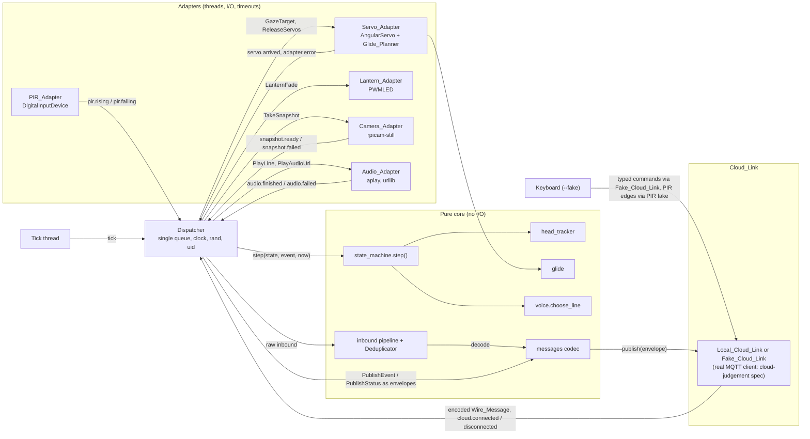
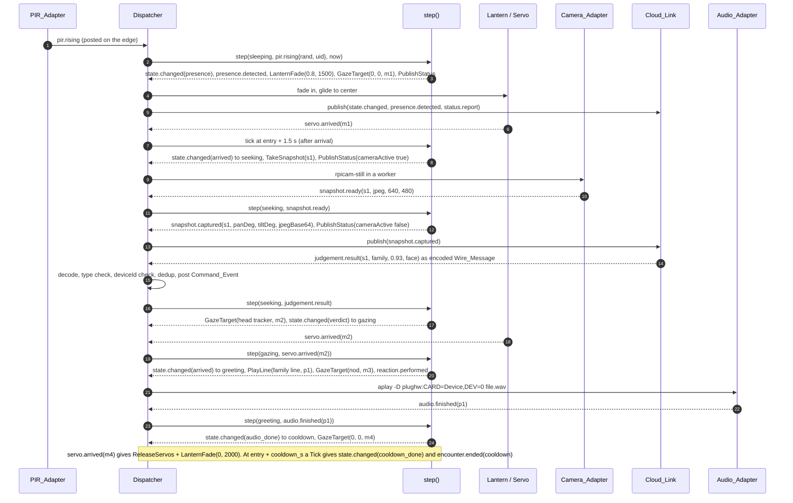
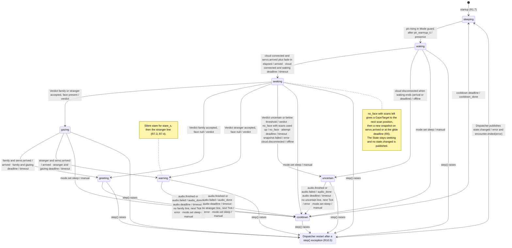

# Design Document: device-core-loop

## Overview

This design implements **warashi-agent**, the Python program in `/device` that runs the doll's
P0 core loop on the Raspberry Pi Zero W: sleep, presence, waking, seeking, gazing, one Reaction,
cooldown and back to sleep. Every encounter ends in a spoken line from the cached Voice_Manifest
and a return to `sleeping`, with or without the cloud.

`requirements.md` in this folder is authoritative. Every section below names the requirement
criteria it implements as `R<n>.<m>` (Requirement n, criterion m). Where the requirements leave a
choice open, the design states the choice and the reason. Where the requirements conflict with
each other or with a library fact found during research, the design says so in
[Risks and Open Questions](#risks-and-open-questions) instead of silently picking one side.

Design goals, in priority order (from the steering files):

1. **Hardware safety.** No angle outside the Calibrated_Range, at most `glide_step_deg` per
   step, at least `glide_interval_ms` between steps, no motion at startup, detach and lantern off
   on every exit (R14, R15, R20.6, hardware.md).
2. **Liveness.** Every State has a deadline, and every Encounter reaches `sleeping` within
   Encounter_Bound (R10).
3. **Privacy.** No family detail reaches a stranger, a log line or a published envelope (R13).
4. **Testability.** All decisions live in pure functions, checked by Hypothesis properties on a
   laptop with `make test` (R1, R29, tech.md).

### Research findings that shape the design

| Topic | Finding | Effect on the design | Source |
|---|---|---|---|
| gpiozero `AngularServo(initial_angle=None)` | `None` starts the servo uncontrolled. The internal `PWMOutputDevice` starts at duty 0 and the servo then sets the frequency to `None`, so the signal line stays low and no pulse is sent. | The Servo_Adapter creates servos with `initial_angle=None` (R15.10). | [gpiozero `output_devices.py` v2.0.1](https://github.com/gpiozero/gpiozero/blob/v2.0.1/gpiozero/output_devices.py) |
| gpiozero lgpio pin factory, PWM duty | `LGPIOPin._set_state` stores the duty cycle as `int(value * 100)`, so duty has 1 % resolution. At 50 Hz one percent is 200 µs. With the R15.3 pulse range (0.5 ms to 2.4 ms over 180°) that is about 19° per duty step. | A 2° glide would move in ~19° jumps on the real servo. The design adds a small pin-factory subclass that passes the duty cycle as a float (see [Servo_Adapter](#servo_adapter-r15)). This is open question Q1. | [gpiozero `pins/lgpio.py` v2.0.1](https://github.com/gpiozero/gpiozero/blob/v2.0.1/gpiozero/pins/lgpio.py) |
| lgpio PWM timing | `tx_pwm` and `tx_servo` are software-timed. The lgpio author recommends software-timed servo pulses only for testing, because jitter makes the servo fidget. | Auto-detach after `servo_settle_ms` (R15.4) limits jitter to the time of a glide. Hardware PWM on GPIO 18 and 13 is listed as a fallback in Q1. | [lgpio Python API](https://abyz.me.uk/lg/py_lgpio.html) |
| gpiozero `MotionSensor` vs `DigitalInputDevice` | `MotionSensor` is a smoothed input (queue and threshold), which is a debounce decision. `DigitalInputDevice` reports raw edges through `when_activated` / `when_deactivated` and fires no callback for the level at creation. | The PIR_Adapter uses `DigitalInputDevice` (R17.3, R17.5). | gpiozero input device docs |
| Raspberry Pi OS on the Pi Zero W | The current Raspberry Pi OS is based on Debian 13 "Trixie", which ships Python 3.13. Its 32-bit image runs on the Pi Zero W. tech.md confirms that the doll runs the system Python 3.13.5. | Keep `requires-python = ">=3.13"` (already in `device/pyproject.toml`) and the stdlib `tomllib`. The Python version is settled (Q4 is closed). | tech.md; [Raspberry Pi documentation](https://www.raspberrypi.com/documentation/usage/) |
| `rsync` on the developer's Mac | macOS ships `openrsync` (protocol 29), which lacks `--mkpath`. | The Deploy_Script creates the remote directory with `--rsync-path="mkdir -p <dir> && rsync"` and uses only options both rsync implementations support. | Local check: `rsync --version` |
| Vertical field of view | `2 × atan(tan(54° / 2) × 3/4) = 41.83°` for the 4:3 image. | Default `camera_vfov_deg = 41.8` (Glossary). | Computed |
| Python JSON | `json.loads` accepts `NaN`, `Infinity` and `1e400` (which becomes `inf`), and deep nesting can raise `RecursionError`. | The Message_Codec rejects non-finite numbers after parsing and maps `RecursionError` to a malformed result (R22.6). | Python `json` docs |
| urllib redirects | `urllib.request.HTTPRedirectHandler` follows redirects to `http` URLs by default. | The Audio_Adapter installs a redirect handler that refuses any non-`https` target (R19.5). | Python `urllib.request` docs |

The AWS IoT Core message size limit is not treated as a fact here. The device keeps the raw
JPEG at or below `jpeg_max_bytes` (90,000) and the `cloud-judgement` spec verifies the broker
limit (R24.1).

## Architecture

### Module layout

The layout follows `.kiro/steering/structure.md`. New modules are marked **new**, each with the
reason it exists.

```
device/
  warashi_agent/
    __main__.py          CLI entry: parses arguments, builds the adapters, runs the Dispatcher or the self-test
    model.py        new  Shared frozen value types (State, Mode, Events, Actions); imported by the pure
                         core, the Dispatcher, the fakes and the tests without import cycles
    state_machine.py     Pure step(state, event, now) -> (state, actions) and the transition table
    glide.py        new  Pure Glide_Planner (R14); shared by the Servo_Adapter, its fake and property P1
    head_tracker.py new  Pure Head_Tracker (R5); a small function with its own property P10
    voice.py        new  Voice_Line type, Manifest_Loader and the line-choice rule (R1.3, R13.1, R26);
                         used by the agent, the self-test and the repository test
    messages.py          Message_Codec: envelope and payload types, type registry, encode / decode (R22)
    inbound.py      new  Pure Deduplicator and the inbound pipeline of R21.8, testable without threads
    config.py            Config_Loader and Config dataclasses (R25)
    redact.py       new  One place for log and print redaction (R13.6, R21.4, R27.3, R27.7)
    timebase.py     new  Clock and Scheduler protocols with real and manual (virtual time) versions,
                         so fakes and Dispatcher tests run without sleeping
    dispatcher.py   new  Main loop: queue, Tick thread, stamping, step(), Action routing, restart,
                         shutdown (R20); kept out of __main__.py so tests can import and pump it
    cli.py          new  Keyboard grammar of --fake mode as a pure parser (R27.2, R27.4)
    selftest.py     new  --selftest sequence (R27.5 to R27.10)
    adapters/
      ports.py      new  typing.Protocol for each adapter, so real adapters and fakes are swappable
      servo.py           Servo_Adapter (R15) and the fine-duty lgpio pin factory (Q1)
      lantern.py         Lantern_Adapter (R16)
      pir.py             PIR_Adapter (R17)
      camera.py          Camera_Adapter and camera probe (R18)
      audio.py           Audio_Adapter, HTTPS download and audio probe (R19)
      cloud.py           Cloud_Link protocol, Local_Cloud_Link (R21)
      fakes.py           Fake devices and fake adapters, Fake_Cloud_Link (R15.9, R16.5, R17.4, R18.7, R19.8, R21.5)
    voice/
      lines.toml         Voice_Manifest (R26); the WAV files next to it are git-ignored
  systemd/
    warashi-agent.service  Systemd_Unit template (R28.1)
  tests/                   pytest + Hypothesis, no hardware (R29)
  config.example.toml      every Config key with its default (R25.12)
scripts/
  deploy_pi.sh             Deploy_Script (R28)
```

No new runtime dependency is added. The device uses the standard library plus gpiozero and
lgpio from `apt` (tech.md). JPEG size parsing, WAV format checks (`wave`), HTTPS downloads
(`urllib`), TOML (`tomllib`) and subprocess timeouts all use the standard library. Pillow and
numpy are not used.

### Component diagram



Rules that the diagram encodes:

- Only the Dispatcher calls `step()`. Adapters never call each other or the State_Machine; they
  post Internal_Events to the Dispatcher queue (R20.2).
- Adapters make no decisions (structure.md). The Servo_Adapter executes Glide_Planner output;
  the Glide_Planner is pure.
- The State_Machine reads no clock, no random source and no file (R1.1). The Dispatcher supplies
  `now`, `rand` and `uid` (R1.5, R20.1).

### Data flow: from PIR edge to spoken line

The sequence below is the connected `family` path with default Config. The offline path is the
same until `waking` ends; then the State_Machine enters `uncertain` and emits the `uncertain`
`PlayLine` in the same `step()` call (R2.6, R9.2).



### State machine

#### State transition diagram

Each edge label is `trigger / reason`, where `reason` is the `state.changed` reason that R24.4
assigns. When one pair of States has several triggers, they share one edge and are separated by
`·`. The dashed node is not a State: it stands for the Dispatcher's restart after a `step()`
exception (R10.5, R10.7), which can happen in any State and always ends in `sleeping` with
reason `error`.



A `step()` exception in `sleeping` restarts the Machine_State in `sleeping` without
`state.changed` (no Encounter is active, R10.5). `conversing` is reserved for P1 and has no edge.

#### Path to sleeping

The table gives, per State, the longest time the State_Machine may stay in that State (R10.1)
and the worst-case route from entering that State to entering `sleeping`, given Ticks at most
`T` apart. Default values use the Glossary defaults: `T = 0.1`, `waking_timeout_s = 3`,
`verdict_timeout_s = 8`, `glide_timeout_s = 3`, `scan_attempts_max = 3`, `stare_s = 2`,
`audio_timeout_s = 12`, `cooldown_s = 20`.

| State | Maximum time in State (R10.1) | Default | Worst-case route to `sleeping` | Worst-case time from entry to `sleeping` (default) |
|---|---|---|---|---|
| `sleeping` | no limit (waits for presence) | — | already there | 0 |
| `cooldown` | `cooldown_s + T` | 20.1 s | `cooldown` → `sleeping` (cooldown deadline) | 20.1 s |
| `uncertain` | `audio_timeout_s + T` | 12.1 s | `uncertain` → `cooldown` (audio deadline) → `sleeping` | 12.1 + 20.1 = 32.2 s |
| `greeting` | `audio_timeout_s + T` | 12.1 s | `greeting` → `cooldown` (audio deadline) → `sleeping` | 12.1 + 20.1 = 32.2 s |
| `warning` | `stare_s + audio_timeout_s + 2T` | 14.2 s | `warning` → stare deadline → stranger line → audio deadline → `cooldown` → `sleeping` | 14.2 + 20.1 = 34.3 s |
| `gazing` | `glide_timeout_s + T` | 3.1 s | `gazing` (deadline, stranger) → `warning` → `cooldown` → `sleeping` | 3.1 + 34.3 = 37.4 s |
| `seeking` | `(scan_attempts_max + 1) × verdict_timeout_s + scan_attempts_max × glide_timeout_s + (2 × scan_attempts_max + 1) × T` | 4 × 8 + 3 × 3 + 7 × 0.1 = 41.7 s | three `no_face` Verdicts, each just before the attempt deadline is observed, three scan moves ending at the glide deadline, then a stranger Verdict with a face just before the last attempt deadline → `gazing` → `warning` → `cooldown` → `sleeping` | 41.7 + 37.4 = 79.1 s |
| `waking` | `waking_timeout_s + T` | 3.1 s | `waking` (deadline) → `seeking` → `gazing` → `warning` → `cooldown` → `sleeping` | 3.1 + 79.1 = **82.2 s** |
| any State, `mode.set` sleep | — | — | that State → `cooldown` (manual) → `sleeping` | at most 20.1 s after the command |
| any State, `step()` raises | — | — | Dispatcher restart → `sleeping` (R10.5) | 0 (same loop iteration) |

An Encounter starts with the `pir.rising` that enters `waking`, so the `waking` row is the
Encounter_Bound. Adding the dwell bounds along the worst route:

```
(waking_timeout_s + T)
+ ((s + 1) × verdict_timeout_s + s × glide_timeout_s + (2s + 1) × T)     seeking, s = scan_attempts_max
+ (glide_timeout_s + T)                                                  gazing
+ (stare_s + audio_timeout_s + 2T)                                       warning
+ (cooldown_s + T)                                                       cooldown
= waking_timeout_s + (s + 1) × (verdict_timeout_s + glide_timeout_s) + stare_s + audio_timeout_s
  + cooldown_s + (2s + 6) × T
= Encounter_Bound L
```

With defaults: `L = 3 + 4 × (8 + 3) + 2 + 12 + 20 + 12 × 0.1 = 3 + 44 + 2 + 12 + 20 + 1.2 = 82.2 s`.

Why each `seeking` attempt can take `verdict_timeout_s + T`: a Verdict that arrives after the
deadline but before the Tick that observes it is still processed (R3.3, R10.3). Each scan move
can take `glide_timeout_s + T` for the same reason. The last attempt either gets a Verdict or
times out, so it has no scan move after it, which gives `s` glide terms and `2s + 1` Tick lags.

The `greeting` and `uncertain` routes are shorter than `warning` because their line starts on
entry. A missing line ends the Reaction state at the next Tick (R7.10), which is shorter still.
The two offline bounds follow from the same table: disconnected at the start, `waking` ends by
`waking_timeout_s + T` = 3.1 s and the `uncertain` line is emitted in that `step()` call
(Offline_Bound_Disconnected). Connected but silent, `waking` takes up to 3.1 s and the first
attempt times out after `verdict_timeout_s + T`, so the line comes by 3 + 8 + 0.2 = 11.2 s
(Offline_Bound_Silent).

## Components and Interfaces

### State_Machine (`state_machine.py`)

```python
def step(ms: MachineState, event: Event, now: float) -> tuple[MachineState, tuple[Action, ...]]:
    """Pure transition function (R1). No clock, no random source, no I/O, no globals."""
```

#### How `step()` stays pure

- `MachineState`, every Event and every Action are frozen dataclasses holding only immutable
  values (tuples, strings, numbers, enums, other frozen dataclasses). `step()` returns a new
  `MachineState` built with `dataclasses.replace`; the argument is never mutated.
- `now`, `rand` and `uid` are inputs. `rand` and `uid` are fields of the Event (R1.5); `now` is
  an argument (R20.1). `state_machine.py` imports neither `time`, `random`, `uuid4` nor
  `os`; a unit test asserts this by inspecting the module's imports.
- One `StepContext` object is created at the start of each call. It collects Actions and hands
  out identifiers. It is local to the call and is discarded at the end, so no mutable state
  escapes.
- Config and the Available_Lines are part of the `MachineState` (Glossary), so the result
  depends only on the arguments (R1.2).

#### Identifier derivation (R1.4)

```python
class StepContext:
    def __init__(self, ms: MachineState, event: Event, now: float) -> None:
        self.ms, self.event, self.now = ms, event, now
        self.actions: list[Action] = []
        self._counts: dict[str, int] = {}

    def new_id(self, kind: Literal["snap", "motion", "play"]) -> str:
        """'<kind>-<n>-<uid>': injective in (kind, n, uid), so different uids and
        two ids of one kind in one call always differ."""
        n = self._counts.get(kind, 0) + 1
        self._counts[kind] = n
        return f"{kind}-{n}-{self.event.uid}"

    def new_encounter_id(self) -> str:
        """At most one Encounter starts per call, so the Event uid (a UUID v4) is used as is.
        That keeps encounterId a UUID on the wire, as in docs/schema.md."""
        return self.event.uid
```

#### Dispatch per (State, Event)

`step()` looks up a handler by the State and the Event class. Handlers for a specific State
come first; global handlers cover Events that behave the same in every State. An Event with no
handler returns the argument unchanged and no Actions (R1.9).

```python
def step(ms, event, now):
    ctx = StepContext(ms, event, now)
    handler = STATE_HANDLERS.get((ms.state, type(event))) or GLOBAL_HANDLERS.get(type(event))
    nxt = handler(ctx) if handler else ms
    return finalize(ctx, ms, nxt)      # camera watch, audio pruning, PublishStatus (R23)
```

The table below is the complete transition table. `—` means the Event changes nothing and emits
nothing (R1.9). "level" means only the PIR level is recorded (R11.3). "conn" means only the
connectivity is recorded (R2.7, R9.7). "err" means only `error.reported` with the Event's code is
emitted. Columns: Sl `sleeping`, Wa `waking`, Se `seeking`, Ga `gazing`, Gr `greeting`, Wn
`warning`, Un `uncertain`, Co `cooldown`.

| Event | Sl | Wa | Se | Ga | Gr | Wn | Un | Co |
|---|---|---|---|---|---|---|---|---|
| `tick` | status only | leave on arrival + fade or deadline (R2.3, R2.4) | attempt deadline → `uncertain` offline (R3.6); scan-move deadline → next attempt (R6.2) | deadline → Reaction (R5.6) | nod deadline → nod return (R7.2); line deadline → `cooldown` (R7.6); missing line → `cooldown` (R7.10) | stare over → stranger line (R7.4); line deadline; missing line | line deadline; missing line | glide deadline → release + fade out (R8.2); cooldown deadline → `sleeping` (R8.3) |
| `pir.rising` | start Encounter if Mode `guard` and warm (R2.1), else level (R11.5, R11.6) | level (R11.1) | level | level | level | level | level | level (R11.2) |
| `pir.falling` | level | level | level | level | level | level | level | level |
| `servo.arrived` | — | waking Motion_Id → arrived flag, leave if fade elapsed (R2.3) | scan Motion_Id → next attempt (R6.2) | gazing Motion_Id → Reaction (R5.6) | nod Motion_Id → nod return (R7.2) | — | — | cooldown Motion_Id → release + fade out (R8.2) |
| `audio.finished` | forget Play_Id | forget | forget | forget | Reaction Play_Id → `cooldown` audio_done (R7.6), else forget | same as Gr | same as Gr | forget |
| `audio.failed` | as `audio.finished`, plus `error.reported` unless code is `interrupted` (R20.9) | same | same | same | same | same | same | same |
| `snapshot.ready` | — (R3.8) | — | Current_Snapshot_Id → `snapshot.captured` (R3.2), else — | — | — | — | — | — |
| `snapshot.failed` | err (R3.9) | err | Current_Snapshot_Id → err + `uncertain` offline, reason error (R3.5), else err | err | err | err | err | err |
| `cloud.connected` | conn | conn | conn | conn | conn | conn | conn | conn |
| `cloud.disconnected` | conn | conn (R2.7) | → `uncertain` offline (R3.7) | conn | conn | conn | conn | conn |
| `adapter.error` | err (R20.9) | err | err | err | err | err | err | err |
| `judgement.result` | — (R3.4) | — | Verdict rule (R3.3, R4, R5, R6) | — | — | — | — | — |
| `speak` | speak rules (R12.4 to R12.6, R12.11, R13.2 to R13.4) in every State | | | | | | | |
| `gaze`, `lantern` | reject (R12.3) | emit Clamped Action (R12.1, R12.2) | emit | emit | emit | emit | emit | reject |
| `mode.set` | set Mode (R12.8) | `sleep` → `cooldown` manual (R12.7); `guard` → set (R12.9) | same as Wa | same | same | same | same | set Mode (R12.8) |

"forget" removes the Play_Id from the unfinished-audio list used by the `audio_busy` rule
(R12.6). It changes no State, Encounter or deadline and emits no Action (R10.6).

#### Entering a State

Every State change goes through one `enter_<state>(ctx, ms, reason, ...)` helper. The helper
emits `state.changed(from, to, reason)` first, then the entry Actions, and sets the State's
deadlines from `ctx.now` (R10.3, R10.4).

| Helper | Entry Actions | Deadlines set |
|---|---|---|
| `enter_waking` | new Encounter; `presence.detected(source="pir")`; `LanternFade(lantern_wake_level, lantern_fade_in_ms)`; `GazeTarget(0, 0, m)` (R2.1, R2.2) | `fade_done_at = now + lantern_fade_in_ms/1000`, `deadline = now + waking_timeout_s` |
| `enter_seeking` | `TakeSnapshot(s)` and the attempt record (R3.1) | attempt `deadline = now + verdict_timeout_s` |
| `enter_gazing` | `GazeTarget(head_tracker(...), m)` (R5.4) | `deadline = now + glide_timeout_s` |
| `enter_greeting` | `PlayLine(family line, p)`, `GazeTarget(pan, tilt − nod_deg, m)` Clamped, `reaction.performed(family, lineId, false)` (R7.1); R7.7 when no line | nod `deadline = now + glide_timeout_s`; line `deadline = now + audio_timeout_s` |
| `enter_warning` | nothing audible (R7.3) | `stare_until = now + stare_s` |
| `enter_uncertain(offline)` | `PlayLine(uncertain line, p)`, `reaction.performed(uncertain, lineId, offline)` (R7.5); R7.7 when no line | line `deadline = now + audio_timeout_s` |
| `enter_cooldown(manual)` | `GazeTarget(0, 0, m)` (R8.1) | glide `deadline = now + glide_timeout_s`; `until = now + cooldown_s` |
| `enter_sleeping` | `encounter.ended(reason)`; `ReleaseServos` and `LanternFade(0, 0)` when R8.4 is unmet; then the Encounter is cleared (R8.3 to R8.5) | none |

The warning line is not an entry Action: the first Tick at or after `stare_until` emits
`PlayLine(stranger line, p)` and `reaction.performed(stranger, lineId, false)` and sets the line
deadline (R7.4). The Reaction flag in the Encounter is set by whichever helper publishes
`reaction.performed`, and every helper checks it first, so an Encounter publishes at most one
`reaction.performed` (R7.8).

In `cooldown`, one Tick can pass both the glide deadline and `until` when Ticks are sparse. The
Tick handler applies the release first and the sleeping check second in the same call, so the
release is always emitted before `sleeping` (R8.2, R8.4).

#### Deadlines and Tick-only checks (R10.3, R10.4)

Deadlines are absolute monotonic times stored in the phase record of the current State (see
[Data Models](#data-models)). They are written only by the entry helpers and by the starts of
a snapshot attempt, a scan move, the stare and a Reaction line. Manual commands, cloud events,
stale feedback and repeated `pir.rising` never touch them.

Only the Tick handlers compare `now` with a deadline. A non-Tick Event whose `now` is past a
deadline follows its own rule. For example, a Verdict that arrives after the attempt deadline
but before the Tick that observes it is processed normally (R3.3).

#### Stale feedback filter (R10.6, R5.8, R3.4, R3.8, R3.9)

Each feedback Event carries the identifier of the Action it answers. A handler acts only when
the identifier equals the one the current phase waits for:

| Event | Waited-for identifier |
|---|---|
| `servo.arrived` | `Waking.motion_id`, `Seeking.scan.motion_id`, `Gazing.motion_id`, `Greeting.nod_motion_id` (until the nod return is emitted), `Cooldown.motion_id` (until released) |
| `audio.finished`, `audio.failed` | `line.play_id` of the Reaction phase; any Play_Id in `MachineState.audio` (forget only) |
| `snapshot.ready`, `snapshot.failed` | `Encounter.attempt.snapshot_id` while in `seeking` |
| `judgement.result` | `Encounter.attempt.snapshot_id`, in `seeking`, no scan move pending, Verdict not yet processed |

Anything else returns the Machine_State unchanged. The only Actions allowed for stale feedback
are the `error.reported` of R3.9 (`snapshot.failed`) and R20.9 (`audio.failed` with a code other
than `interrupted`).

#### Verdict handling (R3.3, R4, R5, R6)

```python
def accept(verdict: Verdict, confidence: float, j: JudgementConfig) -> AcceptedVerdict:
    """R4.1 to R4.5."""
    if verdict is Verdict.FAMILY:
        return AcceptedVerdict.FAMILY if confidence >= j.family_confidence_min else AcceptedVerdict.UNCERTAIN
    if verdict is Verdict.STRANGER:
        return AcceptedVerdict.STRANGER if confidence >= j.stranger_confidence_min else AcceptedVerdict.UNCERTAIN
    return AcceptedVerdict.NO_FACE if verdict is Verdict.NO_FACE else AcceptedVerdict.UNCERTAIN

def on_judgement(ctx: StepContext) -> MachineState:
    ms, ev = ctx.ms, ctx.event
    phase, enc = ms.phase, ms.encounter
    if not isinstance(phase, Seeking) or phase.scan is not None:        # R3.4, R6.6
        return ms
    att = enc.attempt
    if att is None or ev.snapshot_id != att.snapshot_id or att.verdict_processed:
        return ms                                                       # R3.4
    accepted = accept(ev.verdict, ev.confidence, ms.config.judgement)
    enc = enc.with_verdict(accepted)          # keeps family/stranger/uncertain once set (R4.6)
    if accepted in (AcceptedVerdict.FAMILY, AcceptedVerdict.STRANGER):
        if ev.face is not None:
            return enter_gazing(ctx, ms, enc, ev.face, att, reason="verdict")     # R5.4
        enter = enter_greeting if accepted is AcceptedVerdict.FAMILY else enter_warning
        return enter(ctx, ms, enc, reason="verdict")                              # R5.5
    if accepted is AcceptedVerdict.UNCERTAIN:
        return enter_uncertain(ctx, ms, enc, offline=False, reason="verdict")     # R3.3
    if enc.scans_run < ms.config.camera.scan_attempts_max:
        return start_scan_move(ctx, ms, enc)                                       # R6.1
    return enter_uncertain(ctx, ms, enc, offline=False, reason="no_face")         # R6.3
```

`start_scan_move` takes entry `k = scans_run + 1` of `scan_pan_positions_deg` (1-based),
Clamps it, emits `GazeTarget(p, 0, m)`, increments `scans_run` and stores
`ScanMove(motion_id=m, deadline=now + glide_timeout_s)` (R6.1, R6.5). When the move ends
(`servo.arrived` for `m` or the first Tick at or after the deadline), the handler clears the
scan move and starts a new snapshot attempt in the same call (R6.2, R3.1).

#### Manual commands (R12, R13)

`speak` is checked in the order that R12.12 fixes, and the first failing check produces the one
`error.reported` with `refId` = the command `id`:

```python
def on_speak(ctx) -> MachineState:
    ms, cmd = ctx.ms, ctx.event
    situation = situation_category(ms)                    # Glossary: Situation_Category
    if cmd.line_id is not None:
        line = ms.line_by_id(cmd.line_id)
        if line is None:                                  return reject(ctx, "unknown_line")            # R12.5
        if not permitted(line.category, situation):       return reject(ctx, "speak_rejected")          # R13.4
    elif situation is not Category.FAMILY:                return reject(ctx, "speak_rejected")          # R13.3
    if isinstance(ms.phase, WarningPhase) and ms.phase.line is None:
                                                          return reject(ctx, "command_rejected_state")  # R12.11
    if audio_busy(ms, ctx.now):                           return reject(ctx, "audio_busy")              # R12.6
    if cmd.line_id is not None:
        return emit_play_line(ctx, ms, line)              # R12.4, State and deadlines unchanged
    return emit_play_audio_url(ctx, ms, cmd.audio_url)    # R13.2

def permitted(category: Category, situation: Category) -> bool:
    """R13.4: family may hear family and uncertain lines; stranger and uncertain only their own."""
    if situation is Category.FAMILY:
        return category is not Category.STRANGER
    return category is situation

def audio_busy(ms: MachineState, now: float) -> bool:
    """R12.6: an unfinished PlayLine or PlayAudioUrl whose busy window has not ended."""
    return any(now < a.busy_until for a in ms.audio)
```

`gaze` and `lantern` are rejected with `command_rejected_state` in `sleeping` and `cooldown`
(R12.3) and otherwise emit `GazeTarget(clamp(panDeg), clamp(tiltDeg), new Motion_Id)` or
`LanternFade(clamp(level, 0, 1), clamp(fadeMs, 0, 10000))` without touching the State or a
deadline (R12.1, R12.2). A manual `GazeTarget` updates the last emitted Gaze_Target, which a
later greeting nod or snapshot uses (R7.1, R3.1). Rejections emit nothing else and change
nothing else (R12.12).

`mode.set` with `sleep` during an Encounter outside `cooldown` sets the Mode and calls
`enter_cooldown(manual=True)` with reason `manual` (R12.7). In `sleeping`, in `cooldown`, or
when it repeats the current Mode, it only sets the Mode (R12.8). `guard` never starts an
Encounter by itself (R12.9).

#### Line choice (R1.3, R7.7)

```python
def choose_line(lines: tuple[VoiceLine, ...], category: Category, rand: float) -> VoiceLine | None:
    """Available_Lines are kept sorted by id (code-point order). floor(rand * n) is computed
    exactly with fractions.Fraction, because a floating-point rand * n can round up to the
    next integer k when rand lies just below k / n and pick the wrong line. The exact product
    never reaches n because rand < 1; min(..., n - 1) only guards a caller that breaks that."""
    pool = [line for line in lines if line.category is category]
    if not pool:
        return None
    return pool[min(math.floor(Fraction(rand) * len(pool)), len(pool) - 1)]
```

When `choose_line` returns `None`, the entry helper applies R7.7: no `PlayLine`, the other
Actions of the criterion, `reaction.performed` with `lineId: null`, and `error.reported` with
`voice_line_missing`. The phase records `line = ReactionLine(play_id=None, ...)`, and the next
Tick enters `cooldown` with reason `error` (R7.10).

#### `finalize`: status reports and the camera indicator (R1.8, R23)

`finalize(ctx, prev, nxt)` runs after every handler:

1. **Camera indicator (R23.2).** `cameraActive` is `MachineState.camera is not None`. It is set
   by `TakeSnapshot` and cleared when `snapshot.ready` or `snapshot.failed` for the
   Current_Snapshot_Id is handled in `seeking`, or by the first Tick at or after the attempt
   deadline. Because R3.8 and R3.9 forbid any extra Action for a snapshot result that arrives
   outside `seeking`, such a late result does not clear the indicator; the deadline Tick
   clears it, at most `verdict_timeout_s + T` after `TakeSnapshot`. The indicator therefore
   never shows `false` while `rpicam-still` may still run. See Q2.
2. **Audio list.** When the State changed in this call, entries of `MachineState.audio` whose
   busy window has ended are dropped, which keeps the tuple short without touching no-op steps.
3. **Status (R23.1, R23.5, R1.8).** Exactly one `PublishStatus` is appended, as the last
   Action, when the State changed, `cameraActive` changed, this is the first Tick since the
   Start_Time, or this is a Tick with `now ≥ last_status_at + status_interval_s`. Its data is
   built from `nxt`, so it reflects the end of the call. `uptimeSec = floor(now − start_time)`.

### Glide_Planner (`glide.py`, R14)

The Glide_Planner is pure: it takes the start angles, the Gaze_Target, the plan start time and
the Config, and returns an immutable `GlidePlan`. It never reads a clock or touches a pin, so
property P1 can check it over random Action sequences, and the Servo_Adapter and its fake run
the same plan.

```python
@dataclass(frozen=True, kw_only=True)
class GlidePlan:
    motion_id: str
    t0: float                         # plan start (seconds, monotonic)
    start: tuple[float, float]        # (pan, tilt) commanded angles at t0
    pan: tuple[float, ...]            # k-th entry is scheduled at t0 + k * interval_s (k = 1..n_pan)
    tilt: tuple[float, ...]
    interval_s: float

    @property
    def duration_s(self) -> float:    # R14.3
        return max(len(self.pan), len(self.tilt)) * self.interval_s

def plan_glide(start, target, t0, motion_id, cfg: Config) -> GlidePlan | None:
    if not (math.isfinite(target[0]) and math.isfinite(target[1])):
        return None                                       # R14.9: no plan, current plan continues
    goal = clamp_gaze(target, cfg)                        # R14.1
    axes = []
    for a0, g in zip(start, goal):
        d = g - a0
        n = math.ceil(abs(d) / cfg.servo.glide_step_deg)  # R14.2
        steps = tuple(a0 + d * k / n for k in range(1, n))
        axes.append(steps + ((g,) if n else ()))          # last step is exactly the target (R14.4)
    return GlidePlan(motion_id=motion_id, t0=t0, start=start, pan=axes[0], tilt=axes[1],
                     interval_s=cfg.servo.glide_interval_ms / 1000)

def commanded_at(plan: GlidePlan, t: float) -> tuple[float, float]:
    """Last Commanded_Angle per axis scheduled at or before t (R14.5, R29.3)."""
    k = max(0, math.floor((t - plan.t0) / plan.interval_s + 1e-9))
    pan = plan.pan[min(k, len(plan.pan)) - 1] if k and plan.pan else plan.start[0]
    tilt = plan.tilt[min(k, len(plan.tilt)) - 1] if k and plan.tilt else plan.start[1]
    return pan, tilt

def to_servo_angle(axis: Axis, a: float, s: ServoConfig) -> float:
    """R14.7: absolute angle for AngularServo. |offset| + limit <= 90 keeps it inside [-90, 90]."""
    if axis is Axis.PAN:
        return s.pan_center_offset + (-a if s.pan_invert else a)
    return s.tilt_center_offset + (-a if s.tilt_invert else a)
```

Why the limits hold:

- Each step is `|d| / n ≤ glide_step_deg` because `n = ceil(|d| / glide_step_deg)`, and the
  first step starts from the current commanded angle (R14.2).
- Interpolated angles lie between the start and the Clamped goal, and both are inside the
  Calibrated_Range, so every Commanded_Angle is inside it (R14.4).
- Across plans (R14.5), a new plan starts from the last angle written at or before its arrival
  time `t`, and its first angle is scheduled at `t + interval_s`. The gap to the previous
  write is therefore at least `interval_s`, and the step from it is at most `glide_step_deg`.
- Cancellation (R14.6) is a property of the timeline: `ReleaseServos` or a new `GazeTarget`
  drops every angle of the old plan scheduled after the arrival time, and the old Motion_Id
  gets no `servo.arrived`.
- Only positional angles exist in the plan. There is no speed or duration API, so time-based
  rotation cannot be expressed (R14.8).

The pure `GlideTimeline` reducer in `glide.py` applies a sequence of `(t, GazeTarget |
ReleaseServos)` to a list of written `(time, axis, angle)` entries using the rules above. P1
checks that reducer, and the servo fake uses it to compute arrival times.

### Head_Tracker (`head_tracker.py`, R5)

```python
def head_target(face: FaceBox, snap_pan: float, snap_tilt: float, cfg: Config) -> tuple[float, float]:
    left, top, width, height = (clamp(v, 0.0, 1.0) for v in (face.left, face.top, face.width, face.height))  # R5.1
    cx = min(1.0, left + width / 2)
    cy = min(1.0, top + height / 2)
    pan_corr = (cx - 0.5) * cfg.camera.camera_hfov_deg    # face right of center -> positive pan (R5.2)
    tilt_corr = (0.5 - cy) * cfg.camera.camera_vfov_deg   # image y grows downward; face above center -> positive tilt
    return clamp_gaze((snap_pan + pan_corr, snap_tilt + tilt_corr), cfg)                                    # R5.3
```

The camera sits on the tilt plate and looks where the doll looks (hardware.md), so the
correction is added to the head angles recorded with the snapshot (R3.1), not to the current
head angles. The vertical field of view follows from the 4:3 image and the 54° horizontal field
of view on a rectilinear lens: `vfov = 2 × atan(tan(hfov / 2) × 3/4) = 2 × atan(0.5095 × 0.75)
= 2 × 20.91° = 41.83°`, rounded to the default 41.8. A linear mapping of the offset to degrees
is a small-angle approximation; the error is at most a few degrees at the image edge, and the
next snapshot of a later Encounter starts again from the center.

### Dispatcher (`dispatcher.py`, R20)

```python
class Dispatcher:
    def __init__(self, *, config: Config, initial: MachineState, adapters: Adapters,
                 cloud: CloudLink, clock: Clock, rng: random.Random, new_uid: Callable[[], str],
                 log: logging.Logger) -> None: ...
    def post(self, item: Event | InboundRaw) -> None: ...      # thread-safe, used by adapters
    def run(self) -> int: ...                                  # production loop; returns the exit code
    def pump(self, max_items: int | None = None) -> None: ...  # tests: process queued items synchronously
    def request_shutdown(self) -> None: ...                    # signal handlers call only this
```

#### Threads and the single queue

| Thread | Work | Never blocks the loop because |
|---|---|---|
| Main (loop) | Takes one item from the `queue.Queue`, reads `now = clock.monotonic()`, stamps `rand` and `uid`, calls `step()`, routes Actions | Routing only enqueues work for adapters (R20.2) |
| Tick | Posts `Tick` every `tick_interval_ms` with `threading.Event.wait` | It only posts |
| Servo worker | Executes `GlidePlan`s, auto-detaches | Owns the pins; posts `servo.arrived` |
| Lantern worker | Executes fades in steps of at most 20 ms | Owns the PWM pin |
| Camera worker | Runs `rpicam-still` with a deadline of `camera_timeout_s` | `subprocess` with `wait(timeout=...)` and `kill()` |
| Audio worker | Downloads with `download_timeout_s`, plays with `audio_timeout_s` | Same |
| PIR callback | gpiozero / lgpio callback thread posts edges | It only posts |
| Cloud_Link | Implementation-defined; `publish()` never waits on the network (R21.1) | Local link logs; fake records |
| Stdin reader (`--fake`) | Parses keyboard lines and calls the fakes | It only posts |

The loop processes items one at a time in queue order (R20.1). `now` is read when an item is
removed, so it never decreases. `rand` comes from a `random.Random` seeded from `os.urandom`,
and `uid` from `uuid.uuid4()` (R1.5). Adapters post Events with placeholder `rand=0.0, uid=""`;
the Dispatcher replaces both with `dataclasses.replace` before `step()`.

Inbound cloud messages arrive as `InboundRaw(payload: bytes)`. The loop runs the pure
inbound pipeline on them (see [Message_Codec](#message_codec-messagespy-r22)), publishes the
resulting `error.reported` if any, and posts the resulting Command_Event back onto the queue
(R21.8 step 5), so commands and hardware Events share one order.

#### Action routing (R20.2, R20.4, R9.6)

| Action | Destination |
|---|---|
| `GazeTarget`, `ReleaseServos` | `servo.handle(action)` (enqueue) |
| `LanternFade` | `lantern.handle(action)` |
| `TakeSnapshot` | `camera.handle(action)` |
| `PlayLine`, `PlayAudioUrl` | `audio.handle(action)` |
| `PublishEvent` | `cloud.publish(Envelope(v=1, id=uuid4(), ts=utc_now_ms(), deviceId=config.device.id, encounterId=action.encounter_id, type, data))` |
| `PublishStatus` | the same with `encounterId=None` (R20.4) |

Actions are routed in the order `step()` returned them. Publishing happens in both
connectivity states (R9.6). Every Event other than `tick` and every Action is logged as one
line through `redact.py` (R27.7).

#### `step()` exception and restart (R10.5, R10.7)

```python
try:
    nxt, actions = step(ms, event, now)
except Exception:
    log.exception("step() failed; restarting the state machine")   # stack trace, no event payload
    self.servo.handle(ReleaseServos())
    self.lantern.handle(LanternFade(0.0, 0))
    enc_id = ms.encounter.encounter_id if ms.encounter else None
    self._publish(ErrorReported(code="internal_error", message="state machine restarted", ref_id=None), enc_id)
    if ms.encounter is not None:
        self._publish(StateChanged(from_=ms.state, to=State.SLEEPING, reason="error"), enc_id)
        self._publish(EncounterEnded(reason="error"), enc_id)
    ms = initial_state(config=ms.config, lines=ms.lines, agent_version=ms.agent_version,
                       start_time=ms.start_time, mode=ms.mode, cloud_connected=ms.cloud_connected)
    continue
```

The restarted state is the R1.7 initial state with the Start_Time, Mode and connectivity of
the failing call (R10.7). Its PIR level is low, so a person who is still in front of the doll
starts a new Encounter only after the next `pir.rising`.

#### Startup sequence (R20.5, R25.10)

1. Parse arguments. Load the Config. On rejection write the message to stderr and exit with
   code 2. No adapter has been built yet, so no GPIO pin is touched (R25.10).
2. Build the Cloud_Link and start it, so that startup errors can be published.
3. Load the Voice_Manifest (WAV_File_Check on unless `--fake`) and collect its problems.
4. Build the Lantern_Adapter and set the level to 0 (R16.3). Build the Servo_Adapter; it reads
   `pose_file` but creates no servo device (R15.6).
5. Run the camera probe and the audio probe in parallel threads, each bounded by
   `probe_timeout_s`, and collect their problems (R18.5, R19.7).
6. Publish every collected `error.reported` with `encounterId: null`.
7. Build the initial `MachineState` with `start_time = clock.monotonic()` taken immediately
   before the first `queue.get()` (loop entry), start the PIR_Adapter and the Tick thread, and
   enter the loop. No servo has moved.

#### Shutdown sequence (R20.6 to R20.8)

The SIGTERM and SIGINT handlers call only `request_shutdown()`, which sets a flag and posts a
sentinel. Signal handlers run on the main thread between bytecodes, so calling adapter code
from them could re-enter a lock the loop holds. The loop waits on the queue with a 100 ms
timeout and checks the flag after each item, so it reacts within about one `step()` plus
100 ms.

```python
def _safe_stop(self) -> None:
    """Called once, on shutdown request or when an exception escapes the loop. No glide."""
    self._hardware_gate_closed = True        # no further Action reaches servo or lantern
    self.servo.emergency_detach()            # cancel the plan, detach both servos (< 50 ms)
    self.lantern.off_now()                   # cancel the fade, level 0 (< 50 ms)
    self.tick.stop(); self.pir.close()
    self.camera.stop(); self.audio.stop()    # terminate rpicam-still / aplay, then kill after 0.5 s
    self.cloud.stop()
```

Detach and lantern off finish well within 1 s (R20.6). Process termination is bounded by
the 0.5 s kill grace per child and thread joins with timeouts, which keeps the exit within 3 s
(R20.7). After a signal the exit code is 0; after an escaped exception the exception is logged
and the exit code is 1 (R20.8), and systemd restarts the service (R28.1).

### Adapters

All adapters implement a Protocol from `adapters/ports.py`. Each adapter receives `post:
Callable[[Event], None]` and a `Scheduler` (real threads in production, virtual time in tests).
`handle()` only enqueues and never raises; worker exceptions become `adapter.error` with code
`adapter_failed` (R20.10, R20.11).

```python
class ServoPort(Protocol):
    def handle(self, action: GazeTarget | ReleaseServos) -> None: ...
    def emergency_detach(self) -> None: ...

class LanternPort(Protocol):
    def handle(self, action: LanternFade) -> None: ...
    def off_now(self) -> None: ...

class PirPort(Protocol):
    def start(self) -> None: ...
    def close(self) -> None: ...

class CameraPort(Protocol):
    def handle(self, action: TakeSnapshot) -> None: ...
    def probe(self) -> ProbeResult: ...
    def stop(self) -> None: ...

class AudioPort(Protocol):
    def handle(self, action: PlayLine | PlayAudioUrl) -> None: ...
    def probe(self) -> ProbeResult: ...
    def stop(self) -> None: ...
```

A shared `OnceResult` helper in `ports.py` records which identifiers already got a result, so
the camera and audio adapters post exactly one result per Snapshot_Id or Play_Id even when an
interruption and a finishing worker race (R18.8, R19.9).

#### Servo_Adapter (R15)

- **Device creation.** The adapter takes a `ServoDeviceFactory`. The real factory creates
  `AngularServo(pin, initial_angle=None, min_angle=-90, max_angle=90, min_pulse_width=0.0005,
  max_pulse_width=0.0024, pin_factory=FineLGPIOFactory())` (R15.3, R15.10). It is called only
  when the first `GazeTarget` arrives and only while `motion_enabled` is `true` (R15.1, R15.6).
  Importing the module touches no pin.
- **Fine duty cycle (Q1).** `FineLGPIOFactory` subclasses gpiozero's `LGPIOFactory` with a pin
  class whose `_set_state` passes `value * 100` to `lgpio.tx_pwm` as a float instead of
  `int(value * 100)`. That restores sub-percent duty resolution, so a 2° Commanded_Angle is a
  2° pulse change (about 21 µs) instead of a jump at every whole percent (about 19°). The
  subclass is about 15 lines and keeps the `AngularServo` call of R15.3. The self-test glide
  is the on-device check.
- **Execution.** One worker thread holds the current `GlidePlan`. It writes the k-th angle of
  each axis as `servo.angle = to_servo_angle(axis, a, cfg)` no earlier than `t0 + k ×
  interval_s` and no earlier than `glide_interval_ms` after the previous write on that axis
  (R15.3). It waits with `threading.Event.wait(timeout)`, so a cancel wakes it at once.
- **New plan.** On `GazeTarget` the adapter cancels the running plan without posting
  `servo.arrived` for it, takes the last angle actually written per axis, and asks the
  Glide_Planner for a new plan from there (R14.5, R14.6). A non-finite target gives no plan,
  and the old plan continues (R14.9).
- **Completion.** When a plan completes, including an empty plan, the worker posts
  `servo.arrived(motion_id)` and arms a detach timer of `servo_settle_ms` that a new plan
  cancels (R15.4). Detach sets `servo.detach()` on both axes and, while `motion_enabled` is
  `true`, writes the last angles to `pose_file` (R15.7). A failed write is logged and ignored
  (R15.12).
- **Release.** `ReleaseServos` and `emergency_detach()` cancel the plan and detach both servos
  under the adapter lock within 50 ms (R15.5). Worker writes hold the lock only for one
  `angle` assignment.
- **Motion disabled.** While `motion_enabled` is `false`, the worker runs the same schedule
  but logs one line per scheduled time with the intended angles instead of writing, creates no
  device, starts no PWM and leaves `pose_file` alone. It posts `servo.arrived` when the plan's
  duration has elapsed, unless the plan was cancelled (R15.1, R15.2).
- **Pose file (R15.8).** JSON `{"panDeg": number, "tiltDeg": number}` in the Calibrated_Range
  frame. The first plan after startup starts from it, or from `(0, 0)` when the file is
  missing, unreadable, non-finite or outside the Calibrated_Range.
- **Worker failure (R15.11).** An exception in the worker cancels the plan, detaches within
  50 ms and posts `adapter.error(adapter_failed)`.
- **Fake (R15.9).** `FakeServoDeviceFactory` records each device creation, each written angle
  with its scheduler time, each detach and each PWM start, and is injected into the real
  adapter, so the fake tests the adapter's own logic.

#### Lantern_Adapter (R16)

- Real device: `gpiozero.PWMLED(lantern_pin, initial_value=0, frequency=100)` created at
  startup, which sets the level to 0 (R16.3). One whole percent of duty is fine for an LED.
- Fades use the pure function `fade_levels(start, target, fade_ms) -> tuple[(offset_ms,
  level), ...]` in `lantern.py`: steps every 20 ms or less, linear between start and target,
  the last entry exactly `(fade_ms, target)`, and a single `(0, target)` when `fade_ms` is 0.
  Level and `fade_ms` are Clamped first (R16.1). The worker plays the list against the
  scheduler, so the target is reached by `fade_ms` plus at most one 20 ms step.
- A new `LanternFade` cancels the running fade and starts from the level last written (R16.2).
- `off_now()` cancels the fade and writes 0 within 50 ms. The level stays 0 until a later
  `LanternFade` arrives (R16.4); on shutdown none arrives, because the Dispatcher has closed
  its hardware gate.
- Fake (R16.5): `FakePwmDevice` records `(time, level)` for every write.

#### PIR_Adapter (R17)

- Real device: `gpiozero.DigitalInputDevice(pir_pin, pull_up=False, bounce_time=None)`.
  `when_activated` posts `pir.rising`; `when_deactivated` posts `pir.falling` (R17.1, R17.2).
  `pull_up=False` adds a pull-down, which is harmless for the HC-SR501's push-pull output.
- No smoothing, no debounce and no warm-up logic (R17.3); `MotionSensor` is not used because it
  smooths. gpiozero fires callbacks only on changes, so a level that is already high at start
  posts nothing (R17.5).
- Fake (R17.4): `FakePir.rise()` / `FakePir.fall()` post the edges; the `--fake` keyboard uses
  them for `p` and `u`.

#### Camera_Adapter (R18)

```python
def _snapshot(self, action: TakeSnapshot, arrived: float) -> None:
    deadline = arrived + cfg.timing.camera_timeout_s                    # whole operation (R18.1)
    with tempfile.TemporaryDirectory(prefix="warashi-snap-") as tmp:    # deleted afterwards (R18.6)
        for quality in (80, 60, 40):                                    # R18.2
            path = Path(tmp) / f"q{quality}.jpg"
            argv = ["rpicam-still", "-n", "-t", "500", "--width", "640", "--height", "480",
                    "-q", str(quality), "-o", str(path)]
            if not self._run(argv, deadline):                           # non-zero exit or timeout
                return self._fail(action, "camera_failed")              # R18.4
            data = path.read_bytes() if path.exists() else b""
            if not data:
                return self._fail(action, "camera_failed")
            if len(data) <= cfg.camera.jpeg_max_bytes:
                width, height = jpeg_size(data) or (640, 480)           # SOF marker parser, stdlib only
                return self._ready(action, data, width, height)         # R18.3
        return self._fail(action, "snapshot_too_large")                # R18.2
```

- `_run` starts the process with `subprocess.Popen` and waits with `timeout = deadline −
  now`. On timeout it calls `terminate()`, waits 0.5 s, then `kill()` (R18.1).
- `jpeg_size` is a pure parser of the SOF0/SOF2 marker. It returns `None` on malformed input
  and never raises; a property test feeds it random bytes.
- Probe: `rpicam-still --list-cameras` with `probe_timeout_s`. A zero exit code whose output
  has at least one line matching `^\s*\d+\s*:\s*\S` counts as a camera. Otherwise the agent logs
  "Camera not found: check the camera ribbon cable", publishes `camera_missing` and keeps
  running (R18.5).
- `snapshot.ready` carries the bytes inside the process only. They leave the device only as
  `jpegBase64` of `snapshot.captured` and are never logged (R13.6).
- Fake (R18.7): returns a fixed 1×1 JPEG held as a `bytes` constant in `fakes.py` (or a
  scripted `snapshot.failed`) after a scripted delay. The constant lives in the package
  because `--fake` mode runs the fake outside the test suite.

#### Audio_Adapter (R19)

- `PlayLine(line_id, play_id)`: the WAV path is `voice/<wav>` from the manifest entry. A
  missing file gives `audio.failed(audio_failed)`. Otherwise the worker runs `aplay -q -D
  <audio_device> <file>` and waits up to `audio_timeout_s`; non-zero exit or timeout gives
  `audio.failed(audio_failed)`, a zero exit gives `audio.finished` (R19.1 to R19.3).
- Interruption (R19.4): a new request while a playback or download runs stops it (terminate,
  then kill), posts `audio.failed(interrupted)` for the old Play_Id through `OnceResult`, and
  starts the new request.
- `PlayAudioUrl(url, play_id)` (R19.5, R19.6):

  ```python
  class HttpsOnlyRedirect(urllib.request.HTTPRedirectHandler):
      def redirect_request(self, req, fp, code, msg, headers, newurl):
          if urllib.parse.urlsplit(newurl).scheme != "https":
              raise urllib.error.URLError("redirect to a non-https URL")
          return super().redirect_request(req, fp, code, msg, headers, newurl)

  def download(url: str, dest: Path, timeout_s: float, cancel: threading.Event) -> bool:
      if urllib.parse.urlsplit(url).scheme != "https":
          return False
      opener = urllib.request.build_opener(HttpsOnlyRedirect)
      end = time.monotonic() + timeout_s
      with opener.open(url, timeout=min(timeout_s, 2.0)) as resp, dest.open("wb") as out:
          total = 0
          while chunk := resp.read(16384):
              total += len(chunk)
              if total > 2_000_000 or time.monotonic() > end or cancel.is_set():
                  return False
              out.write(chunk)
      return time.monotonic() <= end and is_pcm16_wav(dest)
  ```

  The per-read socket timeout of at most 2 s bounds each blocking read, and the loop checks the
  total deadline. `is_pcm16_wav` opens the file with the stdlib `wave` module and requires
  `getsampwidth() == 2` and `getcomptype() == "NONE"`. On any failure the partial file is
  deleted and `audio.failed(download_failed)` is posted. After playback, failure or
  interruption the downloaded file is deleted. URLs are logged only as `scheme://host/path`
  (R13.6).
- Probe (R19.7): `aplay -L` with `probe_timeout_s`. Lines that start without whitespace are PCM
  names; the probe passes when one equals `audio_device`. Otherwise the agent logs "Audio
  device not found: the USB cable and the power cable may be swapped between the PWR and USB
  ports", publishes `audio_device_missing` and keeps running.
- Fake (R19.8): records each request and posts `audio.finished` after a scripted duration, or
  a scripted `audio.failed`.

### Cloud_Link (`adapters/cloud.py`, R21)

```python
class CloudLink(Protocol):
    def start(self, post: Callable[[InboundRaw | CloudConnected | CloudDisconnected], None]) -> None: ...
    def publish(self, envelope: Envelope) -> None: ...   # never waits on the network, never raises (R21.1)
    def stop(self) -> None: ...
```

- **Local_Cloud_Link** (normal mode, R21.4, R21.6): `publish` encodes the envelope, replaces the
  value of `jpegBase64` with its character count, and logs one JSON line. It delivers no
  command and never posts `cloud.connected`, so the State_Machine stays offline and every
  Encounter ends in an Offline_Reaction.
- **Fake_Cloud_Link** (tests and `--fake`, R21.5): records envelopes in publish order (thread
  safe), delivers scripted encoded commands and scripted connectivity changes at given clock
  times through the Scheduler, and offers `type_command(...)`, `go_online()` and
  `go_offline()` for the keyboard.
- Both wrap `publish` in `try/except Exception` and log the failure instead of raising.
- The real MQTT client, its topics, TLS and reconnect belong to `cloud-judgement`. It will
  implement the same Protocol.

### Message_Codec (`messages.py`, R22)

#### Results

```python
@dataclass(frozen=True)
class Valid:
    message: Envelope

@dataclass(frozen=True)
class Ignored:
    reason: Literal["unsupported_version", "unknown_type"]
    message_id: str | None             # the envelope id when it is a string

@dataclass(frozen=True)
class Malformed:
    message_id: str | None
    problem: str                       # names the rule and the field path, never a value

DecodeResult = Valid | Ignored | Malformed

def encode(envelope: Envelope) -> bytes: ...
def decode(raw: bytes) -> DecodeResult: ...    # never raises (R22.6, R29.6)
```

#### Type registry

One registry maps every wire `type` to its direction (`event`, `command`, `status`), its payload
dataclass and its field specs `(wire_name, attribute, kind, nullable, allowed_values)`. Encode
and decode are generic over the registry, so a type is defined in exactly one place. The
schema test of R24.2 parses the Events, Commands and Status tables of `docs/schema.md` (not the
"Device-internal events" section) and asserts that their `type` sets equal the registry's sets
per direction.

#### Decode order

1. More than 131,072 bytes → `Malformed`. Not UTF-8, not JSON, `RecursionError`, or not an
   object → `Malformed`. `json.loads` is called with `parse_constant` and `parse_float` hooks
   that accept `NaN`, `Infinity`, `-Infinity` and overflowing floats (for example `1e400`) and
   record that one was seen. After parsing, the `id` is read when the top level is an object
   and `id` is a string; then any non-finite number → `Malformed` with that `id` as `refId`
   (null when it is not readable), before the checks of steps 2 to 8.
2. `v` is an `int` (not `bool`) greater than 1 → `Ignored("unsupported_version")` without
   further validation (R22.4).
3. `v` is not an `int` ≥ 1 → `Malformed`.
4. Envelope fields other than `type` and `data`: `id` string, `ts` string that
   `datetime.fromisoformat` parses with a UTC offset (see schema item F1), `deviceId` string,
   `encounterId` string or null. A missing field or a wrong type → `Malformed`.
5. `type` not a string → `Malformed`; a string not in the registry →
   `Ignored("unknown_type")` without validating `data` (R22.5).
6. `data` must be an object. Each defined field is checked for presence, type (a JSON boolean is
   never a number, `int` fields reject floats), nullability and enumerated values. Undefined
   `data` fields are dropped (R13.7). Unknown top-level fields are ignored (F4).
7. `speak` needs exactly one of `lineId` and `audioUrl` non-null (R22.6).
8. Finite numbers outside documented ranges are valid (R22.11); the State_Machine Clamps them.

#### Encode

`json.dumps(obj, ensure_ascii=False, separators=(",", ":"), allow_nan=False)` with the fields in
the order of `docs/schema.md`. `ts` is formatted as `YYYY-MM-DDTHH:MM:SS.mmmZ` from a UTC
datetime (R22.3). `error.reported` always includes `refId` (null when absent) and its `message`
is cut to 200 code points (R22.1, R22.10). Decoding an `error.reported` without `refId` gives
`ref_id=None`.

#### Inbound pipeline and Deduplicator (`inbound.py`, R21.8, R22.7 to R22.9)

```python
@dataclass(frozen=True)
class Deduplicator:
    window: int
    ids: tuple[str, ...] = ()           # oldest first, at most `window` entries (R22.9)

    def seen(self, message_id: str) -> bool:
        return message_id in self.ids

    def accept(self, message_id: str) -> "Deduplicator":
        return replace(self, ids=(self.ids + (message_id,))[-self.window:])

def route_inbound(raw: bytes, dedup: Deduplicator, device_id: str
                  ) -> tuple[Deduplicator, CommandEvent | ErrorToPublish | None]:
    result = decode(raw)                                                    # step 1
    if isinstance(result, Ignored):
        return dedup, ErrorToPublish(result.reason, ref_id=result.message_id)   # R22.4, R22.5
    if isinstance(result, Malformed):
        return dedup, ErrorToPublish("malformed_message", ref_id=result.message_id)  # R12.10
    env = result.message
    if REGISTRY[env.type].direction != "command":                           # step 2
        return dedup, ErrorToPublish("unknown_type", ref_id=env.id)
    if env.device_id != device_id:                                          # step 3 (R22.7)
        return dedup, ErrorToPublish("wrong_device", ref_id=env.id)
    if dedup.seen(env.id):                                                  # step 4 (R22.8), silent
        return dedup, None
    return dedup.accept(env.id), to_command_event(env)                      # step 5
```

`to_command_event` builds the Command_Event with `ref_id = env.id` and the fields the
State_Machine needs. `speak` loses `ja` and `en` at this point: the State_Machine never sees
them, so no Action or log line can carry them (R13.6). A window of at most 4096 ids makes the
tuple copy in `accept` negligible.

### Config_Loader (`config.py`, R25)

```python
def load_config(path: Path, *, fake: bool) -> Config | ConfigRejected: ...

@dataclass(frozen=True)
class Violation:
    key: str                 # "section.key"; several keys for a cross-key rule
    value: str | None        # repr of the value; None for privacy.blocked_words (R25.9)
    allowed: str             # the "Allowed values" text of the Glossary table
```

- The file is read with `tomllib`. A missing file is accepted only with `--fake`, which uses
  the defaults and logs that it did (R25.11). Otherwise missing, unreadable or invalid TOML is
  a violation naming the path and the cause (R25.13).
- Validation is table-driven: one `KeySpec(section, key, kind, default, check, allowed_text)`
  per Glossary row. Passes run in order and collect every violation instead of stopping at the
  first (R25.9): unknown sections and keys outside `[aws]` (R25.8); TOML types, non-finite
  values, empty strings and the `CARD=` rule (R25.14); ranges and pins (R25.2 to R25.6); then
  the cross-key rules of R25.7, each evaluated only when all its keys passed the earlier
  passes, without raising.
- `[aws]` is accepted and kept as an opaque mapping in any form, and may be absent (R21.7).
- On rejection `__main__` writes one message to stderr listing every violation as
  `section.key = value (allowed: ...)` and exits with code 2 before building any adapter
  (R25.9, R25.10).
- The test of R25.12 loads `device/config.example.toml` and asserts no violation and every
  Glossary key present.

### Voice_Manifest and Manifest_Loader (`voice.py`, `voice/lines.toml`, R26, R13.1)

```python
def load_manifest(path: Path, *, blocked_words: tuple[str, ...], wav_check: bool
                  ) -> ManifestResult: ...

@dataclass(frozen=True)
class ManifestResult:
    available: tuple[VoiceLine, ...]       # sorted by id, the Available_Lines
    problems: tuple[ManifestProblem, ...]  # each becomes a log line and an error.reported
```

Rules per line, in order: required fields and string types, `id` pattern and uniqueness (first
wins), `category`, `wav` (ends in `.wav`, no `/` or `\`), `ja` rules, `en` rules, blocked words
(R26.1, R26.3, R26.4, R26.9, R13.1). The `ja` length counts Unicode code points. Latin letters
are `[A-Za-z]` and full-width `Ａ-Ｚ` / `ａ-ｚ`. Blocked words compare `casefold()` of both
strings. A problem names the line `id` (or its 1-based position when the id is unusable) and
the rule, never the matched word or the text (R13.1, R26.5). With the WAV_File_Check on, a line
whose file is missing or not 16-bit PCM mono (`wave` module) is left out of `available` and
reported as `voice_file_missing` (R26.6). A missing or invalid manifest file gives no lines and
one `voice_line_invalid` problem (R26.11).

The proposed manifest keeps the five existing lines and adds six, written per the persona
steering. It has four `family`, four `stranger` and three `uncertain` lines. Every `ja` value
was checked against R26.3: at most 22 code points, at most two sentence-ending marks, no Latin
letters, no emoji. Every `en` value is at most 47 characters.

| id | category | ja | en | ja length | marks |
|---|---|---|---|---|---|
| `greeting_family` (existing) | family | おかえり。きょうも ぶじで よかった。 | Welcome home. I'm glad you're safe today. | 19 | 2 |
| `greeting_family_late` (existing) | family | もう おそいよ。はやく おやすみ。 | It's late. Go to sleep soon. | 17 | 2 |
| `greeting_family_waited` | family | あ、かえってきた。ずっと まってたよ。 | Oh, you're back. I was waiting for you. | 19 | 2 |
| `greeting_family_lantern` | family | あかり、ともしておいたよ。おかえり。 | I kept the lantern lit for you. Welcome home. | 18 | 2 |
| `warning_stranger_first` (existing) | stranger | ……だあれ？ このいえの ひとじゃ ないね。 | ...Who are you? You don't belong to this house. | 22 | 2 |
| `warning_stranger_watching` (existing) | stranger | ……ずっと、みているよ。 | ...I have been watching, all along. | 12 | 1 |
| `warning_stranger_house` | stranger | ……ここは、わたしの いえだよ。 | ...This house is mine. | 16 | 1 |
| `warning_stranger_footsteps` | stranger | ……しらない あしおとが する。 | ...Those are footsteps I do not know. | 16 | 1 |
| `uncertain` (existing) | uncertain | ……だれか、いるの？ | ...Is someone there? | 10 | 1 |
| `uncertain_shadow` | uncertain | ……いま、かげが うごいた？ | ...Did a shadow just move? | 14 | 1 |
| `uncertain_wind` | uncertain | ……かぜの おと、かな。 | ...Was that only the wind? | 12 | 1 |

None of the lines threatens, mentions death or injury, insults anyone, or names a person
(R26.2). The stranger lines stay quiet and watchful. `greeting_family_late` can be chosen at any
hour, because time-of-day choice is out of scope (Q5).

New `lines.toml` format (one entry shown; the file lists all eleven):

```toml
# Cached voice lines for the zashiki-warashi (device-core-loop R26).
# id: [a-z0-9_]+, unique. category: family | stranger | uncertain.
# wav: file name in this directory (16-bit PCM mono WAV, generated by scripts/generate_voice_lines.*,
# git-ignored). ja: at most 40 characters and two sentences, no Latin letters, no emoji.
[[lines]]
id = "greeting_family"
category = "family"
ja = "おかえり。きょうも ぶじで よかった。"
en = "Welcome home. I'm glad you're safe today."
wav = "greeting_family.wav"
```

`.gitignore` gains `device/warashi_agent/voice/*.wav` (R26.8) and `last_pose.json` (R25.12).
`config.toml` is already ignored.

### CLI (`__main__.py`, `cli.py`, `selftest.py`, R27)

| Invocation | Adapters | Cloud_Link | Clock | WAV_File_Check | `pir_warmup_s` |
|---|---|---|---|---|---|
| `python -m warashi_agent [--config PATH]` | real | Local_Cloud_Link | real | on | Config |
| `python -m warashi_agent --fake [--config PATH]` | fakes | Fake_Cloud_Link | real | off | 0 |
| `python -m warashi_agent --selftest` | real | Local_Cloud_Link | real | on | n/a |
| `python -m warashi_agent --fake --selftest` | fakes | Fake_Cloud_Link | real | off | n/a |

Keyboard grammar of `--fake` (R27.2), parsed by the pure `parse_line(text) -> KeyCommand |
HelpRequest | Quit | ParseError`:

```
p | u                                         PIR rising / falling through the PIR fake
family   [<confidence> [<left> <top> <width> <height>]]
stranger [<confidence> [<left> <top> <width> <height>]]
noface | unsure                               verdict no_face / uncertain, confidence 1.0, face null
speak <lineId>                                audioUrl null, ja "" and en ""
gaze <pan> <tilt>
lantern <level> <fadeMs>                      fadeMs must be an integer
mode sleep | mode guard
online | offline                              connectivity of the Fake_Cloud_Link
help | quit
```

Numbers are parsed with `float()` (or `int()` for `fadeMs`), must be finite, and pass through
unclamped. A missing confidence is 1.0; a missing box gives `face: null`. Every verdict uses the
Snapshot_Id of the most recent `TakeSnapshot` Action, which the CLI learns from the Dispatcher's
Action hook; before the first one, the CLI prints "no snapshot is pending" and posts nothing
(R27.4). Each command is encoded as a Wire_Message with a fresh `id`, `deviceId` from Config and
`encounterId: null`, and enters through the Fake_Cloud_Link, so it takes the same inbound
pipeline as a cloud message. Unknown input prints the help text (R27.4). `quit` or end of input
shuts down like SIGINT and exits 0 (R27.11). Every Action and envelope is printed as one line
through `redact.py` (R27.3).

Self-test (R27.5 to R27.10), each step bounded by its timeout:

| Step | PASS | FAIL | SKIP |
|---|---|---|---|
| Lantern: 0 → 0.5 over 1000 ms → 0 over 1000 ms | no exception, no `adapter.error` | exception or `adapter.error` | — |
| Servos: pan to +10° Clamped and back, tilt to +10° Clamped and back, detach | each `servo.arrived` within `glide_timeout_s` | missing arrival, exception, `adapter.error` | `motion_enabled = false`, with the hint to enable it after calibration |
| PIR: count edges for 10 s | always, with the count | exception | — |
| Camera: one snapshot, print the byte size | `snapshot.ready` within `camera_timeout_s` | `snapshot.failed` or no result | — |
| Audio: the first `uncertain` Available_Line by `id` | `audio.finished` | probe failed, `audio.failed`, or no `uncertain` line | — |
| Cloud_Link: publish one `status.report` envelope | `publish` returns | exception | — |

The self-test prints "If the head and lantern did nothing, check the battery rail", detaches
and turns the lantern off within 1 s at the end, on failure and on a signal, and exits 0 when no
step failed, 1 otherwise or when interrupted (R27.6, R27.10).

### Systemd_Unit and Deploy_Script (R28)

`device/systemd/warashi-agent.service`:

```ini
# Template. scripts/deploy_pi.sh replaces @WORKDIR@ and @USER@ when it installs the unit.
[Unit]
Description=Zashiki-Warashi Guardian device agent
After=network-online.target sound.target
Wants=network-online.target

[Service]
Type=simple
User=@USER@
WorkingDirectory=@WORKDIR@
ExecStart=/usr/bin/python3 -m warashi_agent
Environment=PYTHONUNBUFFERED=1
SupplementaryGroups=gpio video audio
Restart=on-failure
RestartSec=5
RestartPreventExitStatus=2
KillSignal=SIGTERM
TimeoutStopSec=5
StandardOutput=journal
StandardError=journal

[Install]
WantedBy=multi-user.target
```

`python3 -m warashi_agent` run from `WorkingDirectory` (the deployed `device` directory) finds
the package in the current directory, so the Pi needs no `pip install`, and `config.toml` and
`last_pose.json` resolve there (R28.1). Exit code 2 (rejected Config) does not restart, which
avoids a restart loop on a typo.

`scripts/deploy_pi.sh` (bash, `set -euo pipefail`), steps in order, each stopping the script
with its name and a non-zero code on failure (R28.6):

1. If `PI_HOST` is empty, print `PI_HOST is not set (example: PI_HOST=<user>@<hostname>.local)`
   and exit 1 before any network call (R28.2). The example is a placeholder, so the script
   holds no real user or host name (R28.7).
2. `PI_DIR="${PI_DIR:-~/warashi/device}"`. A leading `~/` is stripped for rsync, because a
   relative remote path is relative to the login home directory on both rsync and openrsync.
3. **copy**: `rsync -a --rsync-path="mkdir -p '<dir>' && rsync"` with `--exclude` for
   `config.toml`, `.venv`, `__pycache__`, `.pytest_cache`, `.ruff_cache`, `*.egg-info`,
   `last_pose.json`, from `device/` to `$PI_HOST:<dir>/` (R28.3, R28.4). No `--delete`, so
   nothing on the Pi is removed.
4. **user query**: `ssh "$PI_HOST" id -un`. If the answer is `root`, print "the service must not
   run as root", install nothing and exit 1 (R28.5, R28.8). The name must match
   `^[a-z_][a-z0-9_-]*$`.
5. **unit installation**: over ssh, `cd <dir> && pwd` gives the absolute `WorkingDirectory`
   (must match `^/[A-Za-z0-9._/-]+$`); `sed` fills `@WORKDIR@` and `@USER@` from the copied
   template into `sudo tee /etc/systemd/system/warashi-agent.service`; then `sudo systemctl
   daemon-reload` and `sudo systemctl enable warashi-agent`.
6. **restart**: `ssh "$PI_HOST" sudo systemctl restart warashi-agent`.

The script and the unit hold no host name, user name, Wi-Fi detail, certificate or account ID
(R28.7). The `sudo` calls assume the passwordless sudo that Raspberry Pi OS gives its first
user (Q6).

## Data Models

All value types are frozen dataclasses with `kw_only=True` and contain only immutable values.
Collections are tuples. Enums are `StrEnum` (Python 3.11+), so their values are the wire
strings.

### Enums (`model.py`)

```python
class State(StrEnum):
    SLEEPING = "sleeping"
    WAKING = "waking"
    SEEKING = "seeking"
    GAZING = "gazing"
    GREETING = "greeting"
    WARNING = "warning"
    UNCERTAIN = "uncertain"
    COOLDOWN = "cooldown"
    CONVERSING = "conversing"     # defined by docs/schema.md for P1; never entered in this spec

class Mode(StrEnum):
    GUARD = "guard"
    SLEEP = "sleep"

class Category(StrEnum):          # Voice_Line category, Reaction kind, Situation_Category
    FAMILY = "family"
    STRANGER = "stranger"
    UNCERTAIN = "uncertain"

class Verdict(StrEnum):           # judgement.result verdict on the wire
    FAMILY = "family"
    STRANGER = "stranger"
    NO_FACE = "no_face"
    UNCERTAIN = "uncertain"

class AcceptedVerdict(StrEnum):   # after the thresholds of R4
    FAMILY = "family"
    STRANGER = "stranger"
    UNCERTAIN = "uncertain"
    NO_FACE = "no_face"

class Reason(StrEnum):            # state.changed reason (R24.4)
    PRESENCE = "presence"; ARRIVED = "arrived"; VERDICT = "verdict"; NO_FACE = "no_face"
    TIMEOUT = "timeout"; OFFLINE = "offline"; AUDIO_DONE = "audio_done"; MANUAL = "manual"
    COOLDOWN_DONE = "cooldown_done"; ERROR = "error"

class EndReason(StrEnum):         # encounter.ended reason (R24.1)
    COOLDOWN = "cooldown"; MANUAL = "manual"; ERROR = "error"

class Axis(StrEnum):
    PAN = "pan"
    TILT = "tilt"
```

### Events (`model.py`)

```python
@dataclass(frozen=True, kw_only=True)
class EventBase:
    rand: float = 0.0     # replaced by the Dispatcher with a value in [0, 1) (R1.5)
    uid: str = ""         # replaced by the Dispatcher with a fresh UUID v4 (R1.5)

# Internal_Events (never on the wire)
@dataclass(frozen=True, kw_only=True)
class Tick(EventBase): pass
@dataclass(frozen=True, kw_only=True)
class PirRising(EventBase): pass
@dataclass(frozen=True, kw_only=True)
class PirFalling(EventBase): pass
@dataclass(frozen=True, kw_only=True)
class ServoArrived(EventBase):
    motion_id: str
@dataclass(frozen=True, kw_only=True)
class AudioFinished(EventBase):
    play_id: str
@dataclass(frozen=True, kw_only=True)
class AudioFailed(EventBase):
    play_id: str
    code: Literal["audio_failed", "download_failed", "interrupted"]
@dataclass(frozen=True, kw_only=True)
class SnapshotReady(EventBase):
    snapshot_id: str
    jpeg: bytes = field(repr=False)          # never printed (R13.6)
    width: int
    height: int
@dataclass(frozen=True, kw_only=True)
class SnapshotFailed(EventBase):
    snapshot_id: str
    code: Literal["camera_failed", "snapshot_too_large"]
@dataclass(frozen=True, kw_only=True)
class CloudConnected(EventBase): pass
@dataclass(frozen=True, kw_only=True)
class CloudDisconnected(EventBase): pass
@dataclass(frozen=True, kw_only=True)
class AdapterError(EventBase):
    code: str                                # a code of R24.1 only (R20.11)

# Command_Events (built from a decoded command by inbound.route_inbound)
@dataclass(frozen=True, kw_only=True)
class FaceBox:
    left: float; top: float; width: float; height: float
@dataclass(frozen=True, kw_only=True)
class JudgementResult(EventBase):
    ref_id: str                              # the command's envelope id, for error.reported refId
    snapshot_id: str
    verdict: Verdict
    confidence: float
    face: FaceBox | None
@dataclass(frozen=True, kw_only=True)
class Speak(EventBase):
    ref_id: str
    line_id: str | None
    audio_url: str | None                    # ja and en are deliberately not carried (R13.6)
@dataclass(frozen=True, kw_only=True)
class Gaze(EventBase):
    ref_id: str
    pan_deg: float
    tilt_deg: float
@dataclass(frozen=True, kw_only=True)
class Lantern(EventBase):
    ref_id: str
    level: float
    fade_ms: int
@dataclass(frozen=True, kw_only=True)
class ModeSet(EventBase):
    ref_id: str
    mode: Mode

InternalEvent = (Tick | PirRising | PirFalling | ServoArrived | AudioFinished | AudioFailed
                 | SnapshotReady | SnapshotFailed | CloudConnected | CloudDisconnected | AdapterError)
CommandEvent = JudgementResult | Speak | Gaze | Lantern | ModeSet
Event = InternalEvent | CommandEvent
```

### Actions (`model.py`)

```python
@dataclass(frozen=True, kw_only=True)
class LanternFade:
    level: float
    fade_ms: int
@dataclass(frozen=True, kw_only=True)
class GazeTarget:
    pan_deg: float          # Calibrated_Range frame, always Clamped (R5.7)
    tilt_deg: float
    motion_id: str
@dataclass(frozen=True, kw_only=True)
class ReleaseServos: pass
@dataclass(frozen=True, kw_only=True)
class TakeSnapshot:
    snapshot_id: str
@dataclass(frozen=True, kw_only=True)
class PlayLine:
    line_id: str
    play_id: str
@dataclass(frozen=True, kw_only=True)
class PlayAudioUrl:
    url: str = field(repr=False)            # printed only through redact.py (R13.6)
    play_id: str
@dataclass(frozen=True, kw_only=True)
class PublishEvent:
    data: EventData                          # payload dataclass from messages.py; type = data.TYPE
    encounter_id: str | None
    @property
    def type(self) -> str:
        return self.data.TYPE
@dataclass(frozen=True, kw_only=True)
class PublishStatus:
    data: StatusReport

Action = (LanternFade | GazeTarget | ReleaseServos | TakeSnapshot | PlayLine | PlayAudioUrl
          | PublishEvent | PublishStatus)
```

### Machine_State (`state_machine.py`)

The State is not a free field: it is derived from the type of the phase record, so impossible
combinations (for example a scan move outside `seeking`) cannot be represented.

```python
@dataclass(frozen=True, kw_only=True)
class SnapshotAttempt:
    snapshot_id: str                 # the Current_Snapshot_Id
    pan_deg: float                   # last emitted Gaze_Target when TakeSnapshot was emitted (R3.1)
    tilt_deg: float
    deadline: float                  # now + verdict_timeout_s
    verdict_processed: bool = False  # R3.3, R3.4

@dataclass(frozen=True, kw_only=True)
class ScanMove:
    motion_id: str
    deadline: float                  # move start + glide_timeout_s (R6.2)

@dataclass(frozen=True, kw_only=True)
class ReactionLine:
    play_id: str | None              # None: no Available_Line (R7.7, R7.10)
    deadline: float | None           # emit time + audio_timeout_s (R7.6)

@dataclass(frozen=True, kw_only=True)
class Sleeping:
    state: ClassVar[State] = State.SLEEPING
@dataclass(frozen=True, kw_only=True)
class Waking:
    state: ClassVar[State] = State.WAKING
    motion_id: str
    fade_done_at: float              # entry + lantern_fade_in_ms / 1000
    deadline: float                  # entry + waking_timeout_s
    arrived: bool = False            # waking servo.arrived received (R2.3)
@dataclass(frozen=True, kw_only=True)
class Seeking:
    state: ClassVar[State] = State.SEEKING
    scan: ScanMove | None = None     # a pending scan move
@dataclass(frozen=True, kw_only=True)
class Gazing:
    state: ClassVar[State] = State.GAZING
    motion_id: str
    deadline: float
@dataclass(frozen=True, kw_only=True)
class Greeting:
    state: ClassVar[State] = State.GREETING
    pan: float                       # Gaze_Target recorded on entry (R7.1)
    tilt: float
    nod_motion_id: str
    nod_deadline: float
    nod_returned: bool = False
    line: ReactionLine
@dataclass(frozen=True, kw_only=True)
class WarningPhase:                   # not "Warning", which would shadow the builtin
    state: ClassVar[State] = State.WARNING
    stare_until: float               # entry + stare_s (R7.3)
    line: ReactionLine | None = None # set when the stranger line is emitted (R7.4)
@dataclass(frozen=True, kw_only=True)
class Uncertain:
    state: ClassVar[State] = State.UNCERTAIN
    line: ReactionLine
@dataclass(frozen=True, kw_only=True)
class Cooldown:
    state: ClassVar[State] = State.COOLDOWN
    motion_id: str
    glide_deadline: float            # entry + glide_timeout_s (R8.2)
    released: bool = False
    until: float                     # entry + cooldown_s (R8.3)
    manual: bool                     # entered by mode.set sleep (R12.7, R8.3)

Phase = Sleeping | Waking | Seeking | Gazing | Greeting | WarningPhase | Uncertain | Cooldown

@dataclass(frozen=True, kw_only=True)
class Encounter:
    encounter_id: str                # = uid of the starting pir.rising
    accepted: AcceptedVerdict | None = None
    attempt: SnapshotAttempt | None = None
    scans_run: int = 0
    reacted: bool = False            # reaction.performed published (R7.8)

@dataclass(frozen=True, kw_only=True)
class PendingAudio:
    play_id: str
    busy_until: float                # PlayLine: now + audio_timeout_s;
                                     # PlayAudioUrl: now + download_timeout_s + audio_timeout_s (R12.6)

@dataclass(frozen=True, kw_only=True)
class CameraWatch:
    snapshot_id: str
    deadline: float                  # the attempt deadline (R23.2)

@dataclass(frozen=True, kw_only=True)
class MachineState:
    # fixed for the process (kept across a restart, R10.7)
    config: Config
    lines: tuple[VoiceLine, ...]     # Available_Lines sorted by id
    agent_version: str
    start_time: float
    # inputs and mode
    mode: Mode = Mode.GUARD
    cloud_connected: bool = False    # R9.1
    pir_high: bool = False
    # the State
    phase: Phase = Sleeping()
    encounter: Encounter | None = None
    # outputs as last emitted
    gaze: tuple[float, float] = (0.0, 0.0)     # last GazeTarget (R23.4)
    lantern_level: float = 0.0                 # level of the last LanternFade (R23.4)
    servos_released: bool = True               # no GazeTarget since the last ReleaseServos (R8.4)
    audio: tuple[PendingAudio, ...] = ()       # unfinished PlayLine / PlayAudioUrl
    camera: CameraWatch | None = None          # cameraActive (R23.2)
    first_tick_seen: bool = False              # R23.1
    last_status_at: float | None = None        # now of the last PublishStatus

    @property
    def state(self) -> State:
        return self.phase.state

def initial_state(*, config, lines, agent_version, start_time,
                  mode=Mode.GUARD, cloud_connected=False) -> MachineState:
    """R1.7; R10.7 passes the failing state's mode and connectivity."""
```

`agent_version` is read once at startup with `importlib.metadata.version("warashi-agent")`,
falling back to parsing `device/pyproject.toml` with `tomllib` when the package is not installed
(the Pi runs from the source directory), and passed into the state (R23.4).

### Wire messages (`messages.py`)

```python
@dataclass(frozen=True, kw_only=True)
class Envelope:
    v: int                           # always 1 (R24.3)
    id: str
    ts: datetime                     # timezone-aware UTC
    device_id: str                   # wire name deviceId
    encounter_id: str | None         # wire name encounterId
    data: Payload                    # the type is data.TYPE

    @property
    def type(self) -> str:
        return self.data.TYPE

# Events (device -> cloud)
@dataclass(frozen=True, kw_only=True)
class PresenceDetected:
    TYPE: ClassVar[str] = "presence.detected"
    source: Literal["pir", "sound", "manual"]          # this spec emits "pir" only
@dataclass(frozen=True, kw_only=True)
class SnapshotCaptured:
    TYPE: ClassVar[str] = "snapshot.captured"
    snapshot_id: str; width: int; height: int; pan_deg: float; tilt_deg: float
    jpeg_base64: str = field(repr=False)
@dataclass(frozen=True, kw_only=True)
class StateChanged:
    TYPE: ClassVar[str] = "state.changed"
    from_: State                                        # wire name "from"
    to: State
    reason: Reason
@dataclass(frozen=True, kw_only=True)
class ReactionPerformed:
    TYPE: ClassVar[str] = "reaction.performed"
    kind: Category; line_id: str | None; offline: bool
@dataclass(frozen=True, kw_only=True)
class EncounterEnded:
    TYPE: ClassVar[str] = "encounter.ended"
    reason: EndReason
@dataclass(frozen=True, kw_only=True)
class ErrorReported:
    TYPE: ClassVar[str] = "error.reported"
    code: ErrorCode                                     # the R24.1 list
    message: str                                        # at most 200 code points after encode (R22.10)
    ref_id: str | None                                  # always present on the wire (R22.1)

# Commands (cloud -> device)
@dataclass(frozen=True, kw_only=True)
class JudgementResultData:
    TYPE: ClassVar[str] = "judgement.result"
    snapshot_id: str; verdict: Verdict; confidence: float; face: FaceBox | None
@dataclass(frozen=True, kw_only=True)
class SpeakData:
    TYPE: ClassVar[str] = "speak"
    line_id: str | None; audio_url: str | None; ja: str; en: str
@dataclass(frozen=True, kw_only=True)
class GazeData:
    TYPE: ClassVar[str] = "gaze"
    pan_deg: float; tilt_deg: float
@dataclass(frozen=True, kw_only=True)
class LanternData:
    TYPE: ClassVar[str] = "lantern"
    level: float; fade_ms: int
@dataclass(frozen=True, kw_only=True)
class ModeSetData:
    TYPE: ClassVar[str] = "mode.set"
    mode: Mode

# Status (device -> cloud)
@dataclass(frozen=True, kw_only=True)
class StatusReport:
    TYPE: ClassVar[str] = "status.report"
    state: State; mode: Mode; pan_deg: float; tilt_deg: float; lantern: float
    camera_active: bool; mic_active: bool; motion_enabled: bool; uptime_sec: int; agent_version: str
@dataclass(frozen=True, kw_only=True)
class StatusOffline:
    TYPE: ClassVar[str] = "status.offline"              # broker last will; never sent by this spec

EventData = PresenceDetected | SnapshotCaptured | StateChanged | ReactionPerformed | EncounterEnded | ErrorReported
CommandData = JudgementResultData | SpeakData | GazeData | LanternData | ModeSetData
StatusData = StatusReport | StatusOffline
Payload = EventData | CommandData | StatusData
```

### Voice_Line (`voice.py`)

```python
@dataclass(frozen=True, kw_only=True)
class VoiceLine:
    id: str                 # [a-z0-9_]+, unique
    category: Category
    ja: str = field(repr=False)
    en: str = field(repr=False)
    wav: str                # file name in warashi_agent/voice/

@dataclass(frozen=True, kw_only=True)
class ManifestProblem:
    line_ref: str           # the id, or "#<position>" when the id is missing or invalid
    rule: str               # for example "ja longer than 40 characters", "blocked word"
    code: Literal["voice_line_invalid", "voice_file_missing"]
```

### Config (`config.py`)

```python
@dataclass(frozen=True, kw_only=True)
class DeviceConfig:    id: str = "warashi-01"
@dataclass(frozen=True, kw_only=True)
class PinsConfig:      pir_pin: int = 17; pan_pin: int = 18; tilt_pin: int = 13; lantern_pin: int = 23
@dataclass(frozen=True, kw_only=True)
class MotionConfig:    motion_enabled: bool = False
@dataclass(frozen=True, kw_only=True)
class ServoConfig:
    pan_center_offset: float = 0.0; tilt_center_offset: float = 0.0
    pan_limit: float = 30.0; tilt_limit: float = 20.0
    pan_invert: bool = False; tilt_invert: bool = False
    glide_step_deg: float = 2.0; glide_interval_ms: float = 30.0; servo_settle_ms: float = 300.0
    nod_deg: float = 8.0; pose_file: str = "last_pose.json"
@dataclass(frozen=True, kw_only=True)
class LanternConfig:
    lantern_wake_level: float = 0.8; lantern_fade_in_ms: float = 1500.0; lantern_fade_out_ms: float = 2000.0
@dataclass(frozen=True, kw_only=True)
class CameraConfig:
    camera_hfov_deg: float = 54.0; camera_vfov_deg: float = 41.8; jpeg_max_bytes: int = 90000
    scan_pan_positions_deg: tuple[float, ...] = (-15.0, 15.0, 0.0); scan_attempts_max: int = 3
@dataclass(frozen=True, kw_only=True)
class JudgementConfig:
    family_confidence_min: float = 0.80; stranger_confidence_min: float = 0.80
@dataclass(frozen=True, kw_only=True)
class TimingConfig:
    tick_interval_ms: float = 100.0; pir_warmup_s: float = 60.0; waking_timeout_s: float = 3.0
    verdict_timeout_s: float = 8.0; glide_timeout_s: float = 3.0; stare_s: float = 2.0
    audio_timeout_s: float = 12.0; camera_timeout_s: float = 5.0; download_timeout_s: float = 5.0
    probe_timeout_s: float = 5.0; cooldown_s: float = 20.0; status_interval_s: float = 60.0
@dataclass(frozen=True, kw_only=True)
class AudioConfig:     audio_device: str = "plughw:CARD=Device,DEV=0"
@dataclass(frozen=True, kw_only=True)
class MessagesConfig:  dedup_window_size: int = 256
@dataclass(frozen=True, kw_only=True)
class PrivacyConfig:   blocked_words: tuple[str, ...] = field(default=(), repr=False)

@dataclass(frozen=True, kw_only=True)
class Config:
    device: DeviceConfig = DeviceConfig(); pins: PinsConfig = PinsConfig(); motion: MotionConfig = MotionConfig()
    servo: ServoConfig = ServoConfig(); lantern: LanternConfig = LanternConfig(); camera: CameraConfig = CameraConfig()
    judgement: JudgementConfig = JudgementConfig(); timing: TimingConfig = TimingConfig()
    audio: AudioConfig = AudioConfig(); messages: MessagesConfig = MessagesConfig()
    privacy: PrivacyConfig = PrivacyConfig()
    aws: tuple[tuple[str, object], ...] = ()     # opaque, reserved for cloud-judgement (R21.7)

    # Derived values used by the State_Machine, the Config_Loader and the tests (Glossary)
    @property
    def tick_s(self) -> float:            return self.timing.tick_interval_ms / 1000          # T
    @property
    def sweep_time_s(self) -> float:
        s = self.servo
        return math.ceil(2 * max(s.pan_limit, s.tilt_limit) / s.glide_step_deg) * s.glide_interval_ms / 1000
    @property
    def encounter_bound_s(self) -> float:
        t, n = self.timing, self.camera.scan_attempts_max
        return (t.waking_timeout_s + (n + 1) * (t.verdict_timeout_s + t.glide_timeout_s) + t.stare_s
                + t.audio_timeout_s + t.cooldown_s + (2 * n + 6) * self.tick_s)
    @property
    def offline_bound_disconnected_s(self) -> float: return self.timing.waking_timeout_s + self.tick_s
    @property
    def offline_bound_silent_s(self) -> float:
        return self.timing.waking_timeout_s + self.timing.verdict_timeout_s + 2 * self.tick_s
```

With defaults, `sweep_time_s = ceil(60 / 2) × 0.030 = 0.9 s`. The R25.7 rules hold for the
defaults: `waking_timeout_s` 3 ≥ 1.5 and ≥ 0.9; `glide_timeout_s` 3 ≥ 0.9 + 0.2; `cooldown_s` 20
≥ 3 + 2; `camera_timeout_s` 5 < 8.

### New `config.example.toml`

The draft keys `pan_center` and `tilt_center` are renamed to `pan_center_offset` and
`tilt_center_offset` as the Glossary defines. The `[aws]` placeholders become comments,
because this spec does not use them and the `cloud-judgement` spec defines them.

```toml
# Copy to config.toml on the Pi (config.toml is git-ignored). Every key is optional;
# a missing key takes the default shown here. Unknown keys outside [aws] are rejected.

[device]
id = "warashi-01"                 # deviceId in every envelope: 1-64 chars of a-z, 0-9, -

[pins]                            # BCM numbers 2-27, all different
pir_pin = 17
pan_pin = 18
tilt_pin = 13
lantern_pin = 23

[motion]
# Servo actions are only logged while this is false. Turn it on only after the servos are
# verified as 180-degree positional servos and calibrated on the real doll.
motion_enabled = false

[servo]
pan_center_offset = 0             # calibrated center (degrees); abs(offset) + limit <= 90
tilt_center_offset = 0
pan_limit = 30                    # travel from center: 0 < pan_limit <= 60
tilt_limit = 20                   # 0 < tilt_limit <= 30 (camera ribbon and leads run through the neck)
pan_invert = false
tilt_invert = false
glide_step_deg = 2                # largest step between commanded angles: 0 < value <= 2
glide_interval_ms = 30            # smallest time between steps: 30-1000
servo_settle_ms = 300             # detach this long after a glide: 0 < value <= 2000
nod_deg = 8                       # greeting nod depth: 0 < value <= tilt_limit
pose_file = "last_pose.json"      # last commanded angles, kept across restarts (git-ignored)

[lantern]
lantern_wake_level = 0.8          # 0 < value <= 1
lantern_fade_in_ms = 1500         # 0 < value <= 10000
lantern_fade_out_ms = 2000        # 0 < value <= 10000

[camera]
camera_hfov_deg = 54              # 0 < value <= 180
camera_vfov_deg = 41.8            # 2 * atan(tan(54 deg / 2) * 3/4) for the 4:3 image
jpeg_max_bytes = 90000            # 10000-90000
scan_pan_positions_deg = [-15, 15, 0]
scan_attempts_max = 3             # 0 <= value <= length of scan_pan_positions_deg

[judgement]
family_confidence_min = 0.80      # 0 < value <= 1
stranger_confidence_min = 0.80

[timing]
tick_interval_ms = 100            # 10-1000
pir_warmup_s = 60                 # 0-120
waking_timeout_s = 3
verdict_timeout_s = 8
glide_timeout_s = 3
stare_s = 2
audio_timeout_s = 12
camera_timeout_s = 5              # must be < verdict_timeout_s
download_timeout_s = 5
probe_timeout_s = 5
cooldown_s = 20                   # must be >= glide_timeout_s + lantern_fade_out_ms / 1000
status_interval_s = 60

[audio]
audio_device = "plughw:CARD=Device,DEV=0"   # select the card by name (CARD=...), not by number

[messages]
dedup_window_size = 256           # 16-4096

[privacy]
blocked_words = []                # words no voice line may contain; list family names on the Pi only

# [aws]
# Reserved for the cloud-judgement spec. Placeholders only; real values stay on the Pi.
```

## docs/schema.md Changes

**Contract first.** `docs/schema.md` is edited before `messages.py` changes (R24.1, tech.md).
The first implementation task applies every row below to `docs/schema.md`, with its reason
written next to the change in that document. `v` stays 1, because no version has been
deployed (R24.3). A test parses the Events, Commands and Status tables of `docs/schema.md`,
skips the "Device-internal events (not on the wire)" section, and compares the `type` sets per
direction with the codec registry (R24.2). A second test checks that every code in the
`error.reported` code list of `docs/schema.md` equals `ErrorCode` in `messages.py`, and the
same for the `state.changed` reasons.

### Changes required by R24.1

| # | Change to `docs/schema.md` | Reason (from R24.1) | Device code that depends on it |
|---|---|---|---|
| S1 | Add `"reason": string` to `state.changed`, values `presence`, `arrived`, `verdict`, `no_face`, `timeout`, `offline`, `audio_done`, `manual`, `cooldown_done`, `error`, assigned by the mapping below | The timeline can show why a transition happened, including timeouts. | `Reason` enum, `StateChanged`, every `enter_*` helper, Dispatcher restart |
| S2 | `encounter.ended.reason`: replace `timeout` with `error`; keep `cooldown` and `manual` | Every encounter ends through cooldown. Timeouts are visible in `state.changed`; `error` marks a reset after an internal error. | `EndReason`, `enter_sleeping`, Dispatcher restart |
| S3 | Add `"refId": string \| null` to `error.reported`, always present, null when no incoming message caused the error; list the codes below; `message` at most 200 characters, truncated by the sender | Receivers can link an error to the message that caused it and handle codes without parsing text. | `ErrorReported`, `ErrorCode`, encode truncation, `reject()` in `step()`, `route_inbound` |
| S4 | Add `"mode": "guard" \| "sleep"` to `status.report`; state that it is sent on each state change, on each change of `cameraActive`, on the first Tick after start and every `status_interval_s` (default 60 s); `status.report` envelopes always carry `encounterId: null` | The dashboard shows when the doll ignores presence, the camera indicator stays current, and status stays independent of encounters. | `StatusReport`, `finalize()`, Dispatcher envelope builder |
| S5 | State that `micActive` is false while no feature records audio | Makes the privacy indicator exact for this spec. | `finalize()` sets `mic_active=False` |
| S6 | `speak.audioUrl`: `https` only, a 16-bit PCM WAV of at most 2,000,000 bytes, played only when the encounter's accepted verdict is `family`; both or neither of `lineId` and `audioUrl` is malformed | Bounds download size and makes the privacy rule enforceable on the device. | Codec `speak` rule, `on_speak`, Audio_Adapter download |
| S7 | `lantern.fadeMs` clamped to 0..10000, `lantern.level` to 0..1, `judgement.result` face box fields to 0..1; `gaze` angles must be finite and are clamped; finite numbers outside these ranges are not malformed | Defines device behaviour for out-of-range values. | Codec range tolerance, Clamps in `step()` and `head_tracker` |
| S8 | Commands may carry `encounterId: null`; the device matches `judgement.result` by `snapshotId` only | The cloud cannot always know the current encounter. | Codec nullability, `on_judgement` |
| S9 | The device drops a duplicate `id` within the last `dedup_window_size` (default 256) accepted ids and ignores undefined `data` fields | Makes duplicate handling bounded and keeps extra fields (such as names) out of the device. | `Deduplicator`, codec field filtering |
| S10 | Maximum incoming message size 131,072 bytes; a `v` that is not an integer ≥ 1 is malformed; keep the raw JPEG limit of 90,000 bytes (the cloud spec verifies the IoT Core limit) | Gives the decoder a safe input bound. | Codec decode steps 1 to 3, `jpeg_max_bytes` |
| S11 | New section "Device-internal events (not on the wire)": `tick`, `pir.rising`, `pir.falling`, `servo.arrived`, `audio.finished`, `audio.failed`, `snapshot.ready`, `snapshot.failed`, `cloud.connected`, `cloud.disconnected`, `adapter.error` | Prevents the cloud and the dashboard from expecting these on MQTT. | `model.py` Internal_Events; the R24.2 test skips this section |
| S12 | The device emits `presence.detected` with `source: "pir"` only in this spec | `sound` (P2) and `manual` are reserved. | `enter_waking` |

#### `state.changed` reason mapping (R24.4)

The first row whose transition and cause both match gives the reason.

| From → To | Cause | `reason` |
|---|---|---|
| `sleeping` → `waking` | `pir.rising` (R2.1) | `presence` |
| any State other than `sleeping` → `sleeping` | restart after a `step()` exception, published by the Dispatcher (R10.5) | `error` |
| `cooldown` → `sleeping` | cooldown deadline (R8.3) | `cooldown_done` |
| `waking`, `seeking`, `gazing`, `greeting`, `warning` or `uncertain` → `cooldown` | `mode.set` with `mode: "sleep"` (R12.7) | `manual` |
| `waking` → `uncertain` | cloud disconnected when leaving `waking`, whatever the leaving cause (R2.6) | `offline` |
| `waking` → `seeking` | `servo.arrived` and fade elapsed (R2.3) | `arrived` |
| `waking` → `seeking` | waking deadline (R2.4) | `timeout` |
| `seeking` → `uncertain` | `cloud.disconnected` (R3.7) | `offline` |
| `seeking` → `uncertain` | `snapshot.failed` (R3.5) | `error` |
| `seeking` → `uncertain` | attempt deadline (R3.6) | `timeout` |
| `seeking` → `uncertain` | scan attempts used up with `no_face` (R6.3) | `no_face` |
| `seeking` → `gazing`, `greeting`, `warning` or `uncertain` | Verdict (R3.3, R5.4, R5.5) | `verdict` |
| `gazing` → `greeting` or `warning` | `servo.arrived` (R5.6) | `arrived` |
| `gazing` → `greeting` or `warning` | gazing deadline (R5.6) | `timeout` |
| `greeting`, `warning` or `uncertain` → `cooldown` | no Available_Line (R7.7, R7.10) | `error` |
| `greeting`, `warning` or `uncertain` → `cooldown` | `audio.finished` or `audio.failed` (R7.6) | `audio_done` |
| `greeting`, `warning` or `uncertain` → `cooldown` | audio deadline (R7.6) | `timeout` |

#### `error.reported` codes (R24.1, R24.5)

| Code | Emitted by | When | `refId` |
|---|---|---|---|
| `unknown_type` | Dispatcher (inbound) | undefined `type`, or an event or status type received as a command (R22.5, R21.8) | message `id` |
| `unsupported_version` | Dispatcher (inbound) | `v` > 1 (R22.4) | message `id` if a string, else null |
| `malformed_message` | Dispatcher (inbound) | any R22.6 rule (R12.10) | message `id` if readable, else null |
| `wrong_device` | Dispatcher (inbound) | `deviceId` differs from Config `id` (R22.7) | message `id` |
| `speak_rejected` | `step()` | `audioUrl` outside `family`, or a line Category not permitted (R13.3, R13.4) | command `id` |
| `audio_busy` | `step()` | `speak` while earlier audio is unfinished (R12.6) | command `id` |
| `command_rejected_state` | `step()` | `gaze` / `lantern` in `sleeping` or `cooldown`; `speak` during the stare (R12.3, R12.11) | command `id` |
| `unknown_line` | `step()` | `speak.lineId` is not an Available_Line (R12.5) | command `id` |
| `voice_line_missing` | `step()` | no Available_Line of the Reaction's Category (R7.7) | null |
| `voice_line_invalid` | Manifest_Loader (startup) | a rejected line, or a missing or invalid manifest (R26.5, R26.11, R13.1) | null |
| `voice_file_missing` | Manifest_Loader (startup) | WAV file missing or not 16-bit PCM mono (R26.6) | null |
| `audio_failed` | `step()` from `audio.failed` | playback failed, timed out or file missing (R19.3, R20.9) | null |
| `download_failed` | `step()` from `audio.failed` | `audioUrl` download or format failure (R19.6, R20.9) | null |
| `audio_device_missing` | startup probe | `aplay -L` failed or lists no `audio_device` (R19.7) | null |
| `camera_missing` | startup probe | `rpicam-still --list-cameras` failed or found nothing (R18.5) | null |
| `camera_failed` | `step()` from `snapshot.failed` | capture failed or timed out (R18.4, R3.5, R3.9) | null |
| `snapshot_too_large` | `step()` from `snapshot.failed` | quality 40 still above `jpeg_max_bytes` (R18.2) | null |
| `internal_error` | Dispatcher | `step()` raised (R10.5) | null |
| `adapter_failed` | `step()` from `adapter.error` | an adapter worker raised (R15.11, R20.10) | null |

### Further changes found during design (each needs a requirements update)

These are not applied silently. Each is flagged **needs a requirements update** and waits for
the owner's decision. Until then the device implements the behaviour in the third column,
which stays inside the current requirements.

| # | Proposed change | Reason | Behaviour until decided |
|---|---|---|---|
| F1 | State that a receiver treats a `ts` that is not an ISO 8601 timestamp with a UTC offset as malformed. **Needs a requirements update** (R22.6, R24.1). | R22.6 lists "a field of the wrong type" but does not say whether `ts` is just a string or a timestamp. The round trip of R22.2 needs `ts` as a timestamp. | The codec reads `ts` as a timestamp and treats an unparseable or offset-less value as the wrong type, which is malformed. |
| F2 | State that `cameraActive` stays true until the snapshot result is handled in `seeking` or until the attempt deadline, whichever comes first. **Needs a requirements update** (R3.8, R3.9, R23.1, R23.2). | R3.8 and R3.9 forbid any Action for a snapshot result that arrives outside `seeking`, while R23.1 requires a `PublishStatus` whenever `cameraActive` changes. Both cannot hold for a late result. | The indicator stays true until the deadline Tick (Q2). It may over-report "camera active" for at most `verdict_timeout_s + T`, and never under-reports. |
| F3 | State that `status.report.lantern` is the target level of the last lantern command, not the instantaneous brightness during a fade. **Needs a requirements update** (R24.1 table). | R23.4 defines it this way; the dashboard should not expect intermediate values. | As R23.4. |
| F4 | State that receivers ignore undefined top-level envelope fields. **Needs a requirements update** (R13.7 covers only `data`). | Keeps old devices tolerant of a new optional envelope field without bumping `v`. | The codec ignores and drops unknown top-level fields; they never reach the State_Machine or a log line. |

### What the other specs must pick up

`cloud-judgement` (cloud backend):

- Store and expose `state.changed.reason`, `encounter.ended.reason = error`, `error.reported`
  with `refId` and the code list, and `status.report.mode`. Do not expect `encounter.ended`
  with `timeout`.
- Send `judgement.result` with the `snapshotId` of the `snapshot.captured` it answers, and the
  raw `confidence`; the device applies `family_confidence_min` and `stranger_confidence_min`.
  Commands may use `encounterId: null`.
- Give every command a fresh `id` (the device drops repeats within its window) and the target
  `deviceId`. Keep commands at or below 131,072 bytes. Send `speak` with exactly one of
  `lineId` and `audioUrl`; an `audioUrl` must be `https`, point to a 16-bit PCM WAV of at most
  2,000,000 bytes, and be sent only after a `family` verdict, or the device rejects it.
- Verify the IoT Core message size limit against a `snapshot.captured` of 90,000 raw JPEG
  bytes (120,000 Base64 characters plus the envelope).
- Implement the real Cloud_Link against the `CloudLink` Protocol (`publish` never blocks or
  raises; deliver encoded messages; post connectivity changes).
- Never send names in any field: the device discards undefined fields, but defined fields such
  as `speak.ja` must also follow the privacy rule of `docs/schema.md`.

`dashboard-simulation`:

- The reducer handles `reason` on every transition, `mode` and `cameraActive` in status, and
  `encounter.ended` with `error`; it shows `micActive` false.
- The virtual doll mirrors the device: the same State names and edges as the diagram above, the
  same default timings and limits, a silent stare before the stranger line, and an `uncertain`
  Reaction with `offline: true` when the simulated cloud is unreachable.
- Device-internal events never appear in scenario streams on the wire.

## Correctness Properties

*A property is a characteristic or behavior that should hold true across all valid executions of a system-essentially, a formal statement about what the system should do. Properties serve as the bridge between human-readable specifications and machine-verifiable correctness guarantees.*

Properties P1 to P15 implement R29.3 to R29.15. P1 to P5 are the owner's five, in the owner's
order. P16 to P23 are **additional** properties that this design needs to check its own
choices (for example the reason mapping and the Glide_Planner timing). Every property is a
**required** task (R29.1), none is optional.

Rules shared by all properties (R29.2):

- Hypothesis only, at least 100 examples per property (the `dev` profile in
  `device/tests/conftest.py` sets 100, the `ci` profile 500; no test lowers `max_examples`).
- Every test lives in `device/tests`, runs under `make test` and needs no hardware, network or
  AWS account. pytest-timeout bounds each test (30 s by default in `pyproject.toml`; the
  harness-based tests set an explicit, larger `@pytest.mark.timeout` sized for the `ci`
  profile, and `deadline=None`).
- Angles (degrees) and times (seconds) are compared with a tolerance of `1e-9`.
- Each test carries the tag comment
  `# Feature: device-core-loop, Property <n>: <title>`.

### Shared generators and harness

Two test helper modules keep the strategies in one place:

- **`tests/strategies.py`**
  - `valid_configs()` builds a Config that passes every rule of R25 by construction. It draws
    `pan_limit` in (0, 60], `tilt_limit` in (0, 30], center offsets with `|offset| + limit ≤
    90`, `glide_step_deg` in (0, 2], `glide_interval_ms` in [30, 1000], `nod_deg` in (0,
    tilt_limit], and `scan_attempts_max` in [0, len(`scan_pan_positions_deg`)]. It computes
    Sweep_Time and `T` first and then draws `waking_timeout_s`, `glide_timeout_s`,
    `cooldown_s` and `camera_timeout_s` so that every R25.7 rule holds. Timing values are capped
    (each timeout ≤ 30 s, `tick_interval_ms` ≥ 50) so that one Encounter needs at most about
    3,000 Ticks. The caps are a test budget, not a validity rule. A `defaults` example is always
    included through `@example`.
  - `line_sets()` draws Available_Lines with distinct ids, zero to four lines per Category,
    sorted by id. Strategies that need a line in a Category filter on it.
  - `rands()` draws floats in [0, 1) and always includes `0.0` and `math.nextafter(1.0, 0.0)`.
  - Every `uid` comes from a per-example counter formatted as `str(uuid.UUID(int=k,
    version=4))`, so uids are pairwise distinct by construction.
- **`tests/harness.py`**: `run_reactive(data, cfg, lines, *, tick_gap_max, budget)` drives
  `step()` with `st.data()` and returns a trace of `(now, event, before, after, actions)`. At
  each point it draws one of the following:
  - a Tick after a gap;
  - feedback that answers a pending Action (`servo.arrived` for an emitted Motion_Id,
    `audio.finished` or `audio.failed` for an emitted Play_Id, `snapshot.ready` or
    `snapshot.failed` for an emitted Snapshot_Id);
  - stale feedback with an old or random id;
  - a PIR edge;
  - a connectivity change;
  - a Command_Event: `judgement.result` for the Current_Snapshot_Id or for a random id, with
    any verdict, any finite confidence and an optional face box; `speak`; `gaze` and
    `lantern` with any finite numbers; `mode.set`.

  `now` never decreases. When `tick_gap_max` is set, the harness forces a Tick before any
  Event whose `now` would exceed the last Tick + `tick_gap_max`. After the drawn part it
  appends a silent tail of Ticks `T` apart that lasts until every started Encounter has been
  given Encounter_Bound + `T`. The harness asserts that every input is a defined Event and every
  output a defined Action (R1.6).

### Property 1: Servo safety

For all valid Configs and all Event sequences, every `GazeTarget` emitted by `step()` satisfies
`|pan_deg| ≤ pan_limit` and `|tilt_deg| ≤ tilt_limit`. For all valid Configs, all start angles
inside the Calibrated_Range, and all sequences of Gaze_Targets (finite or not) and
`ReleaseServos` applied to the Glide_Planner's `GlideTimeline` at non-decreasing times, the
following hold:

1. A plan that arrives at time `t` starts from the last Commanded_Angle per axis scheduled at
   or before `t`.
2. The plan schedules its k-th Commanded_Angle of both axes at `t + k × glide_interval_ms /
   1000`.
3. `ReleaseServos`, or a later finite Gaze_Target, removes every Commanded_Angle of the running
   plan that is scheduled after its arrival.
4. Per axis, merged across plans, every written Commanded_Angle lies inside the
   Calibrated_Range, consecutive angles differ by at most `glide_step_deg`, and they are at
   least `glide_interval_ms / 1000` apart.
5. Every plan that is not cut short ends exactly at its Clamped target.
6. `to_servo_angle` of every Commanded_Angle lies in [-90, 90].
7. A non-finite target creates no plan.

- Module under test: `state_machine.py` (the `GazeTarget` clause) and `glide.py` (`plan_glide`,
  `commanded_at`, `GlideTimeline`, `to_servo_angle`).
- Generators: `valid_configs()`. For the `step()` clause, `run_reactive` with `gaze` commands
  whose angles are any finite floats, including ±1e300. For the timeline clause: start angles
  uniform in the Calibrated_Range; targets drawn from in-range floats, out-of-range floats,
  `nan` and `±inf`; gaps drawn from [0, 3 × Sweep_Time], including 0 and exact multiples of
  `glide_interval_ms / 1000`, which hit the "at or before `t`" boundary.
- Test file: `tests/test_prop_servo_safety.py`.

**Validates: Requirements 5.7, 6.1, 7.1, 7.2, 12.1, 14.1, 14.2, 14.3, 14.4, 14.5, 14.6, 14.7, 14.8, 14.9, 29.3**

### Property 2: Liveness

For all valid Configs and all Event sequences in which no interval longer than `T` passes
without a Tick after the `pir.rising` that starts an Encounter (any other Events interleaved,
followed by silence, meaning only Ticks at most `T` apart), every Encounter satisfies:

- it stays in each State no longer than the bound of R10.1 for that State;
- it enters `sleeping` no later than Encounter_Bound (`cfg.encounter_bound_s`, 82.2 s with
  defaults) after its starting `pir.rising`;
- at its entry into `sleeping`, its Actions contain at least one `ReleaseServos`, no
  `GazeTarget` follows the last `ReleaseServos`, and the last `LanternFade` has level 0;
- it emits at most `scan_attempts_max` scan `GazeTarget`s, at the positions of
  `scan_pan_positions_deg` in order (R6.5).

- Module under test: `state_machine.py`.
- Generators: `valid_configs()`, `line_sets()` (empty Categories included, which exercises
  R7.7 and R7.10), `run_reactive(..., tick_gap_max=T)`. Generated `judgement.result` values
  are biased toward Verdicts that arrive just before the attempt deadline, so the worst-case
  `seeking` route of the [Path to sleeping](#path-to-sleeping) table is reached.
- Test file: `tests/test_prop_liveness.py`.

**Validates: Requirements 2.4, 3.6, 5.6, 6.5, 7.6, 7.10, 8.1, 8.2, 8.3, 8.4, 10.1, 10.2, 29.4**

### Property 3: Stranger-warning safety

For all valid Configs, all Available_Line sets and all Event sequences, including
`judgement.result` with any verdict and confidence and `speak` commands with any `lineId`,
the following hold:

- No Encounter whose Accepted_Verdict is `family` (a Verdict `family` with `confidence ≥
  family_confidence_min`) contains a `PlayLine` of a `stranger` Voice_Line, whether from a
  Reaction or from a `speak` command, or a `reaction.performed` with `kind: "stranger"`.
- Every `reaction.performed` with `kind: "family"` or `kind: "stranger"` follows, in the same
  Encounter, a Verdict of that kind with `confidence` at or above `family_confidence_min` or
  `stranger_confidence_min` respectively.
- Every Encounter contains at most one `reaction.performed`.
- While the State is `warning` and `now` is before entry + `stare_s`, no `PlayLine` and no
  `reaction.performed` is emitted (R7.3).

- Module under test: `state_machine.py`.
- Generators: `valid_configs()` with thresholds drawn in (0, 1]; `line_sets()` with at least
  one line per Category; `run_reactive` with confidences concentrated around the two
  thresholds (`threshold ± 1e-12`, the exact threshold, 0, 1), and `speak` `lineId`s drawn
  mostly from `stranger` lines.
- Test file: `tests/test_prop_stranger_safety.py`.

**Validates: Requirements 4.1, 4.2, 4.3, 4.4, 4.6, 7.3, 7.8, 7.9, 13.4, 13.5, 29.5**

### Property 4: Schema round trip and robustness

- **Round trip.** For all valid Wire_Messages `m` of every registered type whose `ts` has
  millisecond precision, `decode(encode(m))` returns `Valid(m)`, and the encoded `ts` matches
  `^\d{4}-\d{2}-\d{2}T\d{2}:\d{2}:\d{2}\.\d{3}Z$`.
- **No raise.** For all byte strings and all JSON values, `decode` returns `Valid`, `Ignored` or
  `Malformed` without raising.
- **One broken rule.** For all valid messages changed to break exactly one rule, `decode`
  returns:
  - `Ignored("unsupported_version")` for an integer `v` > 1;
  - `Ignored("unknown_type")` for an undefined `type`;
  - `Malformed` for each rule of R22.6.

  `route_inbound` turns these results into `error.reported` with code `unsupported_version`,
  `unknown_type` or `malformed_message`, with the R22.4 or R12.10 `refId`. A valid event or
  status type received as a command gives `unknown_type`. A wrong `deviceId` gives
  `wrong_device`.
- **`error.reported` encoding.** An `error.reported` whose `message` is longer than 200 code
  points is encoded with its first 200 code points. An `error.reported` without `refId`
  decodes with `refId: null`.

- Module under test: `messages.py`, `inbound.py`.
- Generators:
  - Envelopes are built from the type registry: UUID ids; UTC `datetime`s truncated to
    milliseconds; `deviceId` from the device id alphabet; `encounterId` null or a UUID.
  - Payload fields follow their kind: finite floats including out-of-range values (R22.11);
    ints for int fields; enumerated values; Unicode strings. Hypothesis text excludes lone
    surrogates, which valid UTF-8 cannot carry.
  - `speak` has exactly one of `lineId` and `audioUrl`. `error.reported` messages are at most
    200 code points for the round trip, and up to 400 for the truncation clause.
  - Robustness inputs: `st.binary(max_size=4096)`, `st.recursive` JSON values, and a few
    payloads just above and just below 131,072 bytes.
  - The mutation strategy picks one rule from an explicit list: drop a field; change a field's
    type (including `true` for a number); set an out-of-enum value; set `v` to 0, -1, 1.5,
    `"1"` or `true`; inject `NaN`, `Infinity` or `1e400`; give `speak` both or neither of
    `lineId` and `audioUrl`; exceed the size limit; break the UTF-8 encoding; use a non-object
    top level.
- Test file: `tests/test_prop_messages.py`.

**Validates: Requirements 12.10, 21.8, 22.1, 22.2, 22.3, 22.4, 22.5, 22.6, 22.7, 22.10, 22.11, 29.6**

### Property 5: Offline reaction

For all valid Configs and all Event sequences that meet the preconditions of R29.7, an
Encounter started by `pir.rising` at time `t` contains a `PlayLine` of an `uncertain`
Voice_Line, emitted in the same `step()` call as `reaction.performed` with `kind:
"uncertain"`, the same `lineId` and `offline: true`. That call comes no later than `t +
Offline_Bound_Disconnected` (3.1 s with defaults) when the cloud is disconnected at `t` and
stays disconnected until that `PlayLine`, and no later than `t + Offline_Bound_Silent`
(11.2 s with defaults) for any connectivity changes. The preconditions are:

- at least one `uncertain` Available_Line exists;
- the sequence contains no `judgement.result`;
- no `mode.set` with `mode: "sleep"` arrives in [`t`, `t + Offline_Bound_Silent`];
- after `t`, no interval longer than `T` passes without a Tick.

In addition, for all valid Configs and all Event sequences (without these preconditions),
every `TakeSnapshot` is emitted in a `step()` call whose argument and returned Machine_State
both have the cloud connected (R9.5).

- Module under test: `state_machine.py`.
- Generators: `valid_configs()`; `line_sets()` filtered to at least one `uncertain` line;
  `run_reactive(..., tick_gap_max=T)` with `judgement.result` and `mode.set sleep` removed
  from the Event menu around the Encounter. Two sub-strategies are mixed: connectivity fixed
  at disconnected, and connectivity toggled at random times, including in the same `now` as
  the `pir.rising` and just before the waking deadline.
- Test file: `tests/test_prop_offline.py`.

**Validates: Requirements 2.6, 3.6, 3.7, 7.5, 9.1, 9.2, 9.3, 9.4, 9.5, 29.7**

### Property 6: PIR debounce

For all valid Configs and all Event sequences with any number of `pir.rising` and
`pir.falling` Events:

- each Encounter has at most one `reaction.performed` and at most one `presence.detected`;
- every `presence.detected` is emitted in the `step()` call of a `pir.rising` that arrived in
  `sleeping`, with Mode `guard`, and with `now − Start_Time ≥ pir_warmup_s`;
- the `now` values of consecutive `presence.detected` events are at least `cooldown_s` apart;
- no Encounter starts in a `step()` call that enters `sleeping`.

- Module under test: `state_machine.py`.
- Generators: `valid_configs()` with `pir_warmup_s` in [0, 120]; `run_reactive` with the
  Event menu weighted toward PIR edges, including bursts of `pir.rising` with equal `now`,
  edges before the warm-up ends, edges in `cooldown` and `mode.set` toggles.
- Test file: `tests/test_prop_debounce.py`.

**Validates: Requirements 2.1, 11.1, 11.2, 11.3, 11.4, 11.5, 11.6, 11.7, 12.9, 29.8**

### Property 7: `motion_enabled` false never drives a servo

For all valid Configs with `motion_enabled = false` and all timed sequences of `GazeTarget`
(any floats) and `ReleaseServos` Actions sent to the Servo_Adapter, the following hold after
the scheduler has run past the last plan:

- the `FakeServoDeviceFactory` records zero servo output device creations and zero PWM
  starts;
- the `pose_file` is unchanged (same bytes, or still absent);
- every plan that was not cancelled gets exactly one `servo.arrived`, posted at its plan start
  + `duration_s`;
- every cancelled plan gets no `servo.arrived`.

- Module under test: `adapters/servo.py` (with `glide.py`), `adapters/fakes.py`,
  `timebase.py` (`ManualScheduler`).
- Generators: `valid_configs()` with `motion_enabled` forced to `false`; Action lists with
  gaps drawn in [0, 2 × Sweep_Time]; a temporary `pose_file` that is absent, valid, or
  garbage.
- Test file: `tests/test_prop_motion_disabled.py`.

**Validates: Requirements 14.6, 15.1, 15.2, 15.6, 29.9**

### Property 8: Privacy at Dispatcher level

For all Event sequences run through the Dispatcher with the fake adapters, the
Fake_Cloud_Link and a `ManualClock`, where the sequences contain `speak` commands whose `ja`,
`en`, `audioUrl` query string and one extra undefined `data` field each hold a random marker:

- no published envelope (its encoded bytes) and no captured log line or printed line contains
  a marker;
- every `PlayAudioUrl` is emitted in a `step()` call whose returned Machine_State has the
  Situation_Category `family`;
- every `PlayLine` emitted in a `step()` call whose returned Machine_State has the
  Situation_Category `stranger` or `uncertain` names a Voice_Line of that Category;
- every published `error.reported` has a code from the R24.1 list (R24.5).

Each marker is at least 12 characters and starts with a prefix (`ZQXJ`) that occurs nowhere
else in the code, the test data or the generated values.

- Module under test: `dispatcher.py`, `inbound.py`, `messages.py`, `redact.py`,
  `state_machine.py`, `adapters/fakes.py`.
- Generators: `valid_configs()`; `line_sets()` with every Category present; sequences built
  as in `run_reactive`. The sequences enter the Dispatcher as encoded Wire_Messages through
  `Fake_Cloud_Link.type_command`, plus PIR and connectivity changes through the fakes and
  `ManualClock.advance`. Markers are `"ZQXJ" + st.text(alphabet=ascii_letters + digits,
  min_size=8)`. `audioUrl` is `https://example.invalid/a.wav?k=<marker>`.
- Log capture is described in [Testing Strategy](#testing-strategy).
- Test file: `tests/test_prop_privacy.py`.

**Validates: Requirements 13.2, 13.3, 13.5, 13.6, 13.7, 24.5, 29.10**

### Property 9: Determinism

For all reachable Machine_States `ms`, all Events `e` and all values `now ≥` the `now` that
produced `ms`, two calls `step(ms, e, now)` return equal Machine_States and equal Action
tuples, and neither call changes `ms` (it compares equal to a copy taken before the calls).

- Module under test: `state_machine.py`.
- Generators: a reachable `ms` is the final state of a `run_reactive` prefix of random
  length; `e` is drawn from the full Event menu, including stale ids; `now` is the prefix's
  last `now` plus a gap in [0, 2 × Encounter_Bound].
- Test file: `tests/test_prop_determinism.py`.

**Validates: Requirements 1.1, 1.2, 29.11**

### Property 10: Head_Tracker

For all valid Configs, all face boxes (fields any finite floats, including values outside
[0, 1]) and all finite snapshot angles, with `p` and `q` the snapshot `panDeg` and `tiltDeg`
Clamped to the Calibrated_Range, the Head_Tracker result `(gp, gt)` satisfies:

- `(gp, gt)` lies inside the Calibrated_Range;
- `(gp, gt) = (p, q)` when the computed center `(cx, cy)` is `(0.5, 0.5)`;
- `gp ≥ p` when `cx > 0.5`, and `gp ≤ p` when `cx < 0.5`;
- `gt ≥ q` when `cy < 0.5`, and `gt ≤ q` when `cy > 0.5`.

- Module under test: `head_tracker.py`.
- Generators: `valid_configs()`; face boxes from `st.floats(-10, 10)` mixed with exact centered
  boxes (`left = 0.5 − width / 2`, `top = 0.5 − height / 2`); snapshot angles from
  `st.floats(-1e6, 1e6)`.
- Test file: `tests/test_prop_head_tracker.py`.

**Validates: Requirements 5.1, 5.2, 5.3, 5.7, 29.12**

### Property 11: Config_Loader

For all Config mappings, `config.validate_mapping` (the pure step inside `load_config` after
`tomllib` has parsed the file) accepts the mapping exactly when the test's independent oracle
finds that every rule of R25.2 to R25.8 and R25.14 holds. An accepted mapping yields a Config
whose missing keys equal the Glossary defaults (R25.1). Every rejection message names each
violating `section.key` that the oracle lists (every key involved, for an R25.7 rule), and
never contains an entry of `privacy.blocked_words`.

- Module under test: `config.py`.
- Generators: per Glossary key one of omitted, a valid value, an exact boundary value, an
  out-of-range value, a wrong TOML type (bool for a number, float for a pin, string, list),
  `nan` or `inf`, and, where it applies, an empty string or an `audio_device` without
  `CARD=`. Also unknown sections and keys, an `[aws]` table with arbitrary content, duplicate
  pins, and `blocked_words` entries that carry markers. The oracle is written from the Glossary
  table in the test file, not imported from `config.py`.
- Test file: `tests/test_prop_config.py`.

**Validates: Requirements 21.7, 25.1, 25.2, 25.3, 25.4, 25.5, 25.6, 25.7, 25.8, 25.9, 25.14, 29.13**

### Property 12: Manifest_Loader

For all Voice_Manifest contents, `load_manifest(..., wav_check=False)` rejects a line exactly
when the test's oracle finds at least one broken rule of R26.3, R26.4, R26.9 or R13.1. For a
repeated `id`, the first line in file order is kept and every later line is rejected. The
Available_Lines equal the kept lines sorted by `id` (R26.10). Each problem names the line `id`,
or `#<position>` when the `id` is missing or invalid, and the rule. No problem contains the
matched blocked word or the line text.

- Module under test: `voice.py`.
- Generators: line records whose fields are valid or broken by one or more rules:
  - a missing field or a non-string field;
  - `id` outside `[a-z0-9_]+`, or a duplicate `id`;
  - an unknown `category`;
  - a `wav` without `.wav` or with `/` or `\`;
  - `ja` that is empty, exactly 40 or 41 code points, has three sentence marks, contains ASCII
    or full-width Latin letters, or contains a code point from each emoji range;
  - `en` that is empty or 120 or 121 characters long;
  - a blocked word inserted with different case (`casefold` cases such as `ß` and `SS`).
- Test file: `tests/test_prop_manifest.py`.

**Validates: Requirements 13.1, 26.1, 26.3, 26.4, 26.5, 26.9, 26.10, 29.14**

### Property 13: Deduplicator

For all windows `w` in [16, 4096] and all sequences of message ids, feeding each id through
the inbound rule (drop when `seen`, otherwise `accept`) drops exactly the ids that appear among
the last `w` accepted ids of a reference list model, and the Deduplicator never holds more
than `w` ids.

- Module under test: `inbound.py` (`Deduplicator`, and `route_inbound` on valid commands).
- Generators: `w` drawn mostly from [16, 40] so that evictions happen, plus the bounds 16 and
  4096. Ids are drawn from a small alphabet (about `w + 8` distinct values), so repeats both
  inside and just outside the window are frequent. Sequence length is up to `4 × w`.
- Test file: `tests/test_prop_dedup.py`.

**Validates: Requirements 21.8, 22.8, 22.9, 29.14**

### Property 14: Exactly one camera result

For all sequences of `TakeSnapshot` Actions at least `camera_timeout_s` apart, with a scripted
outcome per `rpicam-still` run (a JPEG of a size at or below or above `jpeg_max_bytes` per
quality, a non-zero exit, no file, an empty file, a run that hangs past the deadline), every
Snapshot_Id gets exactly one `snapshot.ready` or `snapshot.failed`. The count is taken after the
scheduler has run past every deadline. Each `snapshot.ready` carries at most `jpeg_max_bytes`
bytes, and every temporary JPEG file is gone (R18.6).

- Module under test: `adapters/camera.py` with a scripted `Runner`, and the `FakeCamera` of
  `adapters/fakes.py`. One test function is parametrized over both implementations.
- Generators: lists of scripted outcomes per quality step; gaps in [`camera_timeout_s`,
  `2 × camera_timeout_s`].
- Test file: `tests/test_prop_camera_results.py`.

**Validates: Requirements 18.1, 18.2, 18.4, 18.6, 18.8, 29.15**

### Property 15: Exactly one audio result

For all sequences of `PlayLine` and `PlayAudioUrl` Actions at any spacing, including spacings
that interrupt a running playback or download, with scripted outcomes (finish, non-zero exit,
timeout, missing file, download failure, oversize, non-WAV), every Play_Id gets exactly one
`audio.finished` or `audio.failed`. The count is taken after the scheduler has run past every
deadline. Every downloaded file is gone at the end (R19.5).

- Module under test: `adapters/audio.py` with a scripted `Runner` and a scripted opener, and
  the `FakeAudio` of `adapters/fakes.py`. One test function is parametrized over both
  implementations.
- Generators: Action lists with gaps in [0, `download_timeout_s + audio_timeout_s`],
  including 0; per-request outcomes as above.
- Test file: `tests/test_prop_audio_results.py`.

**Validates: Requirements 19.3, 19.4, 19.6, 19.9, 29.15**

### Property 16: Glide arrival time equals the plan duration (additional)

For all valid Configs, start angles inside the Calibrated_Range and finite targets, the last
scheduled Commanded_Angle of `plan_glide` (over both axes) is at `t0 + duration_s`, or the plan
is empty and `duration_s` is 0. With `motion_enabled = true` and the `FakeServoDeviceFactory`,
the Servo_Adapter writes the last angle and posts `servo.arrived(motion_id)` at `t0 +
duration_s`, never before that write. It then detaches both servos `servo_settle_ms` later
unless a new plan started first.

- Module under test: `glide.py`, `adapters/servo.py`.
- Generators: `valid_configs()` with `motion_enabled = true`; start angles and targets as in P1
  (finite only); single plans and pairs of plans whose second arrives before, at, or after the
  first one's end.
- Test file: `tests/test_prop_glide_arrival.py`.

**Validates: Requirements 14.3, 15.3, 15.4**

### Property 17: State changes are announced with the R24.4 reason (additional)

For all valid Configs and every step `(before, event, now) → (after, actions)` of a
`run_reactive` trace:

- **`state.changed`.** When `after.state ≠ before.state`, the actions contain exactly one
  `state.changed` with `from = before.state`, `to = after.state`, and the `reason` that the
  test's transcription of the R24.4 table assigns for the event and its cause. When the State
  is unchanged, the actions contain no `state.changed`.
- **`PublishStatus`.** It appears at most once. It appears exactly when the State changed,
  `cameraActive` changed, the event is the first Tick since the Start_Time, or the event is a
  Tick with `now ≥ last_status_at + status_interval_s`. It is the last Action, and its data
  equals the status computed from `after` and `now` (R23.4). `micActive` is false.
  `cameraActive` is true from `TakeSnapshot` until the result for that Snapshot_Id is handled
  in `seeking`, or until the first Tick at or after the attempt deadline.
- **`encounterId`.** Every `PublishEvent` carries the current Encounter's `encounterId`: the
  ending one in the call that enters `sleeping`, and null outside an Encounter.
- **No side effects.** Cloud events, PIR edges in non-`sleeping` States, stale feedback and
  accepted `gaze`, `lantern` and `speak` commands leave the State, the Encounter and every
  phase deadline unchanged (R9.7, R10.4, R10.6, R11.1).

- Module under test: `state_machine.py`.
- Generators: `valid_configs()`, `line_sets()`, `run_reactive` with and without
  `tick_gap_max`.
- Test file: `tests/test_prop_state_changes.py`.

**Validates: Requirements 1.8, 1.9, 2.7, 8.5, 9.7, 9.8, 10.3, 10.4, 10.6, 23.1, 23.2, 23.3, 23.4, 23.5, 24.4**

### Property 18: Identifier freshness (additional)

For all reachable Machine_States `ms`, all `now` and all pairs of Events `e1` and `e2` that
differ only in `uid`, the new identifiers in the result of `step(ms, e1, now)` and those in the
result of `step(ms, e2, now)` are disjoint. New identifiers are the Encounter ids, Snapshot_Ids,
Motion_Ids and Play_Ids that appear in the result but not in `ms`. Within one result, the new
identifiers of one kind are pairwise distinct. An `encounterId` created by the call equals the
Event's `uid`.

- Module under test: `state_machine.py`.
- Generators: reachable states as in P9; pairs of distinct uuid4 strings from
  `st.uuids(version=4)`.
- Test file: `tests/test_prop_identifiers.py`.

**Validates: Requirements 1.4**

### Property 19: Line choice (additional)

For all Available_Line tuples, Categories and `rand` in [0, 1), `choose_line` returns `None`
exactly when the Category has no line. Otherwise it returns the line at index `floor(rand × n)`
of the Category's lines sorted by `id` in code-point order, where the floor is computed exactly
with `fractions.Fraction(rand) * n`. In every `run_reactive` trace, each Reaction `PlayLine`
names `choose_line(lines, category, event.rand)` for the Event of its `step()` call.

- Module under test: `voice.py` (`choose_line`), `state_machine.py`.
- Generators: `line_sets()` with ids that differ only in code-point order (for example `a_1`
  and `a1`); `rands()`.
- Test file: `tests/test_prop_line_choice.py`.

**Validates: Requirements 1.3, 7.1, 7.4, 7.5**

### Property 20: Command rejection is exact and atomic (additional)

For all reachable Machine_States and all `speak`, `gaze` and `lantern` Command_Events, let the
test's oracle compute the first applicable code in the order `unknown_line`, `speak_rejected`,
`command_rejected_state`, `audio_busy`. For `gaze` and `lantern` the only possible code is
`command_rejected_state` in `sleeping` and `cooldown`.

- When the oracle gives a code, `step()` returns the argument Machine_State unchanged and
  exactly one Action: `error.reported` with that code and `refId` equal to the command's `id`.
- Otherwise `step()` emits the single accepted Action and keeps the State, Encounter and
  deadlines: `PlayLine`, or `PlayAudioUrl` only when the Situation_Category is `family`, or a
  Clamped `GazeTarget`, or `LanternFade` with `level` Clamped to [0, 1] and `fadeMs` Clamped
  to [0, 10000].

- Module under test: `state_machine.py`.
- Generators: reachable states as in P9, biased toward `warning` before the stranger line
  and toward unfinished audio; `lineId` drawn from the Available_Lines, from removed lines
  and from random strings; `audioUrl` variants; any finite numbers for `gaze` and `lantern`.
- Test file: `tests/test_prop_rejections.py`.

**Validates: Requirements 12.1, 12.2, 12.3, 12.4, 12.5, 12.6, 12.11, 12.12, 13.2, 13.3, 13.4**

### Property 21: Lantern fade levels (additional)

For all start levels in [0, 1], all finite target levels and all integer `fade_ms` (including
negative values and values above 10000), `fade_levels(start, target, fade_ms)` returns entries
that satisfy:

- offsets are non-decreasing, the first offset is at most 20 ms, and consecutive offsets are
  at most 20 ms apart;
- every level lies between `start` and the Clamped target;
- the last entry is `(clamp(fade_ms, 0, 10000), clamp(target, 0, 1))`, and a single entry
  `(0, target)` is returned when the Clamped `fade_ms` is 0.

- Module under test: `adapters/lantern.py` (`fade_levels`, pure).
- Generators: `st.floats(0, 1)`, `st.floats(-10, 10)`, `st.integers(-1000, 20000)`.
- Test file: `tests/test_prop_lantern_fade.py`.

**Validates: Requirements 12.2, 16.1**

### Property 22: Keyboard parser (additional)

For all strings, `cli.parse_line` returns a `KeyCommand`, `HelpRequest`, `Quit` or `ParseError`
without raising. For all lines produced by a printer of the R27.2 grammar with finite numbers,
`parse_line` returns the matching command with the numbers unchanged (print, then parse, gives
the command back). Changing one argument of such a line to a non-numeric or non-finite token,
or adding or removing one argument, gives `ParseError`.

- Module under test: `cli.py`.
- Generators: `st.text()`; grammar-based lines with finite floats printed with `repr`;
  mutations as listed.
- Test file: `tests/test_prop_cli_parser.py`.

**Validates: Requirements 27.2, 27.4**

### Property 23: JPEG size parser (additional)

For all byte strings, `jpeg_size` returns `None` or a pair of positive integers without
raising. For all `width` and `height` in [1, 65535], a minimal JPEG prefix with an SOF0 or SOF2
segment of that size, optionally preceded by APPn segments, gives `(width, height)`.

- Module under test: `adapters/camera.py` (`jpeg_size`, pure).
- Generators: `st.binary(max_size=2048)`; built headers with random APPn segment lengths;
  truncations of built headers.
- Test file: `tests/test_prop_jpeg_size.py`.

**Validates: Requirements 18.3**

## Error Handling

Every failure leaves the loop running unless the table says the process exits. The codes are
those of the R24.1 list; "none" means nothing is published.

| Failure | How it is detected | What the device does | Error code | Requirement |
|---|---|---|---|---|
| Config rejected | `validate_mapping` collects violations; the file is missing (without `--fake`), unreadable or not valid TOML | One stderr message lists every violation with `section.key`, value and allowed values (no value for `blocked_words`). Exit code 2 before any adapter is built, so no GPIO pin is touched. systemd does not restart (`RestartPreventExitStatus=2`). | none (the Cloud_Link is not built yet) | R25.9, R25.10, R25.13, R28.1 |
| Config file missing with `--fake` | `load_config(fake=True)` | Defaults are used and a log line says so | none | R25.11 |
| Voice_Manifest missing or not valid TOML | `load_manifest` | Log the problem and continue with no Available_Lines. Every Reaction then follows R7.7. | `voice_line_invalid` at startup; `voice_line_missing` per Reaction | R26.11, R7.7 |
| Voice_Line invalid (field, `id`, `category`, `wav`, `ja`, `en` or blocked-word rule) | `load_manifest` per line | Skip the line. Log its `id` or position and the rule, never the text or the matched word. | `voice_line_invalid` | R26.5, R26.9, R13.1 |
| WAV file missing or not 16-bit PCM mono (check on) | `wave` check at startup | Leave the line out of the Available_Lines and log the `id` and the file name | `voice_file_missing` | R26.6 |
| No Available_Line of the Reaction's Category | `choose_line` returns `None` | No `PlayLine`. `reaction.performed` with `lineId: null`. The next Tick enters `cooldown` with reason `error`. | `voice_line_missing` | R7.7, R7.10 |
| WAV file disappears after startup | Audio_Adapter checks the path on `PlayLine` | `audio.failed(audio_failed)`. The Reaction ends with `audio_done`. | `audio_failed` | R19.3, R20.9, R7.6 |
| Audio device missing | `aplay -L` exits non-zero, times out after `probe_timeout_s`, or lists no `audio_device` | Log the PWR/USB swap hint and keep running with lantern and gaze. Later `PlayLine`s fail with `audio_failed`. | `audio_device_missing` | R19.7 |
| Camera missing | `rpicam-still --list-cameras` exits non-zero, times out, or lists no camera | Log the ribbon-cable hint and keep running. Snapshots then fail, and Encounters end in an Offline_Reaction. | `camera_missing` | R18.5 |
| Camera failure or timeout | Non-zero exit, no or empty file, or the whole operation exceeds `camera_timeout_s` (terminate, then kill after 0.5 s) | `snapshot.failed(camera_failed)` and temporary files deleted. For the Current_Snapshot_Id in `seeking`: `uncertain` as an Offline_Reaction with reason `error`. Otherwise only the error. | `camera_failed` | R18.1, R18.4, R18.6, R3.5, R3.9 |
| Snapshot too large | The quality 40 JPEG is still above `jpeg_max_bytes` | `snapshot.failed(snapshot_too_large)`, handled as above | `snapshot_too_large` | R18.2, R3.5 |
| `aplay` failure or timeout | Non-zero exit, or still running after `audio_timeout_s` (terminate, then kill) | `audio.failed(audio_failed)`. The Reaction enters `cooldown` with `audio_done`; the audio deadline is the backstop. | `audio_failed` | R19.1, R19.3, R7.6 |
| Playback or download interrupted by a new request | Audio worker | `audio.failed(interrupted)` for the old Play_Id, then the new request starts | none (`interrupted` is not reported) | R19.4, R20.9 |
| `audioUrl` download failure | Non-`https` URL or redirect, timeout after `download_timeout_s`, more than 2,000,000 bytes, not 16-bit PCM WAV, or any `urllib` error | Play nothing, delete the partial file, `audio.failed(download_failed)` | `download_failed` | R19.5, R19.6 |
| Malformed inbound message | `decode` returns `Malformed` (size, UTF-8, JSON, `v`, fields, types, enums, non-finite numbers, `speak` rule) | Drop the message. Its raw bytes are never logged. | `malformed_message` (`refId` = `id` when readable) | R12.10, R22.6, R13.6 |
| Unknown `type`, or an event or status type received as a command | `decode` returns `Ignored("unknown_type")`, or the pipeline's step 2 | Drop | `unknown_type` | R22.5, R21.8 |
| Higher contract version | `decode` returns `Ignored("unsupported_version")` | Drop without validating the other fields | `unsupported_version` | R22.4 |
| Command for another device | `deviceId ≠` Config `id` | Drop | `wrong_device` | R22.7 |
| Duplicate command | `Deduplicator.seen(id)` | Drop silently | none | R22.8 |
| `speak` with an unknown `lineId` | `on_speak` | Ignore; nothing else changes | `unknown_line` | R12.5, R12.12 |
| `speak` not permitted for the Situation_Category (`audioUrl` outside `family`, or a line Category not permitted) | `on_speak` | Ignore | `speak_rejected` | R13.3, R13.4, R12.12 |
| `gaze` or `lantern` in `sleeping` or `cooldown`; `speak` during the silent stare | `on_gaze`, `on_lantern`, `on_speak` | Ignore | `command_rejected_state` | R12.3, R12.11, R12.12 |
| `speak` while earlier audio is unfinished | `audio_busy(ms, now)` | Ignore | `audio_busy` | R12.6, R12.12 |
| Late, stale or out-of-State `judgement.result` | `on_judgement` identifier and phase checks | Ignore silently | none | R3.4, R6.6 |
| Stale feedback (`servo.arrived`, `audio.*`, `snapshot.*`) | Stale feedback filter | Ignore. Only `snapshot.failed` and a non-`interrupted` `audio.failed` publish their code. | the carried code, or none | R10.6, R3.8, R3.9, R5.8, R20.9 |
| Non-finite gaze target | The codec rejects non-finite numbers; the Glide_Planner refuses a non-finite target as a backstop | Malformed command dropped; at the planner, no plan and the current plan continues | `malformed_message` (codec) | R22.6, R14.9 |
| Adapter worker exception | `try/except Exception` around each worker iteration | Post `adapter.error(adapter_failed)` and keep accepting Actions. The Servo_Adapter also cancels the plan and detaches within 50 ms. | `adapter_failed` | R15.11, R20.9, R20.10, R20.11 |
| Cloud_Link `publish` fails internally | `try/except` inside `publish` | Log and continue; the Dispatcher never sees an exception | none | R21.1 |
| `step()` raises | `try/except` around `step()` in the Dispatcher | Log the stack trace without the event payload. Send `ReleaseServos` and `LanternFade(0, 0)`. With an active Encounter, also publish `state.changed(→ sleeping, error)` and `encounter.ended(error)`. Restart in `sleeping`, keeping the Start_Time, Mode and connectivity. | `internal_error` | R10.5, R10.7 |
| Exception escapes the loop | Outer `try/except` in `Dispatcher.run()` | `_safe_stop()`: close the hardware gate, detach both servos and switch the lantern off within 1 s with no glide, stop children. Log the exception and exit with code 1. systemd restarts after 5 s. | none | R20.6, R20.8, R28.1 |
| SIGTERM or SIGINT | The signal handler calls `request_shutdown()` | `_safe_stop()`, terminate `aplay` and `rpicam-still`, exit with code 0 within 3 s | none | R20.6, R20.7 |
| `quit` or end of input in `--fake` | Stdin reader | Same as SIGINT, exit 0 | none | R27.11 |
| `pose_file` write fails | `OSError` on write at detach | Log and keep accepting Actions. The next start may fall back to (0, 0). | none | R15.12 |
| `pose_file` missing, unreadable, non-finite or out of range at startup | JSON parse and range check | The first glide starts from (0, 0) | none | R15.8 |
| Battery rail loose (servos and LED unpowered while the Pi runs) | Not detectable in software: PWM output succeeds with no load | `--selftest` prints "If the head and lantern did nothing, check the battery rail". The loop itself carries on unchanged. | none | R27.6, hardware.md |
| Wi-Fi or cloud lost | The Cloud_Link posts `cloud.disconnected`. The Local_Cloud_Link never connects. | Connectivity is recorded. In `seeking` the doll enters `uncertain` as an Offline_Reaction with reason `offline`; elsewhere it carries on. Envelopes are still passed to `publish`; buffering belongs to the real Cloud_Link (cloud-judgement). | none | R9.1, R9.6, R9.7, R3.7, R21.1 |
| Self-test step fails | Exception, `adapter.error`, missing result within its timeout | Print FAIL for that adapter; at the end detach and lantern off within 1 s; exit 1 | none | R27.9, R27.10 |
| Deploy step fails | Non-zero exit of `rsync`, the user query, the unit install or the restart | Print the failing step, run no later step, exit non-zero | none | R28.6 |

## Testing Strategy

The device test suite uses **pytest, Hypothesis and pytest-timeout only** (tech.md,
`device/pyproject.toml`). `make test` runs it on a laptop or in CI with no Raspberry Pi, no
network and no AWS account. No test imports `gpiozero` or `lgpio`. The real device factories
import them lazily inside their constructors, and the scaffold test keeps checking that every
module imports without hardware.

Two kinds of test work together. Example-based unit tests pin concrete behaviour, boundaries
and error paths. Property-based tests (P1 to P23) check the universal rules over generated
inputs. Unit tests stay few where a property already covers the input space.

### Unit tests per module

| Module | Test file | What the unit tests cover |
|---|---|---|
| `state_machine.py` | `tests/test_state_machine.py` | Initial state (R1.7); import check: no `time`, `random`, `uuid` or `os` (R1.1). One test per edge of the transition diagram, with the exact Actions and their order. Boundaries: `servo.arrived` before and after the fade (R2.3); a Verdict after the deadline but before the observing Tick (R3.3); one Tick that passes both cooldown deadlines (R8.2, R8.4). `scan_attempts_max = 0` (R6.3); a judgement during a scan move (R6.6); the nod return (R7.2); the stare (R7.3, R7.4); a missing line (R7.7, R7.10); `encounter.ended` reasons (R8.3); `mode.set` cases (R12.7 to R12.9); `snapshot.captured` Base64 and angles (R3.2) |
| `glide.py` | `tests/test_glide.py` | Default sweep 0.9 s; an empty plan; the inverted axis conversion (R14.7); a non-finite target (R14.9) |
| `head_tracker.py` | `tests/test_head_tracker.py` | Corner faces with default FOV values; the `min(1, …)` center cap |
| `messages.py` | `tests/test_messages.py` | One literal JSON example per type from `docs/schema.md`; `ts` formatting; truncation at exactly 200 and 201 code points; `refId` absent on decode; `1e400` and nesting depth beyond the recursion limit |
| `inbound.py` | `tests/test_inbound.py` | Pipeline order of R21.8 with one message per drop step; `ja` and `en` removed from `Speak` |
| `config.py` | `tests/test_config.py` | `config.example.toml` loads with no violation and contains every Glossary key (R25.12); missing file with and without `--fake` (R25.11, R25.13); invalid TOML; message format of R25.9 |
| `voice.py` | `tests/test_voice.py` | WAV check with temporary files: missing, 8-bit, stereo, valid (R26.6); missing manifest (R26.11) |
| `redact.py` | `tests/test_redact.py` | `jpegBase64` replaced by its length; the `audioUrl` query removed; `ja` and `en` removed |
| `dispatcher.py` | `tests/test_dispatcher.py` | `rand` and `uid` stamping (R1.5); routing order (R20.2); envelopes (R20.4); publishing in both connectivity states (R9.6); `step()` restart with an injected failing step (R10.5, R10.7); `request_shutdown` and an escaped exception: hardware calls within the virtual 1 s, no Action after the gate closes, exit codes 0 and 1 (R20.6 to R20.8); `adapter.error` and `audio.failed` reporting (R20.9); startup order and the published probe errors (R20.5) |
| `adapters/servo.py` | `tests/test_servo_adapter.py` | Lazy device creation (R15.6); `initial_angle=None`, so no pulse at creation (R15.10); write timing (R15.3); auto-detach after `servo_settle_ms` (R15.4); `ReleaseServos` within 50 ms (R15.5); pose file write, read and fallback (R15.7, R15.8, R15.12); worker exception (R15.11) |
| `adapters/lantern.py` | `tests/test_lantern_adapter.py` | Level 0 at start (R16.3); a fade interrupted by a new fade (R16.2); `off_now` within 50 ms and level kept at 0 (R16.4) |
| `adapters/pir.py` | `tests/test_pir_adapter.py` | Edges from a fake input device in order; no Event for a high level at start (R17.5) |
| `adapters/camera.py` | `tests/test_camera_adapter.py` | Command line of R18.1; quality retries (R18.2); probe parsing and hint (R18.5); file deletion (R18.6) |
| `adapters/audio.py` | `tests/test_audio_adapter.py` | `aplay -q -D` command line; timeout; the redirect handler refusing `http` (called directly); size cut at 2,000,000 bytes; probe parsing and hint (R19.7) |
| `adapters/cloud.py` | `tests/test_cloud_link.py` | Local_Cloud_Link logs one JSON line with the `jpegBase64` length and never connects (R21.4); Fake_Cloud_Link order and scripted connectivity (R21.5); `publish` never raises (R21.1) |
| `cli.py`, `__main__.py` | `tests/test_cli.py` | Exit 2 on a rejected Config before any factory is called (R25.10); `--fake` keyboard flow through stdin with `quit` (R27.1 to R27.4, R27.11). One subprocess smoke test runs `python -m warashi_agent --fake` with `p`, `offline` and `quit` on stdin and checks exit 0 and the printed Actions. It is the only test that uses the real clock. |
| `selftest.py` | `tests/test_selftest.py` | PASS, FAIL and SKIP rows with fakes; the battery hint; exit codes; detach on interruption (R27.5 to R27.10) |
| Repository | `tests/test_repository.py` | Voice_Manifest loaded with the WAV_File_Check **disabled**: zero rejected lines and at least 3 lines per Category (R26.7). `.gitignore` covers `config.toml`, `last_pose.json` and `device/warashi_agent/voice/*.wav` (R25.12, R26.8). The unit template has the R28.1 keys and no host, user or certificate value (R28.7). |
| `docs/schema.md` | `tests/test_schema_tables.py` | See below (R24.2) |
| `scripts/deploy_pi.sh` | `tests/test_deploy_script.py` | Runs the script with `bash` and a `PATH` of stub `rsync` and `ssh` scripts that record their arguments. Covers: `PI_HOST` unset (exit 1, no stub called); the excludes; user `root` (exit 1, no install); a failing step stops later steps (R28.2 to R28.8). |

### Fakes and how they are driven

- **Pure core.** `step()`, `plan_glide`, `head_target`, `choose_line`, the codec, the
  Deduplicator, `validate_mapping`, `load_manifest`, `fade_levels`, `parse_line` and
  `jpeg_size` are called directly. Time is a plain float that the test (or `run_reactive`)
  advances, so no test sleeps.
- **Adapters and the Dispatcher.** `timebase.py` provides `ManualClock` and `ManualScheduler`.
  `advance(dt)` runs every due callback in time order and moves the clock. Adapters take the
  scheduler instead of real threads in tests. The servo and lantern adapters run against
  `FakeServoDeviceFactory` and `FakePwmDevice`. The camera and audio adapters take a scripted
  `Runner` (a `Popen` stand-in with scripted exit codes, durations and written files) and a
  scripted URL opener. Tests call `Dispatcher.pump()` to process the queue synchronously.
- **Real clock.** The real `MonotonicClock` and thread scheduler are used only in `--fake` CLI
  mode (R27.1): by the developer at the keyboard and in the single subprocess smoke test.
  That test is bounded by pytest-timeout.

### Dispatcher-level privacy test (P8)

Hypothesis forbids function-scoped fixtures such as `caplog` inside `@given`, so each example
installs its own capture:

1. A `logging.Handler` subclass on the root logger, at level `DEBUG`, stores
   `handler.format(record)` for every record, including formatted exception tracebacks. All
   `warashi_agent` loggers propagate to it.
2. `contextlib.redirect_stdout` and `redirect_stderr` capture the `--fake` print lines. The
   Dispatcher's Action and envelope printer (`redact.py`) writes to an injected stream that
   the test also captures.
3. The Fake_Cloud_Link's recorded envelopes are encoded with `messages.encode`.

The test then searches every captured string and every encoded envelope for the `ZQXJ`
prefix. The handler is removed in a `finally` block after each example.

### Schema table parsing test (R24.2)

`tests/test_schema_tables.py` reads `docs/schema.md` from the repository root. It takes the
first-column backtick values of the Events, Commands and Status tables, and stops each table
at the next heading. It skips the "Device-internal events (not on the wire)" section. It
asserts that each set equals the codec registry's set for that direction. The same test
compares the `error.reported` code list in `docs/schema.md` with `ErrorCode`, and the
`state.changed` reason values with `Reason`. It fails with the differing names, so a contract
edit without a code edit (or the reverse) fails `make test`.

### Property-based tests

| Property | Test file | Main module |
|---|---|---|
| P1 Servo safety | `tests/test_prop_servo_safety.py` | `glide.py`, `state_machine.py` |
| P2 Liveness | `tests/test_prop_liveness.py` | `state_machine.py` |
| P3 Stranger-warning safety | `tests/test_prop_stranger_safety.py` | `state_machine.py` |
| P4 Schema round trip and robustness | `tests/test_prop_messages.py` | `messages.py`, `inbound.py` |
| P5 Offline reaction | `tests/test_prop_offline.py` | `state_machine.py` |
| P6 PIR debounce | `tests/test_prop_debounce.py` | `state_machine.py` |
| P7 `motion_enabled` false | `tests/test_prop_motion_disabled.py` | `adapters/servo.py` |
| P8 Privacy at Dispatcher level | `tests/test_prop_privacy.py` | `dispatcher.py` and the inbound path |
| P9 Determinism | `tests/test_prop_determinism.py` | `state_machine.py` |
| P10 Head_Tracker | `tests/test_prop_head_tracker.py` | `head_tracker.py` |
| P11 Config_Loader | `tests/test_prop_config.py` | `config.py` |
| P12 Manifest_Loader | `tests/test_prop_manifest.py` | `voice.py` |
| P13 Deduplicator | `tests/test_prop_dedup.py` | `inbound.py` |
| P14 Exactly one camera result | `tests/test_prop_camera_results.py` | `adapters/camera.py`, `adapters/fakes.py` |
| P15 Exactly one audio result | `tests/test_prop_audio_results.py` | `adapters/audio.py`, `adapters/fakes.py` |
| P16 Glide arrival time (additional) | `tests/test_prop_glide_arrival.py` | `glide.py`, `adapters/servo.py` |
| P17 State-change announcements (additional) | `tests/test_prop_state_changes.py` | `state_machine.py` |
| P18 Identifier freshness (additional) | `tests/test_prop_identifiers.py` | `state_machine.py` |
| P19 Line choice (additional) | `tests/test_prop_line_choice.py` | `voice.py`, `state_machine.py` |
| P20 Command rejection (additional) | `tests/test_prop_rejections.py` | `state_machine.py` |
| P21 Lantern fade levels (additional) | `tests/test_prop_lantern_fade.py` | `adapters/lantern.py` |
| P22 Keyboard parser (additional) | `tests/test_prop_cli_parser.py` | `cli.py` |
| P23 JPEG size parser (additional) | `tests/test_prop_jpeg_size.py` | `adapters/camera.py` |

Each property is implemented by a single `@given` test function (P14 and P15 parametrize that
one function over the real adapter and the fake). Every property test is a required task,
runs at least 100 examples, and runs under `make test` with pytest-timeout. When a property
fails, Hypothesis prints the shrunk Event sequence. The `ci` profile prints the reproduction
blob as well (`print_blob=True`).

## Risks and Open Questions

| # | Risk or question | Impact | Mitigation or proposed answer | Status |
|---|---|---|---|---|
| Q1 | **Software PWM jitter and duty resolution with the lgpio backend on the Pi Zero W.** lgpio times PWM in software, and its author recommends software servo pulses for testing only. gpiozero's lgpio pin rounds the duty cycle to whole percent (about 19° per step at the R15.3 pulse range). | The head may fidget while a servo is attached, or move in coarse jumps. A voltage dip from fidgeting can reboot the Pi. | `FineLGPIOFactory` passes a float duty cycle. The servos detach `servo_settle_ms` after each glide (R15.4) and the plans are slow (R14), so jitter only lasts while the head moves. The subclass overrides a private gpiozero method, and gpiozero is not installed on the laptop, so only the on-device `--selftest` glide checks it. If jitter is still visible, a fallback is the kernel hardware PWM on GPIO 18 (PWM0) and GPIO 13 (PWM1) through the `pwm-2chan` overlay. That would need a new servo backend and a tech.md line, so it is not part of this spec. | Open: check on the real doll |
| Q2 | **`cameraActive` after a late snapshot result** (F2). | The indicator may stay true for at most `verdict_timeout_s + T` after the camera has stopped. It never shows false while the camera may be running. | As in [`finalize`](#finalize-status-reports-and-the-camera-indicator-r18-r23) and F2 | Awaiting a requirements decision |
| Q3 | **AWS IoT Core message size limit.** It is verified in the `cloud-judgement` spec, not here (R24.1). | A raw JPEG of 90,000 bytes is 120,000 Base64 characters plus about 300 bytes of envelope. If the verified limit is lower than that, the `jpeg_max_bytes` range of the Glossary must change. | `jpeg_max_bytes` is a Config key with a maximum of 90,000, so lowering it on the Pi needs no code change | Open: `cloud-judgement` |
| Q4 | **Python version.** | — | tech.md states that the doll runs Python 3.13.5. `requires-python = ">=3.13"` and the stdlib `tomllib` stay. | Closed |
| Q5 | **`greeting_family_late` without time-of-day choice.** "It's late" can play at noon, because time-of-day choice is out of scope. | Mild oddity in a demo | Keep the line, or the owner drops it from the manifest (three `family` lines would remain, which still meets R26.2) | Owner decision |
| Q6 | **Passwordless `sudo` in the Deploy_Script.** The unit installation and the restart use `sudo` over ssh. | The deploy fails with a clear step name on a Pi without passwordless `sudo` | Raspberry Pi OS gives its first user passwordless `sudo`. Otherwise the owner installs the unit once by hand. | Assumption |
| Q7 | **WAV files are generated outside this spec** (`scripts/generate_voice_lines.*`). | Until they exist, the real doll stays silent. Startup publishes `voice_file_missing` for each line, and every Reaction follows R7.7 (`lineId: null`, `voice_line_missing`). The loop, lantern and gaze still work. `--fake` and the tests disable the WAV_File_Check. | The generator spec must produce 16-bit PCM mono WAV files named as in the manifest. Each clip must be shorter than `audio_timeout_s` (12 s); the lines are at most 22 code points, about 2 to 4 s of speech. | Open: separate spec |
| Q8 | **F1 to F4** (see [Further changes found during design](#further-changes-found-during-design-each-needs-a-requirements-update)). | Small contract gaps: `ts` format, the camera indicator, the lantern status meaning, unknown top-level fields | The device behaviour in the F-table stays inside the current requirements | Awaiting a requirements decision |
| Q9 | **Tick lag on a single-core Pi.** `rpicam-still`, `aplay` and the Python loop share one ARMv6 core. | A Tick can be processed later than `T` after the previous one. Every bound in R10 and R29 assumes gaps of at most `T`, so the bounds stretch by the excess lag. Deadlines are still observed by the first late Tick, so nothing hangs. | Keep the loop free of heavy work. Base64 encoding of at most 90,000 bytes in `step()` takes milliseconds. A warning log line when a Tick arrives more than `2 × T` late would make lag visible. That is not required and would need a requirements line. | Owner decision |
| Q10 | **Property test run time.** The harness-based properties (P2, P3, P5, P8, P17) replay whole Encounters. | A slow `make test` or a pytest-timeout failure in CI | Timing caps in `valid_configs()`, `deadline=None`, per-test timeouts sized for the `ci` profile. No property lowers its example count below 100. | Mitigated |
