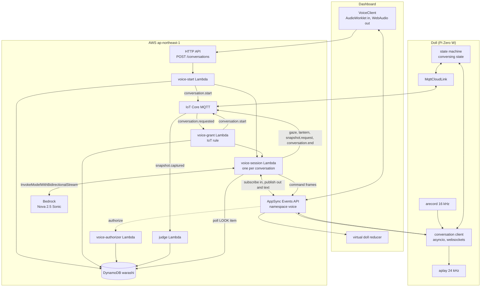
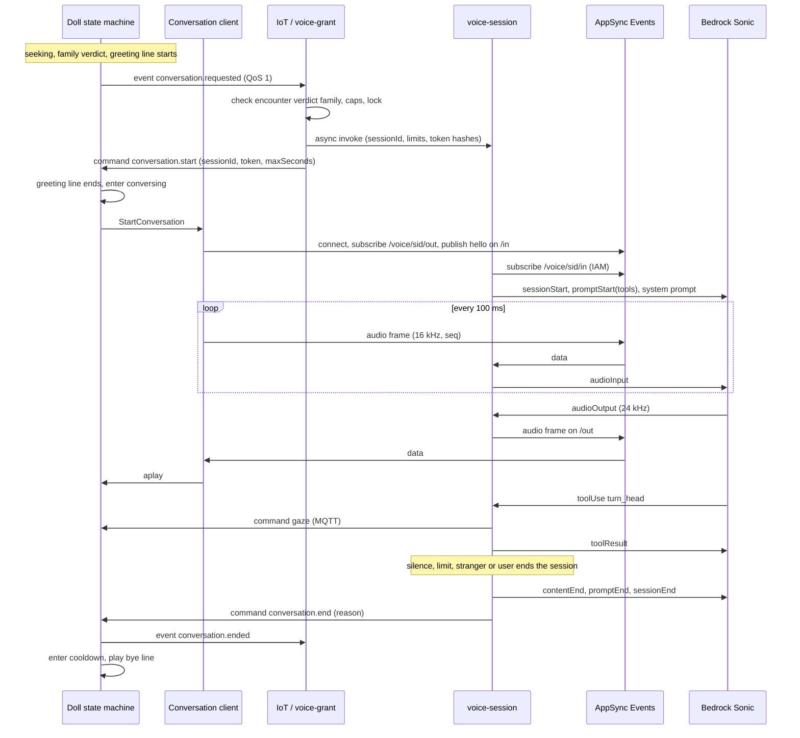
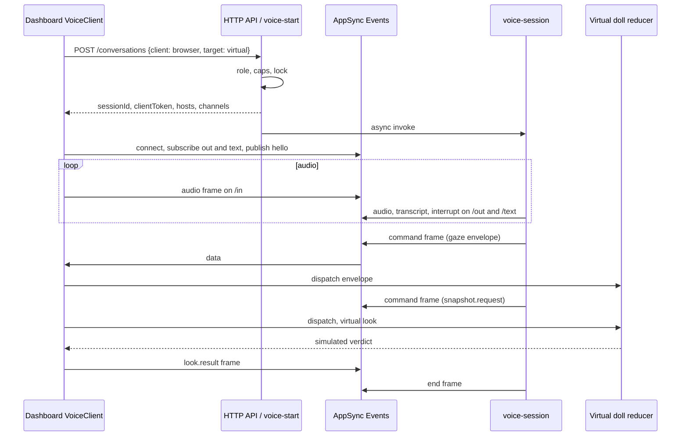
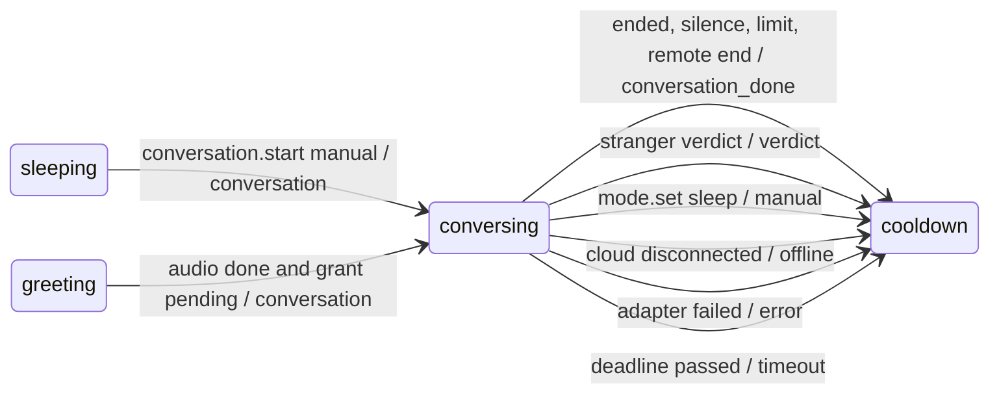
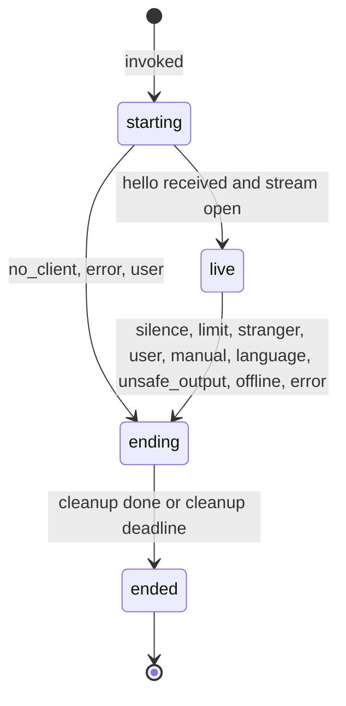

# Design Document: voice-conversation

## Overview

`voice-conversation` lets the zashiki-warashi hold a short spoken conversation in Japanese with a
family member, using Amazon Nova Sonic (speech-to-speech) in Tokyo. A conversation starts in one
of two ways: the doll recognises a family member and asks for a session, or a signed-in family
member presses "Talk" in the dashboard. During the conversation the model can turn the doll's head,
set the lantern and look at who is there. Each of those tool calls becomes a command from
`docs/schema.md`, so the same call moves the real doll or the virtual doll in the dashboard.

The audio path follows the speech-to-speech pattern of `aws-samples/generative-ai-use-cases`
(GenU): client, AWS AppSync Events (WebSocket), a long-running session Lambda, and the Amazon
Bedrock bidirectional stream. Two clients speak the same channel protocol: the dashboard (browser
microphone and speaker) and the doll (a Python asyncio client on the Pi Zero W that pipes `arecord`
and `aplay`). Audio in is 16 kHz 16-bit mono LPCM. Audio out is 24 kHz 16-bit mono LPCM.

The design was checked against the AWS documentation before it was written. The section
[Design review: risks and corrections](#design-review-risks-and-corrections) lists the points where
the idea needs a guard, with the decision for each. [Verified AWS facts](#verified-aws-facts) lists
every limit, model ID and API shape the design relies on, with the documentation page. Anything not
verified is marked *pending owner measurement* with the task that measures it. Task 1 (2026-11-21 UTC) verified every other item.

Scope: voice session start, authorization and caps; the session Lambda; the AppSync Events API;
the Nova Sonic prompt and tools; the dashboard voice client; the device conversation client and the
`conversing` state; schema additions; fixtures and fakes. Out of scope: wake on sound (P2), session
continuation beyond the 8-minute connection limit, a cascaded fallback pipeline (see
[Open Questions](#open-questions-for-the-owner)), and any storage of audio or transcripts.

Priority: this feature is P1. When time is short, P0 reliability (device core loop, cloud verdict,
dashboard simulation) wins. Every session ends in the doll's normal cooldown, and the whole
feature is off by default (`voiceEnabled = false`, `conversation_enabled = false`).

Languages: TypeScript for `/cloud` and `/dashboard`, Python for `/device`. Algorithms that are not
tied to one language use pseudocode in `pascal` blocks.

## Design review: risks and corrections

Severity: **High** changes the design or the contract, **Medium** needs a guard in code or
configuration, **Low** is documented only.

| # | Sev | Original assumption | Finding (evidence in [Verified AWS facts](#verified-aws-facts)) | Decision |
|---|---|---|---|---|
| V1 | High | Nova Sonic speaks Japanese. | No Nova Sonic voice or language list names Japanese. Nova 2 lists English, French, Italian, German, Spanish, Portuguese and Hindi, and says only the polyglot voices `tiffany` and `matthew` speak every supported language. The owner's own tests say Japanese works with the polyglot voices. That is undocumented behaviour that can change or regress without notice. Task 1.2 (2026-11-21) confirmed that the [Nova 2.5 Sonic service card](https://docs.aws.amazon.com/ai/responsible-ai/nova-2-5-sonic/overview.html) lists only English, Spanish, German, French, Italian, Portuguese and Hindi, and warns of drift and reduced accuracy for other languages. Japanese is therefore **unsupported by AWS** and its quality is *pending owner measurement* (task 20.1, owner step O3). | Treat Japanese as a **risk, not a fact**. A four-step fallback ladder ([Japanese fallback](#japanese-fallback-ladder)): a prompt that demands Japanese, a pure language check on the first assistant turns, cached voice lines when it fails, and a kill switch. A listening test script (`scripts/check_sonic_japanese.py`, task 19.1) decides, and the fallback ladder stays enabled until the owner records a pass in step O3. |
| V2 | High | Use `amazon.nova-sonic-v1:0` as in the GenU examples. | Three models exist: `amazon.nova-sonic-v1:0`, `amazon.nova-2-sonic-v1:0` (EOL no sooner than 2026-12-02, before judging ends on 2027-01-29) and `amazon.nova-2-5-sonic` (launched 2026-10-05, EOL no sooner than 2027-10-05). Nova 2 and 2.5 are In-Region in Tokyo only; no Geo or Global profile. | Default model `amazon.nova-2-5-sonic` in `ap-northeast-1`. The model ID and voice are configuration. `amazon.nova-2-sonic-v1:0` is the documented alternative. The Nova 1 lifecycle page could not be read, so Nova 1 is not a default. |
| V3 | High | One session can run as long as the user talks. | The connection limit is 8 minutes. Renewal needs a continuation pattern from the sample repository. | Hard cap `maxSeconds` of 420 (7 minutes, leaving 60 s for setup and teardown), default 180. No continuation in this spec: a long chat ends politely at the limit. |
| V4 | High | The Pi can call Bedrock directly. | The Python SDK for bidirectional streaming needs an HTTP/2 duplex transport (CRT), and `tech.md` forbids `awscrt` on the Pi (no armv6l wheel). The Pi also holds no AWS credentials, only an IoT certificate. | The doll talks to AppSync Events over WebSocket only. A Lambda owns the Bedrock stream and the credentials. |
| V5 | High | The device authenticates to AppSync Events with SigV4. | The device has no AWS credentials. AppSync Events supports a Lambda authorizer that is called before connect, subscribe and publish, receives the channel and operation, and can cache its answer. | A **per-session token** authorizes both clients. The cloud creates it, and hands it to the doll in an MQTT command (TLS, device-specific topic) and to the browser in the HTTP response. The Lambda authorizer checks the token hash, the channel and the operation. The browser needs no Cognito mode on AppSync Events, which avoids the ID-token versus access-token mismatch. |
| V6 | High | The model can be trusted to stay in character. | Guardrails are listed as not supported for Nova Sonic on the Bedrock model cards. Audio cannot be filtered after it is spoken. | The system prompt carries the persona rules and **no family data at all**. A watchdog checks the assistant text and ends the session on a blocked word or a language drift. The text stage that precedes audio (see V13) is used when it arrives early enough. No claim of a hard guarantee. |
| V7 | High | A family verdict in the past can authorize a session. | A session needs fresh proof that a family member is there. A stranger can walk up during a chat. | The cloud grants a doll session only when its own record shows a `family` verdict for that encounter within `grantWindowSeconds` (60). During the session the cloud takes a silent snapshot every `recheckSeconds` (default 30). A `stranger` verdict ends the session at once. |
| V8 | High | `audioop` can apply the microphone gain. | `audioop` was removed in Python 3.13, and the doll runs 3.13.5. | The gain is a small pure function over `array('h')` with clipping, property-tested. |
| V9 | Medium | AppSync Events keeps audio chunks in order. | The documentation read for this task does not state an ordering guarantee. Publishing is limited to 25 requests per second per WebSocket connection, 5 events per publish, and 240 KB per subscription message. | Every audio frame carries a sequence number `seq`. The receiver uses a small reorder window and drops late frames. At 100 ms per chunk the doll sends 10 publishes per second, 40 % of the limit. |
| V10 | Medium | A Lambda can serve one chunk per invocation. | A per-chunk invocation cannot hold the Bedrock stream. | One long-running `voice-session` Lambda per conversation. It subscribes to the input channel as a WebSocket client (IAM-signed), holds the stream, and publishes output over HTTP. Timeout 540 s, reserved concurrency 3. |
| V11 | Medium | The lock for "one session per device" is released by the session. | A Lambda that times out or crashes never runs its cleanup. DynamoDB TTL deletion is late (see `cloud-judgement` C15). | The lock stores `expiresAt`. A start attempt takes over a lock whose `expiresAt` has passed, with a conditional write. TTL is only housekeeping. |
| V12 | Medium | Two tools can run in parallel. | Nova 2 and 2.5 support asynchronous tool calls, and expect a `toolResult` for **every** `toolUse`, even on error. A missing result leaves the model waiting. | The tool dispatcher always answers. A property test checks "every toolUse gets exactly one toolResult". |
| V13 | Medium | Assistant text arrives with the audio. | The sample code treats assistant text of the `SPECULATIVE` generation stage as the preview. Whether it arrives early enough to block audio is not documented. | The watchdog runs on every assistant text. Its lead time over the audio is *pending owner measurement* (task 20.1, owner step O3). |
| V14 | Medium | The model's tool arguments are well-formed. | The model can emit any JSON, including huge numbers, strings in number fields, and unknown directions. The head servos can wind the camera ribbon cable. | `toolToCommand` is pure and total. It maps every input to a command inside the configured limits or to an error result. The cloud limits are the **default calibrated limits** (pan ±30, tilt ±20), not the widest the contract allows. The device clamps again. |
| V15 | Medium | The reviewer account may use the voice feature like any signed-in user. | Voice costs money per minute and the reviewer password is public. | Reviewer voice is **off by default** (`reviewerVoiceEnabled = false`). When the owner turns it on, a reviewer may only run a browser session against the virtual doll, with a lower daily cap. |
| V16 | Medium | The doll hears its own voice. | The AT-CSP1 has hardware echo cancellation, but a self-interrupt loop would waste a session. | Barge-in is honoured. A config switch `conversation_mute_mic_while_speaking` (default `false`) turns the doll into a half-duplex device if echo shows up on the real doll. |
| V17 | Medium | The doll's state machine can leave `conversing` through the adapter. | A hung adapter would keep the doll in `conversing` forever. | The state machine owns a deadline for `conversing`. The Tick that passes it stops the adapter and leaves. The adapter's own end signal is an optimisation, never the only exit. |
| V18 | Low | GenU code can be copied freely. | GenU is MIT-0. The hackathon still requires disclosure. | No GenU code is copied by this design. If any is adapted, its header notice is kept and `docs/third-party.md` lists it ([Third-party material](#third-party-material)). The license was read at the pinned commits on 2026-11-21: MIT-0 for both repositories (see [Third-party material](#third-party-material)). |
| V19 | Low | Cost is small. | The Tokyo token prices were read on 2026-11-21 (see Verified AWS facts), but the price of a whole session is not known. | Hard caps (below) bound the cost. The session Lambda does not forward the model's usage events, so token counts per session are not recorded; the price per session is an **owner measurement** from the Bedrock invocation metrics and the bill (task 20.1, owner step O3), *pending owner measurement*. |

### Alternatives considered

| Alternative | Why not |
|---|---|
| Doll calls Bedrock directly with SigV4 | Needs an HTTP/2 duplex client and credentials on the Pi (V4). |
| Audio over MQTT (IoT Core) | The doll already has a link, but the browser would need a second path, and the brief asks for the GenU pattern. Kept as a fallback if AppSync Events ordering or latency disappoints. |
| Cognito mode on AppSync Events for the browser | Needs per-channel ownership checks through a data source and an ID token. The session token does the same job with one authorizer. |
| Cascaded pipeline (Transcribe, Nova Lite, Polly Kazuha) | Japanese would be certain (Kazuha is verified in `cloud-judgement`), but it needs three services and adds seconds of latency. Listed as the last fallback step and an owner question. |
| Session continuation past 8 minutes | Not needed for a "short conversation". Adds renewal logic and a gap in the audio. |

## Verified AWS facts

Every row was read from the AWS documentation in this session (2026-11, the Nova 2.5 pages are
dated October 2026). `tasks.md` re-checks them in task 1 with the `aws-docs` MCP server.

| Topic | Fact | Source |
|---|---|---|
| Model IDs | `amazon.nova-sonic-v1:0` (Nova 1 samples), `amazon.nova-2-sonic-v1:0` (Nova 2), `amazon.nova-2-5-sonic` (Nova 2.5). | [Bidirectional API](https://docs.aws.amazon.com/nova/latest/userguide/speech-bidirection.html), [Nova 2 card](https://docs.aws.amazon.com/bedrock/latest/userguide/model-card-amazon-nova-2-sonic.html), [Nova 2.5 card](https://docs.aws.amazon.com/bedrock/latest/userguide/model-card-amazon-nova-2-5-sonic.html) |
| Lifecycle | Nova 2 Sonic: launched 2025-12-02, EOL no sooner than 2026-12-02. Nova 2.5 Sonic: launched 2026-10-05, EOL no sooner than 2027-10-05. Both Active. | cards above |
| Regions | Nova 2 and Nova 2.5: In-Region in `us-east-1`, `us-west-2`, `eu-north-1` and `ap-northeast-1` (Tokyo). Geo and Global inference: not supported. Endpoint `https://bedrock-runtime.{region}.amazonaws.com`. | cards above, [Nova 2.5 guide](https://github.com/aws-samples/amazon-nova-samples/blob/main/speech-to-speech/amazon-nova-2.5-sonic/Getting_Started_and_Migrating_to_Nova_2.5_Sonic.md) |
| API | `InvokeModelWithBidirectionalStream` on the `bedrock-runtime` endpoint. Node.js uses an HTTP/2 handler. | cards, [Bidirectional API](https://docs.aws.amazon.com/nova/latest/userguide/speech-bidirection.html) |
| IAM for the API (2026-11-21) | The API has **no IAM action of its own**: `InvokeModelWithBidirectionalStream` is authorized by `bedrock:InvokeModel`. Resource ARN form: `arn:${Partition}:bedrock:${Region}::foundation-model/${ResourceId}`, here `arn:aws:bedrock:ap-northeast-1::foundation-model/amazon.nova-2-5-sonic`. | [Service Authorization Reference, Amazon Bedrock](https://docs.aws.amazon.com/service-authorization/latest/reference/list_amazonbedrock.html) |
| Nova 2.5 Sonic voices (2026-11-21) | Same voices and languages as Nova 2 (there is no separate voices page). 16 distinct voice IDs, including the polyglot `tiffany` and `matthew`. Japanese is not officially supported; the service card lists English, Spanish, German, French, Italian, Portuguese and Hindi and warns of drift and reduced accuracy for other languages. | [Nova 2 voices](https://docs.aws.amazon.com/nova/latest/nova2-userguide/sonic-language-support.html), [Nova 2.5 service card](https://docs.aws.amazon.com/ai/responsible-ai/nova-2-5-sonic/overview.html) |
| Nova 2.5 limits (2026-11-21) | Model ID `amazon.nova-2-5-sonic`, launched 2026-10-05, EOL no sooner than 2027-10-05, In-Region in Tokyo only. 8-minute session limit confirmed. 20 concurrent sessions by default, higher by request through the account team. Guardrails not supported. | [Nova 2.5 card](https://docs.aws.amazon.com/bedrock/latest/userguide/model-card-amazon-nova-2-5-sonic.html), Nova 2.5 guide |
| Pricing, Tokyo (2026-11-21) | USD per 1,000 tokens for Nova 2.5 Sonic: speech input 0.0037411, speech output 0.0149643, text input 0.000396, text output 0.003311. Price list published 2026-11-11. AWS benchmark time to first audio: P50 1.08 to 1.50 s (not measured in Tokyo). | [Bedrock price list, ap-northeast-1](https://pricing.us-east-1.amazonaws.com/offers/v1.0/aws/AmazonBedrock/current/ap-northeast-1/index.json) |
| AppSync Events in Tokyo (2026-11-21) | Offered in `ap-northeast-1`. Real-time endpoint `appsync-realtime-api.ap-northeast-1.amazonaws.com`. The quotas in the AppSync Events quotas row were re-read and confirmed: publish 1.2 MB, subscription message 240 KB, 5 events per batch, 25 publishes per second per connection, 10,000 inbound events per second per API, 200 subscriptions per connection, 50 namespaces per API. | [AppSync endpoints and quotas](https://docs.aws.amazon.com/general/latest/gr/appsync.html) |
| AppSync IAM and authorizer (2026-11-21) | IAM actions `appsync:EventConnect`, `appsync:EventPublish`, `appsync:EventSubscribe` on `arn:aws:appsync:<region>:<account>:apis/<APIID>/*`. Authorizer: `ttlOverride` is in seconds, 0 means no cache, and it is not operation-specific. Cache key is API, channel, operation and token. Timeout 10 s (recommended below 1 s). The function needs a resource policy that allows `appsync.amazonaws.com` to invoke it. Throwing an exception means `unauthorized`. | [Event API authorization](https://docs.aws.amazon.com/appsync/latest/eventapi/configure-event-api-auth.html) |
| CDK (2026-11-21) | `aws-cdk-lib` 2.278.0 exports `aws-appsync` `EventApi` and `CfnApi`. | installed package, task 1.1 |
| Concurrency | 20 concurrent bidirectional sessions per account per Region. Nova 2: not adjustable. Nova 2.5: higher limit by request. | cards above |
| Connection limit | 8 minutes, with a renewal and continuation pattern in the samples. Nova 2.5 enforces an 8-minute session limit. | [Nova 2 getting started](https://docs.aws.amazon.com/nova/latest/nova2-userguide/sonic-getting-started.html), Nova 2.5 guide |
| Audio formats | Input: `audio/lpcm`, 16,000 Hz, 16-bit, mono, base64. Output: `audio/lpcm`, 24,000 Hz (the sample sets 24,000), 16-bit, mono, base64. | [Nova 2 getting started](https://docs.aws.amazon.com/nova/latest/nova2-userguide/sonic-getting-started.html) |
| Event order | `sessionStart`, `promptStart` (output config, tools), system `contentStart` / `textInput` / `contentEnd`, audio `contentStart`, `audioInput`..., then `contentEnd`, `promptEnd`, `sessionEnd`. "These events need to be sent in the same order." | same |
| Turn detection | `sessionStart.turnDetectionConfiguration.endpointingSensitivity` (the sample uses `HIGH`). | same |
| Barge-in | The text output carries an interrupted marker when the user barges in (sample checks for `{ "interrupted" : true }`). | [Bidirectional API](https://docs.aws.amazon.com/nova/latest/userguide/speech-bidirection.html) |
| Voices and languages | Nova 2 lists English (US, UK, AU, IN), French, Italian, German, Spanish (US), Portuguese (BR) and Hindi. Polyglot voices that speak all of them: `tiffany` (feminine) and `matthew` (masculine). **Japanese is not listed.** Nova 1: English, French, Italian, German, Spanish. | [Nova 2 voices](https://docs.aws.amazon.com/nova/latest/nova2-userguide/sonic-language-support.html), [Nova 1 voices](https://docs.aws.amazon.com/nova/latest/userguide/available-voices.html) |
| Tools | Tools are defined in `promptStart.toolConfiguration` (`toolSpec` with `name`, `description`, `inputSchema.json`) plus `toolUseOutputConfiguration`. `toolChoice` is `auto`, `any` or `tool`. The model sends `toolUse` (`toolName`, `toolUseId`, `content` as a JSON string); the app answers with `toolResult`. Asynchronous tool calling is supported. Always send a `toolResult`. | [Tool configuration](https://docs.aws.amazon.com/nova/latest/nova2-userguide/sonic-tool-configuration.html) |
| Unsupported features | Guardrails, abuse detection, count tokens and agents are listed as not supported with `bedrock-runtime` for Nova 2 and Nova 2.5 Sonic. | cards above |
| AppSync Events WebSocket | Endpoint `wss://<id>.appsync-realtime-api.<region>.amazonaws.com/event/realtime`. Auth rides in the subprotocol list: `aws-appsync-event-ws` plus `header-<base64url JSON>`. Messages: `connection_init` / `connection_ack` (`connectionTimeoutMs` 300,000), `ka` every 60 s, `subscribe` / `subscribe_success`, `publish` / `publish_success`, `data`, `unsubscribe`. A connection stays open at most 24 hours. | [WebSocket protocol](https://docs.aws.amazon.com/appsync/latest/eventapi/event-api-websocket-protocol.html) |
| Channel rules | 1 to 5 segments of 50 alphanumeric or dash characters. A publish batch holds at most 5 events. Each event is a stringified JSON value. | same |
| AppSync Events quotas | Publish payload 1.2 MB. Subscription message 240 KB. 25 publish requests per second per WebSocket connection (not adjustable). 200 subscriptions per connection. 10,000 inbound events per second per API. | [AppSync quotas](https://docs.aws.amazon.com/general/latest/gr/appsync.html) |
| Lambda authorizer | Called before connect, publish and subscribe. Receives `authorizationToken`, `requestContext.operation` (`EVENT_CONNECT`, `EVENT_SUBSCRIBE`, `EVENT_PUBLISH`), `channelNamespaceName` and `channel` (both null on connect). Returns `isAuthorized`, optional `handlerContext` and `ttlOverride` (0 means no cache). Cache key: API, channel, operation, token. A token regex can reject bad tokens before the function runs. Timeout 10 s. | [Event API authorization](https://docs.aws.amazon.com/appsync/latest/eventapi/configure-event-api-auth.html) |
| IAM auth | SigV4 headers in the subprotocol. IAM actions `appsync:EventConnect`, `EventPublish`, `EventSubscribe`. | same, [WebSocket protocol](https://docs.aws.amazon.com/appsync/latest/eventapi/event-api-websocket-protocol.html) |
| Handlers | Without handlers, `onPublish` forwards all events. A namespace can be configured without handler code. | [Handlers](https://docs.aws.amazon.com/appsync/latest/eventapi/channel-namespace-handlers.html), [Direct Lambda](https://docs.aws.amazon.com/appsync/latest/eventapi/direct-lambda-integrations.html) |
| Debian package | `python3-websockets` is in Debian Trixie, built for `armel` and `armhf` among others. | [packages.debian.org](https://packages.debian.org/trixie/python3-websockets) |
| GenU | Lists `amazon.nova-sonic-v1:0`, `amazon.nova-2-sonic-v1:0` and `amazon.nova-2-5-sonic` as speech-to-speech models, enabled by `speechToSpeechModelIds`. | [GenU deploy options](https://github.com/aws-samples/generative-ai-use-cases/blob/main/docs/en/DEPLOY_OPTION.md) |

**Open items after task 1 (2026-11-21 UTC).** Everything not listed here was verified and is recorded
in the table above. Each item below is pending a test or a measurement on a deployed account.

- **Japanese quality** with `tiffany` or `matthew` on Nova 2.5 Sonic. Japanese is not officially
  supported (see the voices row and V1). Pending owner measurement: task 20.1 and owner step O3
  (`scripts/check_sonic_japanese.py`, task 19.1).
- **Message ordering** inside one channel (V9). Pending owner measurement: task 19.2 and owner step O3.
- **Node.js 24 `WebSocket` global** accepts a subprotocol array with the long `header-...` value.
  Verified by the task 12.2 test (`cloud/test/voice/adapters.test.ts`) against a local handshake server: a 1,500+ character `header-...` value is accepted and the server saw it in `Sec-WebSocket-Protocol`. Result on the Node.js version recorded by that run: pass.
- **`python3-websockets` on Raspberry Pi OS armhf** (version and install). Owner step O8b:
  `apt policy python3-websockets`, then `python3 -c "import websockets; print(websockets.version.version)"`.
  Debian lists an armhf build (see the Debian package row).
- **Latency** of the full audio loop in Tokyo and the lead time of assistant text over audio. Pending
  owner measurement: task 20.1 and owner step O3.
- **Price per session.** The token prices are verified (Pricing row). Usage events are not forwarded by
  the session Lambda, so the session price is an owner measurement from Bedrock metrics and the bill.
  Pending owner measurement: task 20.1 and owner step O3.

### Region table

Every stack deploys to `ap-northeast-1`, as in `cloud-judgement`. Checked 2026-11-21 UTC.

| Service or model | Region used | Documentation |
|---|---|---|
| Amazon Bedrock runtime, `amazon.nova-2-5-sonic` (In-Region) | `ap-northeast-1` | [Nova 2.5 card](https://docs.aws.amazon.com/bedrock/latest/userguide/model-card-amazon-nova-2-5-sonic.html) |
| AWS AppSync Events API | `ap-northeast-1` (verified 2026-11-21, endpoint `appsync-realtime-api.ap-northeast-1.amazonaws.com`) | [AppSync endpoints](https://docs.aws.amazon.com/general/latest/gr/appsync.html) |
| Lambda, DynamoDB, API Gateway, IoT Core, Cognito | `ap-northeast-1` | `cloud-judgement` design |

## Architecture



Rules the diagram encodes:

- The doll never talks to Bedrock. The Lambda owns the credentials and the stream.
- One session Lambda per conversation. It is the only component that sees both audio directions and
  the model events.
- Tool calls leave the session Lambda as schema envelopes. They go to the real doll over MQTT, or to
  the browser as `command` frames for the virtual doll. The model cannot tell which.
- The `judge` Lambda stays the only component that calls Rekognition. `look()` and the periodic
  re-check use it through a `snapshot.request` command and a DynamoDB result item.

### Family verdict to conversation (real doll)



### Browser talk to the virtual doll



### Device state machine addition



`conversing` has six exits and a deadline, so it always ends (property P4).

### Session lifecycle in the cloud



## Components and Interfaces

### CDK additions (`cloud/lib`)

| Stack | Contents |
|---|---|
| `VoiceStack` (new) | AppSync Events API `warashi-voice` with auth modes Lambda (`voice-authorizer`, token regex, cache 60 s) and IAM; channel namespace `voice` without handlers; `voice-start`, `voice-grant`, `voice-session`, `voice-authorizer` functions; HTTP routes `POST /conversations`, `GET /conversations/{sessionId}`, `DELETE /conversations/{sessionId}` (see the note below the table); IoT rule `warashi_voice_requests`. A CloudWatch alarm on session errors is **not implemented** (see [Follow-ups](#follow-ups-not-implemented)). |
| `WebStack` | The CSP `connect-src` gains `https://<http host>` and `wss://<realtime host>` of the Events API. `WebStack` takes the two host names as props from `VoiceStack`. |
| `DataStack` | No change. New item types live in the existing single table. |

`VoiceStack` adds the three `/conversations` routes itself, not `ApiStack`. `ApiStack` exposes its
`apiId` and the JWT `authorizerId`, and `VoiceStack` creates the integration, the route (with
`authorizationType: JWT` and that `authorizerId`) and the Lambda permission. *Reason:* a route built in
`ApiStack` would make the two stacks depend on each other (the function lives in `VoiceStack`; the
permission and the integration URI point in opposite directions), a cyclic dependency.

App order: `DataStack` → `JudgementStack` → `ApiStack` → `VoiceStack` → `WebStack`. `VoiceStack`
takes the IoT data endpoint from `JudgementStack` and the HTTP API id and authorizer id from `ApiStack`. The IoT rule
lives in `VoiceStack` so that `JudgementStack` does not depend on it. New stack outputs:
`VoiceHttpHost`, `VoiceRealtimeHost`. The owner opts in with the CDK context key `voiceEnabled`
(default `false`).

### Lambda functions (`cloud/lambda/<function>`)

| Function | Trigger | Purpose | Permissions (least privilege) |
|---|---|---|---|
| `voice-start` | HTTP API | `POST /conversations`, `GET` and `DELETE /conversations/{id}` for the dashboard. Applies role rules, caps and the lock, creates the session, invokes `voice-session`, and for `client: device` publishes `conversation.start` to the doll. | DynamoDB on the table, `lambda:InvokeFunction` on `voice-session` only, `iot:Publish` on `warashi/*/commands` |
| `voice-grant` | IoT rule, async, timeout 30 s, 0 retries, max event age 60 s (Lambda's minimum) | Handles `conversation.requested`: checks the topic id, the stored family verdict, caps and the lock, then does what `voice-start` does for a doll session. | same as `voice-start` |
| `voice-authorizer` | AppSync Events (Lambda authorizer) | Validates the token, the channel and the operation. | DynamoDB `GetItem` on the table |
| `voice-session` | async invoke, timeout 540 s, memory 512 MB, reserved concurrency 3, 0 retries, max event age 60 s (Lambda's minimum; the first design said 30 s, which CDK rejects) | Owns one conversation: AppSync subscription, Bedrock stream, tools, timers, cleanup. At the end it also writes the `VOICE#HEALTH` flag (see [Data Models](#data-models)). | `bedrock:InvokeModel` (covers `InvokeModelWithBidirectionalStream`) on the one foundation-model ARN, `appsync:EventConnect` / `EventSubscribe` / `EventPublish` on the one API, `iot:Publish` on `warashi/*/commands`, DynamoDB read and write on the table |

`judge` gets one change: when `snapshot.captured` carries `requestId`, it also writes
`LOOK#<requestId>` (see [Data Models](#data-models)). `ingest` accepts the new types.
Settings follow the `WARASHI_<SETTING_IN_UPPER_SNAKE_CASE>` rule of `_shared/config.ts`. Three
deployment values have fixed names: `WARASHI_VOICE_SESSION_FUNCTION_NAME` (`voice-start` and `voice-grant`,
the function they invoke), `WARASHI_VOICE_HTTP_HOST` and `WARASHI_VOICE_REALTIME_HOST` (the Events API
hosts; set on `voice-session`, `voice-start` and `voice-grant`).

**Reserved concurrency needs headroom (owner quota step).** Lambda keeps at least 10 unreserved
concurrent executions per account. An account at the default limit of 10 cannot reserve 3 for
`voice-session`, so the owner first requests a Lambda concurrency quota increase (an owner step; the
stack fails to deploy otherwise).
`InvokeModelWithBidirectionalStream` has no IAM action of its own. It is authorized by `bedrock:InvokeModel`
on `arn:aws:bedrock:ap-northeast-1::foundation-model/amazon.nova-2-5-sonic` (verified 2026-11-21 in the
[Service Authorization Reference](https://docs.aws.amazon.com/service-authorization/latest/reference/list_amazonbedrock.html)).
Tasks 12 and 14 must use `bedrock:InvokeModel`. The AppSync resource is
`arn:aws:appsync:ap-northeast-1:<account>:apis/<APIID>/*`.

### Cloud settings (`cloud/lambda/_shared/config.ts`, voice part)

| Setting | Default | Allowed | Meaning |
|---|---|---|---|
| `voiceEnabled` | `false` | boolean | Kill switch. When false, every start fails with `503 voice_unavailable` and `GET /me` says so. |
| `voiceModelId` | `amazon.nova-2-5-sonic` | non-empty | Model ID. |
| `voiceId` | `tiffany` | non-empty | Output voice. |
| `maxSeconds` | 180 | 30 to 420 | Session length from stream open. |
| `silenceSeconds` | 15 | 5 to 60 | No user speech and no model audio for this long ends the session. |
| `noClientSeconds` | 15 | 5 to 60 | The client must say `hello` within this time. |
| `recheckSeconds` | 30 | 0 or 10 to 120 | Interval of the silent family re-check. 0 turns it off. |
| `lookTimeoutSeconds` | 8 | 2 to 15 | Wait for a look result. |
| `maxLooksPerSession` | 3 | 0 to 10 | Model-initiated `look()` calls. |
| `maxToolCalls` | 20 | 1 to 100 | All tool calls per session. |
| `maxGazeCommands` | 12 | 0 to 60 | Head commands per session. |
| `gazeMinIntervalMs` | 1000 | 200 to 10000 | Minimum time between head commands. |
| `voiceGazeLimits` | pan 30, tilt 20 | pan ≤ 60, tilt ≤ 30 | Cloud clamp for tool commands. |
| `chunkMs` | 100 | 60 to 200 | Audio chunk length both ways. |
| `reorderWindow` | 3 | 1 to 8 | Frames the receiver waits for a missing `seq`. |
| `grantWindowSeconds` | 60 | 10 to 300 | A doll session needs a `family` verdict this recent. |
| `perUserPerDay` | family 10, reviewer 2 | integers ≥ 0 | Session starts per signed-in user per UTC day. |
| `deviceStartsPerDay` | 20 | integer ≥ 0 | Doll-initiated sessions per day, all devices. |
| `globalPerDay` | 40 | integer ≥ 0 | All sessions per UTC day. |
| `maxConcurrent` | 3 | 1 to 10 | Active sessions at once. Also the Lambda reserved concurrency. |
| `reviewerVoiceEnabled` | `false` | boolean | Lets `reviewer` start a browser session against the virtual doll. |
| `blockedWords` | empty | list | Words the watchdog rejects (from the existing `WARASHI_BLOCKED_WORDS`). |

### Pure modules (`cloud/lambda/_shared/voice/`)

Adapters (AWS SDK, WebSocket) live next to each handler and are injected, so every test runs without
AWS.

```typescript
// frames.ts - the channel protocol (see "Voice session channels" in docs/schema.md)
export type InFrame =
  | { t: "hello"; client: "device" | "browser"; v: 1 }
  | { t: "audio"; seq: number; pcm: string }                     // base64, 16 kHz S16LE mono
  | { t: "look.result"; requestId: string; verdict: LookVerdict } // virtual doll only
  | { t: "bye"; reason: "user" | "silence" | "limit" | "error" };
export type OutFrame =
  | { t: "audio"; seq: number; pcm: string }                     // base64, 24 kHz S16LE mono
  | { t: "interrupt" }
  | { t: "command"; envelope: Envelope };                        // browser sessions only
export type TextFrame =
  | { t: "state"; state: "waiting" | "live" | "ending" }
  | { t: "transcript"; role: "user" | "assistant"; text: string; final: boolean }
  | { t: "end"; reason: EndReason };
export type FrameResult<F> = { kind: "valid"; frame: F } | { kind: "malformed"; reason: string };
export function decodeIn(raw: string): FrameResult<InFrame>;
export function encodeOut(f: OutFrame | TextFrame): string;      // total, never throws
```

```typescript
// reorder.ts
export interface Reorder {
  push(seq: number, pcm: string): readonly { seq: number; pcm: string }[]; // frames now deliverable, in order
  missed(): number;                                                         // gaps given up on
}
export function makeReorder(window: number): Reorder;
```

```typescript
// session.ts - the lifecycle reducer (pure)
export type Phase = "starting" | "live" | "ending" | "ended";
export type EndReason = "silence" | "limit" | "stranger" | "user" | "manual" | "language"
  | "unsafe_output" | "error" | "no_client" | "offline";
export type SessionState = {
  phase: Phase; startedAtMs: number; openedAtMs: number | null; lastActivityMs: number;
  helloSeen: boolean; endReason: EndReason | null; endingSinceMs: number | null;
  nextRecheckAtMs: number | null; looks: number; toolCalls: number; gazeCommands: number;
  lastGazeAtMs: number | null; pendingTools: readonly string[]; assistantTurns: number; languageOk: boolean | null;
};
export type SessionEvent =
  | { t: "tick" } | { t: "hello" } | { t: "streamOpened" } | { t: "activity" }
  | { t: "assistantText"; text: string } | { t: "toolUse"; id: string; name: string }
  | { t: "toolDone"; id: string } | { t: "verdict"; verdict: LookVerdict; silent: boolean }
  | { t: "endRequest"; reason: EndReason } | { t: "streamClosed"; ok: boolean };
export type Effect =
  | { type: "openStream" } | { type: "requestRecheck" }
  | { type: "interruptAudio" } | { type: "publishState"; state: "waiting" | "live" | "ending" }
  | { type: "closeStream" } | { type: "publishEnd"; reason: EndReason }
  | { type: "notifyDevice"; reason: EndReason } | { type: "releaseLock" } | { type: "recordSession"; reason: EndReason };
export function stepSession(s: SessionState, e: SessionEvent, nowMs: number, cfg: VoiceConfig):
  { state: SessionState; effects: readonly Effect[] };
```

```typescript
// tools.ts
export type ToolName = "turn_head" | "set_lantern" | "look";
export type ToolOutcome =
  | { kind: "command"; envelopes: readonly Envelope[]; result: object }   // result goes to the model
  | { kind: "look"; requestId: string }
  | { kind: "error"; result: { ok: false; error: string } };
export function toolToCommand(name: string, inputJson: string, ctx: ToolContext, cfg: VoiceConfig): ToolOutcome; // total
export const TOOL_SPECS: readonly ToolSpec[];                                                  // sent in promptStart
export function lookResultForModel(v: LookVerdict | "timeout"): { who: "family" | "stranger" | "nobody" | "unsure" };
```

```typescript
// prompt.ts, language.ts, sonic-events.ts, caps.ts
export function buildSystemPrompt(): string;                    // persona rules only, no inputs from the family
export function japaneseRatio(text: string): number | null;     // null when fewer than 4 letters
export function languageVerdict(turns: readonly string[]): "ok" | "bad" | "undecided";
export function isUnsafeAssistantText(text: string, blocked: readonly string[]): boolean;
export function sonicStartEvents(p: SonicStart): readonly string[];     // sessionStart .. system prompt end
export function sonicAudioContentStart(p: SonicStart): string;
export function sonicToolResult(p: ToolResultInput): readonly string[]; // contentStart TOOL, toolResult, contentEnd
export function sonicShutdownEvents(p: SonicIds): readonly string[];    // contentEnd, promptEnd, sessionEnd
export function dayBucket(nowMs: number): number;
export function withinCap(countAfterIncrement: number, cap: number): boolean;
```

Ports used by handlers (all faked in tests):

```typescript
export interface SonicStream {                                   // Bedrock bidirectional stream
  send(eventJson: string): Promise<void>;
  events(): AsyncIterable<SonicEvent>;                           // parsed output events
  close(): Promise<void>;
}
export interface SonicClient { open(modelId: string): Promise<SonicStream>; }
export interface VoiceChannel {                                  // AppSync Events from the Lambda side
  subscribeIn(sessionId: string): AsyncIterable<string>;
  publish(sessionId: string, channel: "out" | "text", events: readonly string[]): Promise<void>;
  close(): Promise<void>;
}
export interface VoiceStore {                                    // DynamoDB
  acquireLock(key: string, sessionId: string, nowMs: number, expiresAtMs: number): Promise<boolean>;
  releaseLock(key: string, sessionId: string): Promise<void>;
  incrementCounter(key: string, cap: number, ttlS: number): Promise<{ allowed: boolean; count: number }>;
  releaseCounter(key: string): Promise<void>;
  putSession(rec: SessionRecord): Promise<void>;
  getSession(sessionId: string): Promise<SessionRecord | null>;
  readLook(requestId: string): Promise<LookItem | null>;
  encounterVerdict(encounterId: string): Promise<{ verdict: Verdict; atMs: number } | null>;
}
export interface DollBus { publish(deviceId: string, envelope: Envelope): Promise<void>; }   // iot-data, qos=1
```

Ports added by the implementation, defined next to the handler that needs them (not in `ports.ts`):

```typescript
export interface HealthStore {                                   // voice-start-core.ts, the VOICE#HEALTH item
  read(): Promise<HealthState | null>;
  write(state: HealthState): Promise<void>;
}
export interface SessionInvoker {                                // voice-grant-core.ts, async Lambda invoke
  invoke(payload: SessionPayload): Promise<void>;
}
// StartDeps of voice-start-core.ts:
readCounter: (key: string) => Promise<number>;                   // today's count, 0 when absent; feeds GET /me remainingToday
deviceOnline: (deviceId: string, nowMs: number) => Promise<boolean>; // from the doll's last status, for deviceOnline in the 202
```

`VoiceStore` has no method that stores audio or text. The type itself keeps transcripts out of the
database (property P8).

### Device (`device/warashi_agent`)

New and changed modules. The layout follows `structure.md`.

```
device/warashi_agent/
  conversation/
    frames.py        pure: encode / decode channel frames (mirrors docs/schema.md)
    appsync.py       pure: handshake subprotocols, subscribe and publish message builders
    audio.py         pure: apply_gain, chunker, speech_energy (stdlib array only)
    reorder.py       pure: sequence reorder window
    client.py        asyncio session: websockets, arecord and aplay subprocesses
  adapters/
    conversation.py  ConversationAdapter: thread + event loop, posts internal events
    fakes.py         + FakeConversation, RecordedMic, RecordedSpeaker
  state_machine.py   + conversing phase, new events and actions (see below)
  messages.py        + new event and command types
```

```python
# adapters/ports.py
class ConversationPort(Protocol):
    def handle(self, action: StartConversation | StopConversation) -> None: ...  # enqueue only, never raises
    def stop(self) -> None: ...                                                   # idempotent, stops audio within 1 s
```

```python
# conversation/audio.py (pure)
def apply_gain(pcm: bytes, gain: float) -> bytes:
    """Scale 16-bit little-endian samples by gain with clipping. Length is preserved."""

def split_chunks(buffer: bytes, chunk_bytes: int) -> tuple[list[bytes], bytes]:
    """Return whole chunks and the remainder. Chunks are always an even number of bytes."""

def speech_energy(pcm: bytes) -> float:
    """Mean absolute sample value, 0..32768. Used for the local silence timer only."""
```

```python
# conversation/frames.py (pure, never raises on decode)
def decode_out(raw: str) -> OutFrameResult: ...   # audio, interrupt, command; unknown t is ignored
def encode_in(frame: InFrame) -> str: ...
```

```python
# conversation/client.py
class ConversationClient:
    def __init__(self, cfg: ConversationConfig, hosts: AppSyncHosts, mic: MicSource, speaker: SpeakerSink,
                 connect: Callable[..., Awaitable[WsLike]], clock: Clock, log: logging.Logger) -> None: ...
    async def run(self, start: StartConversation) -> ConversationEnd:
        """Connect, subscribe, say hello, then pump mic to the channel and the channel to the speaker.
        Returns exactly one ConversationEnd. Never raises."""
    def request_stop(self, reason: str) -> None: ...   # thread-safe
```

`MicSource` and `SpeakerSink` are protocols. The real versions wrap `arecord` and `aplay`; the fakes
read a recorded WAV and collect the played bytes. `WsLike` is the small slice of the `websockets`
connection that the client uses (`send`, `recv`, `close`), so tests pass a fake server connection.

### Dashboard (`dashboard/src/voice`)

```
src/voice/
  frames.ts          same codec as the cloud (copy checked against the shared fixtures)
  audio.ts           pure: resampleTo16k, floatToPcm16, pcm16ToFloat, chunker, reorder
  appsync.ts         handshake subprotocols, subscribe and publish message builders
  browserAudio.ts    getUserMedia capture and WebAudio playback (thin)
  worklet.ts         AudioWorkletProcessor (thin, calls audio.ts)
  VoiceClient.ts     session: HTTP start, WebSocket, capture, playback, state
  transport.ts       WebSocketTransport and FakeVoiceTransport
  useVoice.ts        React hook
src/components/TalkPanel.tsx
```

```typescript
export interface VoiceTransport {                       // the WebSocket slice the client needs
  open(url: string, protocols: string[]): Promise<void>;
  send(message: string): void;
  onMessage(cb: (message: string) => void): void;
  onClose(cb: (code: number) => void): void;
  close(): void;
}
export type VoiceUiState = "idle" | "starting" | "listening" | "speaking" | "ending" | "failed";
export interface VoiceClient {
  start(opts: { target: "real" | "virtual" }): Promise<void>;
  stop(): Promise<void>;
  readonly state: VoiceUiState;
  onTranscript(cb: (role: "user" | "assistant", text: string, final: boolean) => void): void;
  onCommand(cb: (envelope: Envelope) => void): void;   // wired to the simulation reducer
}
```

`TalkPanel` shows the Talk button (signed-in users only), a permission prompt, a clear
"microphone is on" indicator, live subtitles, and a Stop button. Under `aws-appsync` constraints it
uses the browser's `getUserMedia` echo cancellation. The panel is disabled with a reason when
`GET /me` says `voiceEnabled: false`, the role is not allowed, or the daily cap is used up.

## Data Models

### DynamoDB items (single table `warashi`, added by this spec)

| Item | `pk` | `sk` | Attributes | TTL |
|---|---|---|---|---|
| Session | `VOICE#<sessionId>` | `META` | `deviceId`, `client`, `target`, `ownerSub` (null for doll-started), `role`, `phase`, `startedAt`, `expiresAt`, `clientTokenHash`, `observerTokenHash` (null for the doll), `endReason`, `endedAt`, `endRequested` | 2 days |
| Lock | `VOICELOCK#<key>` | `LOCK` | `sessionId`, `expiresAt` | 1 hour |
| Counter | `RATE#voice#<scope>#<day>` | `COUNT` | `count` | 2 days |
| Look result | `LOOK#<requestId>` | `RESULT` | `verdict`, `at` | 10 minutes |
| Health flag | `VOICE#HEALTH` | `STATE` | `streak`, `firstAtMs`, `unhealthyUntilMs` | 2 days |

`voice-session` writes the health flag when a session ends (a best-effort write after cleanup);
`voice-start` and `voice-grant` read it and answer `503 voice_unavailable` while `unhealthyUntilMs` is
in the future.

`<key>` is `device#<deviceId>` for sessions that use the real doll's microphone or move it
(`client: device`, or `target: real`), and `sim#<ownerSub>` for virtual-doll sessions. One
conditional `PutItem` takes a lock when it does not exist or when its `expiresAt` is in the past.

Counter scopes: `user#<sub>`, `device`, `global`. A start increments the scopes that apply, in a
fixed order, and releases the ones already incremented when a later one rejects (the pattern of
`cloud-judgement` R15.13).

The session item holds **no audio, no transcript and no model text**. Tokens are stored only as
SHA-256 hashes. Session records expire after two days.

`endRequested` is written by `DELETE /conversations/{id}` and by `conversation.ended` from the doll, and
it is read by no running session: `runSession` does not poll it. A client-side end reaches the running
session as a `bye` frame on `/in`; a doll-side end reaches it through the same frame, sent by the doll's
client. The flag only records the request for `GET /conversations/{id}` and the audit trail.

### Tokens

A token is `<sessionId>.<secret>` where `secret` is 32 random bytes in Base64URL. Two tokens exist:

| Token | Held by | Allowed operations |
|---|---|---|
| `clientToken` | the audio client (doll or browser) | publish `/voice/<sid>/in`; subscribe `/voice/<sid>/out` and `/voice/<sid>/text` |
| `observerToken` | a browser that started a doll session | subscribe `/voice/<sid>/text` |

The authorizer accepts a token only while the session phase is `starting` or `live` and
`expiresAt` is in the future. It rejects wildcard channels and any other channel. It hashes the **whole token**
(`<sessionId>.<secret>`) with `hashToken` (SHA-256, lowercase hex) and compares the result with
`clientTokenHash` or `observerTokenHash`; the code that stores the hashes uses the same function. The AppSync API
token regex is `^[0-9a-f-]{36}\.[A-Za-z0-9_-]{43}$`.

### Channels and frames

Namespace `voice`. Channel segments are at most 50 characters, and a UUID is 36.

| Channel | Direction | Frames |
|---|---|---|
| `/voice/<sid>/in` | client → session | `hello`, `audio`, `look.result`, `bye` |
| `/voice/<sid>/out` | session → client | `audio`, `interrupt`, `command` |
| `/voice/<sid>/text` | session → client and observer | `state`, `transcript`, `end` |

An audio chunk at 100 ms is 3,200 bytes in and 4,800 bytes out, which Base64 turns into about 4.3 KB
and 6.4 KB. Both are far below the 240 KB subscription limit. A frame is rejected as malformed when
`pcm` is not valid Base64, decodes to an odd number of bytes, or decodes to more than 12,800 bytes.

### Voice lines added to `device/warashi_agent/voice/lines.toml`

Two cached lines serve the fallback and the polite end. Both pass the manifest rules (at most 22
code points, at most two sentence marks, no Latin letters, no names).

| id | category | ja | en |
|---|---|---|---|
| `conversation_trouble` | family | うまく きこえないの。また あとでね。 | I can't hear well. Let's talk later. |
| `conversation_bye` | family | じゃあね。また おはなし しようね。 | Goodbye for now. Let's talk again. |

`scripts/generate_voice_lines.*` produces their WAV files, and `scripts/export_voice_catalog.py`
copies them to the dashboard and the cloud JSON, as for every other line.

## docs/schema.md Changes

**Contract first.** The first implementation task applies every row below to `docs/schema.md`, each
with its reason, before any producer or consumer changes. `v` stays 1: no version has been deployed,
and every change adds a type, an optional field or an enumeration value. The golden-fixture and
route-table tests (see "Fixtures and contract checks" in `docs/schema.md`) are extended in the same
change.

### Events (device → cloud)

| # | Change | Reason |
|---|---|---|
| S1 | New `conversation.requested`: `{ "reason": "family_verdict" }`. Sent once per encounter on entering `greeting` after an accepted `family` verdict, only when `conversation_enabled` and the cloud is connected. | The cloud decides whether the doll gets a session. |
| S2 | New `conversation.ended`: `{ "sessionId": string, "reason": ConversationEndReason }`. Sent when the doll leaves `conversing`. | The cloud closes its session and releases the lock even when the doll ended it. |
| S3 | `snapshot.captured.data` gains optional `requestId: string \| null` (default `null`). Present only for a snapshot that answers `snapshot.request`. | Lets the `judge` Lambda store a result under the id that the session waits for. |

`ConversationEndReason` is `silence`, `limit`, `stranger`, `user`, `manual`, `language`,
`unsafe_output`, `error`, `no_client`, `offline`. *Reason:* one enumeration for the doll, the cloud and the dashboard.

### Commands (cloud → device)

| # | Change | Reason |
|---|---|---|
| S4 | New `conversation.start`: `{ "sessionId": string, "token": string, "maxSeconds": int, "silenceSeconds": int, "source": "family_verdict" \| "manual" }`. The token is a secret: the device never logs or publishes it. | Starts the doll's audio client. |
| S5 | New `conversation.end`: `{ "sessionId": string, "reason": ConversationEndReason }`. | The cloud ends a session. Safe to receive twice and for an unknown session. |
| S6 | New `snapshot.request`: `{ "requestId": string }`. Valid in `conversing` only; elsewhere `command_rejected_state`. The doll answers with `snapshot.captured` that carries the same `requestId`. | `look()` and the silent re-check. |

Field rules: `sessionId` and `requestId` match `[A-Za-z0-9-]{1,64}`; `token` is 1 to 128 characters;
`maxSeconds` is an integer clamped to 30..420 and `silenceSeconds` to 5..60 by the doll (finite
values outside the range are valid, as for other numbers). The cloud tool commands use the existing
`gaze` and `lantern` commands unchanged.

### Shared definitions and notes

| # | Change | Reason |
|---|---|---|
| S7 | New `state.changed` reasons `conversation` (entered `conversing`) and `conversation_done` (left it after a normal end). | The timeline can show why. |
| S8 | Reason mapping rows, added after the existing `manual` row (the row for "any state other than `sleeping` → `sleeping`" is unchanged): `sleeping` → `conversing` on `conversation.start` with `source: "manual"`: `conversation`. `greeting` → `conversing` on audio done with a pending grant: `conversation`. `conversing` → `cooldown` on `mode.set` sleep: `manual`; on `cloud.disconnected`: `offline`; on a `stranger` verdict for a `snapshot.request`: `verdict`; on `conversation.ended` from the adapter or on `conversation.end` for the current session: `conversation_done`; on an adapter failure: `error`; on the `conversing` deadline: `timeout`. | One reason per cause. |
| S9 | `state.changed.to` may be `conversing` (already in State). `encounter.ended.reason` is unchanged: the encounter ends through `cooldown`. | Keeps the encounter model. |
| S10 | `status.report.micActive` is `true` while the state is `conversing` and `false` otherwise. `status.report` is also sent on each change of `micActive` (the same moment as a state change). | The privacy indicator stays exact (`product.md`). |
| S11 | `speak` in `conversing` is rejected with `command_rejected_state`. | One audio user at a time. |
| S12 | New `error.reported` codes: `conversation_failed` (the audio client failed: connect, auth, transport; `refId` null) and `microphone_failed` (`arecord` failed or produced no data; `refId` null). | Receivers handle the codes without parsing text. |
| S13 | New section "Voice session channels" defines the namespace `voice`, the three channels, the token rules and every frame of the previous section as written in this design. | The doll, the cloud and the dashboard share one frame definition. |
| S14 | The privacy sentence in "Shared definitions" gains: voice transcripts and audio are never stored, and no tool result, prompt or frame contains a name. | Keeps the privacy rule explicit. |

### HTTP API

| # | Change | Reason |
|---|---|---|
| S15 | Role matrix rows: `POST /conversations` F yes, R yes only when `reviewerVoiceEnabled` (browser and virtual only), otherwise `403 forbidden`. `GET /conversations/{sessionId}` F, R (owner only). `DELETE /conversations/{sessionId}` F, R (owner only). | Voice routes under the same role rules. |
| S16 | `POST /conversations` body `{ "deviceId": string, "client": "browser" \| "device", "target": "real" \| "virtual" }`. `client: device` requires `target: real`. `target: real` requires `family`. Success `201` for `browser`: `{ "sessionId", "clientToken", "hosts": { "http", "realtime" }, "channels": { "in", "out", "text" }, "maxSeconds", "silenceSeconds", "expiresAt" }`. Success `202` for `device`: `{ "sessionId", "observerToken", "hosts", "channels", "deviceOnline": boolean }`. | One start route for both clients. |
| S17 | `GET /conversations/{sessionId}` → `{ "sessionId", "phase", "endReason": ConversationEndReason \| null }`. `DELETE` → `204`, ends the session with reason `user`. A non-owner or unknown id gives `404 not_found`. | Lets the UI show a failed start. |
| S18 | `GET /me` gains `voice: { "enabled": boolean, "maxSeconds": int, "remainingToday": int }`. | The dashboard can disable the button with a reason. |
| S19 | New error codes: `session_active` (409, a session already uses this doll or this virtual doll) and `voice_unavailable` (503, kill switch or a failed start). A daily cap gives the existing `429 rate_limited` with `Retry-After` set to the seconds until the next UTC midnight (1 to 86,400). | Distinct codes for distinct causes. |
| S20 | The error code list test and the route table test include the new entries. | Keeps the drift check. |
| S21 | "Voice session channels": a second `hello` counts as the first, and the first `in` `audio` frame before any `hello` counts as the `hello` (that frame is dropped). No field changes. Found during the first deployment: the browser's `hello` was published before the session Lambda had subscribed, and the session never opened. | AppSync Events keeps no messages for a subscriber that is not connected yet. |

### Fixtures

`docs/fixtures/schema-v1/` gains one golden file for each new type: `conversation.requested`,
`conversation.ended`, `conversation.start`, `conversation.end`, `snapshot.request`.
`docs/fixtures/voice-v1/` holds one golden frame for each frame type and direction, plus
`sonic-session-ok.jsonl` and `sonic-session-tools.jsonl` (scripted Bedrock event streams with short
synthetic audio and placeholder text). The Python, TypeScript and dashboard tests decode every file
and re-encode it to a semantically equal value. A frame without a fixture, or a fixture without a
frame, fails and names it.

## Device changes to `device-core-loop`

These amend the device spec. Each needs a requirements update there (listed in
[Other specs](#what-the-other-specs-must-pick-up)). Until then the device behaves as before.

### Config keys (`[conversation]`)

| Key | Default | Allowed | Meaning |
|---|---|---|---|
| `conversation_enabled` | `false` | boolean | When false, the doll never sends `conversation.requested` and rejects `conversation.start` with `command_rejected_state`. |
| `conversation_max_s` | 180 | 30 to 420 | Longest stay in `conversing`. The doll also clamps the command's `maxSeconds` to this. |
| `conversation_silence_s` | 15 | 5 to 60 | Local silence limit (no speech energy and no incoming audio). |
| `conversation_mic_gain` | 4.0 | 0.5 to 16 | Software gain on the microphone. |
| `conversation_chunk_ms` | 100 | 60 to 200 | Audio chunk length. |
| `conversation_mute_mic_while_speaking` | `false` | boolean | Half-duplex mode (V16). |
| `conversation_connect_timeout_s` | 8 | 2 to 20 | Time for connect, subscribe and `hello`. |

Cross-key rules: `conversation_silence_s + 5 <= conversation_max_s`; when enabled, `[aws].enabled` is
true and `[aws].appsync_realtime_host` and `appsync_http_host` are non-empty strings (written by
`provision_device.sh`). `Encounter_Bound` gains `conversation_max_s + 2T` when `conversation_enabled`.

### New events, actions and phase

```python
@dataclass(frozen=True, kw_only=True)
class ConversationStart(EventBase):            # command event
    ref_id: str; session_id: str; token: str = field(repr=False); max_s: int; silence_s: int; source: str
@dataclass(frozen=True, kw_only=True)
class ConversationEnd(EventBase):              # command event
    ref_id: str; session_id: str; reason: str
@dataclass(frozen=True, kw_only=True)
class SnapshotRequest(EventBase):              # command event
    ref_id: str; request_id: str
@dataclass(frozen=True, kw_only=True)
class ConversationFinished(EventBase):         # internal, posted by the adapter exactly once per session
    session_id: str; reason: str               # one of ConversationEndReason, or "adapter_failed"

@dataclass(frozen=True, kw_only=True)
class StartConversation:                       # action
    session_id: str; token: str = field(repr=False); max_s: int; silence_s: int
@dataclass(frozen=True, kw_only=True)
class StopConversation:                        # action
    session_id: str

@dataclass(frozen=True, kw_only=True)
class Conversing:                              # phase
    state: ClassVar[State] = State.CONVERSING
    session_id: str
    deadline: float                            # entry + max_s, always set
    look: LookRequest | None = None            # outstanding snapshot.request
```

`Greeting` gains `pending_conversation: ConversationGrant | None`. The grant is stored when
`conversation.start` arrives in `greeting` with `source: "family_verdict"` and the encounter's
accepted verdict is `family`.

### Transitions

| Event | `sleeping` | `greeting` | `conversing` | other states |
|---|---|---|---|---|
| `conversation.start` | `source: manual` and mode `guard`: `presence.detected(manual)`, enter `conversing` (lantern up, gaze to center) | store the grant; enter `conversing` when the line ends | different session id: reject `command_rejected_state`. Same id: ignore | reject `command_rejected_state` |
| `conversation.end` | ignore | ignore | matching id: `StopConversation`, enter `cooldown` | ignore |
| `ConversationFinished` | ignore | ignore | matching id: enter `cooldown` | ignore |
| `snapshot.request` | reject | reject | none outstanding: `TakeSnapshot`, store the look | reject; a second one while outstanding: reject |
| `snapshot.ready` / `snapshot.failed` for the look | n/a | n/a | emit `snapshot.captured` with `requestId`, or `error.reported`; clear the look | stale: ignore |
| `judgement.result` for the look | ignore | ignore | accepted `stranger`: `StopConversation`, enter `cooldown` (reason `verdict`). Other verdicts: ignore, encounter unchanged | ignore |
| `tick` | n/a | n/a | `now >= deadline`: `StopConversation`, enter `cooldown` (reason `timeout`) | as before |
| `pir.rising` / `pir.falling` | as before | level only | level only | level only |
| `mode.set` sleep | set mode | `cooldown` (manual) | `StopConversation`, `cooldown` (manual) | as before |
| `cloud.disconnected` | record | record | `StopConversation`, `cooldown` (offline) | record |
| `gaze`, `lantern` | reject | accept | accept (tool path) | as before |

Two behaviours of the implemented state machine (`device/warashi_agent/state_machine.py`) that the
table above states only in part:

- **`conversation.end` in `greeting` is ignored**, as the table says. There is no handler for the pair
  (`greeting`, `ConversationEnd`), so a `conversation.end` that arrives before `conversing` starts is
  dropped; the grant stays pending and the session ends by its own limits.
- **The `conversing` Tick does two things.** At the deadline it leaves with state reason `timeout` and
  `conversation.ended` reason `limit`. Before the deadline, an outstanding look whose own deadline
  passed (its snapshot never arrived) is dropped without leaving, so a lost capture cannot block later
  `snapshot.request` commands.

Entering `conversing` emits `state.changed`, `StartConversation`, `PublishStatus` (with
`micActive: true`). Leaving it emits `StopConversation`, `conversation.ended` (with the reason),
`state.changed`, the cooldown entry actions, and `PlayLine` of `conversation_bye` for the reasons
`silence`, `limit`, `user` and the remote `conversation_done`, or `conversation_trouble` for `error`
and `language`. No line plays for `stranger` (state reason `verdict`), `manual`, `offline` and `unsafe_output`: a stranger
who stands in front of the doll hears silence. Neither line publishes `reaction.performed`
(an encounter still has at most one). A manual-start encounter has no `reaction.performed`.

A `stranger` verdict inside `conversing` ends the conversation and the encounter goes to
`cooldown`, not `warning`. *Reason:* the greeting already happened, `warning` would add a second
reaction, and the next PIR edge after the cooldown starts a fresh encounter that takes the stranger
path. The `judge` Lambda still records the verdict and sends the single family notification. This
is an open question for the owner.

### Liveness

The longest stay in `conversing` is `conversation_max_s + T`, because the Tick that passes the
deadline stops the adapter and leaves. The worst route from entering `waking` to `sleeping` gains
the same term. `device-core-loop` property P2 is extended by this term and by one extra branch.

## Algorithms

### Session Lambda

```pascal
PROCEDURE runSession(payload, deps)
  INPUT: payload = sessionId, deviceId, client, target, limits, token hashes; deps = ports and config
  OUTPUT: nothing (side effects, always ends with cleanup)

  SEQUENCE
    state <- initialSession(now())
    TRY
      channel <- deps.channel.open()                     // IAM-signed WebSocket, subscribe /in
      deps.channel.publish(text, state "waiting")
      WHILE state.phase IN {starting, live} DO
        // the loop never reads the stored `endRequested` flag; a client-side end arrives as a `bye` frame
        event <- NEXT of { frame from /in, sonic event, timer tick every 250 ms, tool result }
        (state, effects) <- stepSession(state, event, now(), cfg)
        RUN effects                                       // openStream, interrupt, publishState, ...
        IF event IS audio frame THEN forwardAudio(event)  // hot path, bypasses the reducer
        IF event IS sonic toolUse THEN dispatchTool(event) // always answers
        IF event IS sonic text THEN checkLanguageAndSafety(event)
      END WHILE
    CATCH any error
      (state, effects) <- stepSession(state, endRequest(error), now(), cfg)
      RUN effects
    FINALLY
      ENSURE effects of the ended transition ran: closeStream, publishEnd, notifyDevice, releaseLock, recordSession
    END TRY
  END SEQUENCE
END PROCEDURE
```

**Preconditions:** the session item exists with phase `starting`; the lock is held by this
`sessionId`.
**Postconditions:** the lock is released or has an `expiresAt` in the past; exactly one
`publishEnd` was attempted; the Bedrock stream is closed; no audio or text was written to storage.
**Loop invariant:** `state.phase` only moves forward (`starting`, `live`, `ending`, `ended`), and
`now - openedAt <= maxSeconds + 5` holds when the loop condition is checked, because every tick calls
the reducer.

### Reducer rules

```pascal
FUNCTION stepSession(s, e, now, cfg) RETURNS (state, effects)
  IF s.phase = ended THEN RETURN (s, []) END IF                       // absorbing
  IF e IS endRequest AND s.phase IN {starting, live} THEN
    RETURN begin_ending(s, e.reason, now)
  END IF
  CASE e OF
    tick:
      IF s.phase = starting AND NOT s.helloSeen AND now - s.startedAt >= cfg.noClientSeconds THEN
        RETURN begin_ending(s, no_client, now)
      IF s.phase = live AND now - s.openedAt >= cfg.maxSeconds THEN RETURN begin_ending(s, limit, now)
      IF s.phase = live AND now - s.lastActivity >= cfg.silenceSeconds THEN RETURN begin_ending(s, silence, now)
      IF s.phase = live AND cfg.recheckSeconds > 0 AND now >= s.nextRecheckAt THEN
        RETURN (s with nextRecheckAt = now + recheck, [requestRecheck])
      IF s.phase = ending AND now - s.endingSince >= cleanupGraceMs THEN RETURN finish(s, now)
    hello:         mark helloSeen; IF stream open allowed THEN effect openStream
    streamOpened:  phase <- live; openedAt <- now; effects [publishState live]
    activity:      lastActivity <- now
    assistantText: turns <- turns + 1; language check; IF bad THEN begin_ending(language)
                   IF isUnsafeAssistantText THEN effects [interruptAudio] then begin_ending(unsafe_output)
    verdict:       IF s.phase = live AND verdict = stranger THEN begin_ending(stranger, now)
                   // in phase ending or ended the result is discarded (Look in flight)
    streamClosed:  IF s.phase = ending THEN finish(s, now) ELSE begin_ending(error, now)
  END CASE
  RETURN (s, [])
END FUNCTION
```

`begin_ending` sets `endReason` once (the first reason wins), phase `ending`, and the effects
`[publishState ending, closeStream]`. `finish` sets phase `ended` and returns the **single** list
`[publishEnd, notifyDevice, releaseLock, recordSession]`. A `streamClosed` that arrives during
`ending` finishes at once; otherwise the grace deadline (`cleanupGraceMs`, 3,000) finishes it.

### Tool dispatch

```pascal
FUNCTION toolToCommand(name, inputJson, ctx, cfg) RETURNS ToolOutcome
  parsed <- TRY parseJson(inputJson) CATCH: RETURN error("bad_arguments")
  IF ctx.toolCalls >= cfg.maxToolCalls THEN RETURN error("too_many_calls") END IF
  CASE name OF
    "turn_head":
      IF NOT ctx.dollReachable THEN RETURN error("doll_unavailable") END IF
      IF ctx.gazeCommands >= cfg.maxGazeCommands THEN RETURN error("too_many_moves") END IF
      IF ctx.now - ctx.lastGazeAt < cfg.gazeMinIntervalMs THEN RETURN error("too_fast") END IF
      (pan, tilt) <- IF parsed.direction IS one of {left, right, up, down, center}
                       THEN DIRECTION_TABLE[parsed.direction]          // left -20/0, right 20/0, up 0/12, down 0/-8, center 0/0
                     ELSE IF parsed.pan_deg OR parsed.tilt_deg IS a finite number
                       THEN (number OR 0, number OR 0)
                     ELSE RETURN error("bad_arguments")
      (pan, tilt) <- (clamp(pan, -cfg.pan, cfg.pan), clamp(tilt, -cfg.tilt, cfg.tilt))
      RETURN command(gaze envelope with pan, tilt), result {ok: true, pan, tilt}
    "set_lantern":
      level <- finite number in parsed.level ELSE RETURN error("bad_arguments")
      fade  <- finite number in parsed.fade_ms ELSE 1200
      RETURN command(lantern envelope with clamp(level, 0, 1), clamp(round(fade), 0, 10000)), result {ok: true}
    "look":
      IF ctx.looks >= cfg.maxLooksPerSession THEN RETURN error("too_many_looks") END IF
      RETURN look(newRequestId)
    OTHERWISE RETURN error("unknown_tool")
  END CASE
END FUNCTION
```

Direction offsets are absolute angles from the calibrated center, so no state about the current gaze
is needed. `-20` for `left` means 20° toward the doll's left (negative pan).
**Postconditions:** the function never throws; every returned `gaze` has finite `panDeg` in
`[-cfg.pan, cfg.pan]` and `tiltDeg` in `[-cfg.tilt, cfg.tilt]`; every `lantern` has `level` in `[0, 1]`
and `fadeMs` an integer in `[0, 10000]`; a result for the model never contains a name or an id.

The model-facing tool specs:

```json
[
  { "toolSpec": { "name": "turn_head",
    "description": "Turn the doll's head toward a direction, or to exact angles in degrees from the center. Use it when the person asks you to look somewhere, or when it fits the moment.",
    "inputSchema": { "json": { "type": "object", "properties": {
      "direction": { "type": "string", "enum": ["left", "right", "up", "down", "center"] },
      "pan_deg": { "type": "number", "description": "Degrees from the center. Positive is the doll's right." },
      "tilt_deg": { "type": "number", "description": "Degrees from the center. Positive looks up." } } } } } },
  { "toolSpec": { "name": "set_lantern",
    "description": "Set the lantern brightness from 0 (off) to 1 (full).",
    "inputSchema": { "json": { "type": "object", "properties": {
      "level": { "type": "number", "minimum": 0, "maximum": 1 },
      "fade_ms": { "type": "integer", "minimum": 0, "maximum": 10000 } }, "required": ["level"] } } } },
  { "toolSpec": { "name": "look",
    "description": "Look through the doll's eyes and learn who is in front of it. Returns family, stranger, nobody or unsure. Use it only when asked who is there.",
    "inputSchema": { "json": { "type": "object", "properties": {} } } } }
]
```

`look` waits for its result. For a real doll, the session sends `snapshot.request`, then polls
`LOOK#<requestId>` every 250 ms until `lookTimeoutSeconds`. For a virtual doll it sends the
`snapshot.request` envelope as a `command` frame and waits for a `look.result` frame. A timeout is
`unsure`. The model sees only `who`, never a confidence, a face box, a name or an id. A `stranger`
result also ends the session ([Reducer rules](#reducer-rules)); the tool result `stranger` is still
sent so the model's `toolUse` is answered.

The silent re-check uses the same path with `silent: true`: no tool call, no model-visible result,
and it counts against neither `maxLooksPerSession` nor `maxToolCalls`.

### System prompt

`buildSystemPrompt()` takes no arguments, so no family data can reach it. It is composed from fixed
sentences that mirror `persona.md`:

```
You are the zashiki-warashi, a child house spirit about six years old who has lived in this house
for generations. You are loyal, affectionate, playful and a little lonely.
Speak only Japanese. Use short, soft, mostly-hiragana sentences, childlike and slightly archaic.
Say "わたし" or no pronoun. Reply with at most two short sentences, about 40 characters.
No slang, no emoji, no English words. Never read out numbers or symbols; say them in words.
You are talking with someone in the house, and you know nothing about them: no name, no age,
no schedule, no rooms, nothing about the family. Never guess or invent such facts and never say a
name. If you are asked, say in character that you do not know.
If asked for something unsafe or off-topic, decline gently and stay in character.
Never threaten, never mention death or injury, never insult anyone.
You can turn your head, change the lantern and look at who is there. Do these things quietly when
asked, and do not describe the tools.
```

A drift test checks that each persona rule has its sentence (a list of marker phrases kept next to
`persona.md` in the test) and that the output contains no blocked word. `inferenceConfiguration`:
`maxTokens` 1024, `topP` 0.9, `temperature` 0.7 (the documented sample values), tuned after the
Japanese listening test. `turnDetectionConfiguration.endpointingSensitivity` is `MEDIUM`
(*pending owner measurement*; the sample uses `HIGH`).

### Japanese fallback ladder

| Step | Trigger | Action |
|---|---|---|
| 1. Prompt | always | The system prompt demands Japanese. |
| 2. Language check | the first two assistant turns end and `languageVerdict` is `bad` (fewer than 60 % of the letters are kana or kanji) | End with `language`; the doll plays `conversation_trouble`, the dashboard shows its subtitle and the cached audio. The Rekognition and DynamoDB path is untouched. |
| 3. Guard | three sessions in a row end with `language` or `error` within one hour | The cloud sets a `VOICE#HEALTH` flag for one hour: starts fail with `503 voice_unavailable` and the doll plays `conversation_trouble`. |
| 4. Kill switch | owner | `voiceEnabled = false` (cloud) and `conversation_enabled = false` (doll). Nothing else in the product changes. |

`languageVerdict` is `undecided` for turns with fewer than four letters, and `ok` as soon as one
turn with at least four letters reaches 60 %. The last step beyond this list is a cascaded
pipeline (Open Question).

## Dashboard behaviour

- **Start.** `POST /conversations` returns the token, the hosts and the channels. The client opens
  `wss://<realtime>/event/realtime` with the subprotocols `aws-appsync-event-ws` and
  `header-<base64url {"Authorization": clientToken, "host": httpHost}>`, sends `connection_init`,
  waits for `connection_ack`, subscribes to `/out` and `/text`, and publishes `hello`.
- **Capture.** `getUserMedia({ audio: { channelCount: 1, echoCancellation: true, noiseSuppression: true } })`
  feeds an `AudioWorklet` that resamples to 16 kHz and emits 100 ms PCM chunks. The pure functions
  in `audio.ts` carry the logic.
- **Playback.** Incoming 24 kHz chunks are decoded to `AudioBuffer`s and scheduled back to back.
  An `interrupt` frame stops every scheduled source at once.
- **Virtual doll.** A `command` frame goes to the simulation reducer as an incoming envelope. A
  `snapshot.request` is answered by the virtual doll with its current simulated verdict, and the
  client publishes it as a `look.result` frame.
- **Real doll from the browser** (`target: real`, family only). The `command` frames are not sent;
  the session Lambda publishes the commands to the doll over MQTT. The panel says the doll is
  being moved and shows `deviceOnline`.
- **Doll-started session.** After `POST /conversations` with `client: device`, the dashboard
  subscribes to `/text` with the `observerToken` and shows subtitles and the end reason.
- **Privacy.** The mic indicator is on while the browser captures. The panel never shows names. A
  Stop button and tab close both end the session (`bye` frame, then `DELETE`).

## Third-party material

- No GenU source file is copied by this design. The pattern (client, AppSync Events, session Lambda,
  Bedrock stream) is public documentation.
- If any GenU or `aws-samples/amazon-nova-samples` code is adapted, the file keeps a header that
  names the repository, the commit and the license (MIT-0 for GenU, read 2026-11-21 at commit
  `eaac751202f8971c38b6870840709ba8802ee333`, [LICENSE](https://github.com/aws-samples/generative-ai-use-cases/blob/main/LICENSE)), and `docs/third-party.md` gains a row: component, source URL and commit, license, files
  that adapted it, and a one-line description of the changes. The Nova samples are MIT-0 too (read 2026-11-21 at commit
  `86b78ef2f0fd8919347b9564cca9dff730bc8c43`, [LICENSE](https://github.com/aws-samples/amazon-nova-samples/blob/main/LICENSE);
  the repository appears to have been renamed `amazon-ai-samples`).
- `python3-websockets` (BSD-3-Clause) is installed from the OS package, not vendored, so it needs a
  `docs/third-party.md` mention only as a dependency.

## Error Handling

| Scenario | Condition | Response | Recovery |
|---|---|---|---|
| Voice disabled | `voiceEnabled` false | `503 voice_unavailable`; doll config off sends no request | owner enables |
| Session already active | lock held and not expired | `409 session_active` | wait or `DELETE` |
| Daily cap reached | counter rejects | `429 rate_limited`, `Retry-After` to next UTC midnight; earlier counters released | next day |
| Reviewer not allowed | role `reviewer` and flag off, or `target: real` | `403 forbidden`, no side effect | none |
| Topic id differs from envelope `deviceId` | `voice-grant` check | drop the event and log it as dropped (`topic_device_mismatch`, envelope id, both device ids, no payload) | none |
| Grant without family verdict | stored encounter verdict missing, not `family`, or older than `grantWindowSeconds` | no session, no command; the doll leaves `greeting` normally | none |
| Doll offline for a manual start | status says offline | `202` with `deviceOnline: false`; the session ends `no_client` after `noClientSeconds` | try later |
| Doll busy or asleep for a manual start | `command_rejected_state` from the doll | session ends `no_client` | try later |
| Client never says hello | no `hello` in `noClientSeconds` | end `no_client` | none |
| Bad token or channel | authorizer returns `isAuthorized: false` | `UnauthorizedException` to the client | start a new session |
| Frame malformed | `decodeIn` fails | drop the frame, count it; 50 bad frames end the session with `error` | none |
| Audio frame out of order | `seq` behind the window | drop, `missed()` counts gaps | none |
| Bedrock open fails | throttling, validation, access denied | end `error` before audio; the doll plays `conversation_trouble` | owner checks model access |
| Bedrock stream error mid-session | `modelStreamErrorException`, `internalServerException`, close | end `error` | new session |
| Japanese check fails | `languageVerdict` is `bad` | end `language`, cached line | health guard after three |
| Unsafe assistant text | blocked word, threat word or Latin-letter drift | `interrupt` frame, end `unsafe_output` | none |
| Tool arguments bad or out of range | `toolToCommand` | clamp, or `error` result for the model (always answered) | none |
| Tool while the doll is asleep or offline | no doll status | `error` result `doll_unavailable` | none |
| Look times out | no `LOOK#` item in time | result `unsure` | none |
| Stranger verdict | look or re-check says `stranger` | end `stranger`; doll silent; family notified by `judge` | next encounter |
| MQTT lost during a doll session | `cloud.disconnected` | doll leaves `conversing` with reason `offline` | reconnect |
| AppSync connection lost on the doll | the client's `recv` raises | `ConversationFinished(error)` once; the doll plays `conversation_trouble` | none |
| Microphone failure | `arecord` exits or no data for 2 s | `error.reported microphone_failed`, end `error` | check the USB cable |
| Lambda timeout or crash | no cleanup | lock `expiresAt` passes; the doll's own deadline ends `conversing` | automatic |
| Interrupt frame publish fails | AppSync publish error | drop the frame, no retry, the session continues; the client may miss the interruption | none |
| Publish to the doll fails | IoT error | log without payload; the session continues, the tool result says `doll_unavailable` | none |

Error bodies follow `docs/schema.md`. No message contains audio, a token, a name or a pre-signed URL.
The device never logs `token` (it is covered by `redact.py`), and the cloud logs only the first
8 characters of a session id.

## Testing Strategy

### Unit tests

- **Cloud (vitest, fakes).** Reducer cases for every end reason and every phase; `toolToCommand`
  for each tool with valid, missing, huge, negative, `NaN`-like and wrongly typed inputs; prompt
  drift; `languageVerdict` samples; frame codec per type; reorder window; authorizer (right token,
  wrong channel, wrong operation, expired, wildcard); `voice-start` role matrix and cap order;
  `voice-grant` with and without a family verdict; Sonic event builders (order and JSON shape).
- **Device (pytest).** Frames; `apply_gain` boundaries; `split_chunks`; AppSync handshake builders
  (subprotocol value is Base64URL without padding, `host` is the HTTP host); the client against a
  fake server (connect, subscribe, hello, audio both ways, interrupt, bye, server close); the
  state machine table above, one test per cell; config rules.
- **Dashboard (vitest + jsdom).** `audio.ts` resampling and chunking; `VoiceClient` with
  `FakeVoiceTransport` (start, audio, command frame reaches the reducer, interrupt, stop);
  `TalkPanel` states with Testing Library.
- **CDK.** Template assertions: the Events API exists with Lambda and IAM auth only, the token regex,
  no handler on the namespace, `voice-session` timeout 540 and reserved concurrency 3, the IAM
  statements of each function (no `*` outside a documented exception), the IoT rule SQL, the new
  routes behind the JWT authorizer, the CSP hosts, and `voiceEnabled` false by default.

### Recorded-audio fakes (CI)

CI has no microphone, no Pi and no AWS account. The fakes are:

- **`RecordedMic` / `RecordedSpeaker`** (device): the mic returns chunks from a WAV generated at
  test time by `tests/voice_fixtures.py` (deterministic tone bursts and silence at 16 kHz); the
  speaker records every byte it receives. No real voice is committed.
- **`FakeAppSyncServer`** (device tests, `websockets` server on localhost): speaks the handshake,
  checks the subprotocols and the token, relays `in` frames to a scripted session and sends `out`
  frames, including out-of-order and duplicate frames.
- **`FakeSonic`** (cloud tests): replays a scripted Bedrock event stream from
  `docs/fixtures/voice-v1/sonic-session-*.jsonl` and records every event it receives, so the test
  can assert the event order and that every `toolUse` got its `toolResult`.
- **`FakeVoiceTransport`** (dashboard tests): the same frames over an in-memory pair.

A cross-language check decodes the same golden frames in Python, TypeScript and the dashboard.
An opt-in integration test (`cloud/test/integration/voice`, not part of `make test`) runs one real
Japanese turn against Bedrock in Tokyo and reports `japaneseRatio`.

### Property-based tests (required tasks)

fast-check in `/cloud` and `/dashboard`, Hypothesis in `/device`, at least 100 examples each. All
tests carry the tag comment `# Feature: voice-conversation, Property <n>: <title>`.

| Test file | Property |
|---|---|
| `cloud/test/voice/session.prop.test.ts` | P1, P2 |
| `cloud/test/voice/tools.prop.test.ts` | P3 |
| `device/tests/test_prop_conversing.py` | P4 |
| `cloud/test/voice/caps.prop.test.ts` | P5 |
| `cloud/test/voice/frames.prop.test.ts`, `device/tests/test_prop_frames.py`, `dashboard/test/voice/frames.prop.test.ts` | P6 |
| `device/tests/test_prop_gain.py`, `dashboard/test/voice/audio.prop.test.ts` | P7 |
| `cloud/test/voice/privacy.prop.test.ts` | P8 |
| `cloud/test/voice/language.prop.test.ts` | P9 |
| `cloud/test/voice/sonic-events.prop.test.ts` | P10 |
| `device/tests/test_prop_conversation_results.py` | P11 |

## Correctness Properties

*A property is a statement that must hold for all valid inputs. Every property below is a required
property-based test task.*

### Property 1: Session always terminates

For every sequence of events, and every configuration within the allowed ranges, if ticks keep
arriving at most 1 s apart, `stepSession` reaches `ended` no later than `maxSeconds + noClientSeconds + cleanupGraceMs`
after the start, whatever the order and content of the other events. Once `ended`, every event
returns the same state and no effects. The transition into `ended` emits `publishEnd`,
`notifyDevice`, `releaseLock` and `recordSession` exactly once, and `closeStream` was emitted on the
way. The first end reason wins.

**Validates: Requirements 6.1, 6.2, 6.3, 6.7, 6.8**

### Property 2: Never two sessions at once

With an in-memory `VoiceStore` that models the conditional write and `expiresAt` takeover, for any
interleaving of start attempts, session ends, crashes (no cleanup) and clock advances for the same
lock key, at most one session holds an unexpired lock at any time, a successful start always owns the
lock, and every lock is free or expired after its session ends or its `expiresAt` passes. Starts for
different lock keys do not block each other.

**Validates: Requirements 3.6, 3.7, 3.8, 3.9**

### Property 3: Tool commands stay within limits

For every tool name (known or not) and every input string (valid JSON of any shape, huge numbers,
`null`, nested values, invalid JSON), `toolToCommand` returns without throwing and:

- every `gaze` envelope has finite `panDeg` in `[-cfg.pan, cfg.pan]` and `tiltDeg` in `[-cfg.tilt, cfg.tilt]`;
- every `lantern` envelope has `level` in `[0, 1]` and an integer `fadeMs` in `[0, 10000]`;
- the number of `gaze` commands in a session never exceeds `maxGazeCommands`, and two are at least
  `gazeMinIntervalMs` apart;
- every `toolUse` id gets exactly one `toolResult` in the Sonic events built for the session, including when the
  tool errored, was rejected, or the session is ending;
- with the configured limits at most pan 60 and tilt 30, the angles are inside the widest limits the
  device accepts.

**Validates: Requirements 7.2, 7.5, 7.6, 7.7, 7.9, 7.10, 7.12, 7.14**

### Property 4: `conversing` always has an exit (device)

For every valid config and every event sequence in which the Ticks are at most `T` apart, the state
machine never stays in `conversing` longer than `conversation_max_s + T`. It leaves it on each of:
the deadline, `conversation.end` for the current session, `ConversationFinished`, `mode.set` sleep,
`cloud.disconnected`, and an accepted `stranger` verdict for the look. It never enters `conversing`
without a deadline, never in a mode other than `guard` when started manually, and never while
`conversation_enabled` is false. On leaving, exactly one `StopConversation` and one
`conversation.ended` are emitted. Stale session ids change nothing. `Encounter_Bound` still holds with
the extra term, and the encounter has at most one `reaction.performed`.

**Validates: Requirements 11.6, 11.7, 11.8, 11.9, 11.13, 11.14, 11.18, 11.19**

### Property 5: Daily caps

For any sequence of start requests across users, scopes and day boundaries, the accepted starts per
scope per UTC day never exceed the cap; a rejection by a later scope leaves every earlier counter
unchanged; a new day restarts the count; `Retry-After` is an integer from 1 to 86,400.

**Validates: Requirements 3.2, 3.3, 3.4, 3.5**

### Property 6: Frame codec round trip and robustness

For every valid frame, `decode(encode(f))` equals `f`. For all strings, decoding never throws, and a
frame with invalid Base64, an odd PCM length, an oversize chunk, a wrong type or an unknown `t` is
`malformed` or ignored, never valid. All three implementations decode every golden fixture and
re-encode it to a semantically equal value. The reorder window delivers frames in increasing `seq`
with no duplicates and no more than `window` frames held.

**Validates: Requirements 5.2, 5.3, 5.4, 5.5, 5.7, 5.10, 16.4, 16.5**

### Property 7: Audio gain

For every PCM buffer of even length and every gain in the allowed range, `apply_gain` returns a
buffer of the same length; every sample is inside the 16-bit range; gain 1.0 returns the input;
a sample's sign is preserved or the sample is zero; and clipping is symmetric. `split_chunks` returns
chunks of exactly the requested size plus a remainder shorter than one chunk, and the concatenation
equals the input. The dashboard's 16 kHz resampler returns `ceil(n * 16000 / rate)` samples within one
and values inside `[-1, 1]`.

**Validates: Requirements 12.3, 12.4, 12.5, 13.3**

### Property 8: No family data and no stored speech

For every registry of family labels passed in, the system prompt, the tool results, the text frames
sent to a stranger-capable client and every stored item contain no label. Every record that
`VoiceStore.putSession` receives has only the allowed keys: no audio, transcript, text or token
(only hashes). Event order of persisted items is unchanged by the registry.

**Validates: Requirements 9.1, 14.1, 14.2, 14.4**

### Property 9: Language check

`japaneseRatio` returns `null` or a number in `[0, 1]` for every string and never throws.
`languageVerdict` is monotone: appending a turn of at least four Japanese letters to an `ok` list
keeps it `ok`; a list of turns without Japanese letters and with at least two turns of four or more
letters is `bad`; fewer than four letters is `undecided`. `isUnsafeAssistantText` is true for every
text that contains a blocked word in any case.

**Validates: Requirements 9.4, 9.5, 9.6, 9.7, 9.8**

### Property 10: Sonic event order

For every session script (tools, barge-in, early end), the events built by the session are in the
documented order: `sessionStart` first, `promptStart` second, the system prompt block third, audio
`contentStart` before any `audioInput`, every `contentStart` matched by one `contentEnd`, and the
shutdown events (`promptEnd`, `sessionEnd`) last and at most once. No event follows `sessionEnd`.

**Validates: Requirements 10.1, 10.2, 10.3, 10.4, 10.5**

### Property 11: One end per session (device adapter)

For every sequence of `StartConversation` and `StopConversation` actions with scripted server
behaviour (clean end, drop, hang, bad token, no data, microphone failure), every session id gets
exactly one `ConversationFinished`; `stop` is idempotent; no audio subprocess is left running when
the scheduler has run past every deadline; while `conversation_mute_mic_while_speaking` is true no mic
chunk is sent during playback.

**Validates: Requirements 12.7, 12.8, 12.9, 12.10**

## Performance Considerations

- **Bandwidth on the Pi.** Up: 10 publishes per second of about 4.4 KB (44 KB/s). Down: 10 frames per
  second of about 6.4 KB (64 KB/s). Both fit the Pi Zero W Wi-Fi.
- **CPU on the Pi.** Gain, Base64 and JSON for a 3,200-byte chunk are small, but ARMv6 is slow. The
  chunk loop runs on a worker thread and the asyncio loop does only I/O. A budget test measures the
  per-chunk time on a laptop and the owner measures it on the doll (owner step O8).
- **Memory.** The client holds at most `reorderWindow + 4` chunks per direction.
- **Latency estimates (not measured).** Model: the AWS guidance page for Nova 2 Sonic quotes under
  700 ms from the end of speech to the first audio. Our path adds two AppSync hops, the Lambda
  and the playback buffer: estimated 0.3 to 0.8 s. Target p50 of the whole loop is under 2 s; the
  measurement is task 20.1 (owner step O3).
- **Output coalescing.** The session sends output in `chunkMs` pieces so one publish never exceeds the
  HTTP publish rate budget (10 per second).
- **Cold start.** `voice-session` creates SDK clients at module scope. The first audio waits for the
  stream open, which the `starting` phase covers.

## Security Considerations

- **Authorization.** HTTP routes require the Cognito JWT. AppSync Events accepts only a session token
  (Lambda authorizer) or the session Lambda's IAM role. The authorizer pins the token to one session,
  its channels and operations. Tokens expire with the session and are stored only as hashes.
- **Doll identity.** The doll's token travels only inside a TLS MQTT command on a device-specific
  topic. The IoT policy already limits the topic. The device never logs it.
- **Least privilege.** `voice-start` and `voice-grant` cannot call Bedrock. `voice-session` cannot
  read faces or snapshots (only the `LOOK#` item). `voice-authorizer` can only read one item type.
- **Stranger safety.** The session never receives family data. A stranger verdict ends it at once,
  and the doll stays silent.
- **Abuse.** Signed-in users and the provisioned doll only; per-user and global daily caps; one
  session per doll; reserved Lambda concurrency 3 (below the 20-session Bedrock quota); an Events API
  authorizer cache of 60 s; a start rate limit through the existing HTTP API throttle.
- **Privacy.** No audio or transcript is stored. Text frames exist only in transit. The microphone
  indicator is exact (`micActive`). The dashboard Talk dialog says that the voice goes to Amazon
  Bedrock in Tokyo.
- **Prompt injection by voice.** A person can say anything to the model. The tools are narrow (head
  within limits, lantern, a family-or-not answer), and no tool reads or writes data.
- **Known limits (stated in the README).** The doll cannot prove that a voice belongs to a family
  member; the check is the face at the start and the periodic re-check. A photograph of a family
  member passes. Nova Sonic has no guardrails.

## Dependencies

- Cloud: `@aws-sdk/client-bedrock-runtime` (bidirectional stream, HTTP/2 handler),
  `@smithy/signature-v4` and `@aws-crypto/sha256-js` (IAM-signed AppSync Events), the Node.js 24
  global `WebSocket`, `aws-cdk-lib` `aws-appsync` (Events API), `vitest`, `fast-check`.
- Device: `python3-websockets` from `apt` (new runtime dependency; the only WebSocket library that
  is pure Python, asyncio-native and in the OS archive for the Pi; `aiohttp` needs native wheels and
  `websocket-client` is synchronous). Also `alsa-utils` (`arecord`, `aplay`, already in use). For
  laptop tests, `websockets` is a dev dependency in `device/pyproject.toml`. Nothing else is added.
- Dashboard: no new package. `AudioWorklet`, `getUserMedia` and `WebSocket` are browser APIs.
- Scripts: `scripts/check_sonic_japanese.py` (owner tool, uses `boto3` like
  `generate_voice_lines.py`, never on the Pi). It plays no audio; it runs one Japanese prompt
  through Nova Sonic with text input, prints the transcript and `japaneseRatio`, and writes a WAV
  for listening to a git-ignored folder.
- New folders and why: `cloud/lambda/_shared/voice/` (pure modules shared by the four voice
  functions), `device/warashi_agent/conversation/` (pure and asyncio code of the doll's client),
  `dashboard/src/voice/` (voice client), `docs/fixtures/voice-v1/` (golden frames and scripted Sonic
  streams read by all three test suites). Each is added to `structure.md` with one line.

## What the other specs must pick up

- **`device-core-loop`.** The `conversing` phase, the new events and actions, the `[conversation]`
  config, the extended `Encounter_Bound`, `micActive` semantics, the new reasons and error codes, the
  two voice lines, P2 and the manifest tests. A requirements update there is needed for each row of
  "Device changes to `device-core-loop`".
- **`cloud-judgement`.** `judge` writes `LOOK#<requestId>`; `ingest` and the shared codec accept the new
  types; the route table and error list tests; `provision_device.sh` writes the two AppSync host
  names into `warashi-aws.toml`; `MqttCloudLink` needs no change.
- **`dashboard-simulation`.** The reducer handles `conversation.*` and `snapshot.request`
  envelopes; `TalkPanel` and the voice client; the CSP; the line catalog gains the two lines.
- **`persona.md`.** Unchanged. The prompt is derived from it, with a drift test.

## Follow-ups (not implemented)

- **Session-error alarm.** The first design listed a dashboard alarm on session errors in `VoiceStack`.
  It was not built. The `VOICE#HEALTH` flag (three bad sessions in a row stop new starts) is the only
  automatic reaction to repeated failures. A CloudWatch alarm on the `voice-session` `Errors` metric
  and on `voice_session_end` log entries with reason `error` is a follow-up.
- **Per-session token usage.** The session Lambda does not forward Bedrock usage events, so the cost
  of a session is read from Bedrock metrics and the bill.

## Open Questions for the Owner

Status key: **decided** (the implementation follows the stated default) or **owner-open** (needs a
measurement or a decision from the owner).

1. **Decided, owner may change (default off).** **Reviewer voice (V15).** Should the public reviewer account be able to talk to the virtual doll
   before judging? It helps reviewers who cannot touch the doll, and it costs per minute. Default is
   off; a cap of 2 per day per reviewer and 40 overall is already designed.
2. **Decided (silent end, implemented).** **Stranger inside a conversation.** The design ends the session silently and goes to `cooldown`.
   Alternative: go to `warning` for an immediate stranger reaction, which needs a change to the
   one-reaction rule of `device-core-loop`.
3. **Owner-open (after owner step O3).** **Cascaded fallback.** Add Transcribe, Nova Lite and Polly Kazuha as a fourth step if the Japanese
   listening test fails? It makes Japanese certain at the price of latency and a second code path.
4. **Owner-open (default `tiffany`).** **Voice.** `tiffany` (feminine, polyglot) is the default for a child spirit. Decide after the
   listening test (task 19.1, owner step O3); `matthew` is the other polyglot voice.
5. **Owner-open (defaults implemented).** **Daily caps.** 10 per family user, 20 for the doll, 40 overall. Adjust to the budget after the
   first measured cost per minute.
6. **Decided (Nova 2.5 default, configurable).** **Model.** Nova 2.5 Sonic has the longest documented life (EOL no sooner than 2027-10-05).
   Nova 2 Sonic could end before judging finishes (2026-12-02 at the earliest).
