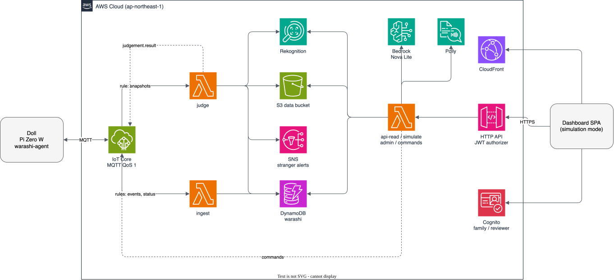
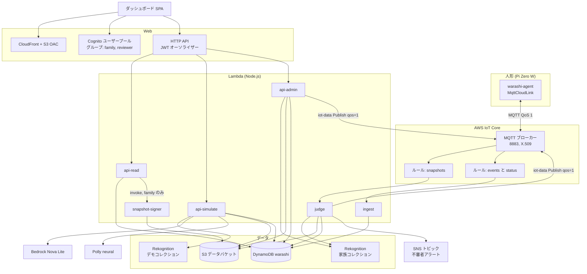
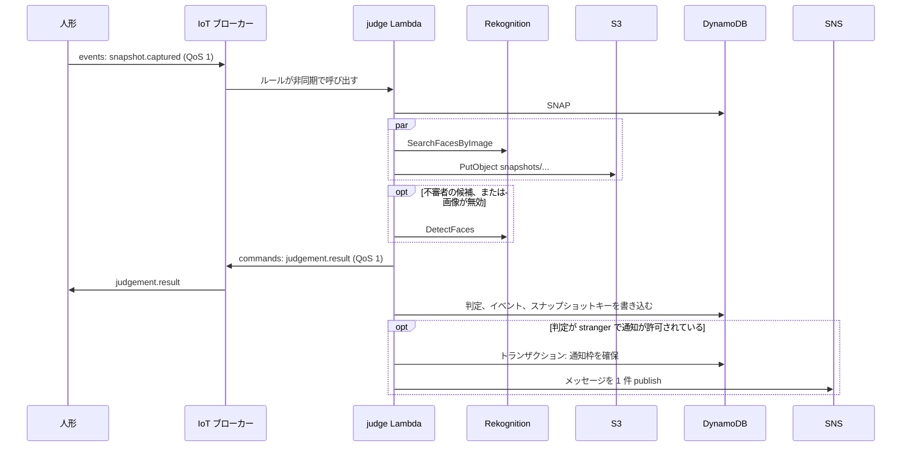
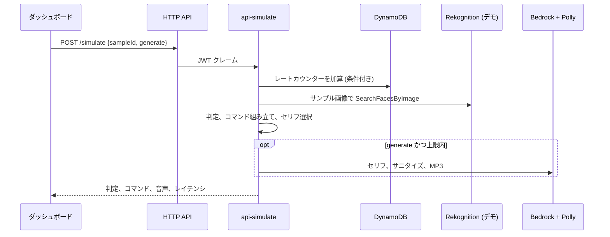

# アーキテクチャ

3 つの部品がどう組み合わさるかを示します。メッセージ契約は `docs/schema.md` です。このファイルは
`cloud-judgement` spec で作ったクラウド側を説明します。すべて `ap-northeast-1` にデプロイします。
英語版は [`architecture.md`](architecture.md) です。

## 全体図

上の図は AWS 公式アイコンを使っています。元ファイルは [`architecture.drawio`](architecture.drawio)
です(draw.io Desktop か VS Code 拡張 `hediet.vscode-drawio` で開きます)。編集したら
`architecture.svg` と `architecture.png` を書き出し直し、下の Mermaid 図も合わせて更新してください。

`POST /commands` は専用の関数 (`ApiCommands`) で動かします。これにより `api-admin` は IoT の権限を
持ちません。`snapshots/*` を読めるのは `snapshot-signer` だけです。

## CDK スタック (`cloud/lib`)

| スタック (ファイル) | 内容 |
|---|---|
| `DataStack` (`data-stack.ts`) | プレフィックスごとにライフサイクルルールを持つ非公開 S3 データバケット、DynamoDB テーブル `warashi` (オンデマンド、TTL、GSI 1 つ)、家族用とデモ用の Rekognition コレクション。 |
| `JudgementStack` (`judgement-stack.ts`) | IoT データエンドポイントの取得、デバイスの IoT ポリシー (`device-policy.ts`)、トピックルール、`judge` と `ingest` 関数、不審者アラート用の SNS トピック。 |
| `ApiStack` (`api-stack.ts`) | Cognito ユーザープール (グループ `family`, `reviewer`)、JWT オーソライザー付き HTTP API、`api-read`、`snapshot-signer`、`api-simulate`、`api-admin`、commands 関数。 |
| `WebStack` (`web-stack.ts`) | 非公開の S3 サイトバケット、オリジンアクセスコントロール付き CloudFront、`config.json` のデプロイ、API の CORS 設定。 |
| `BudgetStack` (`budget-stack.ts`) | 通知付きの月次コスト予算。 |

配線は `cloud/bin/cloud.ts`、共通設定の読み込みは `cloud/lib/context.ts` にあります。
デプロイ順は `DataStack`、`JudgementStack`、`ApiStack`、`WebStack` です。`BudgetStack` は独立しています。

## Lambda 関数 (`cloud/lambda/<function>`)

各関数は薄い `index.ts` ハンドラーと、純粋ロジックの `*-core.ts` モジュールで構成します。

| 関数 | トリガー | 役割 |
|---|---|---|
| `judge` | IoT ルール (`snapshot.captured`) | 判定、`judgement.result` コマンドの送信、スナップショット保存、遭遇記録の更新、不審者通知。 |
| `ingest` | IoT ルール (events, status) | 検証、重複排除、画像の除去、遭遇ログへの追記、デバイス状態の追跡。 |
| `api-read` | HTTP API | `/me`, `/samples`, `/encounters`, `/encounters/{id}`, `/device/status`。ロールに応じてマスクします。 |
| `snapshot-signer` | `api-read` からの内部呼び出し | family ロールにだけ、短命なスナップショット URL を署名して返します。 |
| `api-simulate` | HTTP API | デモコレクションに対する `POST /simulate`。任意で音声を生成します。 |
| `api-admin` | HTTP API (family) | 顔の登録と削除。`POST /commands` は別関数です。 |

## ポートとアダプター

判断ロジックは `cloud/lambda/_shared` の純粋モジュールにあります (`verdict.ts`, `notify.ts`,
`messages.ts`, `redact.ts`, `authz.ts`, `ratelimit.ts`, `sanitizer.ts`, `persona.ts`, `lines.ts`,
`wav.ts`, `ttl.ts`, `config.ts`)。時刻と乱数は引数で渡します。AWS 呼び出しは `_shared/ports.ts` の
インターフェースの後ろに置き、実装は `_shared/adapters/` にあります。

| ポート | アダプター | AWS サービス |
|---|---|---|
| `FaceSearch` | `adapters/rekognition.ts` | Rekognition |
| `SnapshotStore` | `adapters/s3.ts` | S3 |
| `DeviceBus` | `adapters/iot-bus.ts` | IoT Core データプレーン |
| `Notifier` | `adapters/sns.ts` | SNS |
| `SpeechSynth` | `adapters/speech.ts` | Bedrock, Polly |
| `StateStore`, `Repository` | `adapters/dynamo.ts` | DynamoDB |

テストは `cloud/test/fakes.ts` のフェイクを使うので、`make test` に AWS アカウントは要りません。

## データフロー: 1 枚のスナップショット

`ingest` 関数はすべての event と status メッセージを並行して受け取り、遭遇ログを書きます。
保存前に `jpegBase64` を取り除き、`hasImage: true` を付けます。

## データフロー: ダッシュボードのシミュレーション

`simulate` は人形に何も publish せず、遭遇記録も保存しません。

## DynamoDB と S3

DynamoDB テーブルは `warashi` の 1 つです (`pk`, `sk`、TTL 属性 `ttl`、デバイスごとの遭遇一覧用の
GSI 1 つ)。アイテムの種類は、遭遇のメタとイベント、メッセージの重複排除、スナップショットの確保、
デバイス状態、通知枠、家族メンバー、レートカウンターです。

S3 データバケットのプレフィックスは次のとおりです。`snapshots/` (数日で失効)、`audio/` (1 日)、
`faces-staging/` (1 日)、`samples/` (オーナーが用意し、git には入れません)。

## ダッシュボードのホスティング

ダッシュボードは CloudFront から配信する静的 SPA です。起動時に自分のオリジンの `/config.json`
(API URL、リージョン、Cognito の ID) を読みます。サインインは Cognito で、ロールは
`cognito:groups` クレームから決まります。
