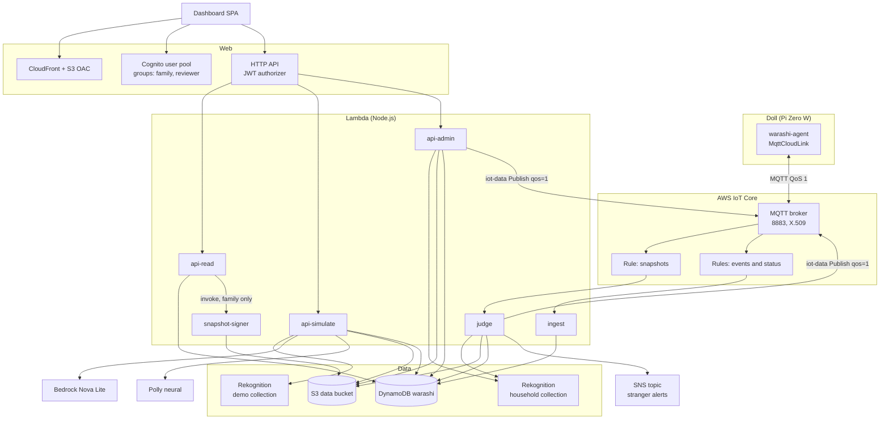
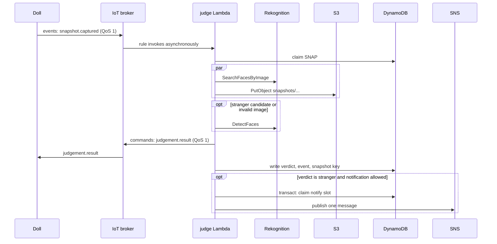
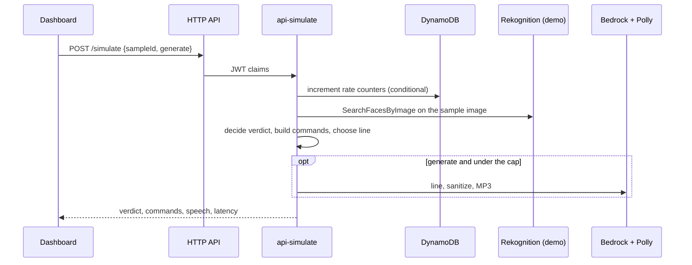

# Architecture

How the three parts fit together. The message contract is `docs/schema.md`; this file shows
the cloud side as built by the `cloud-judgement` spec. Everything deploys to `ap-northeast-1`.

## Overview

`POST /commands` runs in its own function (`ApiCommands`) so that `api-admin` holds no IoT
permission. Only `snapshot-signer` can read `snapshots/*`.

## CDK stacks (`cloud/lib`)

| Stack (file) | Contents |
|---|---|
| `DataStack` (`data-stack.ts`) | Private S3 data bucket with lifecycle rules per prefix, DynamoDB table `warashi` (on demand, TTL, one GSI), Rekognition collections for the household and the demo. |
| `JudgementStack` (`judgement-stack.ts`) | IoT data endpoint lookup, device IoT policy (`device-policy.ts`), topic rules, `judge` and `ingest` functions, SNS topic for stranger alerts. |
| `ApiStack` (`api-stack.ts`) | Cognito user pool (groups `family`, `reviewer`), HTTP API with JWT authorizer, `api-read`, `snapshot-signer`, `api-simulate`, `api-admin`, commands function. |
| `WebStack` (`web-stack.ts`) | Private S3 site bucket, CloudFront with origin access control, `config.json` deployment, API CORS setting. |
| `BudgetStack` (`budget-stack.ts`) | Monthly cost budget with notifications. |

Wiring is in `cloud/bin/cloud.ts`. Shared settings are read in `cloud/lib/context.ts`.
Deploy order: `DataStack`, `JudgementStack`, `ApiStack`, `WebStack`; `BudgetStack` is independent.

## Lambda functions (`cloud/lambda/<function>`)

Each function is a thin `index.ts` handler plus a pure `*-core.ts` module.

| Function | Trigger | Purpose |
|---|---|---|
| `judge` | IoT rule (`snapshot.captured`) | Verdict, `judgement.result` command, snapshot storage, encounter update, stranger notification. |
| `ingest` | IoT rules (events, status) | Validate, drop duplicates, strip the image, append to the encounter log, track device status. |
| `api-read` | HTTP API | `/me`, `/samples`, `/encounters`, `/encounters/{id}`, `/device/status`, with role-based redaction. |
| `snapshot-signer` | Internal invoke from `api-read` | Signs short-lived snapshot URLs for the family role only. |
| `api-simulate` | HTTP API | `POST /simulate` against the demo collection, optional generated speech. |
| `api-admin` | HTTP API (family) | Face registration and deletion. `POST /commands` is a separate function. |

## Ports and adapters

Decision logic lives in pure modules under `cloud/lambda/_shared` (`verdict.ts`, `notify.ts`,
`messages.ts`, `redact.ts`, `authz.ts`, `ratelimit.ts`, `sanitizer.ts`, `persona.ts`, `lines.ts`,
`wav.ts`, `ttl.ts`, `config.ts`). Time and randomness are passed in. AWS calls sit behind the
interfaces in `_shared/ports.ts`; the real implementations are in `_shared/adapters/`.

| Port | Adapter | AWS service |
|---|---|---|
| `FaceSearch` | `adapters/rekognition.ts` | Rekognition |
| `SnapshotStore` | `adapters/s3.ts` | S3 |
| `DeviceBus` | `adapters/iot-bus.ts` | IoT Core data plane |
| `Notifier` | `adapters/sns.ts` | SNS |
| `SpeechSynth` | `adapters/speech.ts` | Bedrock, Polly |
| `StateStore`, `Repository` | `adapters/dynamo.ts` | DynamoDB |

Tests use the fakes in `cloud/test/fakes.ts`, so `make test` needs no AWS account.

## Data flow: one snapshot

The `ingest` function receives every event and status message in parallel and writes the
encounter log. It removes `jpegBase64` and sets `hasImage: true` before storing.

## Data flow: dashboard simulation

Nothing is published to the doll and no encounter is stored by `simulate`.

## DynamoDB and S3

One DynamoDB table `warashi` (`pk`, `sk`, TTL attribute `ttl`, one GSI for the per-device
encounter list). Item kinds: encounter meta and events, message dedupe, snapshot claim, device
status, notify slot, family member, rate counter.

S3 data bucket prefixes: `snapshots/` (expire in days), `audio/` (1 day), `faces-staging/`
(1 day), `samples/` (owner-supplied, never in git).

## Dashboard hosting

The dashboard is a static SPA served from CloudFront. It reads `/config.json` from its own origin
at start-up (API URL, Region, Cognito ids). Sign-in is Cognito; the role comes from the
`cognito:groups` claim.
